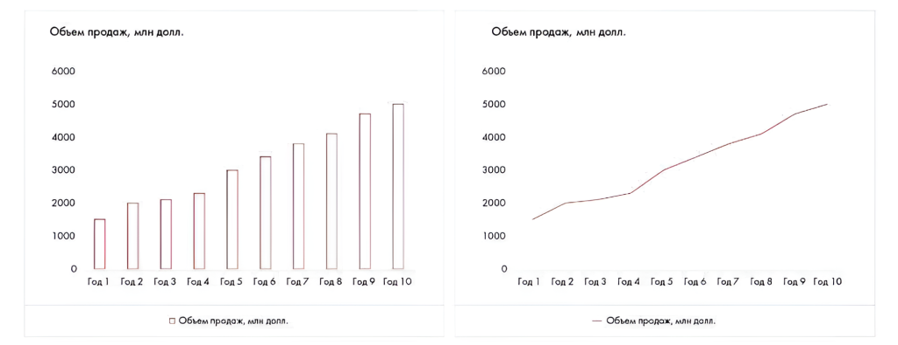

# Иллюстрация: PDF 284, изображение 1

Иллюстрация исходника: «удаленность от метро и величина площадки. Рейтинговая диаграмма.». Подписи и числовые значения вынесены в расшифровку; порядок и связи элементов проверяются по сохранённому изображению.

Источник: [PDF 284](../../SOURCE.md#pdf-284).

Необходимая тема: [Ответы: неделя 8](../../chapters/13-answers/05-week-08.md).

## Текст изображения

> Автоматическая расшифровка. Подписи в сложных слайдах, рукописный текст и порядок колонок могут содержать ошибки OCR. Уточнения, проверенные таблицы и формулы выше имеют приоритет. Не интерпретируйте отсутствие распознанного текста как отсутствие данных в рисунке.

- Обьем продаж, млн долл.
- 6000
- 5000
- 4000
- 3000
- 2000
- 1000
- Год 1
- Год 2
- Год 3
- Год 4
- Год 5
- Год 6
- Год 7
- Год 8
- Год 9
- Год 10
- • Обьюм продож, мли допл.
- Объем продаж, млн долл.
- 6000
- 5000
- 4000
- 3000
- 2000
- 1000
- Год 1 Год 2 Год 3
- — Обьом продож, млн долл.

## Связанные материалы

[Вернуться к теме](../../chapters/13-answers/05-week-08.md) · [Ограничения распознавания](../../meta/issues.md)
