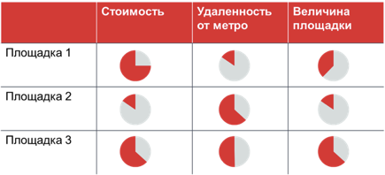

# Иллюстрация: PDF 284, изображение 2

Иллюстрация исходника: «продаж. Комбинированная диаграмма.». Подписи и числовые значения вынесены в расшифровку; порядок и связи элементов проверяются по сохранённому изображению.

Источник: [PDF 284](../../SOURCE.md#pdf-284).

Необходимая тема: [Ответы: неделя 8](../../chapters/13-answers/05-week-08.md).

## Текст изображения

> Автоматическая расшифровка. Подписи в сложных слайдах, рукописный текст и порядок колонок могут содержать ошибки OCR. Уточнения, проверенные таблицы и формулы выше имеют приоритет. Не интерпретируйте отсутствие распознанного текста как отсутствие данных в рисунке.

- Стоимость
- Удаленность
- от метро
- Величина
- площадки

## Связанные материалы

[Вернуться к теме](../../chapters/13-answers/05-week-08.md) · [Ограничения распознавания](../../meta/issues.md)
