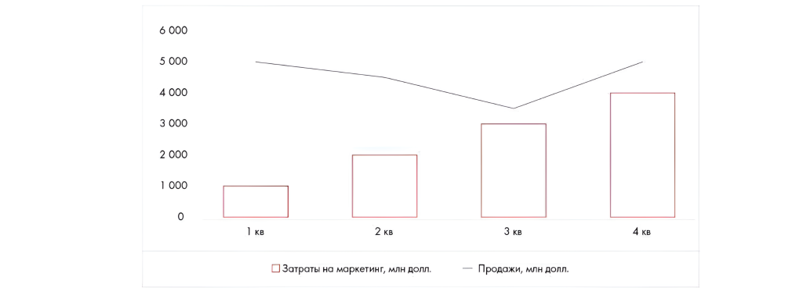

# Иллюстрация: PDF 285, изображение 1

Иллюстрация исходника: «примерно одинаков.Линейчатая диаграмма.». Подписи и числовые значения вынесены в расшифровку; порядок и связи элементов проверяются по сохранённому изображению.

Источник: [PDF 285](../../SOURCE.md#pdf-285).

Необходимая тема: [Ответы: неделя 8](../../chapters/13-answers/05-week-08.md).

## Текст изображения

> Автоматическая расшифровка. Подписи в сложных слайдах, рукописный текст и порядок колонок могут содержать ошибки OCR. Уточнения, проверенные таблицы и формулы выше имеют приоритет. Не интерпретируйте отсутствие распознанного текста как отсутствие данных в рисунке.

- 6 000
- 5 000
- 4 000
- 3 000
- 2 000
- 1000
- 1 кв
- 2 кв
- • Затраты на маркетинг, млн долл.
- 3 кв
- - Продажи, млн долл.
- 4 кв

## Связанные материалы

[Вернуться к теме](../../chapters/13-answers/05-week-08.md) · [Ограничения распознавания](../../meta/issues.md)
