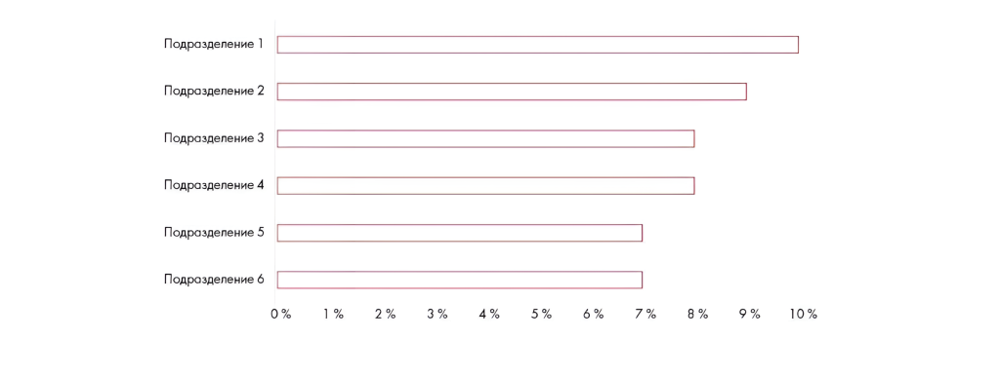

# Иллюстрация: PDF 285, изображение 2

На рисунке приведены элементы: Подразделение 1; Подразделение 2; Подразделение 3; Подразделение 4; Подразделение 5. Полная текстовая расшифровка приведена отдельно; геометрия и цветовые обозначения сохранены на изображении.

Источник: [PDF 285](../../SOURCE.md#pdf-285).

Необходимая тема: [Ответы: неделя 8](../../chapters/13-answers/05-week-08.md).

## Текст изображения

> Автоматическая расшифровка. Подписи в сложных слайдах, рукописный текст и порядок колонок могут содержать ошибки OCR. Уточнения, проверенные таблицы и формулы выше имеют приоритет. Не интерпретируйте отсутствие распознанного текста как отсутствие данных в рисунке.

- Подразделение 1
- Подразделение 2
- Подразделение 3
- Подразделение 4
- Подразделение 5
- Подразделение 6
- 0 %
- 1 %
- 2 %
- 3 %
- 4 %
- 5%
- 6 %
- 7 %
- 8 %
- 9 %
- 10%

## Связанные материалы

[Вернуться к теме](../../chapters/13-answers/05-week-08.md) · [Ограничения распознавания](../../meta/issues.md)
