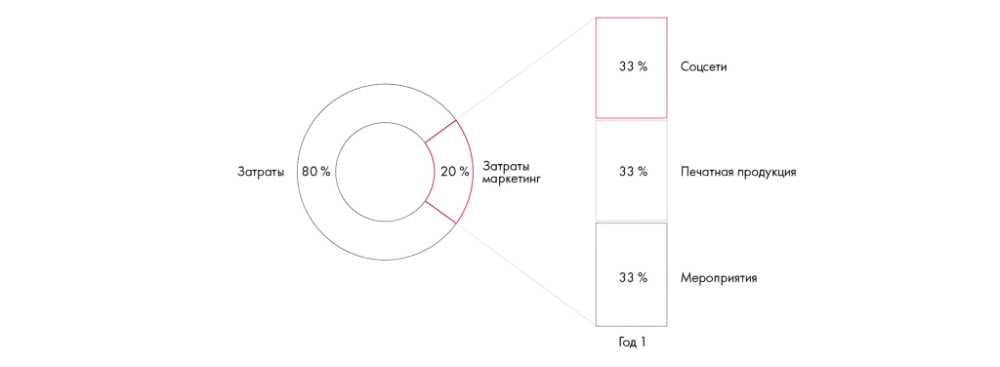

# Иллюстрация: PDF 285, изображение 3

На рисунке приведены элементы: Затраты; 80%; | 20 %; Затраты; маркетинг. Полная текстовая расшифровка приведена отдельно; геометрия и цветовые обозначения сохранены на изображении.

Источник: [PDF 285](../../SOURCE.md#pdf-285).

Необходимая тема: [Ответы: неделя 8](../../chapters/13-answers/05-week-08.md).

## Текст изображения

> Автоматическая расшифровка. Подписи в сложных слайдах, рукописный текст и порядок колонок могут содержать ошибки OCR. Уточнения, проверенные таблицы и формулы выше имеют приоритет. Не интерпретируйте отсутствие распознанного текста как отсутствие данных в рисунке.

- Затраты
- 80%
- | 20 %
- Затраты
- маркетинг
- 33 %
- 33 %
- 33 %
- Год 1
- Соцсети
- Печатная продукция
- Мероприятия

## Связанные материалы

[Вернуться к теме](../../chapters/13-answers/05-week-08.md) · [Ограничения распознавания](../../meta/issues.md)
