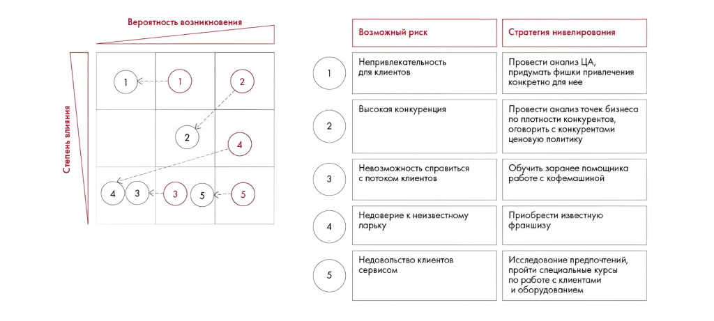

# Иллюстрация: PDF 286, изображение 1

На рисунке приведены элементы: Вероятность возникновения; Степень влияния; 2; 4; 5. Полная текстовая расшифровка приведена отдельно; геометрия и цветовые обозначения сохранены на изображении.

Источник: [PDF 286](../../SOURCE.md#pdf-286).

Необходимая тема: [Ответы: неделя 10, задания 10.1–10.3](../../chapters/13-answers/07-week-10-risks.md).

## Текст изображения

> Автоматическая расшифровка. Подписи в сложных слайдах, рукописный текст и порядок колонок могут содержать ошибки OCR. Уточнения, проверенные таблицы и формулы выше имеют приоритет. Не интерпретируйте отсутствие распознанного текста как отсутствие данных в рисунке.

- Вероятность возникновения
- Степень влияния
- 2
- 4
- 5
- Возможный риск
- Непривлекательность
- для клиентов
- Высокая конкуренция
- Невозможность справиться
- с потоком клиентов
- Недоверие к неизвестному
- ларьку
- Недовольство клиентов
- сервисом
- Стратегия нивелирования
- Провести анализ ЦА,
- идумать фишки привлечен
- нкретно для н
- Тровести анализ точек бизнес
- 10 плотности конкурентов
- оворить с конкурента
- новую полити
- робуить зорево помощника
- Приобрести известную
- франшизу
- Исследование предпочтений,
- пройти специальные курсы
- по работе с клиентами
- и оборудованием

## Связанные материалы

[Вернуться к теме](../../chapters/13-answers/07-week-10-risks.md) · [Ограничения распознавания](../../meta/issues.md)
