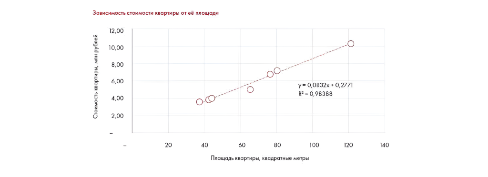

# Иллюстрация: PDF 292, изображение 1

На рисунке приведены элементы: Зависимость стоимости квартиры отвёлощади; Стоимость квартиры, млн рублей; 12,00; 10,00; 8,00. Полная текстовая расшифровка приведена отдельно; геометрия и цветовые обозначения сохранены на изображении.

Источник: [PDF 292](../../SOURCE.md#pdf-292).

Необходимая тема: [Ответы: задания 10.5–10.7](../../chapters/13-answers/09-week-10-valuation.md).

## Текст изображения

> Автоматическая расшифровка. Подписи в сложных слайдах, рукописный текст и порядок колонок могут содержать ошибки OCR. Уточнения, проверенные таблицы и формулы выше имеют приоритет. Не интерпретируйте отсутствие распознанного текста как отсутствие данных в рисунке.

- Зависимость стоимости квартиры отвёлощади
- Стоимость квартиры, млн рублей
- 12,00
- 10,00
- 8,00
- 6,00
- 4,00
- 2,00
- 00--
- y= 0,0832x + 0,2771
- R== 0,98388
- 20
- 40
- 60
- 80
- 100
- Плащадь квартиры, квадратные метры
- 120
- 140

## Связанные материалы

[Вернуться к теме](../../chapters/13-answers/09-week-10-valuation.md) · [Ограничения распознавания](../../meta/issues.md)
