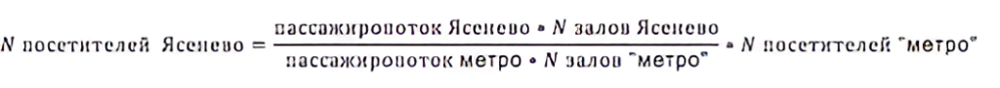

# Иллюстрация: PDF 293, изображение 1

На рисунке приведены элементы: пассажиропоток Ясенево • N залов Ясенево; N посетителей Яселево = .; - • N посетителей "метро"; пассажиропоток метро • N залов "метро". Полная текстовая расшифровка приведена отдельно; геометрия и цветовые обозначения сохранены на изображении.

Источник: [PDF 293](../../SOURCE.md#pdf-293).

Необходимая тема: [Ответы: задания 10.5–10.7](../../chapters/13-answers/09-week-10-valuation.md).

## Проверенная запись формулы

$$N_{\text{посетителей Ясенево}}=\frac{\text{пассажиропоток Ясенево}\cdot N_{\text{залов Ясенево}}}{\text{пассажиропоток метро}\cdot N_{\text{залов метро}}}\cdot N_{\text{посетителей метро}}.$$

Это запись подхода 2 из авторского ответа; необходимые числовые подстановки находятся в окружающем тексте.

## Текст изображения

> Автоматическая расшифровка. Подписи в сложных слайдах, рукописный текст и порядок колонок могут содержать ошибки OCR. Уточнения, проверенные таблицы и формулы выше имеют приоритет. Не интерпретируйте отсутствие распознанного текста как отсутствие данных в рисунке.

- пассажиропоток Ясенево • N залов Ясенево
- N посетителей Яселево = .
- - • N посетителей "метро"
- пассажиропоток метро • N залов "метро"

## Связанные материалы

[Вернуться к теме](../../chapters/13-answers/09-week-10-valuation.md) · [Ограничения распознавания](../../meta/issues.md)
