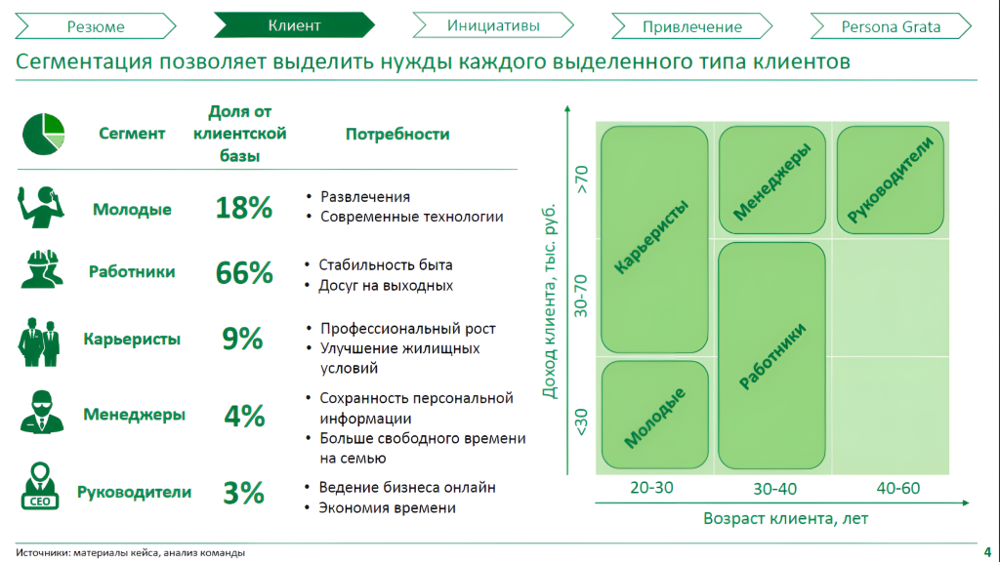

# Иллюстрация: PDF 296, изображение 1

На рисунке приведены элементы: > Резюме Клиент> Инициативы; Привлечение; Сегментация позволяет выделить нужды каждого выделенного типа клиентов; Persona Grata; • Сегмент. Полная текстовая расшифровка приведена отдельно; геометрия и цветовые обозначения сохранены на изображении.

Источник: [PDF 296](../../SOURCE.md#pdf-296).

Необходимая тема: [Ответы: неделя 11](../../chapters/13-answers/10-week-11.md).

## Текст изображения

> Автоматическая расшифровка. Подписи в сложных слайдах, рукописный текст и порядок колонок могут содержать ошибки OCR. Уточнения, проверенные таблицы и формулы выше имеют приоритет. Не интерпретируйте отсутствие распознанного текста как отсутствие данных в рисунке.

- > Резюме Клиент> Инициативы
- Привлечение
- Сегментация позволяет выделить нужды каждого выделенного типа клиентов
- Persona Grata
- • Сегмент
- Доля от
- клиентской
- базы
- Молодые 18%
- Потребности
- Менеджеры
- Руководители
- Работники 66%
- Карьеристы 9%
- Менеджеры
- Руководители
- 4%
- 3%
- • Развлечения
- • Современные технологии
- • Стабильность быта
- • Досуг на выходных
- • Профессиональный рост
- • Улучшение жилищных
- условий
- • Сохранность персональной
- информации
- • Больше свободного времени
- на семью
- • Ведение бизнеса онлайн
- • Экономия времени
- Доход клиента, тыс. руб.
- Карьеристы
- 30-70
- Работники
- Молодые
- 20-30
- 30-40
- Возраст клиента, лет
- 40-60
- Источники: материалы кейса, анализ команды
- 4

## Связанные материалы

[Вернуться к теме](../../chapters/13-answers/10-week-11.md) · [Ограничения распознавания](../../meta/issues.md)
