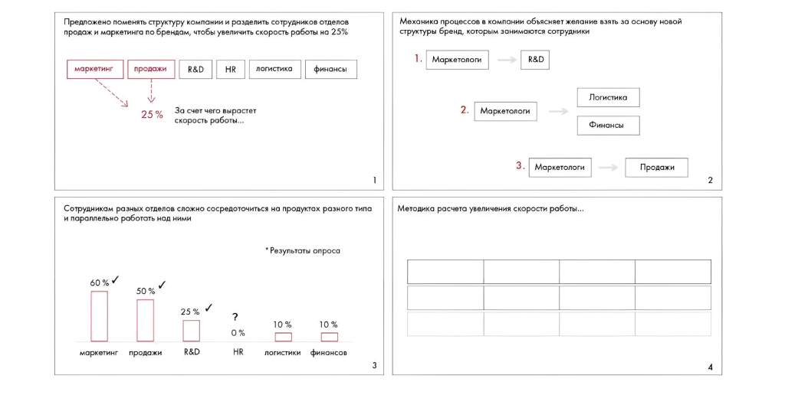

# Иллюстрация: PDF 297, изображение 1

На рисунке приведены элементы: едложено поменять структуру компании и разделить сотрудников отдел; одаж и маркетинга по брендам, чтобы увеличить скорость работы на 2:; маркетинг; продажи; R&D. Полная текстовая расшифровка приведена отдельно; геометрия и цветовые обозначения сохранены на изображении.

Источник: [PDF 297](../../SOURCE.md#pdf-297).

Необходимая тема: [Ответы: неделя 11](../../chapters/13-answers/10-week-11.md).

## Текст изображения

> Автоматическая расшифровка. Подписи в сложных слайдах, рукописный текст и порядок колонок могут содержать ошибки OCR. Уточнения, проверенные таблицы и формулы выше имеют приоритет. Не интерпретируйте отсутствие распознанного текста как отсутствие данных в рисунке.

- едложено поменять структуру компании и разделить сотрудников отдел
- одаж и маркетинга по брендам, чтобы увеличить скорость работы на 2:
- маркетинг
- продажи
- R&D
- HR
- логистика
- финансы
- 25%
- За счет чего вырастет
- скорость работы...
- отрудникам разных отделов сложно сосредоточиться на продуктах разного тип
- параллельно работать над ним
- * Результаты опроса
- 60% /
- 50%
- 25%
- маркетинг
- продажи
- R&D
- ?
- 0 %
- HR
- 10%
- ЛОгИСтикИ
- 10 %
- финонсов
- Механика процессов в компании объясняет желание взять за основу новой
- структуры бренд, которым занимаются сотрудники
- Маркетологи
- R&D
- Маркетологи
- Логистика
- Финансы
- 3.
- Маркетологи
- Продажи
- 2
- Методика расчета увеличения скорости работы...
- 4

## Связанные материалы

[Вернуться к теме](../../chapters/13-answers/10-week-11.md) · [Ограничения распознавания](../../meta/issues.md)
