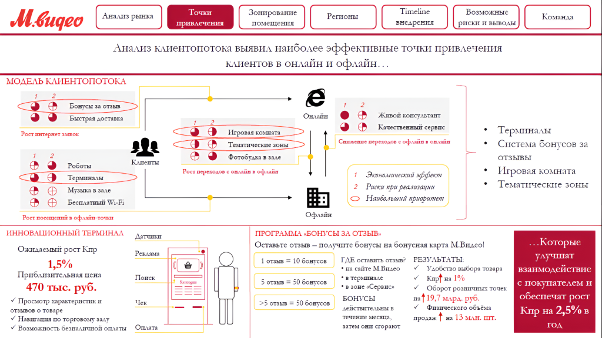

# Иллюстрация: PDF 297, изображение 2

На рисунке приведены элементы: М. видео; Анализ рынка; Точки; привлечения; Зонирование. Полная текстовая расшифровка приведена отдельно; геометрия и цветовые обозначения сохранены на изображении.

Источник: [PDF 297](../../SOURCE.md#pdf-297).

Необходимая тема: [Ответы: неделя 11](../../chapters/13-answers/10-week-11.md).

## Текст изображения

> Автоматическая расшифровка. Подписи в сложных слайдах, рукописный текст и порядок колонок могут содержать ошибки OCR. Уточнения, проверенные таблицы и формулы выше имеют приоритет. Не интерпретируйте отсутствие распознанного текста как отсутствие данных в рисунке.

- М. видео
- Анализ рынка
- Точки
- привлечения
- Зонирование
- помещения
- Регионы
- Timeline
- висдрення
- Возможные
- риски и выводы
- Команда
- Анализ клиентопотока выявил наиболее эффективные точки привлечения
- клиентов в онлайн и офлайн...
- МОДЕЛЬ КЛИЕНТОПОТОКА
- Бовусы за отзыв
- Быстрая доставка
- •
- Онлайн
- Рост шитервет заявок
- Игровая комната
- Тематические зоны
- Фотобудка в зале
- Живої консультант
- Качественный сервис
- Слижелате переходов с офлайн в овлайн
- Роботы
- Терминалы
- Музыка в зале
- Бесплатный Wi-Fi
- Каленты
- Рост переходов с облать в офлат
- •
- Экономический зффект
- 2 Риски при реализации
- O
- Наибальший приоритет
- • Терминалы
- • Спстема бонусов за
- отзывы
- • Игровая комната
- • Тематические зоны
- Рост посещений в офлайн-тотт
- ИННОВАЦИОННЫЙ ТЕРМИНАЛ
- Офлайн
- Датчики
- Ожидаемый рост Кпр
- 1,5%
- Приблизительная цена
- 470 тыс. руб.
- • Просмотр характеристик п
- отзывов о товаре
- • Навигация по торговому залу
- / Возможность безналичной оплаты
- Реклама
- Поиск
- Чек
- Оплата
- ПРОГРАММА «БОНУСЫ ЗА ОТЗЫВ»
- Оставьте отзыв - получите бонусы на бонусная карта M.Видео!
- 1 отзыв = 10 бонусов
- ГДЕ оставить отзыв?
- РЕЗУЛЬТАТЫ:
- • на саїте М. Видео
- Удобство выбора товара
- 5 отзыв = 50 бонусов
- • в терминале
- • Кпр* на 1%
- • в зоне «Сервис»
- • Оборот розничных точек
- БОНУСЫ
- >5 отзыв = 50 бонусов
- нат 19,7 мард. руб.
- действительны в
- Физического объёма
- течение месяца,
- продаж Т на 13 млн. шт.
- затем они сгорают
- ...Которые
- улучшат
- взаимодействие
- с покупателем и
- обеспечат рост
- Кпр на 2,5% в
- год

## Связанные материалы

[Вернуться к теме](../../chapters/13-answers/10-week-11.md) · [Ограничения распознавания](../../meta/issues.md)
