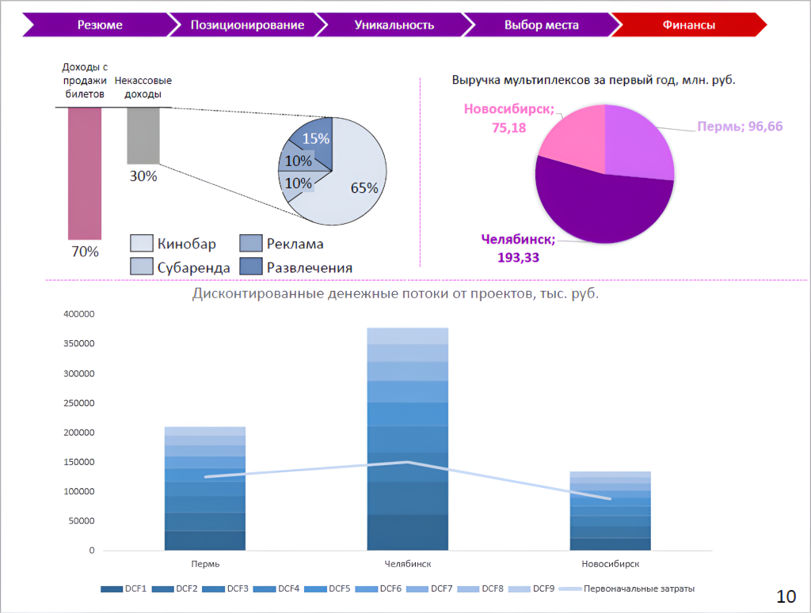

# Иллюстрация: PDF 298, изображение 1

На рисунке приведены элементы: Резюме; Позиционирование; Уникальность; Выбор места; Финансы. Полная текстовая расшифровка приведена отдельно; геометрия и цветовые обозначения сохранены на изображении.

Источник: [PDF 298](../../SOURCE.md#pdf-298).

Необходимая тема: [Ответы: неделя 11](../../chapters/13-answers/10-week-11.md).

## Текст изображения

> Автоматическая расшифровка. Подписи в сложных слайдах, рукописный текст и порядок колонок могут содержать ошибки OCR. Уточнения, проверенные таблицы и формулы выше имеют приоритет. Не интерпретируйте отсутствие распознанного текста как отсутствие данных в рисунке.

- Резюме
- Позиционирование
- Уникальность
- Выбор места
- Финансы
- Доходы с
- продажи Некассовые
- билетов
- доходЫ
- Выручка мультиплексов за первый год, млн. руб.
- Новосибирск;
- 75,18
- 30%
- 15%
- 10%\
- \ 10%
- Пермь; 96,66
- 65%,
- 70%
- Кинобар
- • субаренда
- Реклама
- Челябинск;
- 193,33
- Развлечения
- Дисконтированные денежные потоки от проектов, тыс. руб.
- 400000
- 350000
- 300000
- 250000
- 200000
- 150000
- 100000
- 50000
- Пермь
- Челябинск
- DCF1 DCF2 DCF3 M DCF4 DCF5 DCF6 m DCF7 • DCF8 m
- • DCF9
- Новосибирск
- Первоначальные затраты
- 10

## Связанные материалы

[Вернуться к теме](../../chapters/13-answers/10-week-11.md) · [Ограничения распознавания](../../meta/issues.md)
