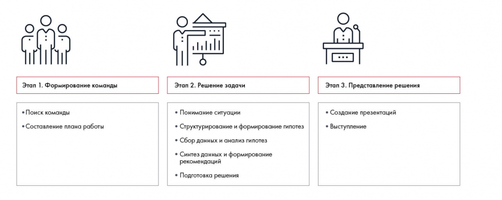
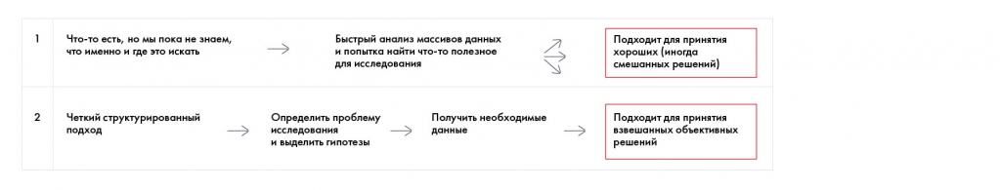
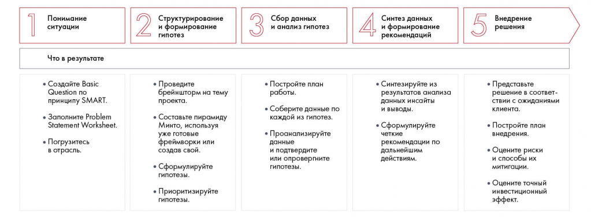
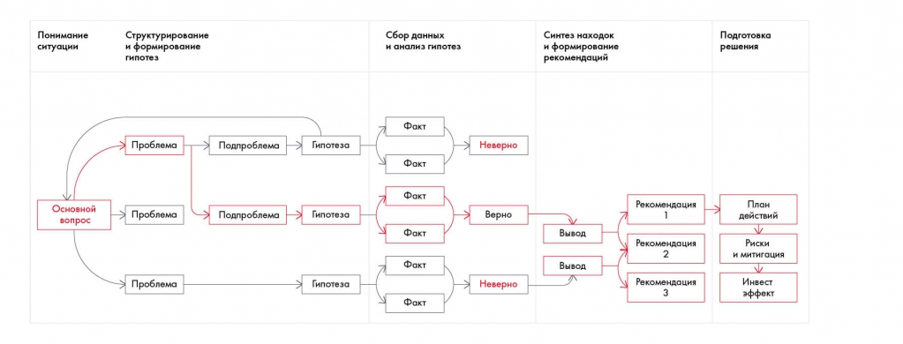

# Этапы решения кейса и недельный план

Показан путь от формирования команды до защиты решения. Сохранены результаты каждого этапа и пример распределения работы по семи дням.

**Источник:** физические страницы PDF 12–18. Печатные номера не установлены.

**Для последовательного чтения:** [Критерии оценки решения кейса](03-evaluation.md).

**Навигация:** [Индекс главы](INDEX.md) · [Маршрутизатор](../../ROUTER.md) · [Проблемы источника](../../meta/issues.md).

---

## Источник: [PDF 12](../../SOURCE.md#pdf-012)

### Неделя 1. Введение в кейс-метод

### Этапы решения кейса

Решение кейса можно условно разбить на три этапа: сбор команды, работа над задачей и презентация результатов. Вам не всегда придется проходить через все из них, например на кейс-интервью вы будете решать кейс самостоятельно. Но чтобы у вас сложилось полное представление о процессе решении кейса, мы разберем каждый этап. Проще всего это сделать на примере кейс-чемпионата.

Три этапа: формирование команды, решение задачи, представление решения. Средний этап включает понимание ситуации, структурирование и гипотезы, сбор и анализ данных, синтез и рекомендации, подготовку решения.

[Подробная текстовая расшифровка рисунка](../../assets/transcripts/pdf-012-img-01.md).

Процесс работы на кейс-чемпионате

**Ссылки на этой странице исходника:** [Ссылка url-004](../../meta/source-links.md#url-004); [Ссылка url-006](../../meta/source-links.md#url-006).

## Источник: [PDF 13](../../SOURCE.md#pdf-013)

### Этап 1. Сбор команды

Как мы уже говорили, в большинстве случаев решать кейс на чемпионате вам придется в команде. Если вы формируете ее самостоятельно, отнеситесь к процессу ответственно. Представьте, как сложно будет работать, если в команде есть человек, который постоянно всех критикует, проваливает сроки или находится в конфликте с другим участником.

Когда члены команды не сработались, легче все сделать самому, чем пытаться сплотить остальных. Но труд в одиночку занимает куда больше времени, а правильно выстроенная командная работа создает синергию: участники дополняют друг друга и вместе получают лучший результат, чем каждый по отдельности. Большинство победителей кейс-чемпионатовпризнаются, что именно команда стала залогом успеха.

Если участники плохо знакомы друг с другом, обязательно пообщайтесь заранее в неформальной обстановке. Это позволит поближе узнать друг друга и избежать сюрпризов в дальнейшем. Заранее распределите, кто за что будет отвечать, и составьте предварительный план работы.

«Если вы оказались в ситуации, когда команда формируется независимо от вашей воли и пожеланий, не спешите расстраиваться. Попробуйте встретиться с другими участниками и узнать сильные и слабые стороны друг друга. Если определить такие вещи до начала работы, это поможет избежать большого количества проблем в дальнейшем. Кроме того, все лучшее происходит неожиданно: отнеситесь к ситуации как к возможности познакомиться с интересными людьми, которые имеют с вами как минимум один общий интерес — решение кейсов!

**Ирина Шиферсон, участница Зимней школы Changellenge >**

### Этап 2. Решение задачи

Когда команда собрана, вы приступаете к решению задачи, поставленной в кейсе. Основных подходов к решению два.

Первый обычно используют новички. Если вы уже решали кейсы, вспомните, как это было в первый раз. Скорее всего, вы прочитали кейс, быстро изучили материалы по теме, выдернули оттуда что-то полезное и начали оформлять презентацию. Этот способ может дать хороший результат, но, скорее всего, вы

**Ссылки на этой странице исходника:** [Ссылка url-004](../../meta/source-links.md#url-004); [Ссылка url-007](../../meta/source-links.md#url-007).

## Источник: [PDF 14](../../SOURCE.md#pdf-014)

упустите важные ограничения и возможности. По сути, такой способ решения

— это попадание пальцем в небо.

Гораздо полезнее второй способ, который используют консалтинговые компании: McKinsey & Company, BCG, Bain & Company, Strategy Partners Group, Oliver Wyman, A. T. Kearney, Accenture и другие. Это четкий и структурированный подход: сначала определяется проблема, затем она делится на части и прорабатывается по каждому направлению с использованием нужных данных. Этот способ дает взвешенные и объективные решения.

Сопоставлены быстрый просмотр массива данных без сформулированной проблемы и структурированный поиск под проблему и гипотезы. Схема объясняет, зачем определять предмет исследования до сбора данных.

[Подробная текстовая расшифровка рисунка](../../assets/transcripts/pdf-014-img-01.md).

Структурный подход помогает в решении задач, планировании и коммуникации

Мы предлагаем решать кейсы за пять шагов.

Первый шаг — понимание ситуации. На этом этапе нужно внимательно прочитать кейс и прийти к пониманию задачи, которую вы должны выполнить. В этом помогут два инструмента, о которых мы подробно расскажем в следующих главах: формулировка задачи по SMART и заполнение Problem Statement Worksheet. Также, если у вас нет соответствующих знаний, на этом этапе нужно получить общее представление об отрасли и компании. Если информации из кейса недостаточно, вам помогут аналитические отчеты, данные по рынку и т. д. Углубляться в изучение деталей на этом этапе не нужно — более подробный анализ вы проведете позднее.

**Второй шаг — структурирование и формирование гипотез. Он посвящен**

построению структуры решения. Начните с генерации идей по кейсу и систематизируйте их. В этом вам помогут инструменты, о которых мы расскажем далее: пирамида Минто, дерево решений, а также специальные фреймворки. Разбив задачу на составляющие, подумайте над их возможными решениями (гипотезами) и расставьте приоритеты.

**Ссылки на этой странице исходника:** [Ссылка url-008](../../meta/source-links.md#url-008).

## Источник: [PDF 15](../../SOURCE.md#pdf-015)

**Третий шаг — сбор данных и анализ гипотез. Именно здесь начинается**

активная работа с информацией. На этом этапе у вас есть список гипотез, которые вы проверяете с помощью тех или иных данных. Если при неструктурированном подходе вы ищете информацию наугад и изучаете все, что попадется, то здесь у вас есть план действий и конкретные запросы. Видите разницу? Вы не распыляетесь, а ищете только то, что нужно для решения.

**Четвертый шаг — синтез данных и формулирование рекомендаций. На**

этом этапе вы уже провели анализ и знаете, какие гипотезы оказались верными, а какие нет. Дальше нужно обобщить результаты и сделать из них выводы в виде рекомендаций для клиента.

Пятый шаг — подготовка решения. На этом этапе вы должны подумать, как воплотить ваши рекомендации в жизнь. В частности, необходимо представить план их внедрения, оценить риски и возможности их снижения, а также стоимость и эффект от ваших предложений.

Всерьез использовать структурный подход стоит не раньше второго-третьего чемпионата, в котором вы принимаете участие. Поначалу из-за неопытности можно многое упустить из виду. Но потренироваться нужно обязательно — при грамотном использовании этот метод позволяет решать бизнес-задачи гораздо быстрее.

Если вы считаете, что перед первым кейс-чемпионатом вам нужно подтянуть навыки структурного мышления, ждем на Школе Changellenge >>. Эксперты расскажут о самых распространенных ошибках, которые допускают новички, и научат решать кейс за пять шагов.

Пять шагов решения и ожидаемые результаты каждого: SMART и PSW; мозговой штурм, пирамида и гипотезы; данные и проверка; инсайты и рекомендации; план внедрения, риски и финансовый эффект.

[Подробная текстовая расшифровка рисунка](../../assets/transcripts/pdf-015-img-01.md).

**Ссылки на этой странице исходника:** [Ссылка url-003](../../meta/source-links.md#url-003); [Ссылка url-009](../../meta/source-links.md#url-009).

## Источник: [PDF 16](../../SOURCE.md#pdf-016)

Пять шагов по решению кейса

Связь основного вопроса с ветвями проблемы, гипотезами, фактами и рекомендациями. Схема задаёт проверяемую цепочку аргументации.

[Подробная текстовая расшифровка рисунка](../../assets/transcripts/pdf-016-img-01.md).

Схема решения кейса

Этап 3. Презентация решения

Третий этап не менее важен, чем первые два. Никто не оценит ваш глубокий анализ, если вы не представите его должным образом и не сделаете так, чтобы клиент захотел взять ваши рекомендации на вооружение. Поэтому успех решения напрямую зависит от качества устного выступления или презентации, если вы сдаете результаты в письменном виде. И здесь нужно учитывать многие вещи: специфику аудитории, структуру повествования, дизайн слайдов, композицию выступления, уверенность речи и даже невербальные сигналы во время выступления. Чтобы продать свое решение, подойдите к процессу создания презентации структурно: начните с истории повествования, потом подумайте над визуализацией информации и дизайном слайдов. Если вы выступаете устно, обязательно отрепетируйте речь.

Для тех, кто хочет создавать качественные слайды, мы в 2020 году откроем курс от Changellenge >> ToolKit, целиком посвященный бизнес-презентациям в PowerPoint. Эксперты научат вас делать красивые и понятные презентации всего за шесть шагов — не пропустите анонс на официальном сайте.

Как правило, участникам кейс-чемпионата дается семь дней на выполнение задания. В таком случае мы рекомендуем построить работу следующим образом:

**День 1. Цель — понять проблему кейса:**

**Ссылки на этой странице исходника:** [Ссылка url-010](../../meta/source-links.md#url-010); [Ссылка url-011](../../meta/source-links.md#url-011).

## Источник: [PDF 17](../../SOURCE.md#pdf-017)

- Распечатайте кейс и внимательно прочитайте его. Подчеркните маркером важную информацию. 30 % решения кейса вы можете найти в тексте задания.

- Сформулируйте основную проблему кейса по SMART.

- Заполните Problem Statement Worksheet (PSW).

- Каждый участник команды работает самостоятельно.

**День 2. Цель — построить дерево решений, сформулировать гипотезы:**

- Подготовьтесь к встрече с командой: изучите новости отрасли и место компании в ней.

- Соберитесь с командой. Составьте общий PSW.

- Проведите брейнсторм, чтобы понять, как можно решить проблему кейса.

- Структурируйте идеи, полученные на брейнсторме. Постройте Issue Tree.

- Сформулируйте гипотезы.

**День 3. Цель — провести анализ гипотез:**

- Оцените дерево свежим взглядом. Доработайте его.

- Распределите гипотезы между участниками.

- Соберите данные по вверенной вам гипотезе.

- Проанализируйте найденные данные.

- Сделайте вывод, верна ваша гипотеза или нет.

**День 4. Цель — финализировать анализ гипотез:**

- Соберитесь с командой.

- Поделитесь выводами по проведенному анализу.

- Выберите три приоритетные гипотезы.

- Проведите более глубокий анализ данных по этим трем гипотезам.

**День 5. Цель — составить рекомендации для клиента:**

- Синтезируйте выводы из результатов анализа гипотез.

- Сформулируйте свои рекомендации о том, как решить проблему кейса.

- Вместе с командой продумайте структуру презентации.

- Распределите слайды между участниками.

- Ответственный за финансы считает экономический эффект.

**День 6. Цель — свести общую презентацию:**

## Источник: [PDF 18](../../SOURCE.md#pdf-018)

- Каждый участник готовит контент вверенного ему слайда.

- Ответственный за презентацию собирает слайды и оформляет их в едином стиле.

- Ответственный за финансы проводит бенчмарк: сравнивает порядок полученных чисел с результатами похожих проектов. Если порядок не совпадает, ищет ошибку и переделывает финансовую модель.

- Ответственный за риски оценивает возможные риски и продумывает способы их нивелирования.

- Ответственный за план внедрения рекомендаций строит дорожную карту.

**День 7. Цель — довести решение до идеала:**

- Попробуйте взглянуть на свое решение со стороны.

- Еще раз убедитесь, что в презентации указаны правильные числа и нет опечаток.

- Если нужно, доработайте ее.

По старой студенческой традиции многие команды откладывают работу над кейсом на последние дни или даже часы. Не повторяйте их ошибок! Победу в чемпионате, призы и уважение лучших работодателей обычно получают те, кто разумно распределил свои силы и занимался кейсом с первого дня. Если хотите перейти от теории к практике, регистрируйтесь на кейс-чемпионат Changellenge >> Cup Moscow!

**Ссылки на этой странице исходника:** [Ссылка url-012](../../meta/source-links.md#url-012).

## Связанные разделы

- [Все темы главы](INDEX.md)
- [Термины и сокращения](../../GLOSSARY.md)
- [Предыдущая тема: Критерии оценки решения кейса](03-evaluation.md)
- [Следующая тема: Чек-лист первой недели и литература](05-checklist.md)
- [Авторские ответы по этой неделе](../13-answers/01-week-01.md)
