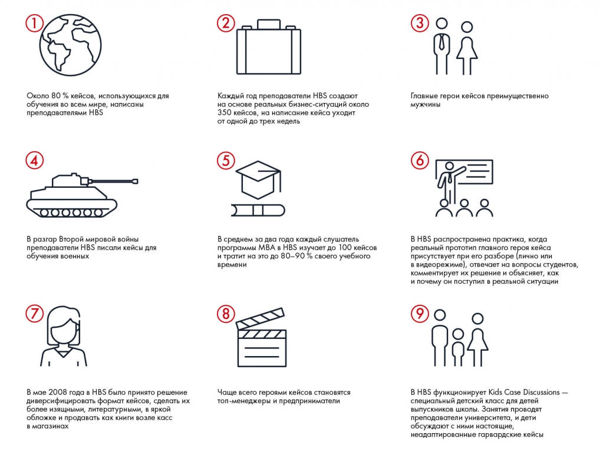

# Практическое задание 1.1: кейсы HBS

Девять утверждений о кейсах HBS предлагается проверить на истинность. Условие из изображения перенесено в текст, ответ связан с приложением.

**Источник:** физические страницы PDF 5–6. Печатные номера не установлены.

**Для последовательного чтения:** [Как все начиналось: история кейс-метода](../01-history.md).

**Навигация:** [Индекс главы](../INDEX.md) · [Маршрутизатор](../../../ROUTER.md) · [Проблемы источника](../../../meta/issues.md).

---

## Источник: [PDF 5](../../../SOURCE.md#pdf-005)

### Практическое задание 1.1

Ниже мы приводим девять утверждений о кейсах Гарвардской школы бизнеса. Попробуйте определить, какие из них правдивы.

## Источник: [PDF 6](../../../SOURCE.md#pdf-006)

Девять утверждений задания 1.1, расположенные сеткой 3 × 3. Порядок чтения: слева направо, затем следующая строка; истинность проверяется по авторским ответам.

[Подробная текстовая расшифровка рисунка](../../../assets/transcripts/pdf-006-img-01.md).

**Ссылки на этой странице исходника:** [Ссылка url-002](../../../meta/source-links.md#url-002).

## Связанные разделы

- [Все темы главы](../INDEX.md)
- [Термины и сокращения](../../../GLOSSARY.md)
- [Предыдущая тема: Как все начиналось: история кейс-метода](../01-history.md)
- [Следующая тема: Современные кейсы и где они обитают](../02-modern-cases.md)
- [Авторские ответы по этой неделе](../../13-answers/01-week-01.md)
