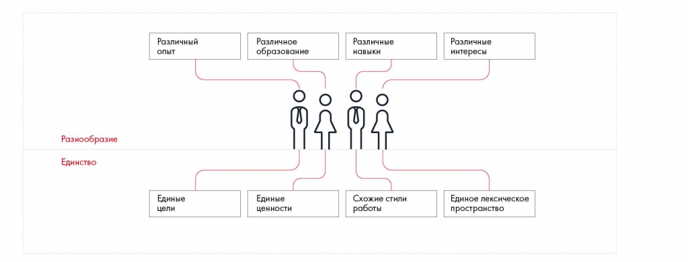

# Формирование эффективной команды

Объясняются критерии команды и польза разнообразия опыта и навыков. Рассматриваются мотивация, согласованность целей и состав участников.

**Источник:** физические страницы PDF 19–22. Печатные номера не установлены.

**Предварительно:** [Этапы решения кейса](../01-case-method/04-solution-stages.md).

**Навигация:** [Индекс главы](INDEX.md) · [Маршрутизатор](../../ROUTER.md) · [Проблемы источника](../../meta/issues.md).

---

## Источник: [PDF 19](../../SOURCE.md#pdf-019)

### Неделя 2. Секреты успешной командной работы

**Ссылки на этой странице исходника:** [Ссылка url-013](../../meta/source-links.md#url-013).

## Источник: [PDF 20](../../SOURCE.md#pdf-020)

На этой неделе ваша задача — разобраться, как сформировать команду мечты, эффективно распределить роли и выстроить коммуникацию с другими участниками.

Обязательное условие многих кейс-чемпионатов — командное решение. Даже если отборочный тур был индивидуальным, готовьтесь, что в финале сильнейших объединят в команды и заставят работать друг с другом. Точно так же в бизнес-школах, где обучение построено на кейс-методе, уделяют много внимания групповой работе студентов. Почему это так важно? Все просто: главная цель кейса — погрузить вас в реальную бизнес-среду. А в бизнесе и менеджеры, и консультанты принимают решения сообща. Работа в команде — одна из важнейших компетенций, которую будут оценивать и на кейс-чемпионате, и во время ассессмент-центров при приеме на работу.

### ФОРМИРОВАНИЕ ЭФФЕКТИВНОЙ

### КОМАНДЫ

Представьте, что вам нужно собрать команду для решения кейса. Скорее всего, в первую очередь позовете друзей и тех, кто учится вместе с вами. Этот простой путь не всегда оказывается эффективным. Друг может не разделять ваших ценностей и показать себя с неожиданной стороны при совместной работе. Например, вообще потерять мотивацию и слиться, поняв, что ему это неинтересно.

Мы убеждены: самая эффективная команда собирается не из друзей и одногруппников, а из единомышленников. С друзьями хорошо провести пятничный вечер, а с одногруппниками — обсудить результаты контрольной. Решать же сложные бизнес-задачи нужно с теми, кто действительно разделяет ваши взгляды и готов работать на пользу команды.

### Критерии идеальной команды

Команда мечты сочетает в себе разнообразие и единство. Разнообразие заключается в опыте и знаниях, а единство — в вашем отношении к работе.

**Ссылки на этой странице исходника:** [Ссылка url-004](../../meta/source-links.md#url-004).

## Источник: [PDF 21](../../SOURCE.md#pdf-021)

Эффективная команда сочетает разнообразие опыта, образования и навыков с общностью целей и мотивации.

[Подробная текстовая расшифровка рисунка](../../assets/transcripts/pdf-021-img-01.md).

Разнообразие и единство в команде

Единство устремлений и ценностей — это основа слаженной команды. Поэтому очень важно сформулировать общую командную цель. Чего вы все хотите от участия в чемпионате: во что бы то ни стало победить или просто получить новый интересный опыт? Кроме того, в самом начале нужно определиться с командными ценностями. Что для вас важнее — победа или участие, процесс или результат? Проводя параллель с бизнесом, можно сказать, что на данном этапе вы выступите в роли топ-менеджмента компании, который формулирует ее миссию и определяет стратегию управления.

Общими должны быть подходы к работе и языковая база каждого участника. Если в команде три жаворонка и одна сова, последней придется начинать работать пораньше. Если одна половина команды свободно говорит на языке, на котором написан кейс, а вторая читает со словарем, то временные издержки на преодоление этого барьера будут слишком высоки и успеха такая команда не добьется.

Почему одновременно с единством важно разнообразие? Хорошо, когда сокомандники разделяют общие научные и деловые интересы. Но еще лучше, когда каждый предпочитает специализироваться на каком-то своем аспекте. Люди с разным жизненным опытом, образованием, навыками и интересами, дополняя друг друга и учитывая сильные и слабые стороны своих партнеров, смогут более эффективно распределить обязанности между собой.

Различия между членами команды также способствуют личностному росту. В процессе решения придется активно обмениваться опытом и знаниями. Например, мастер Excel научит остальных, как анализировать большие объемы

## Источник: [PDF 22](../../SOURCE.md#pdf-022)

числовой информации, а любитель дизайна покажет, как делать стильные слайды. В бизнесе любое знание полезно!

«Чем дольше живу, тем больше убеждаюсь, что в любой команде должны быть люди, мыслящие out of the box, то есть нестандартно, прорывно, что и требуется на чемпионате. Вторая рекомендация — найдите себе модератора, который в случае чего приземлит команду, остановит бессмысленную дискуссию, примет решение».

**Дан Лившиц, руководитель международных проектов в Gett, ранее один из**

самых молодых Associates в истории McKinsey & Company (20 лет), победитель Changellenge >> Cup Russia, преподаватель Школы Changellenge >>

**Ссылки на этой странице исходника:** [Ссылка url-014](../../meta/source-links.md#url-014); [Ссылка url-015](../../meta/source-links.md#url-015).

## Связанные разделы

- [Все темы главы](INDEX.md)
- [Термины и сокращения](../../GLOSSARY.md)
- [Предыдущая тема: Чек-лист первой недели и литература](../01-case-method/05-checklist.md)
- [Следующая тема: Как найти людей в команду](02-recruitment.md)

Ответ к заданию 2.1 в приложении не приведён; самостоятельный ответ не добавлялся.
