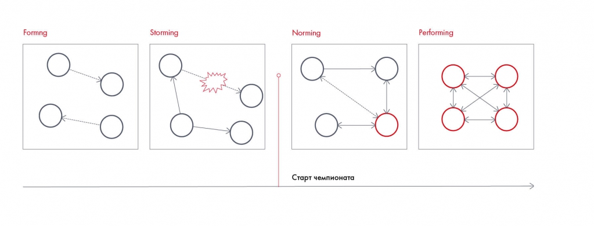
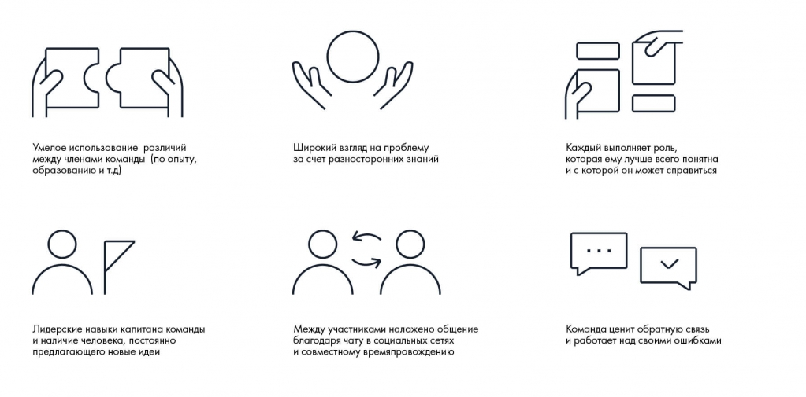
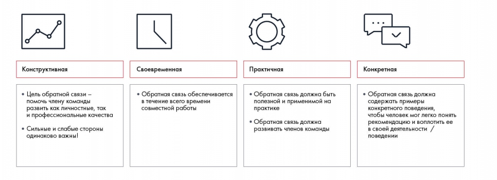

# Командное взаимодействие и обратная связь

Рассматриваются этапы развития команды, общение и обратная связь. Примеры и чек-лист помогают распознать проблемы взаимодействия.

**Источник:** физические страницы PDF 28–33. Печатные номера не установлены.

**Для последовательного чтения:** [Работа в команде: распределение ролей](03-roles.md).

**Навигация:** [Индекс главы](INDEX.md) · [Маршрутизатор](../../ROUTER.md) · [Проблемы источника](../../meta/issues.md).

---

## Источник: [PDF 28](../../SOURCE.md#pdf-028)

### Командное взаимодействие

Наступил волнующий момент: команда сформирована. Если вы плохо знаете друг друга, лучше начать общаться еще до старта работы над кейсом: собраться вместе, провести время в неформальной обстановке, попытаться понять, как лучше спланировать работу. Тогда во время решения вам не придется преодолевать стеснение перед малознакомыми людьми или, наоборот, бороться за сферы влияния.

Разумеется, каждая команда уникальна. Но это не значит, что на нее не будут распространяться общие закономерности становления коллектива. Их выделил в 1965 году психолог Брюс Такман[4]. Согласно его теории, для эффективной работы любая группа людей должна пройти четыре стадии: forming, storming, norming и performing:

1. На этапе формирования команды (forming) участники знакомятся друг с другом, определяют цели, средства их достижения и свою роль в работе.

2. На стадии storming возникает конфронтация, идет борьба за лидерство или сферу влияния. Пройти ее нужно для того, чтобы сразу вскрыть существующие противоречия, хорошенько поспорить и прийти к какому-то решению. К тому же после улаживания конфликта отношения в команде становятся более прочными и доверительными.

**Ссылки на этой странице исходника:** [Ссылка url-016](../../meta/source-links.md#url-016).

## Источник: [PDF 29](../../SOURCE.md#pdf-029)

3. Этап нормирования (norming) — период, когда в команде закладываются организационные принципы ее будущей работы, налаживаются каналы коммуникации между участниками. В результате всем становится удобно взаимодействовать друг с другом.

4. Наконец, начинается performing — собственно рабочий процесс. Ему больше ничего не мешает, и 100 % сил и внимания команда уделяет решению задачи.

Этапы развития команды: forming, storming, norming, performing. Старт чемпионата отмечен на шкале; рисунок связывает результативность с развитием взаимодействия.

[Подробная текстовая расшифровка рисунка](../../assets/transcripts/pdf-029-img-01.md).

Четыре этапа командного взаимодействия

Чтобы успешно прийти к стадии performing, поддерживайте эффективное взаимодействие внутри команды. Установите график встреч, создайте чат в соцсети или мессенджере. Не тратьте время на долгие споры. Не забывайте о чувстве юмора: когда работа близка к завершению и участники на пределе, очень важно вовремя разрядить обстановку.

«Многие команды считают, что чем больше времени они проведут вместе, тем лучше решат кейс. Наша практика показала, что достаточно двух-трех часов, чтобы обсудить мысли по итогам дня. Можно по скайпу. Дальше начинается переливание из пустого в порожнее. Верьте друг в друга. Решайте кейс сами, генерируйте идеи и делитесь ими с командой, вплетайте свое видение в общее решение».

**Николай Агеев, победитель Changellenge >> Cup Moscow**

**Ссылки на этой странице исходника:** [Ссылка url-017](../../meta/source-links.md#url-017); [Ссылка url-012](../../meta/source-links.md#url-012).

## Источник: [PDF 30](../../SOURCE.md#pdf-030)

На рисунке приведены элементы: 1555); Умелое использование различий; между членами команды (по опыту,; образованию и т.д); Лидерские навыки капитана команды. Полная текстовая расшифровка приведена отдельно; геометрия и цветовые обозначения сохранены на изображении.

[Подробная текстовая расшифровка рисунка](../../assets/transcripts/pdf-030-img-01.md).

Факторы успеха команды

Чтобы избежать конфликтов, будьте открытыми и честно давайте друг другу обратную связь. Как правильно это сделать? Для начала опишите конкретные действия человека или поведение, которое вас не устраивает. Затем объясните, как эти действия повлияли на вас в личном или рабочем плане. После этого дайте человеку возможность задать вопросы. Наконец, предложите меры по устранению негативного эффекта или поощрите действия вашего собеседника, выразите признательность за готовность к диалогу.

Например, если один из членов команды постоянно опаздывает на встречи, не нужно молчать и копить раздражение. Вместо этого спокойно скажите: «В последнюю неделю ты постоянно опаздываешь. Это тормозит нашу работу, и мы волнуемся, что не успеем сделать все в срок. Давай обсудим, почему это происходит. Возможно, тебе неудобно приезжать в то время, что мы назначаем».

«Самое важное — помнить, что все люди разные. Широкий спектр личных качеств членов команды — обязательное условие успеха. С самого начала выработайте свод общих правил: как будут решаться спорные моменты, когда и где вы будете собираться, как должен выглядеть макет презентации. Определите сильные стороны каждого из участников. Никогда не идите на конфликт, если вам что-то не понравилось. Сначала выслушайте человека и проанализируйте сказанное. Поблагодарите его за

## Источник: [PDF 31](../../SOURCE.md#pdf-031)

сделанный вклад, спокойно укажите на недостатки и дайте совет по улучшению».

**Андрей Левинак, победитель Changellenge >> Cup Moscow**

Если ваш сокомандник сделал свою часть работы некачественно, не спешите его ругать. Следуйте «правилу бутерброда»: сначала похвалите человека за выполненную работу, потом объясните, что именно стоит переделать, а потом опять похвалите. Например: «Спасибо большое за слайды. Как всегда, все круто! Единственное, я бы убрал текст на слайдах 5, 6 и 7 и заменил его графиками, так будет более наглядно. Думаю, ты быстро справишься, заранее спасибо!»

Четыре требования к обратной связи: конструктивность, своевременность, практичность и конкретность. Нужно помогать развитию участника, обсуждать сильные и слабые стороны, давать применимые рекомендации и примеры наблюдаемого поведения.

[Подробная текстовая расшифровка рисунка](../../assets/transcripts/pdf-031-img-01.md).

Четыре элемента эффективной обратной связи

«Обратная связь после окончания работы в команде тоже имеет большое значение. Если есть незакрытые конфликты, вы сможете разобраться с ними, чтобы в дальнейшем продолжать работать вместе. А в ситуации, когда все прошло отлично, членам команды будет приятно послушать о своих сильных сторонах. Самое главное — не обвинять команду во всех смертных грехах в случае провала. Постарайтесь конструктивно подойти к обсуждению, и вы гарантированно испытаете благодарность за время, проведенное вместе, даже если кейс-чемпионат был проигран с позором».

Ирина Шиферсон, участница Зимней школы Changellenge >>

**Ссылки на этой странице исходника:** [Ссылка url-012](../../meta/source-links.md#url-012); [Ссылка url-018](../../meta/source-links.md#url-018); [Ссылка url-007](../../meta/source-links.md#url-007).

## Источник: [PDF 32](../../SOURCE.md#pdf-032)

### Чек-лист по итогам второй недели

- Знаю, как выглядит dream team.

- Понимаю, где лучше искать людей в команду.

- Могу распределить роли так, чтобы каждый человек приносил максимум пользы.

- Умею улаживать конфликты и давать обратную связь.

- Знаю, что мне комфортнее всего работать полемистом и посредником.

- Точно смогу уговорить лучшего студента с потока участвовать со мной в кейс-чемпионате.

Рекомендуемая литература

Дэйл Карнеги. Как завоевывать друзей и оказывать влияние на людей (Dale Carnegie, How to Win Friends and Influence People).

Дэвид Майстер. Управление фирмой, оказывающей профессиональные услуги (David Maister, Managing the Professional Services Firm).

Изабель Майерс. У каждого свой дар: определение типов MBTI (Isabel Briggs Myers, Gifts Differing: Understanding Personality Type).

Арнольд Минделл. Сидя в огне (Arnold Mindell, Sitting in the fire: Large group transformation using conflict and diversity).

Meredith Belbin, R. (2011). Management teams: Why they succeed or fail. Human Resource Management International Digest, 19(3).

[1] Meredith Belbin, R. (2011). Management teams: Why they succeed or fail. Human Resource Management International Digest, 19(3).

[2] Myers, Isabel Briggs with Peter B. Myers (1995) [1980]. Gifts Differing: Understanding Personality Type. Mountain View, CA: Davies-Black Publishing.

**Ссылки на этой странице исходника:** [Ссылка url-004](../../meta/source-links.md#url-004); [Ссылка url-019](../../meta/source-links.md#url-019).

## Источник: [PDF 33](../../SOURCE.md#pdf-033)

[3] Jung, Carl Gustav (August 1, 1971). Psychological Types. Collected Works of C.G. Jung, Volume 6. Princeton University Press.

[4] Tuckman, B. W. (1965). Developmental sequence in small groups. Psychological bulletin, 63(6), 384.

**Ссылки на этой странице исходника:** [Ссылка url-020](../../meta/source-links.md#url-020).

## Связанные разделы

- [Все темы главы](INDEX.md)
- [Термины и сокращения](../../GLOSSARY.md)
- [Предыдущая тема: Работа в команде: распределение ролей](03-roles.md)
- [Следующая тема: Подход SMART](../03-problem-definition/01-smart.md)

Ответ к заданию 2.1 в приложении не приведён; самостоятельный ответ не добавлялся.
