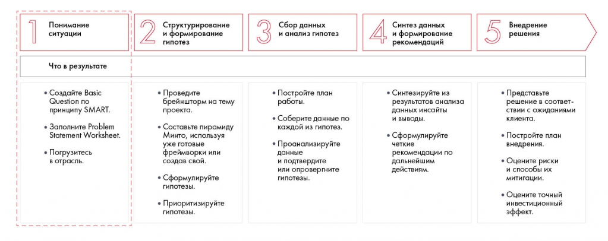
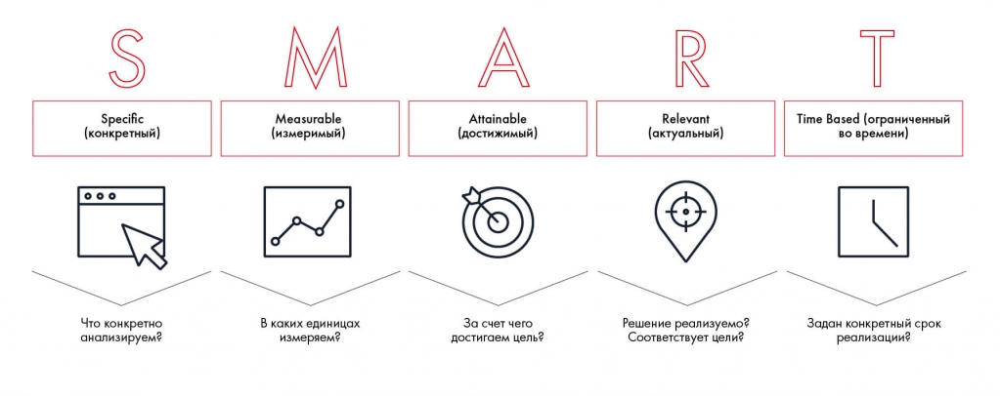

# Подход SMART

Показано, как превратить неопределённую проблему в конкретную задачу. Разбираются критерии SMART, расширения SMARTER и SMARTTA и упражнение 3.1.

**Источник:** физические страницы PDF 33–38. Печатные номера не установлены.

**Предварительно:** [Этапы решения кейса](../01-case-method/04-solution-stages.md).

**Навигация:** [Индекс главы](INDEX.md) · [Маршрутизатор](../../ROUTER.md) · [Проблемы источника](../../meta/issues.md).

---

## Источник: [PDF 33](../../SOURCE.md#pdf-033)

### Неделя 3. Понимание ситуации

Как понять, что именно от вас требуется при решении кейса? Разберемся на этой неделе. Кроме того, вы научитесь формулировать четкие задачи и познакомитесь с инструментом, который поможет собрать максимально полные вводные. А еще возьмете на себя роль консультанта и начнете решать настоящий кейс.

Как мы упоминали в предыдущих главах, кейс далеко не всегда содержит четкую постановку задачи. Обычно это уже ваше дело — сформулировать конкретный вопрос, на который вы будете отвечать. Если этого не сделать, вы рискуете выполнить работу напрасно.

На рисунке приведены элементы: Понимание; ситуации; Что в результате; • Создайте Basic; Question no. Полная текстовая расшифровка приведена отдельно; геометрия и цветовые обозначения сохранены на изображении.

[Подробная текстовая расшифровка рисунка](../../assets/transcripts/pdf-033-img-01.md).

Шаг 1. Понимание ситуации

**Ссылки на этой странице исходника:** [Ссылка url-020](../../meta/source-links.md#url-020).

## Источник: [PDF 34](../../SOURCE.md#pdf-034)

Что значит правильно сформулированная задача? Это задача, которая отвечает критерию SMART, то есть является конкретной, измеримой, достижимой, актуальной и ограниченной по времени. Если задача не сформулирована в явном виде, внимательно изучите кейс — там должна быть вся нужная информация. После этого заполните Problem Statement Worksheet

— инструмент, который поможет обобщить первичные данные по задаче. Он включает в себя задачу по SMART и шесть блоков: контекст, критерии успеха, пространство решений, ограничение пространства решений, заинтересованные стороны и ключевые источники информации. Только после этого вы можете считать, что разобрались с ситуацией.

«Однажды на Школе Changellenge >> мы проходили тренировочный ассессмент-центр — решали кейс в командах. Когда участники презентовали полученные результаты, мне показалось, что все десять команд решали разные кейсы, в которых отличались и условия, и задачи. С одной стороны, было интересно смотреть на такие разные решения, с другой

— стало понятно, что некоторые команды отвечали совсем не на тот вопрос, который был поставлен».

**Ирина Шиферсон, участница Зимней школы Changellenge >>**

### ПОДХОД SMART

Что было бы, если бы все ваши желания сбывались? Предположим, вы хотите знать английский язык. Высшие силы исполнили вашу мечту, и теперь вы владеете английским на уровне Beginner, то есть выучили алфавит и несколько базовых фраз. Вас такой вариант не устраивает, и вы хотите освоить язык на продвинутом уровне Advanced. Ваше желание исполняется, и вы получаете в подарок сертификат на трехлетний офлайн-курс английского у талантливого преподавателя и носителя языка Джеймса в Лондоне. Такой вариант вам тоже не нравится, ведь между вами и Лондоном 3000 км. Тогда вы формулируете свое желание по-другому: «Хочу через полтора года выучить английский в Москве так, чтобы сдать IELTS не ниже чем на 7.0». Эту задачу гораздо сложнее интерпретировать неправильно.

Точно такой же принцип действует в работе. Представьте, что вы проектный менеджер и занимаетесь организацией мероприятий. К вам подходит начальник, и между вами происходит такой диалог.

**Ссылки на этой странице исходника:** [Ссылка url-021](../../meta/source-links.md#url-021).

## Источник: [PDF 35](../../SOURCE.md#pdf-035)

Начальник. Привет! К нам поступил заказ от одного из клиентов. Я решил, что им займешься ты.

Вы. Хорошо. А что нужно сделать?

Начальник. Нужно организовать конференцию — крупную, яркую, чтобы клиент впечатлился. Это нужно для раскрутки его нового продукта. Начинай прямо сейчас.

В этот момент начальнику кто-то звонит, он уходит и забывает о вас, а вы остаетесь с заданием один на один. С чего начнете?

Самое правильное в такой ситуации — ничего не предпринимать, пока не поймете, что именно от вас требуется. В задании, которое вам делегировали, слишком мало конкретики. Чтобы начать действовать, вам нужны:

- Информация о клиенте, который сделал заказ.

- Информация о продукте, который нужно раскрутить.

- Желаемая тематика конференции.

- Сроки проекта, ориентировочная дата конференции.

- Число участников конференции.

- Масштаб мероприятия. Конференция может быть, например, международной или городской.

- Ориентировочный бюджет мероприятия.

Вы также должны понимать, сколько людей будет в вашем распоряжении для организации мероприятия. Возможно, конференцию желаемого масштаба просто невозможно провести из-за сжатых сроков или занятости других сотрудников.

Однако представим, что вы отчаялись получить нужную информацию и решили просто выполнить задание руководителя. Основываясь на опыте проведенных конференций, вы заказываете зал на 1 тыс. посадочных мест с огромной сценой в дальнем углу, украшаете его шарами и гирляндами, расставляете столы и стулья для гостей, заказываете легкие закуски. В итоге клиент разочарован, а начальник в бешенстве. Крупная конференция подразумевала в 2 раза меньше гостей, оформление в стиле хай-тек и фуршет на свежем воздухе.

Чтобы добиться понимания между заказчиком и исполнителем, поставленные задачи должны соответствовать критерию SMART. Этот критерий был

## Источник: [PDF 36](../../SOURCE.md#pdf-036)

разработан американским профессором менеджмента Джорджем Дораном в 1981 году[1] и предназначался для оценки целей, которые организация ставит перед менеджерами. Чтобы соответствовать критерию SMART, задача должна быть:

Конкретной (Specific) — точно обозначать действия, которые нужно сделать. Например, задача «Раскрутить новую марку зубной пасты» не соответствует этому критерию, а вот задача «Провести маркетинговую кампанию, посвященную новой марке зубной пасты, в социальных сетях с охватом 1 млн человек» соответствует.

Измеримой (Measurable) — отражать масштаб работ, которые нужно сделать, в количественном выражении. Например, «опубликовать 10 постов в социальных сетях» или «добиться 1 млн просмотров видеоролика на Youtube». Таким образом, вы сможете получить количественное подтверждение того, что выполнили задачу.

Достижимой (Attainable) — соответствовать тем ресурсам, которые имеются в распоряжении исполнителя. Вспоминая задачу о конференции, если вы в одиночку должны собрать 100 спикеров, а мероприятие через неделю, то это недостижимая цель.

Актуальной (Relevant) — соответствовать целям того, кто ставит задачу. Если конференция посвящена Big Data, а клиент хочет с ее помощью продвинуть новый смартфон, то задача, вероятно, не соответствует этому критерию. Однако актуальность — субъективное понятие и сильно зависит от того, кто ставит задачу.

Ограниченной по времени (Time Based) — задавать конкретный срок выполнения задачи. Здесь все просто: вы должны понимать, когда от вас требуется результат — завтра, через неделю или через год.

**Ссылки на этой странице исходника:** [Ссылка url-022](../../meta/source-links.md#url-022).

## Источник: [PDF 37](../../SOURCE.md#pdf-037)

Критерии SMART на рисунке: Specific (конкретный), Measurable (измеримый), Attainable (достижимый), Relevant (актуальный), Time Based (ограниченный во времени). Подписи содержат вопросы к каждому критерию.

[Подробная текстовая расшифровка рисунка](../../assets/transcripts/pdf-037-img-01.md).

Подход SMART

А теперь немного потренируемся. Поставлены эти задачи по SMART или нет?

1. Приготовить обед из трех блюд на 50 человек.

2. Встретиться с коллегами в офисе, чтобы обсудить стратегию отдела на ближайшие 3 года.

3. Записаться к окулисту на пятницу через интернет, чтобы проверить зрение.

4. Сделать дочке приятный сюрприз в субботу, чтобы порадовать ее.

На самом деле принципу SMART в этом списке соответствует только одна задача — третья. Почему? Она конкретна: нужно записаться к окулисту. Измерима: результатом станет запись к врачу. Релевантна: это нужно, чтобы проверить зрение. Достижима: нам поможет запись через интернет. Ограничена по времени: действие нужно предпринять до пятницы.

В остальных случаях задачи не полностью соответствуют этому принципу. Цели 1 не хватает релевантности (зачем?), ограниченности во времени (когда это надо сделать?), от которой зависит также реализуемость (за день такую задачу выполнить сложно, если вы не команда профессиональных поваров). Второй цели не хватает дедлайна (когда назначить встречу — завтра или через неделю?). Четвертая же цель неконкретна (важно понимать, какой именно сюрприз для дочери будет приятным).

Некоторые авторы в области менеджмента расширяют этот критерий и добавляют туда дополнительные компоненты.

**Ссылки на этой странице исходника:** [Ссылка url-023](../../meta/source-links.md#url-023).

## Источник: [PDF 38](../../SOURCE.md#pdf-038)

SMARTER[2]:

Оцениваемая (Evaluated) — означает, что руководитель будет отслеживать выполнение задачи.

Вознаграждаемая (Rewarded) — означает, что исполнитель в процессе выполнения задачи будет получать обратную связь, обучаться и развиваться.

SMARTTA[3]:

Отслеживаемая (Trackable) — аналогично Evaluated означает, что процесс выполнения можно отслеживать.

Согласованная (Agreed) — означает, что и исполнитель, и руководитель согласны с постановкой задачи.

### Практическое задание № 3.1

Определите, соответствуют ли следующие задачи критерию SMART. Если задача не соответствует критерию, переформулируйте ее.

1. Добиться чистоты в доме.

2. Поехать к бабушке на велосипеде, чтобы узнать о ее здоровье и пообщаться.

3. Увеличить число клиентов на 20 % через маркетинговые мероприятия.

4. За две недели разработать новый дизайн упаковки зубной пасты объемом 200 мл, чтобы соответствовать стратегии ребрендинга.

5. За два месяца увеличить продажи компании ООО «Ромашка» с 5 тыс. до 2 млн руб. в месяц за счет маркетинговой кампании на ТВ стоимостью 3 млн руб.

6. В течение недели держать участников в курсе проведения конкурса, публикуя по одному посту в группе «ВКонтакте» ежедневно.

7. Назначить по телефону встречу с финансовым консультантом, чтобы обсудить личный бюджет на 2018 год.

**Ссылки на этой странице исходника:** [Ссылка url-022](../../meta/source-links.md#url-022).

## Связанные разделы

- [Все темы главы](INDEX.md)
- [Термины и сокращения](../../GLOSSARY.md)
- [Предыдущая тема: Командное взаимодействие и обратная связь](../02-teamwork/04-interaction.md)
- [Следующая тема: Кейс Besh: постановка задачи по SMART](examples/01-besh-smart.md)
- [Авторские ответы по этой неделе](../13-answers/02-week-03.md)
