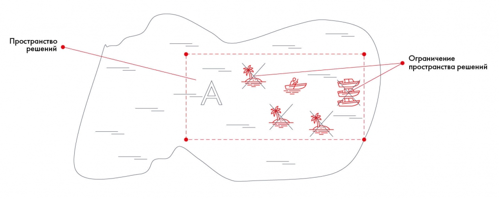
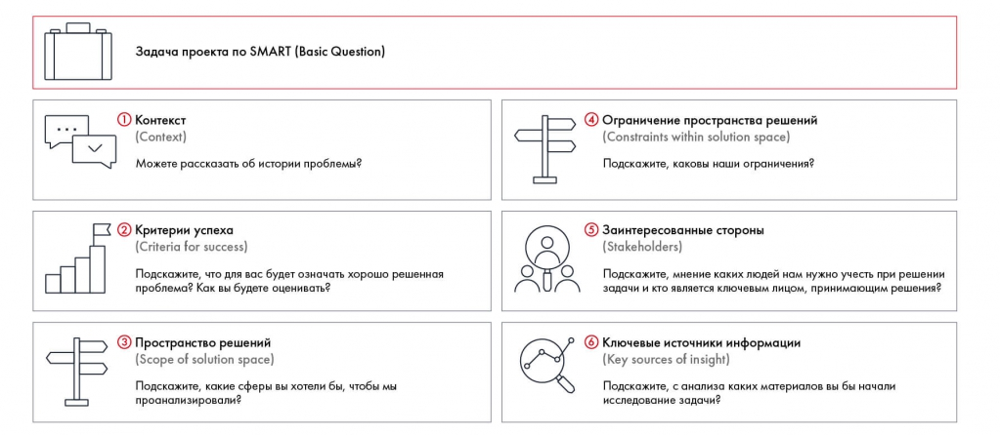

# Problem Statement Worksheet: шесть блоков

Шаблон помогает согласовать контекст, успех, пространство решений, ограничения, стороны и источники. Объясняется различие пространства решений и его ограничений.

**Источник:** физические страницы PDF 42–46. Печатные номера не установлены.

**Для последовательного чтения:** [Кейс Besh: постановка задачи по SMART](examples/01-besh-smart.md).

**Навигация:** [Индекс главы](INDEX.md) · [Маршрутизатор](../../ROUTER.md) · [Проблемы источника](../../meta/issues.md).

---

## Источник: [PDF 42](../../SOURCE.md#pdf-042)

### Неделя 3. Понимание ситуации

На самом деле формулировка задачи по SMART — это только первый шаг по заполнению шаблона бизнес-задачи, или, как его принято называть, Problem Statement Worksheet (PSW). Этот инструмент был разработан консультантами McKinsey & Company[1] и активно используется в самой компании.

**Ссылки на этой странице исходника:** [Ссылка url-024](../../meta/source-links.md#url-024); [Ссылка url-025](../../meta/source-links.md#url-025); [Ссылка url-026](../../meta/source-links.md#url-026); [Ссылка url-027](../../meta/source-links.md#url-027); [Ссылка url-028](../../meta/source-links.md#url-028); [Ссылка url-029](../../meta/source-links.md#url-029); [Ссылка url-030](../../meta/source-links.md#url-030); [Ссылка url-031](../../meta/source-links.md#url-031); [Ссылка url-032](../../meta/source-links.md#url-032).

## Источник: [PDF 43](../../SOURCE.md#pdf-043)

Problem Statement Worksheet представляет собой таблицу из шести блоков, которые заполняются по мере чтения кейса или встречи с клиентом. Заполненный PSW помогает:

- управлять ожиданиями стейкхолдеров;

- понять, какой информации не хватает, чтобы приступить к работе;

- держать перед глазами все вводные по задаче.

Рассмотрим блоки, которые входят в PSW:

1. Контекст (Context). Краткая информация о ситуации и проблемах, из-за которых возникла стоящая перед вами задача, «боль» в рамках кейса. Важно уточнить у клиента, почему вдруг появилась эта задача, что произошло.

**Примеры вопросов, которые помогут заполнить эту часть шаблона:**

Подскажите, пожалуйста, а как возникла данная задача и почему она нам нужна?

Не могли бы вы рассказать краткую историю возникновения этой задачи?

2. Критерии успеха (Criteria for success). Здесь требуется узнать, как клиент будет оценивать успешность вашего решения, и проранжировать все критерии по степени важности. Это могут быть как финансовые (увеличение продаж, снижение расходов), так и нефинансовые (количество посетителей магазина, рекламный охват) показатели. Помимо конкретных критериев важно узнать и обо всех неизмеримых пожеланиях клиента. Может быть, с помощью предложенных вами мер компания хочет добиться изменений в корпоративной культуре.

**Примеры вопросов, которые помогут заполнить эту часть шаблона:**

Подскажите, пожалуйста, на основании каких критериев вы будете оценивать успешность выполнения задачи? По возможности укажите три ключевых.

3. Пространство решений (Scope of solution space). Нужно понять, где заканчиваются границы анализа. Лучше всего спросить у клиента, какие

## Источник: [PDF 44](../../SOURCE.md#pdf-044)

области уже не стоит рассматривать. Например, заказчика может интересовать только определенный регион, а не вся страна.

**Примеры вопросов, которые помогут заполнить эту часть шаблона:**

Подскажите, пожалуйста, какие сферы вы хотите включить в анализ?

4. Ограничение пространства решений (Constrains within solution space). Очерчивает барьеры, которые могут возникнуть в пространстве решений. Это могут быть рамки бюджета, законодательные ограничения или четкий список инструментов, которые вы можете использовать.

**Примеры вопросов, которые помогут заполнить эту часть шаблона:**

Подскажите, пожалуйста, каковы наши ограничения?

5. Заинтересованные стороны (Stakeholders). Это перечень людей, которые будут влиять на принятие решений и успех внедрения. Их можно разделить на тех, кто решает, тех, кто помогает, и тех, кто мешает.

**Примеры вопросов, которые помогут заполнить эту часть шаблона:**

Назовите, пожалуйста, ключевых заинтересованных лиц по проекту?

С кем необходимо согласовывать материалы?

6. Ключевые источники информации (Key sources of insight). Откуда вы будете брать данные для решения кейса? Подумайте и запишите источники, которые изначально предлагает вам клиент, руководитель или автор кейса. Если в голову придут исследования по релевантной теме, запишите их тоже. Лучше разделить источники информации на следующие группы:

- книги, документы, исследования;

- ключевые эксперты;

- аналогичные проекты.

**Примеры вопросов, которые помогут заполнить эту часть шаблона:**

## Источник: [PDF 45](../../SOURCE.md#pdf-045)

Подскажите, с анализа каких материалов вы бы начали исследование?

Какими материалами можете с нами поделиться?

При заполнении PSW часто путают третий и четвертый пункты. Как понять, что отнести к пространству решений, а что — к ограничению? Рассмотрим на простом примере. Клиент хочет найти клад на дне озера. Он знает примерное место, где могут лежать сокровища, и обводит его на карте пунктиром. Так что исследовать все озеро вам не нужно. Пространство решения в этом случае

— зона А.

Вы анализируете ситуацию и понимаете, что справитесь за один день, если возьмете три катера с людьми. Клиент против такого решения. В озере он разводит редких рыб, шум моторов их напугает. С количеством задействованных лиц клиент тоже не согласен. Три катера привлекут внимание зевак, поэтому лучше оставить только один. Кроме того, в зоне А есть мели. Чтобы лодка не села на них, надо следить за глубиной воды. Вы столкнулись с ограничениями пространства решений: нельзя использовать моторные лодки, можно взять только одно судно и нужно избегать мелей.

На примере поиска клада зона A обозначает пространство решений — участок озера для поиска. Запрет моторных лодок, ограничение числа судов и мели являются ограничениями способов поиска внутри этого пространства.

[Подробная текстовая расшифровка рисунка](../../assets/transcripts/pdf-045-img-01.md).

Пространство решений и ограничение пространства решений

## Источник: [PDF 46](../../SOURCE.md#pdf-046)

Пустой PSW содержит Basic Question и шесть блоков: контекст, критерии успеха, пространство решений, ограничения, заинтересованные стороны, источники. В каждом блоке даны наводящие вопросы.

[Подробная текстовая расшифровка рисунка](../../assets/transcripts/pdf-046-img-01.md).

Шаблон Problem Statement Worksheet

## Связанные разделы

- [Все темы главы](INDEX.md)
- [Термины и сокращения](../../GLOSSARY.md)
- [Предыдущая тема: Кейс Besh: постановка задачи по SMART](examples/01-besh-smart.md)
- [Следующая тема: Кейс Besh: заполненный PSW](examples/02-besh-psw.md)
- [Авторские ответы по этой неделе](../13-answers/02-week-03.md)
