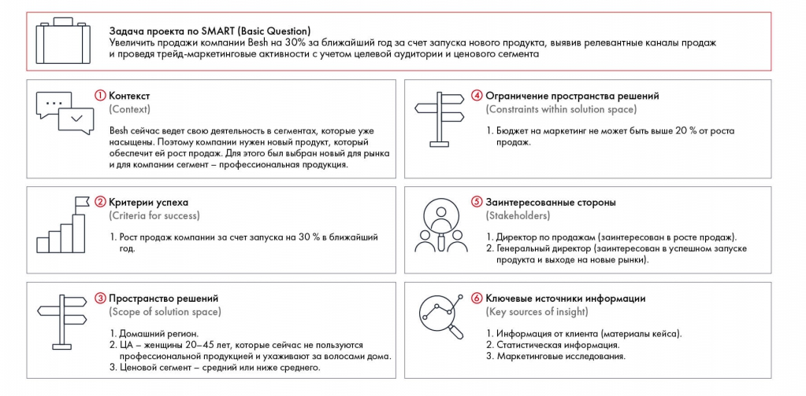

# Кейс Besh: заполненный PSW

Шесть блоков шаблона применены к запуску нового продукта Besh. В конце сохранены задание по Coca-Cola, самопроверка и литература.

**Источник:** физические страницы PDF 46–49. Печатные номера не установлены.

**Для последовательного чтения:** [Problem Statement Worksheet: шесть блоков](../02-psw.md).

**Навигация:** [Индекс главы](../INDEX.md) · [Маршрутизатор](../../../ROUTER.md) · [Проблемы источника](../../../meta/issues.md).

---

## Источник: [PDF 46](../../../SOURCE.md#pdf-046)

Вернемся к кейсу Besh. Постановка задачи по SMART у нас уже есть:

Увеличить продажи компании Besh на 30 % в ближайший год за счет запуска нового продукта, выявив релевантные каналы продаж и проведя трейд-маркетинговые активности с учетом целевой аудитории и ценового сегмента.

Перейдем к заполнению Problem Statement Worskheet.

1. Контекст. Из текста кейса мы знаем, что Besh сейчас ведет деятельность в уже насыщенных сегментах. Поэтому компании нужен новый продукт, который обеспечит ей рост продаж. Для этого был выбран новый для рынка и для компании сегмент — профессиональная продукция.

2. Критерии успеха. Главный критерий успеха — рост продаж вдвое в ближайший год.

3. Пространство решений. В данном случае нас интересует только домашний регион, поскольку в ближайший год компания планирует продавать новый продукт там. Целевая аудитория — женщины 20–45 лет, которые сейчас не пользуются профессиональной продукцией и ухаживают за волосами дома. Ценовой сегмент средний или ниже среднего.

## Источник: [PDF 47](../../../SOURCE.md#pdf-047)

4. Ограничение пространства решений. Бюджет на маркетинговую кампанию ограничен — не более 20 % от роста продаж.

5. Заинтересованные стороны. Во-первых, это сам герой — директор по продажам. Во-вторых, генеральный директор, который заинтересован в том, чтобы продажи удвоились и продукт поступил в другие регионы.

6. Ключевые источники информации. Для решения нам необходима информация о рынке, продажах компании Besh, доступных каналах продаж, специфике целевой аудитории, маркетинговых инструментах. Чтобы узнать конфиденциальные данные (разбивку продаж компании по каналам или долю бренда в портфеле), лучше всего обратиться к эксперту (представителю компании) или данным кейса. Для оценки целевой аудитории будут полезны статистические данные и маркетинговые исследования.

Заполненный PSW Besh связывает рост продаж на 30 % за год с запуском нового продукта, каналами и трейд-маркетингом. Ограничения и заинтересованные стороны перенесены в отдельные блоки.

[Подробная текстовая расшифровка рисунка](../../../assets/transcripts/pdf-047-img-01.md).

Заполненный Problem Statement Worksheet

Если вы заполняете PSW на встрече с клиентом или на интервью, лучше возьмите с собой шаблон в бумажном виде, чтобы заполнять его по ходу разговора. Если такой возможности нет, стоит держать все пункты в голове и задавать соответствующие вопросы, чтобы сразу структурировать проблему.

Зачастую первая версия Problem Statement Worksheet может вас не устроить. Поскольку все блоки PSW связаны, при заполнении одного критерия вы можете понять, что другой надо отредактировать. Чтобы получить идеальный PSW,

**Ссылки на этой странице исходника:** [Ссылка url-033](../../../meta/source-links.md#url-033).

## Источник: [PDF 48](../../../SOURCE.md#pdf-048)

несколько раз просмотрите каждый блок и убедитесь, что ничего не забыли. Если вы поняли, что какой-то информации не хватает, задайте вопрос клиенту, преподавателю или эксперту.

Распространенная ошибка — сразу добавлять в PSW свои идеи по решению кейса. Когда вы заполняете Problem Statement Worksheet, в голове могут появиться мысли, какие еще KPI можно использовать и какие возможности есть у компании в контексте ситуации. Тем не менее вы должны строго следовать имеющимся вводным и описывать только проблему клиента или кейса. Идеи зафиксируйте отдельно — они пригодятся на следующих стадиях решения.

«Очень удобно заполнять PSW по мере чтения кейса, сразу записывая все важные моменты и детали. Особенно хорошо этот подход работает в условиях, когда время ограниченно. После прочтения вы сразу можете использовать свои записи и не тратить время на поиски необходимой информации внутри кейса».

**Ирина Шиферсон, участница Зимней школы Changellenge >>**

Не включайте PSW в презентацию результатов — этот инструмент нужен, чтобы помочь вам разобраться в задаче. Клиент и так знает свою проблему — от вас ему нужно только решение.

### Задание по кейсу

Заполните Problem Statement Worksheet для кейса Coca-Cola HBC Россия.

### Чек-лист по итогам третьей недели:

- Могу расшифровать аббревиатуру SMART.

- Знаю, как правильно формулировать задачи.

- Умею выделять из кейса главное и могу заполнить все блоки PSW.

**Ссылки на этой странице исходника:** [Ссылка url-007](../../../meta/source-links.md#url-007).

## Источник: [PDF 49](../../../SOURCE.md#pdf-049)

- Понимаю, чем блок «Пространство решений» отличается от блока «Ограничения пространства решений».

Рекомендуемая литература

Davis, I., Keeling, D., Schreier, P., Williams, A. (2007). The McKinsey approach to problem solving. McKinsey Staff Paper, 66, 1–27.

Yemm, Graham (2013). Essential Guide to Leading Your Team: How to Set Goals, Measure Performance and Reward Talent. Pearson Education. pp. 37–

39. ISBN 0273772449.

Dwyer, J., & Hopwood, N. (2013). Management strategies and skills (Vol. 10, p. 240). in Australia by McGraw-Hill Education (Australia) Pty Ltd Level 2, 82 Waterloo Road, North Ryde NSW 2113.

Александр Жакупов. SMART 2.0. Как ставить цели, которые работают.

[1] Davis, I., Keeling, D., Schreier, P., Williams, A. (2007). The McKinsey approach to problem solving. McKinsey Staff Paper, 66, 1–27.

**Ссылки на этой странице исходника:** [Ссылка url-025](../../../meta/source-links.md#url-025); [Ссылка url-026](../../../meta/source-links.md#url-026); [Ссылка url-027](../../../meta/source-links.md#url-027); [Ссылка url-028](../../../meta/source-links.md#url-028).

## Связанные разделы

- [Все темы главы](../INDEX.md)
- [Термины и сокращения](../../../GLOSSARY.md)
- [Предыдущая тема: Problem Statement Worksheet: шесть блоков](../02-psw.md)
- [Следующая тема: Структурирование и формирование гипотез: общий подход](../../04-idea-generation/01-structural-thinking.md)
- [Авторские ответы по этой неделе](../../13-answers/02-week-03.md)

> Редакторское примечание SRC-02: здесь сохранено сквозное задание, но полное условие кейса Coca-Cola из приложения 1 отсутствует в предоставленном PDF. См. [реестр проблем](../../../meta/issues.md).
