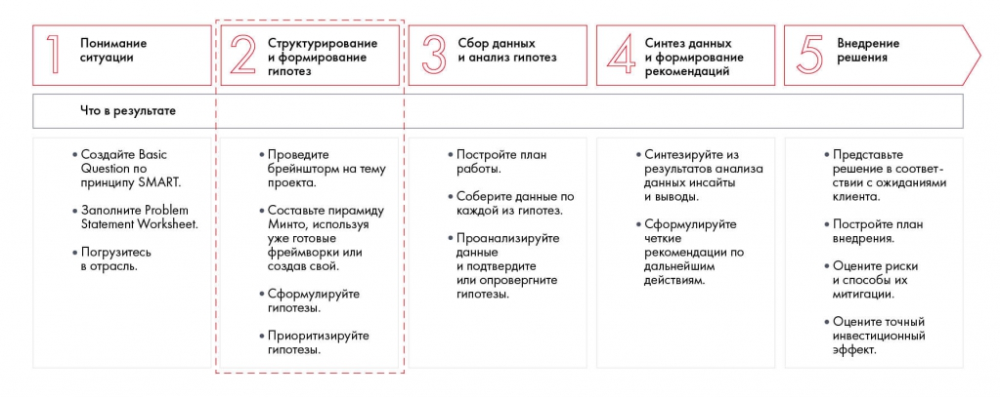
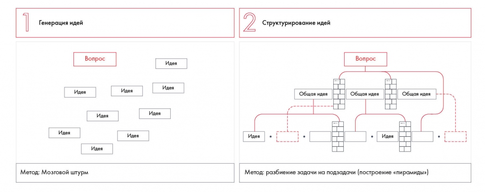

# Структурирование и формирование гипотез: общий подход

Объясняется связь генерации идей, структурирования и гипотез. Показано место этого этапа в общем процессе решения кейса.

**Источник:** физические страницы PDF 49–51. Печатные номера не установлены.

**Предварительно:** [Этапы решения кейса](../01-case-method/04-solution-stages.md).

**Навигация:** [Индекс главы](INDEX.md) · [Маршрутизатор](../../ROUTER.md) · [Проблемы источника](../../meta/issues.md).

---

## Источник: [PDF 49](../../SOURCE.md#pdf-049)

### Недели 4, 5 и 6. Структурирование и формирование гипотез

Итак, у вас есть четко сформулированная задача, вы заполнили Problem Statement Worksheet, возможно, изучили дополнительную информацию об отрасли и проблеме. Теперь переходим к самому важному и сложному этапу решения кейса — структурированию и формированию гипотез. Чтобы тема лучше уложилась в голове, мы разбили ее изучение на три недели и добавили практические упражнения.

**Ссылки на этой странице исходника:** [Ссылка url-025](../../meta/source-links.md#url-025); [Ссылка url-026](../../meta/source-links.md#url-026); [Ссылка url-027](../../meta/source-links.md#url-027); [Ссылка url-028](../../meta/source-links.md#url-028).

## Источник: [PDF 50](../../SOURCE.md#pdf-050)

На рисунке приведены элементы: Понимание; ситуации; Что в результате; • Создайте Basic; Question no. Полная текстовая расшифровка приведена отдельно; геометрия и цветовые обозначения сохранены на изображении.

[Подробная текстовая расшифровка рисунка](../../assets/transcripts/pdf-050-img-01.md).

Шаг 2. Структурирование и формирование гипотез

Когда вы уже сформулировали цель, бывает сложно подступиться к ее достижению. На вас сваливается много информации, данные противоречат друг другу или пересекаются. Возникает множество идей, каждая из них интересна, и охватить хочется решительно все.

Но при решении кейса от вас не требуется все и сразу. Широта анализа заключается не в том, чтобы найти много данных, а в том, чтобы правильно их обработать и собрать воедино. В этом и поможет структурный подход.

Мы предлагаем начинать решение с генерации идей по кейсу. Это позволит собрать все мысли по задаче, которые вы затем оформите в структуру. Если для генерации идей у вас пока мало вводных, то поищите дополнительную информацию об отрасли и компании. Но не тратьте на это слишком много времени — в детали вы сможете углубиться на следующем этапе решения. В следующих главах мы расскажем, как правильно искать и обрабатывать данные.

## Источник: [PDF 51](../../SOURCE.md#pdf-051)

От общего вопроса расходятся идеи мозгового штурма; затем идеи группируются в пирамиду. Показано, что генерация и структурирование являются разными действиями.

[Подробная текстовая расшифровка рисунка](../../assets/transcripts/pdf-051-img-01.md).

Процесс структурного мышления: мозговой штурм и построение пирамиды идей

Лучший способ генерировать идеи в команде — это мозговой штурм. После него выберите самые ценные идеи и соберите их в структуру. Для этого нужно разбить проблему на части, а каждую часть — на более мелкие составляющие, и так до тех пор, пока не придете к разностороннему и цельному пониманию проблемы и возможных решений. Самый простой способ создать структуру — построить дерево решений, в котором на верхних уровнях будут основные проблемы и их составляющие, а на нижних — способы решения каждой проблемы (гипотезы). Чтобы не тратить время на анализ большого количества данных, расставляйте приоритеты, отметайте неперспективные гипотезы и ветви дерева.

Работа над деревом обычно происходит в несколько итераций. Вам может потребоваться не один подход к анализу ситуации, повторный мозговой штурм и выдвижение новых гипотез, чтобы качественно структурировать проблему.

**Ссылки на этой странице исходника:** [Ссылка url-034](../../meta/source-links.md#url-034).

## Связанные разделы

- [Все темы главы](INDEX.md)
- [Термины и сокращения](../../GLOSSARY.md)
- [Предыдущая тема: Кейс Besh: заполненный PSW](../03-problem-definition/examples/02-besh-psw.md)
- [Следующая тема: Мозговой штурм: правила, участники и подготовка](02-brainstorm.md)
