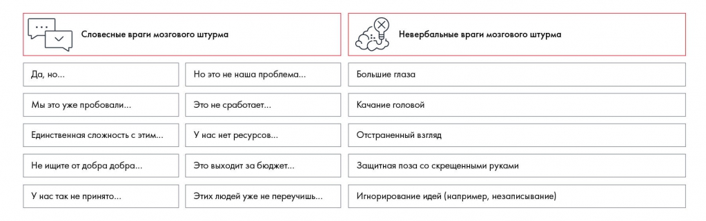

# Мозговой штурм: правила, участники и подготовка

Разбираются правила генерации идей и факторы, которые мешают обсуждению. Описаны подготовка участников, роль ведущего и рабочие материалы.

**Источник:** физические страницы PDF 51–55. Печатные номера не установлены.

**Для последовательного чтения:** [Структурирование и формирование гипотез: общий подход](01-structural-thinking.md).

**Навигация:** [Индекс главы](INDEX.md) · [Маршрутизатор](../../ROUTER.md) · [Проблемы источника](../../meta/issues.md).

---

## Источник: [PDF 51](../../SOURCE.md#pdf-051)

### НЕДЕЛЯ 4. ГЕНЕРАЦИЯ ИДЕЙ

Ваши задачи на эту неделю — понять, откуда берутся идеи, и узнать, как грамотно проводить мозговой штурм.

Существует много методов генерации идей. Мы хотим рассказать о самом простом и популярном — мозговом штурме. Об этом методе слышал практически каждый. Но по нашей статистике, правильно проводить мозговой штурм умеют не больше 5 % людей. Давайте разберемся, что делают не так остальные 95 %.

**Ссылки на этой странице исходника:** [Ссылка url-034](../../meta/source-links.md#url-034).

## Источник: [PDF 52](../../SOURCE.md#pdf-052)

Что такое мозговой штурм

Метод мозгового штурма (или брейнсторм, брейнсторминг) — классический способ группового решения задач. Но дело в том, что, если вы просто соберетесь всей командой в одной комнате, идеи у вас не появятся. Чтобы обсуждение не затянулось, не привело к конфликтам и не разрушило командный дух, нужно соблюдать несколько правил. Действуйте по проверенной схеме, и вы сможете включить ассоциативное мышление. За идеей потянется идея, и вы гарантированно получите список из нескольких жизнеспособных решений, не тратя время впустую.

В ходе мозгового штурма участники высказывают как можно больше вариантов, ориентируясь не на их качество и реализуемость, а только на количество. Это основное правило, о котором нужно помнить. В его несоблюдении часто и кроется главная ошибка.

Роль времени

Для начала определитесь с временными рамками. На проведение мозгового штурма вам понадобится от 30 минут до полутора часов. Почему полчаса — это минимальная продолжительность? Дело в том, что мозг не может мгновенно переключиться в режим нешаблонного мышления и отбросить все привычные ограничения. Ему нужно какое-то время на разогрев. Если встреча длилась меньше 30 минут, ее можно назвать обсуждением, но нельзя считать, что вы применили метод мозгового штурма. Что касается максимальной продолжительности, штурмовать дольше полутора часов просто утомительно. Еще один совет: постарайтесь проводить мозговой штурм в первой половине дня, чтобы все чувствовали себя бодрыми и отдохнувшими.

Критика мешает рождению идей

Критиковать во время мозгового штурма нельзя — запомните это раз и навсегда! Многих это смущает. Зачем записывать «неправильные» решения, тратить на это время? Иногда так и подмывает высмеять предложенную идею, которая вам не по душе.

Сдерживайте себя. Неудачные идеи нужны для того, чтобы не упустить удачную. Люди реагируют на очень хорошие и очень плохие идеи одинаково: «Это не будет работать!» Психологи объясняют это тем, что действительно прорывные идеи часто лежат вне зоны комфорта. Люди не готовы принять их и поэтому сразу говорят «нет».

## Источник: [PDF 53](../../SOURCE.md#pdf-053)

Но именно такие идеи могут оказаться самыми эффективными. Кроме того, неудачные идеи через цепочку ассоциаций могут навести вас на гениальную мысль.

На рисунке приведены элементы: Словесные враги мозгового штурма; Невербальные враги мозгового штурма; Да, но...; Но это не наша проблема...; Большие глаза. Полная текстовая расшифровка приведена отдельно; геометрия и цветовые обозначения сохранены на изображении.

[Подробная текстовая расшифровка рисунка](../../assets/transcripts/pdf-053-img-01.md).

Враги мозгового штурма

Есть замечательная история, в которой методом мозгового штурма было найдено элегантное решение проблемы. В одном высотном здании очень долго приходилось ждать лифт. Владельцу поступало много жалоб от арендаторов, и он искал способы исправить ситуацию. Ему предлагали реконструировать здание, обновить программное обеспечение или установить дополнительные лифты, но все эти варианты были слишком дорогими.

Тогда владелец здания провел брейнсторм среди своих сотрудников. После долгого обсуждения предложение внес молодой стажер кадрового отдела. Он предположил, что причина жалоб не зависела от скорости лифта — время ожидания было долгим субъективно. Ждать лифт скучно, и, чтобы отвлечь людей, он предложил повесить на стенах большие зеркала. Рассматривать себя и окружающих в зеркале во время ожидания лифта пришлось людям по вкусу, и поток жалоб быстро иссяк.

«Мы участвовали в региональном чемпионате, вышли в финал. Конечно, подготовились: почитали советы, сели проводить брейнсторм. В итоге у нас ничего не вышло: в команде был человек, который критиковал каждую идею, которая возникала, говорил: "Это не получится, так никто не делает". В итоге наше решение было банальным, и на обратной связи нам сказали, что ждали более оригинальных предложений. Мы проиграли»

**Ольга Яркова, финалист Changellenge >> Cup Spb**

**Ссылки на этой странице исходника:** [Ссылка url-035](../../meta/source-links.md#url-035).

## Источник: [PDF 54](../../SOURCE.md#pdf-054)

Кого пригласить на мозговой штурм и как к нему готовиться

Каждый участник должен прийти на брейнсторм подготовленным. Прежде чем встречаться с командой, погрузитесь в проблему и проведите поиск в интернете по трем направлениям:

1. Отрасль. Исследуйте особенности и тренды, определите, какое место в отрасли занимает компания.

2. Положение дел в компании. Изучите структуру и финансовые показатели бизнеса (себестоимость, выручку, рентабельность, ассортимент и пр.).

3. Рынок и конкурентная среда. Определите лидеров отрасли и ключевых конкурентов компании на основе индустриальных метрик, пересечений по рынкам и анализа стратегий.

После такого исследования вероятность того, что ваши идеи будут полезны и реализуемы, сильно возрастет. Теперь можно встречаться с командой.

**Слишком много участников — плохая идея. Обычно это приводит к**

шумным спорам и потерянным идеям. Ограничьтесь членами своей команды — четырех человек обычно вполне достаточно. А вот качественный состав участников мозгового штурма может повлиять на результат — старайтесь, чтобы в команду входили люди с разным опытом. Такой подход позволит рассмотреть вопрос с нескольких точек зрения. Хорошо, если удастся привлечь к обсуждению людей, связанных с решаемой проблемой. Возможно, вы сможете договориться с преподавателем или аспирантом с профильной кафедры или найдете другого эксперта по вашему вопросу. Однако не забывайте: мнение эксперта на мозговом штурме имеет тот же вес, что и идеи любого другого участника.

Записывайте все идеи на флипчарт. Так вы не потеряете ни одну мысль. Зафиксированный на бумаге список идей может навести на дополнительные варианты решения. Почему писать лучше на большом флипчарте? Он нагляднее стандартного

## Источник: [PDF 55](../../SOURCE.md#pdf-055)

листа A4 и помогает мозгу не комкать мысль, ограничиваясь краями бумаги. А еще на флипчарте все участники штурма видят написанное.

**Для повышения эффективности мозгового штурма выберите**

ведущего. Это необязательно должен быть капитан команды. Помните: роль ведущего не дает бонусов. Его основная задача — следить за соблюдением всех правил мозгового штурма и записывать возникающие идеи.

Позаботьтесь о комфортной обстановке. Рассадите участников мозгового штурма так, чтобы всем был хорошо виден флипчарт с идеями. Ведущему при этом должно быть видно и слышно каждого. Не создавайте ссор и шума, давайте высказаться тихоням. Их идеи, как правило, хорошо обдуманы и взвешены. В целом обстановка должна быть такой, чтобы всем было комфортно и команда могла сфокусироваться на генерации гипотез.

Подготовьте легкие закуски и напитки. Вам предстоит интенсивно работать, и участники могут быстро проголодаться. Отлично подойдет горький шоколад и орехи. Эти продукты питают мозг, поднимают настроение и помогут быстро восстановить силы.

**Что должен уметь идеальный ведущий мозгового штурма? Ему пригодится**

способность внимательно слушать, задавать наводящие вопросы и поддерживать позитивный настрой в команде. Для брейнсторма очень важен правильный психологический климат. Согласно исследованиям, под давлением внешних обстоятельств интроверты часто принимают более интересные решения, чем экстраверты. Но чтобы заставить их озвучить свои идеи, ведущему следует проявить некоторую находчивость. Ему придется помочь людям побороть стеснение. Кроме того, ведущий должен следить за эмоциональным напряжением в команде. Конфликты обязательно возникнут. Брейнсторм — это эмоции. Придется грамотно улаживать споры и усмирять участников, которые тянут одеяло на себя.

## Связанные разделы

- [Все темы главы](INDEX.md)
- [Термины и сокращения](../../GLOSSARY.md)
- [Предыдущая тема: Структурирование и формирование гипотез: общий подход](01-structural-thinking.md)
- [Следующая тема: А теперь по порядку: проведение мозгового штурма](03-session.md)
