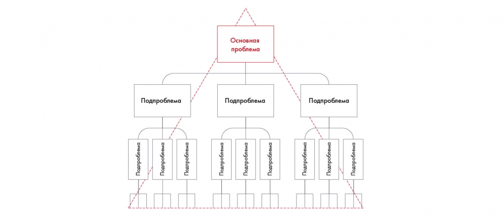

# Как построить структуру решения

Объясняется переход от списка идей к структуре исследования. Сопоставлены движение от вопроса и группировка уже собранных идей.

**Источник:** физические страницы PDF 60–62. Печатные номера не установлены.

**Предварительно:** [Этапы решения кейса](../01-case-method/04-solution-stages.md).

**Навигация:** [Индекс главы](INDEX.md) · [Маршрутизатор](../../ROUTER.md) · [Проблемы источника](../../meta/issues.md).

---

## Источник: [PDF 60](../../SOURCE.md#pdf-060)

### Недели 4, 5 и 6. Структурирование и формирование

### гипотез

### НЕДЕЛЯ 5. СТРУКТУРИРОВАНИЕ ИДЕЙ

Вы разберетесь, как строится структура решения, узнаете, что такое гипотезы и как их выдвигать, и освоите фреймворки, которые помогают решать бизнес-задачи.

Мы переписали выбранные идеи по кейсу Besh на чистый лист. Так лишние строки не будут отвлекать внимание:

Закупить рекламу на радио / в соцсетях / в поисковиках / на ТВ.

Разработать мотивирующие месседжи.

## Источник: [PDF 61](../../SOURCE.md#pdf-061)

Сделать красивую упаковку.

Приоритизировать продукты линейки, распределить продукты по каналам продаж.

Продавать продукт в супермаркетах/гипермаркетах/аптеках

Провести ценовые промоакции.

Продавать продукт в паре с другим.

Устроить конкурс среди потребителей.

Сделать стенды в точках продаж.

Повесить плакаты в точках продаж.

Установить в магазинах брендированные дисплеи.

Изменить цену продукта.

Если люди, ответственные за оценку решения, увидят ваши инициативы в таком виде, цельной картины у них не сложится. Неизбежно возникнут вопросы. Почему именно эти меры? Как они связаны друг с другом? Почему упущены важные моменты? В чем логика решения? Зачем нужны идеи об упаковке, если весь кейс о продажах? Почему не были изучены особенности целевой аудитории, ведь это очень важно?

Чтобы продать свои инициативы, вам придется обосновать каждую меру. Поэтому очень важно структурировать решение. Это позволит охватить все аспекты и сделать свои рекомендации максимально аргументированными.

### Как построить структуру решения

Для структурирования решения кейса мы предлагаем подход, который используют ученые и бизнес-консультанты, — гипотезы. Возможно, вы уже применяли его, просто не знали, как он называется.

Метод гипотез часто используют ученые. Например, научные статьи всегда начинаются с обзора литературы по изучаемой теме. Он показывает, какие данные по проблеме есть на сегодняшний день. На основе предыдущих

## Источник: [PDF 62](../../SOURCE.md#pdf-062)

исследований и, возможно, собственных наблюдений ученый выдвигает ряд гипотез, которые затем подтверждает или опровергает с помощью эмпирических методов. Например: «Компании, использующие Agile-подход в работе, при прочих равных разрабатывают продукты быстрее других». Чтобы подтвердить или опровергнуть эту гипотезу, нужно найти выборку компаний, которая удовлетворяет определенным критериям качества данных, построить эконометрическую модель с контрольными переменными и получить результат. Если ученый захочет выяснить, что же является критерием успеха в скорости работы компании, он выдвинет несколько гипотез. Каждая из них будет утверждать, что тот или иной фактор положительно влияет на скорость работы.

В консалтинге действует тот же подход. На основе личного опыта и первичного анализа консультанты выдвигают гипотезы, каждая из которых отражает тот или иной вариант решения проблемы клиента. Затем консультанты проверяют гипотезы с помощью данных, которые также должны удовлетворять критериям качества.

Выдвинуть качественные гипотезы для решения большой и сложной задачи не так уж просто. Для этого нужен опыт и знания, и поначалу легко что-то упустить. Гораздо проще разбить глобальную проблему на составляющие и строить гипотезы для нескольких небольших задач. Инструмент, который позволяет это сделать, называется принципом пирамиды Минто.

На рисунке приведены элементы: Подпроблема; Подпроблема; Подпроблема; Подпроблема; Подпроблема. Полная текстовая расшифровка приведена отдельно; геометрия и цветовые обозначения сохранены на изображении.

[Подробная текстовая расшифровка рисунка](../../assets/transcripts/pdf-062-img-01.md).

Принцип пирамиды Минто по разделению проблемы на части

## Связанные разделы

- [Все темы главы](INDEX.md)
- [Термины и сокращения](../../GLOSSARY.md)
- [Предыдущая тема: А теперь по порядку: проведение мозгового штурма](../04-idea-generation/03-session.md)
- [Следующая тема: Принцип пирамиды Минто и правило MECE](02-minto-mece.md)
- [Авторские ответы по этой неделе](../13-answers/03-week-05.md)
