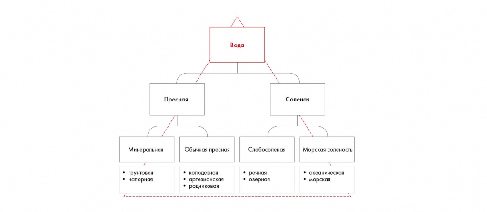
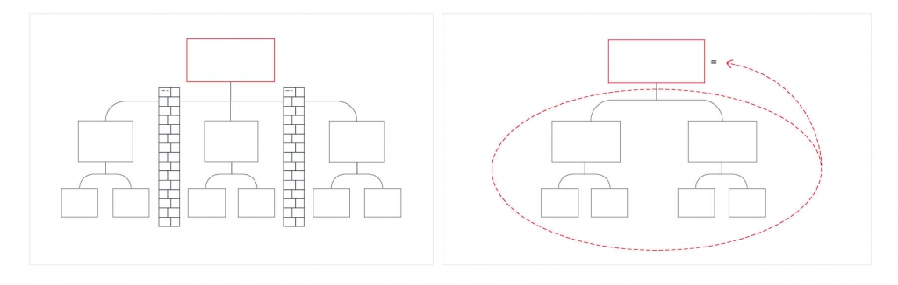
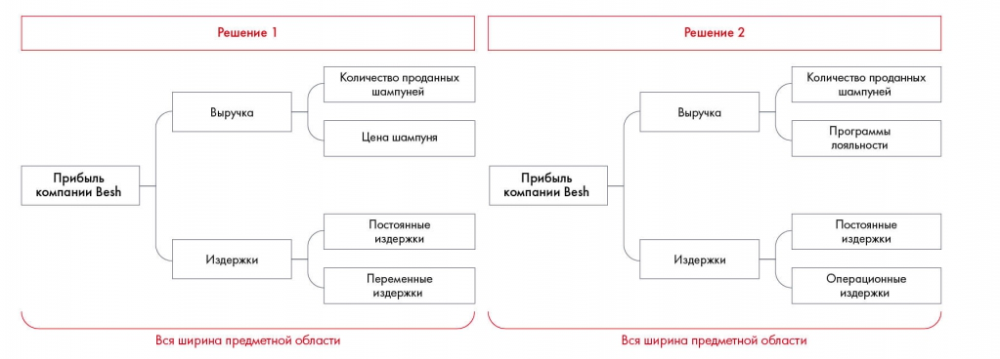
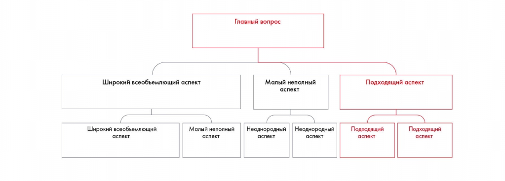
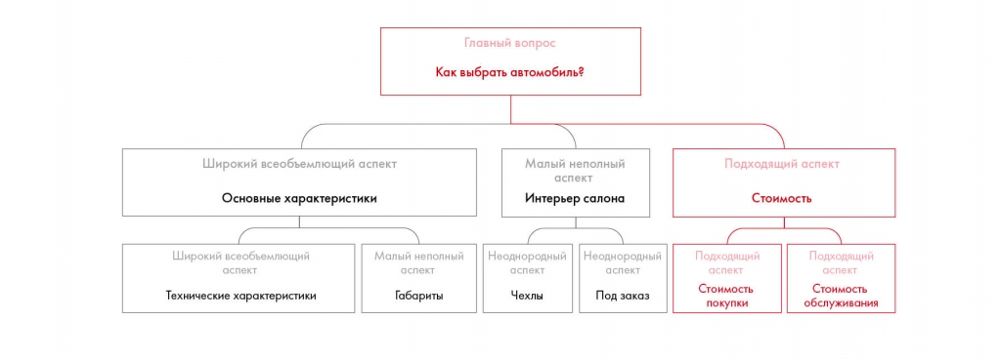
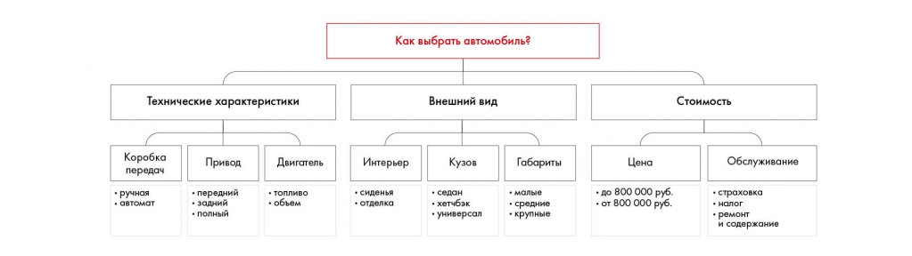
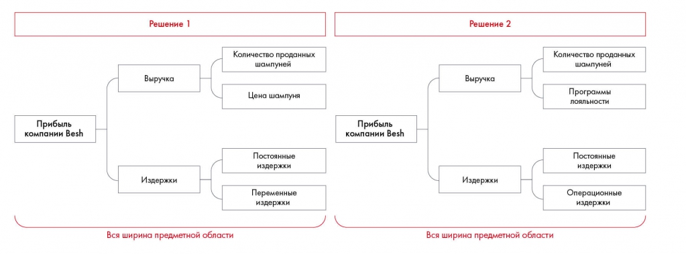

# Принцип пирамиды Минто и правило MECE

Разбираются уровни обобщения, полнота и непересечение ветвей. Примеры воды, прибыли и выбора автомобиля показывают ошибки и соразмерное деление.

**Источник:** физические страницы PDF 62–69. Печатные номера не установлены.

**Для последовательного чтения:** [Как построить структуру решения](01-structure.md).

**Навигация:** [Индекс главы](INDEX.md) · [Маршрутизатор](../../ROUTER.md) · [Проблемы источника](../../meta/issues.md).

---

## Источник: [PDF 62](../../SOURCE.md#pdf-062)

### Принцип пирамиды Минто

Принцип пирамиды Минто — залог развития структурного мышления

## Источник: [PDF 63](../../SOURCE.md#pdf-063)

Принцип пирамиды Минто появился как способ структурирования делового письма, то есть как инструмент, который позволяет преподнести информацию в удобном для восприятия виде. Почему это важно? Представьте, что вы пришли на конференцию. Спикер рассказывает, как много разных типов воды существует на планете Земля. Свои мысли он излагает в том порядке, в котором они возникают у него в голове:

«Люди постоянно путают пресную воду с соленой, а соленую — с пресной. Ни у кого не вызывает сомнения, что колодезная вода пресная, а морская соленая. Но стоит копнуть дальше, начинается неразбериха. Ошибочно называют речную воду пресной, хотя она относится к классу слабосоленой. И наоборот, попробовав минеральную воду, кричат: "Да она же соленая!"»

Что можно вынести из этого отрывка? Судя по всему, типов воды много, и в них легко запутаться. Возможно, вы даже вспомните, как называются несколько из них. Но полного представления о том, какие типы воды существуют и чем они отличаются, у вас не сложилось. Вы бы восприняли информацию лучше, если бы спикер с самого начала представил вам классификацию воды, структурированную по Минто:

Вода делится на пресную и солёную, затем на подвиды. Пример показывает отношение общего утверждения и более детальных элементов.

[Подробная текстовая расшифровка рисунка](../../assets/transcripts/pdf-063-img-01.md).

Принцип пирамиды основан на уровнях. Первый уровень — это главная идея. В нашем случае главной идеей будет то, что на планете Земля есть вода. Второй уровень дает общую детализацию главной идеи, разбивая ее на составляющие. Появляются два разветвления: вода бывает пресной и соленой. На следующем уровне каждый из этих факторов раскрывается еще детальнее. Пресная вода бывает минеральной и обычной пресной, а соленая

**Ссылки на этой странице исходника:** [Ссылка url-036](../../meta/source-links.md#url-036).

## Источник: [PDF 64](../../SOURCE.md#pdf-064)

— слабосоленой и с морской соленостью. Уровни пирамиды можно детализировать очень долго. Главное — придерживайтесь правила: более верхние уровни обобщают то, что расположено ниже.

На первый взгляд составление пирамиды может показаться простой задачей: детализируйте каждый следующий уровень как можно подробнее. На деле все оказывается сложнее. Чтобы построить пирамиду правильно, нужно следовать двум правилам: MECE и соразмерности элементов.

Правило МЕСЕ расшифровывается как Mutually Exclusive Collectively Exhaustive. В переводе с английского это означает, что ветви пирамиды должны быть взаимоисключающими (МЕ) и совместно исчерпывающими (СЕ). Что это значит?

Взаимоисключение означает, что утверждения одного уровня не повторяются и не дублируют друг друга. Нельзя допустить, чтобы факт о солоноватом вкусе минеральной воды попал в ветку «Соленая». Во-первых, это разрушит структуру деления воды на соленую и пресную. Во-вторых, информация о минеральной воде будет храниться сразу в двух ветках.

Совместное исчерпывание говорит о том, что информация со всех ветвей, собранная воедино, дает полную картину происходящего. Если рассматривать воду с точки зрения ее агрегатного состояния, деление только на жидкость и лед было бы неверным. Две ветки не дают полного описания состояний воды. Для исчерпывающей картины не хватает третьей ветви — пара.

Графическое объяснение MECE: совокупность групп должна покрывать рассматриваемое множество, при этом группы не должны пересекаться. Текстовых подписей на изображении нет.

[Подробная текстовая расшифровка рисунка](../../assets/transcripts/pdf-064-img-01.md).

Взаимоисключающие и совместно исчерпывающие элементы

**Ссылки на этой странице исходника:** [Ссылка url-037](../../meta/source-links.md#url-037).

## Источник: [PDF 65](../../SOURCE.md#pdf-065)

Представьте, что мы работаем над проблемой прибыльности компании Besh. Рассмотрим два примера детализации этой темы. Какое из них соответствует правилу MECE, а какое нет?

Сопоставлены два дерева прибыли Besh. Прибыль раскладывается на выручку и издержки; ошибка второго варианта состоит в пересечении операционных и постоянных издержек.

[Подробная текстовая расшифровка рисунка](../../assets/transcripts/pdf-065-img-01.md).

Два примера деления проблемы

В обоих примерах на втором уровне прибыльность исследуется в двух разрезах: выручки и издержек. Это деление соответствует правилу MECE, поскольку вместе эти два признака позволяют в полной мере исследовать прибыльность компании и не пересекаются друг с другом. Меры, которые вы предложите для увеличения прибыльности, будут направлены на одну из этих ветвей: либо увеличение выручки, либо снижение издержек.

На следующих уровнях деление различается. В первом варианте выручку предлагают исследовать через анализ количества проданных шампуней и цену шампуня, а издержки — через постоянные и переменные затраты. Эти элементы также не пересекаются и исключают друг друга: вам удастся либо увеличить число проданных единиц, либо повысить цены на продукт. Постоянные (то есть зависящие от объема производства) и переменные (зависящие от объема производства) затраты также не пересекаются. Третий вид затрат мы проанализировать не можем. Первое дерево соответствует правилу MECE.

Во втором варианте выручка анализируется через количество проданных шампуней и программы лояльности. Это деление не соответствует правилу MECE. Программы лояльности — это обычно часть стимулирования сбыта, то есть увеличения числа проданных продуктов. Здесь также отсутствует важная составляющая — цена продукта. Неверно и деление во второй ветви:

**Ссылки на этой странице исходника:** [Ссылка url-038](../../meta/source-links.md#url-038).

## Источник: [PDF 66](../../SOURCE.md#pdf-066)

операционные издержки пересекаются с постоянными, поскольку, например, оплата электричества на заводе, которая относится к постоянным издержкам, относится и к операционным. Следовательно, дерево не соответствует правилу MECE.

В реальных ситуациях следовать этому правилу непросто, поскольку вся информация, которую вы исследуете по проблеме, так или иначе взаимосвязана. При построении дерева одни и те же данные можно отнести к разным ветвям. В таком случае нужно абстрагироваться от этих связей и четко решить, что повторяющиеся элементы вы рассматриваете только в какой-то одной ветви. Иначе можно запутаться. Обычно такая проблема возникает на третьем-четвертом уровнях дерева и ниже. На первых уровнях, если вы строите пирамиду правильно, проблем с выполнением правила MECE быть не должно.

Второй принцип построения пирамиды — это правило соразмерных элементов. Оно заключается в том, что элементы одного уровня должны быть соизмеримы и однородны. Если не выполнять это правило, пирамида получится кособокой. Невозможно будет сравнивать между собой и оценивать разнородные блоки.

На рисунке приведены элементы: Главный вопрос; Широкий всеобъемлющий аспект; Малый неполный; аспект; Подходящий аспект. Полная текстовая расшифровка приведена отдельно; геометрия и цветовые обозначения сохранены на изображении.

[Подробная текстовая расшифровка рисунка](../../assets/transcripts/pdf-066-img-01.md).

Пирамида с неоднородными и несоразмерными элементами

Как это может выглядеть на примере? Вы хотите выбрать автомобиль, но не знаете, как его оценивать. Тогда вы разбиваете все возможные критерии на три направления: основные характеристики, интерьер салона и стоимость. Каждое из них вы детализируете по удобным параметрам.

## Источник: [PDF 67](../../SOURCE.md#pdf-067)

Иллюстрация исходника: «Пример несоразмерного и неоднородного деления ветвей». Подписи и числовые значения вынесены в расшифровку; порядок и связи элементов проверяются по сохранённому изображению.

[Подробная текстовая расшифровка рисунка](../../assets/transcripts/pdf-067-img-01.md).

Пример несоразмерного и неоднородного деления ветвей

При разбиении видно, что критерии выбора машины разделены несоразмерно. Интерьер салона обычно не так важен, как стоимость. Основные характеристики — слишком широкий аспект, который может включать все что угодно. Интерьер салона разбивается на две неоднородные ветви: чехлы и под заказ. Они не могут стоять на одном уровне. В зависимости от идеи разбиения один из блоков детализирует другой. В интерьере могут быть важны чехлы на сиденья и отделка приборной панели. И то и другое бывает стандартным или выполненным на заказ. Критерии можно разбить и по-другому. Например, в первую очередь вам важно, каким будет интерьер салона — сделанным под заказ или стандартным, а уже потом речь пойдет о том, из каких деталей он состоит. Пирамида получилась несоразмерной и неоднородной. Выдвинутые критерии нельзя объединить в группу: они слишком разные. При таком подходе легко забыть о важных параметрах: типе кузова, объеме двигателя, приводе.

Исправим ошибки и скорректируем пирамиду. Разобьем все критерии выбора на технические характеристики, внешний вид и стоимость. Теперь два автомобиля легко сравнивать между собой. Любителю высоких скоростей и маневренности будут интересны технические характеристики. Ценитель комфорта в первую очередь обратит внимание на внешний вид. И независимо от предпочтений все будут поглядывать на цену, собирая подходящую комплектацию.

**Ссылки на этой странице исходника:** [Ссылка url-039](../../meta/source-links.md#url-039).

## Источник: [PDF 68](../../SOURCE.md#pdf-068)

Пример однородного деления выбора автомобиля на технические характеристики и далее на сопоставимые параметры. Подветви уточняют коробку передач, привод и другие характеристики.

[Подробная текстовая расшифровка рисунка](../../assets/transcripts/pdf-068-img-01.md).

Пример соразмерного однородного деления ветвей

Ранее мы рассматривали два разбиения анализа прибыли. Одно разбиение не соответствовало правилу MECE. Соответствует ли оно правилу соразмерных элементов?

На рисунке приведены элементы: Решение 1; Количество проданных; шампуней; Выручка; Цена шампуня. Полная текстовая расшифровка приведена отдельно; геометрия и цветовые обозначения сохранены на изображении.

[Подробная текстовая расшифровка рисунка](../../assets/transcripts/pdf-068-img-02.md).

Соблюдение и несоблюдение правила соразмерных элементов

Как мы помним, первое дерево рассматривает решение проблемы выручки через влияние на количество проданных шампуней и на цену шампуня. Второе дерево разделяет задачу на количество проданных шампуней и программы лояльности. Однако программы лояльности — это только небольшая часть стимулирования сбыта, то есть мер, направленных на повышение количества проданных шампуней.

Таким образом, второе дерево не соответствует правилу соразмерных элементов. Первое же, напротив, отвечает ему: количество проданных шампуней и цена — равнозначные понятия. Точно так же, как постоянные и переменные издержки.

**Ссылки на этой странице исходника:** [Ссылка url-040](../../meta/source-links.md#url-040).

## Источник: [PDF 69](../../SOURCE.md#pdf-069)

## Связанные разделы

- [Все темы главы](INDEX.md)
- [Термины и сокращения](../../GLOSSARY.md)
- [Предыдущая тема: Как построить структуру решения](01-structure.md)
- [Следующая тема: Практическое задание 5.1: способы построения карьеры](exercises/01-career.md)
- [Авторские ответы по этой неделе](../13-answers/03-week-05.md)
