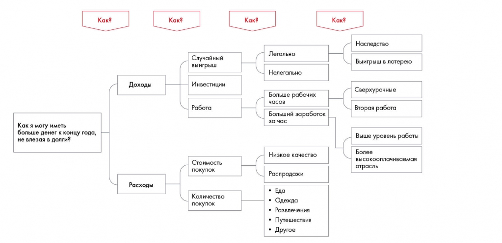
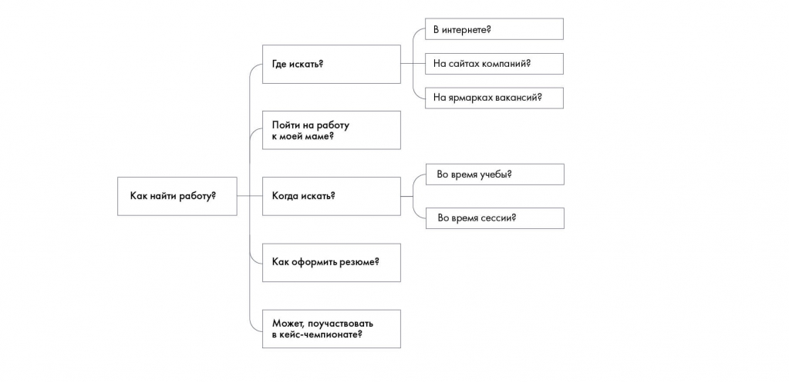
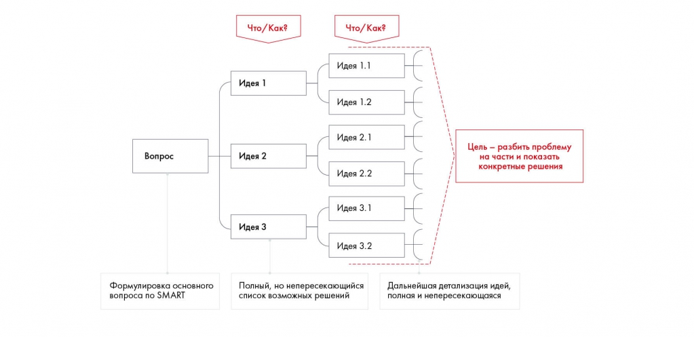

# Дерево решений (Issue Tree)

Показано, как разложить главный вопрос на подпроблемы. Сохранены пример личных финансов и упражнение 5.2 о поиске работы.

**Источник:** физические страницы PDF 69–72. Печатные номера не установлены.

**Для последовательного чтения:** [Практическое задание 5.1: способы построения карьеры](exercises/01-career.md).

**Навигация:** [Индекс главы](INDEX.md) · [Маршрутизатор](../../ROUTER.md) · [Проблемы источника](../../meta/issues.md).

---

## Источник: [PDF 69](../../SOURCE.md#pdf-069)

### Недели 4, 5 и 6. Структурирование и формирование гипотез

## Источник: [PDF 70](../../SOURCE.md#pdf-070)

### ДЕРЕВО РЕШЕНИЙ (ISSUE TREE)

Мы разобрались, как разбивать глобальную проблему на небольшие составляющие с помощью принципа пирамиды Минто. Но как это поможет выстроить решение кейса?

Существует частный случай пирамиды — дерево решений. Это способ упорядочить идеи по решению кейса в единую взаимосвязанную структуру. Так, на самой вершине пирамиды оказывается главный вопрос кейса, сформулированный по SMART. А ветви дерева растут с помощью уточняющих вопросов «Как это можно сделать?». Развивать дерево стоит до тех пор, пока мы не получим четкие способы решить проблему.

Иллюстрация исходника: «Пример дерева решений». Подписи и числовые значения вынесены в расшифровку; порядок и связи элементов проверяются по сохранённому изображению.

[Подробная текстовая расшифровка рисунка](../../assets/transcripts/pdf-070-img-01.md).

Пример дерева решений

Чтобы понять, как иметь на руках больше денег каждый месяц, пришлось четыре раза задать вопрос «Как?». Зато на четвертом уровне мы получили конкретные идеи. Можно выбрать комбинацию тех вариантов, которые подходят вашему образу жизни. Например, перейти работать в более высокооплачиваемую отрасль и покупать вещи только на распродажах.

Дерево решений помогает не упустить из виду ни одного варианта и показывает логику, по которой вы выбрали именно этот вариант, а не другой.

«После Летней школы Changellenge >> я привык рисовать дерево решений не только для кейсов, но и для повседневных задач. Это очень помогает в разных ситуациях,

**Ссылки на этой странице исходника:** [Ссылка url-041](../../meta/source-links.md#url-041).

## Источник: [PDF 71](../../SOURCE.md#pdf-071)

начиная с решения математических задач и заканчивая подготовкой к переговорам. Кстати, выражаясь языком математики, ваше решение должно быть конечным и полным — это и есть правило MECE».

**Сергей Демьяненко, полуфиналист Changellenge >> Cup Moscow**

### Практическое задание № 5.2

Рассмотрите дерево тем. Как его можно улучшить с точки зрения правил, рассмотренных выше?

На рисунке приведены элементы: Как найти работу?; Где искать?; Пойти на работу; к моей маме?; Когда искать?. Полная текстовая расшифровка приведена отдельно; геометрия и цветовые обозначения сохранены на изображении.

[Подробная текстовая расшифровка рисунка](../../assets/transcripts/pdf-071-img-02.md).

Попробуем составить дерево решений из тех идей, который мы собрали по итогам мозгового штурма по кейсу Besh. Составляйте дерево так, чтобы ветви были МЕСЕ, соизмеримы и однородны.

Если вы будете следовать всем правилам построения issue tree, то заметите: чтобы дерево стало однородным, его придется дополнять новыми идеями. Это помогает восполнить мысли и предложения, упущенные во время брейнсторма.

**Ссылки на этой странице исходника:** [Ссылка url-012](../../meta/source-links.md#url-012); [Ссылка url-042](../../meta/source-links.md#url-042).

## Источник: [PDF 72](../../SOURCE.md#pdf-072)

На рисунке приведены элементы: Что / Как?; Что/Как?; Идея 1.1; Идея 1; Идея 1.2. Полная текстовая расшифровка приведена отдельно; геометрия и цветовые обозначения сохранены на изображении.

[Подробная текстовая расшифровка рисунка](../../assets/transcripts/pdf-072-img-01.md).

## Связанные разделы

- [Все темы главы](INDEX.md)
- [Термины и сокращения](../../GLOSSARY.md)
- [Предыдущая тема: Практическое задание 5.1: способы построения карьеры](exercises/01-career.md)
- [Следующая тема: Кейс Besh: как идеи формируются в пирамиду](examples/01-besh-tree.md)
- [Авторские ответы по этой неделе](../13-answers/03-week-05.md)
