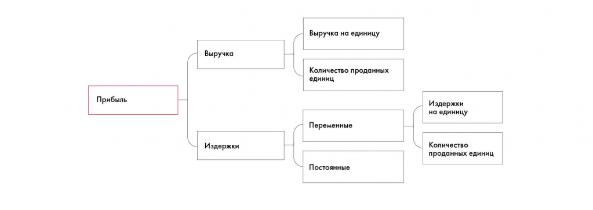
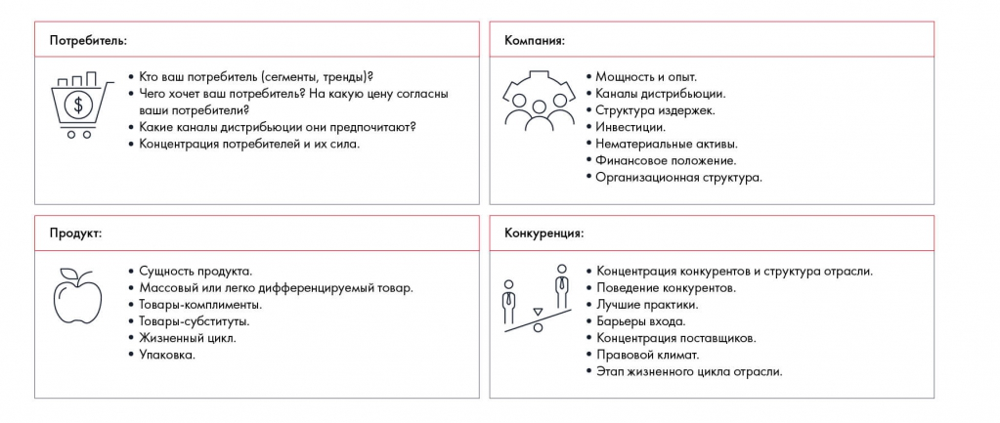

# Фреймворки для общего разбора задачи

Объясняется назначение и ограниченность готовых моделей. Разбираются дерево прибыли, общие блоки бизнеса и переход к анализу среды.

**Источник:** физические страницы PDF 74–77. Печатные номера не установлены.

**Для последовательного чтения:** [Кейс Besh: как идеи формируются в пирамиду](examples/01-besh-tree.md).

**Навигация:** [Индекс главы](INDEX.md) · [Маршрутизатор](../../ROUTER.md) · [Проблемы источника](../../meta/issues.md).

---

## Источник: [PDF 74](../../SOURCE.md#pdf-074)

### Недели 4, 5 и 6. Структурирование и формирование

### гипотез

### Фреймворки

Если не знаете, с чего начать структурирование, воспользуйтесь уже готовыми подходами. Есть четыре инструмента, которые помогут разложить задачу по принципу пирамиды Минто:

Математические формулы: прибыль = доход – расходы, прибыль = объем рынка × доля рынка × прибыльность и т. д.

Проверенная структура: отчет о прибыли и убытках, оргструктура организации.

Шаблоны деревьев решений, часто используемые консультантами.

**Ссылки на этой странице исходника:** [Ссылка url-043](../../meta/source-links.md#url-043).

## Источник: [PDF 75](../../SOURCE.md#pdf-075)

Ваши собственные структуры, которые, возможно, лучше подойдут в конкретной ситуации.

Готовые шаблоны и инструменты (они же frameworks, или фреймворки) — отличный способ облегчить структурирование задачи. Скорее всего, ни один кейс не получится целиком уместить в рамки фреймворка, но они могут дать вам пищу для размышлений, если вы зашли в тупик.

Ниже приводим некоторые фреймворки, которые могут здорово помочь вам в решении кейса:

· Profitability Framework;

· Business Situation Framework;

· SPECIAL-T;

· Marketing Mix (5P или 4P);

· Матрица BCG;

· SWOT-анализ;

· 3C или 4С;

· 5 сил Портера;

· PEST;

· Value chain.

Каждый из них мы разберем подробнее в следующих разделах.

**Фреймворки для общего разбора задачи**

Следующие инструменты хорошо помогают на первых этапах работы над задачей, когда у вас мало информации о компании и ее проблеме.

## Источник: [PDF 76](../../SOURCE.md#pdf-076)

Profitability Framework, пожалуй, самый простой шаблон. Он используется для решения кейсов на увеличение прибыли. Его идея в том, что проблему прибыльности нужно рассматривать в разрезе двух величин: выручки и издержек.

Увеличить выручку можно двумя способами: через выручку на единицу продукции и через количество проданных единиц. Все товары можно разбить на группы по типу продукта, каналам продаж, регионам, целевой аудитории, ценовому сегменту и так далее. Ищите данные для каждого сегмента, пока не найдете источник проблемы. Обнаружив проблему, выясните, почему она возникла, — так вы получите решение.

Аналогично затраты в целом можно сократить через снижение постоянных либо переменных издержек. Здесь продаваемые товары тоже можно разбить на категории, например по расположению производства, его сложности и т. д. Также стоит рассмотреть разные этапы цепочки поставок.

На рисунке приведены элементы: Прибыль; Выручка; Издержки; Выручка на единицу; Количество проданных. Полная текстовая расшифровка приведена отдельно; геометрия и цветовые обозначения сохранены на изображении.

[Подробная текстовая расшифровка рисунка](../../assets/transcripts/pdf-076-img-01.md).

Profitability Framework

Business Situation Framework придумал Виктор Ченг[1] — экс-консультант McKinsey & Company. Его можно использовать в таких ситуациях, как выход на новый рынок, запуск продукта или его доработка, разработка стратегии роста, изменение позиционирования. Фреймворк позволяет рассмотреть четыре составляющие бизнеса: потребителя, саму компанию, ее продукт и конкурентов. Такой анализ помогает найти источники роста.

**Ссылки на этой странице исходника:** [Ссылка url-044](../../meta/source-links.md#url-044); [Ссылка url-045](../../meta/source-links.md#url-045).

## Источник: [PDF 77](../../SOURCE.md#pdf-077)

Иллюстрация исходника: «Подход Business Situation Framework». Подписи и числовые значения вынесены в расшифровку; порядок и связи элементов проверяются по сохранённому изображению.

[Подробная текстовая расшифровка рисунка](../../assets/transcripts/pdf-077-img-01.md).

Подход Business Situation Framework

**Ссылки на этой странице исходника:** [Ссылка url-046](../../meta/source-links.md#url-046); [Ссылка url-047](../../meta/source-links.md#url-047).

## Связанные разделы

- [Все темы главы](INDEX.md)
- [Термины и сокращения](../../GLOSSARY.md)
- [Предыдущая тема: Кейс Besh: как идеи формируются в пирамиду](examples/01-besh-tree.md)
- [Следующая тема: Оценка внутренней и внешней среды](05-environment.md)
- [Авторские ответы по этой неделе](../13-answers/03-week-05.md)
