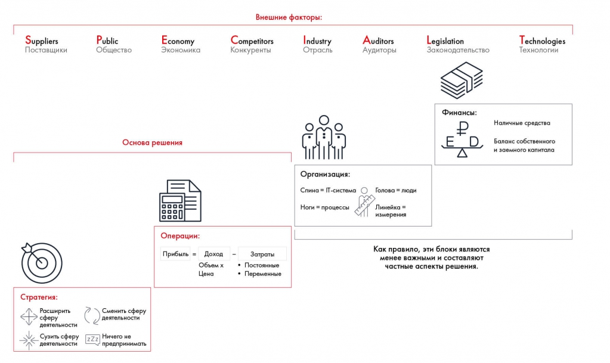
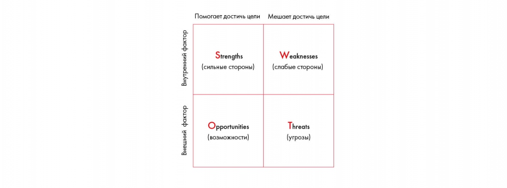
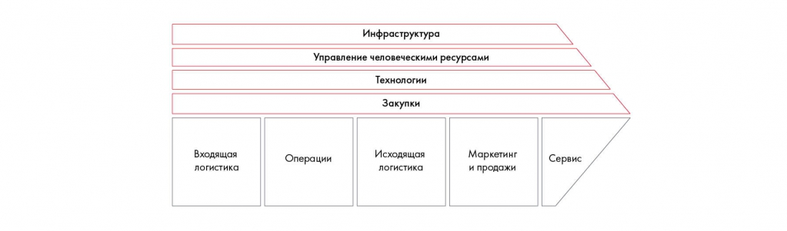

# Оценка внутренней и внешней среды

Разбираются MVM, пять сил Портера, PEST, SWOT и цепочка создания ценности. Упражнение 5.3 предлагает применить эти модели к трём рынкам и компаниям.

**Источник:** физические страницы PDF 77–82. Печатные номера не установлены.

**Для последовательного чтения:** [Фреймворки для общего разбора задачи](04-frameworks-overview.md).

**Навигация:** [Индекс главы](INDEX.md) · [Маршрутизатор](../../ROUTER.md) · [Проблемы источника](../../meta/issues.md).

---

## Источник: [PDF 77](../../SOURCE.md#pdf-077)

**Оценка внутренней и внешней среды**

В некоторых случаях для решения кейса нужно оценить перспективы нового рынка, внешнюю среду, конкурентные преимущества компании, ее сильные и слабые места. Следующие фреймворки помогут вам в этом.

**Фреймворк MVM™ (Maximum Value Model, или модель максимальной**

ценности) был изложен в знаменитой книге Crack the Case[2], которую написал бывший консультант Bain & Company Дэвид Орвал. Согласно MVM™ ценность компании складывается из пяти составляющих: стратегии, операционной составляющей, организации и управления, финансов и внешней среды. Во время кейс-интервью кандидатам как раз предлагают проанализировать один из этих аспектов.

Стратегия в данной модели — это способ получить максимум ценности, используя ограниченные ресурсы. Стратегия влияет на бизнес глобально. Фреймворк предлагает четыре варианта стратегии: расширить сферу деятельности, сменить сферу деятельности, сузить сферу деятельности, ничего не предпринимать.

Операции — то, с помощью чего компания может оптимизировать процессы изнутри. Здесь можно воздействовать на бизнес точечно, используя подход Profitability Framework: увеличить выручку через объем производства или цену продукта, снизить затраты через воздействие на постоянные или переменные издержки.

**Ссылки на этой странице исходника:** [Ссылка url-046](../../meta/source-links.md#url-046); [Ссылка url-047](../../meta/source-links.md#url-047).

## Источник: [PDF 78](../../SOURCE.md#pdf-078)

Организация — это возможность изменить оргструктуру и бизнес-процессы и таким образом положительно повлиять на ценность компании.

Финансы — в этом блоке ценность компании можно повысить через воздействие на структуру капитала и другие финансовые показатели.

Во внешней среде на компанию могут влиять восемь параметров, которые объединяются под аббревиатурой SPECIAL-T: Suppliers (поставщики), Public (общество), Competitors (конкуренты), Industry (отрасль), Auditors (аудиторы), Legislation (законодательство), Technologies (технологии). Каждая из этих сил может повлиять на четыре другие составляющие. Например, в обществе с высокой социальной ответственностью (Public) производственное предприятие может оказаться под давлением из-за отрицательного воздействия на окружающую среду, из-за чего придется менять стратегию с учетом корпоративной социальной ответственности. А действия аудиторов (Auditors)

— всех лиц, которые имеют доступ к подробной отчетности и заинтересованы в том, чтобы компания вела дела чисто, — могут увеличить затраты на персонал. Сотрудникам придется тратить больше рабочего времени на то, чтобы исключить огрехи отчетности.

Иллюстрация исходника: «Подход MVM™». Подписи и числовые значения вынесены в расшифровку; порядок и связи элементов проверяются по сохранённому изображению.

[Подробная текстовая расшифровка рисунка](../../assets/transcripts/pdf-078-img-01.md).

Подход MVM™

Пять сил Портера — фреймворк, разработанный профессором менеджмента Майклом Портером[3], который служит для анализа отрасли и построения стратегии. Именно на этом фреймворке основан Business Situation Framework.

**Ссылки на этой странице исходника:** [Ссылка url-048](../../meta/source-links.md#url-048).

## Источник: [PDF 79](../../SOURCE.md#pdf-079)

В пять сил Портера входят:

Угроза появления товаров-заменителей, на которые могут переключиться потребители, если цена вашего продукта вырастет.

Угроза появления новых игроков. Здесь основную роль играют барьеры входа и выхода, имеющиеся в отрасли. Например, кафе или ларек открыть легко, поэтому здесь высок риск появления новых игроков. В нефтегазовой отрасли, наоборот, начать бизнес крайне сложно и угроза возникновения новых компаний невелика. Но и выйти из этого бизнеса в случае неудачи будет непросто: придется распродавать много дорогих неликвидных активов (например, оборудование).

Рыночная власть поставщиков. Если в индустрии действует поставщик-монополист, он может неограниченно повышать цены на свои продукты. Связавшись с ним, вы рискуете нести большие издержки. Кроме того, сменить выбранного однажды поставщика тоже может оказаться сложным и дорогим делом.

Рыночная власть потребителей. Когда на рынке много предложений, а издержки переключения на другую продукцию невысоки, потребители будут очень чувствительны к изменению цены. Чем легче они готовы сменить предпочтения, тем выше их рыночная власть.

Уровень конкурентной борьбы на рынке — это число компаний, с которыми вы боретесь за потребителей, и динамика роста рынка.

Анализ пяти сил Портера помогает определить цену на продукт или принять решение о выходе на новый рынок. Например, на первый взгляд решение открыть кафе рядом с университетом может показаться выгодным: вокруг много студентов, которые будут заходить к вам перекусить. Но изучив отрасль, вы поймете, что у этого решения есть недостатки: во-первых, слишком большая конкуренция (если университет находится в центре города или районе с хорошей инфраструктурой), во-вторых, во всех вузах есть дешевые столовые, которые служат студентам заменителями кафе и ресторанов.

## Источник: [PDF 80](../../SOURCE.md#pdf-080)

PEST — это фреймворк для оценки внешней среды, в которой работает компания. В рамках него рассматривают четыре группы факторов:

Политические (Political) — законодательство, государственное регулирование отрасли, конкуренция.

Экономические (Economic) — ВВП, доходы населения, покупательная способность, уровень занятости, курсы валют, инфляция.

Социальные (Social) — базовые ценности, отношение к труду и отдыху, демография, религия и культура.

Технологические (Technical) — тенденции, патенты, уровень развития технологий.

Иногда в расширенном формате анализа (PESTLE) к этим четырем группам добавляются правовые (Legal) и экологические (Environmental) факторы.

SWOT — распространенный фреймворк, который включает в себя анализ компании по четырем направлениям: сильные стороны (Strengths), слабые стороны (Weaknesses), возможности (Opportunities) и угрозы (Threats). Подходит для оценки текущей ситуации в компании и определения возможных стратегий. Чуть реже используется расширенный SWOT-анализ, в котором разные части фреймворка объединяют для разработки новых тактик: сильные стороны используют для устранения угроз, а слабые нивелируют с помощью возможностей.

Матрица SWOT разделяет внутренние и внешние факторы, а также помогающие и мешающие достижению цели. В четырёх ячейках находятся Strengths, Weaknesses, Opportunities, Threats.

[Подробная текстовая расшифровка рисунка](../../assets/transcripts/pdf-080-img-01.md).

**Ссылки на этой странице исходника:** [Ссылка url-049](../../meta/source-links.md#url-049).

## Источник: [PDF 81](../../SOURCE.md#pdf-081)

SWOT-анализ обычно визуализируют в форме квадрата, в каждом секторе которого прописываются части фреймворка

**Цепочка создания ценности (value chain) –– это фреймворк, который**

используется для выявления конкурентных преимуществ компании на разных этапах производства. В рамках этого инструмента рассматривают два вида процессов: основные и вспомогательные. В основные входят:

- Входящая логистика — прием и хранение материальных ресурсов, управление поставками.

- Операции — все виды деятельности, которые нужны для превращения входящих ресурсов в готовый продукт: производство, упаковка, сборка, проверка качества.

- Исходящая логистика — транспортировка готовой продукции, путь к покупателю.

- Маркетинг и продажи — меры по информированию покупателя и подготовке к покупке.

- Сервис — постпродажное обслуживание, сохранение ценности товара для покупателя.

Вспомогательные процессы не влияют непосредственно на качество продукта и не взаимодействуют с клиентами, но выполняют поддерживающую функцию по отношению к основным видам деятельности. К вспомогательным относятся внутренние процессы: закупки, технологии, управление человеческими ресурсами, инфраструктура (бухгалтерский учет, финансы, контроль качества, стратегический менеджмент).

Цепочка создания ценности связывает входящую логистику, операции, исходящую логистику, маркетинг, продажи и обслуживание. Инфраструктура, HR, технологии и закупки поддерживают основные действия.

[Подробная текстовая расшифровка рисунка](../../assets/transcripts/pdf-081-img-01.md).

**Ссылки на этой странице исходника:** [Ссылка url-050](../../meta/source-links.md#url-050).

## Источник: [PDF 82](../../SOURCE.md#pdf-082)

Цепочка создания ценности

**Практическое задание № 5.3**

Проанализируйте следующие сферы с использованием фреймворков:

1. Рынок авиалиний в России с точки зрения пяти сил Портера.

2. Рынок высшего образования в Великобритании по PEST.

3. Компанию Danone в России по SWOT.

**Ссылки на этой странице исходника:** [Ссылка url-051](../../meta/source-links.md#url-051).

## Связанные разделы

- [Все темы главы](INDEX.md)
- [Термины и сокращения](../../GLOSSARY.md)
- [Предыдущая тема: Фреймворки для общего разбора задачи](04-frameworks-overview.md)
- [Следующая тема: Оценка продукта и выбор стратегии](06-product-strategy.md)
- [Авторские ответы по этой неделе](../13-answers/03-week-05.md)
