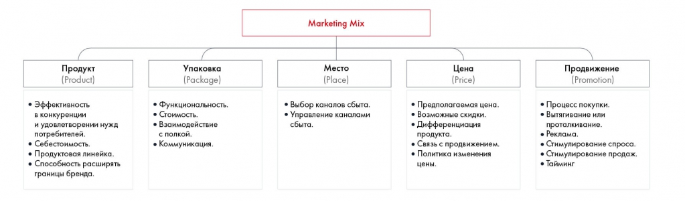

# Оценка продукта и выбор стратегии

Рассматриваются Marketing Mix и модель 3C. Сохранены вопросы к блокам моделей и практическое задание 5.4.

**Источник:** физические страницы PDF 82–86. Печатные номера не установлены.

**Для последовательного чтения:** [Оценка внутренней и внешней среды](05-environment.md).

**Навигация:** [Индекс главы](INDEX.md) · [Маршрутизатор](../../ROUTER.md) · [Проблемы источника](../../meta/issues.md).

---

## Источник: [PDF 82](../../SOURCE.md#pdf-082)

**Оценка продукта**

Marketing Mix (или 5P) подходит для маркетинговых кейсов по решению любых проблем, связанных с продуктом: разработка, вывод на рынок и так далее. Этот фреймворк рассматривает 5P: продукт (product), упаковку (package), место (place), цену (price) и продвижение (promotion).

На рисунке приведены элементы: Продукт; (Product); • Эффективность; в конкуренции; и удовлетворении нужд. Полная текстовая расшифровка приведена отдельно; геометрия и цветовые обозначения сохранены на изображении.

[Подробная текстовая расшифровка рисунка](../../assets/transcripts/pdf-082-img-02.md).

Модель Marketing Mix

Часто в эту модель добавляются другие P:

- People (люди) — ключевые клиенты и лидеры мнений, помогающие продвигать продукт.

- Process (процесс) — процесс взаимодействия между потребителем и компанией.

**Ссылки на этой странице исходника:** [Ссылка url-051](../../meta/source-links.md#url-051).

## Источник: [PDF 83](../../SOURCE.md#pdf-083)

**- Physical Evidence (физическое окружение) — офис компании,**

обстановка в номерах в отеле.

Матрица BCG[4] –– фреймворк, который оценивает потенциал прибыли и роста для товаров, категорий, брендов и других бизнес-единиц. Матрица представляет собой две оси, а все объекты оцениваются по двум параметрам: темпы роста и относительная доля рынка[5].

В зависимости от значений они относятся к одному из четырех типов:

- Дойные коровы — высокая доля рынка, низкие темпы роста. Оптимальная стратегия — продолжать получать от них прибыль при минимальных инвестициях.

- Звезды — высокая доля рынка, высокие темпы роста. Потенциально могут стать дойными коровами, когда темп роста замедлится. Оптимальная стратегия — инвестировать в них, чтобы подавлять конкурентов и поддерживать высокую долю рынка.

- Знаки вопроса (трудные дети) — низкая доля рынка, высокие темпы роста. Потенциально могут стать звездами. Оптимальная стратегия — провести анализ, чтобы понять, стоит ли вкладывать в них значительные средства.

- Собаки (хромые утки) — низкая доля рынка, низкие темпы роста. Оптимальная стратегия — продать бренд/категорию или прекратить производство продукта.

Матрица BCG

**Выбор стратегии**

**Модель 3С (Customer, Competition, Corporation) — это фреймворк, который**

отличается от других. Он не помогает анализировать данные, а предлагает готовые рекомендации для корректировки стратегий по каждой из трех C.

**Ссылки на этой странице исходника:** [Ссылка url-052](../../meta/source-links.md#url-052); [Ссылка url-053](../../meta/source-links.md#url-053); [Ссылка url-054](../../meta/source-links.md#url-054).

## Источник: [PDF 84](../../SOURCE.md#pdf-084)

**Corporation**

Корпоративные стратегии максимизируют преимущества бизнеса по отношению к конкурентам в функциональных областях, которые важны для достижения успеха в отрасли. Как можно скорректировать корпоративную стратегию:

1. Сконцентрироваться на достижении преимущества в одной ведущей функции — второстепенные функции в результате тоже улучшатся.

2. Решить вопрос о передаче части производственного процесса подрядчику или наоборот.

3. Увеличить эффективность затрат. Например, совместив определенную функцию с другими подразделениями корпорации или даже с другими компаниями.

**Customer**

Клиентоориентированные стратегии призваны повысить привлекательность продукта компании для покупателей, а значит, и инвесторов в долгосрочной перспективе. Здесь важнее всего правильно сегментировать рынок. Это позволит сконцентрировать усилия на определенных группах клиентов. Как можно повлиять на клиентоориентированную стратегию:

1. Дифференцировать потребителей в зависимости от того, как они используют продукты компании.

2. Найти компромисс между затратами на маркетинг и охватом рынка.

3. Пересмотреть принятую сегментацию рынка так, чтобы новая версия отличалась от стратегической сегментации прямого конкурента.

**Competition**

## Источник: [PDF 85](../../SOURCE.md#pdf-085)

Стратегии, направленные на конкурентов, фокусируются в первую очередь на поиске различий во всех корпоративных функциях — от закупки и разработки до продаж и обслуживания. Как усилить конкурентную стратегию:

1. Сыграть на имидже.

2. Извлечь выгоду из разницы в структуре дохода и издержек.

3. Использовать реальные функциональные преимущества.

**Практическое задание № 5.4**

Определите, какие фреймворки лучше всего подходят для решения этих проблем:

1. Компания — производитель косметики хочет понять, как распределить инвестиции между своими брендами в ближайшие 5 лет.

2. Нефтегазовый гигант планирует открыть новое месторождение и хочет узнать, насколько это целесообразно.

3. Компания, производящая автомобили, столкнулась с тем, что ее продажи перестали расти. При этом рост рынка продолжается.

4. Компания — стартап по производству компактных кондиционеров собирается вывести свой продукт на рынок США и думает, как лучше это сделать.

5. Фирма — производитель ноутбуков выбирает, на какой рынок ей выйти: смартфонов, принтеров или телевизоров.

Применение фреймворков сильно облегчает разбиение задачи на подзадачи, но каждый кейс индивидуален. Слепое следование фреймворкам убивает оригинальность решения. Кроме того, не забывайте, что можно создавать собственные фреймворки или дорабатывать уже существующие.

[1] Cheng, V. Look over my shoulder.

**Ссылки на этой странице исходника:** [Ссылка url-055](../../meta/source-links.md#url-055).

## Источник: [PDF 86](../../SOURCE.md#pdf-086)

[2] Ohrvall, D. (2007). Crack the case. Naperville, IL: Turtle Hare Media.

[3] Porter, M. E. (2008). The five competitive forces that shape strategy. Harvard business review, 86(1), 25–40.

[4] Henderson, B. (2017). The Product Portfolio. www.bcgperspectives.com. Retrieved 29 November 2017, from https://www.bcgperspectives.com/content/classics/strategy_the_product_portfol io/.

[5] Доля относительно лидера рынка. Если товар лидирует на рынке, то оценивается доля

**Ссылки на этой странице исходника:** [Ссылка url-056](../../meta/source-links.md#url-056); [Ссылка url-057](../../meta/source-links.md#url-057); [Ссылка url-058](../../meta/source-links.md#url-058); [Ссылка url-059](../../meta/source-links.md#url-059); [Ссылка url-060](../../meta/source-links.md#url-060); [Ссылка url-061](../../meta/source-links.md#url-061).

## Связанные разделы

- [Все темы главы](INDEX.md)
- [Термины и сокращения](../../GLOSSARY.md)
- [Предыдущая тема: Оценка внутренней и внешней среды](05-environment.md)
- [Следующая тема: Как правильно формулировать гипотезы](07-hypotheses.md)
- [Авторские ответы по этой неделе](../13-answers/03-week-05.md)
