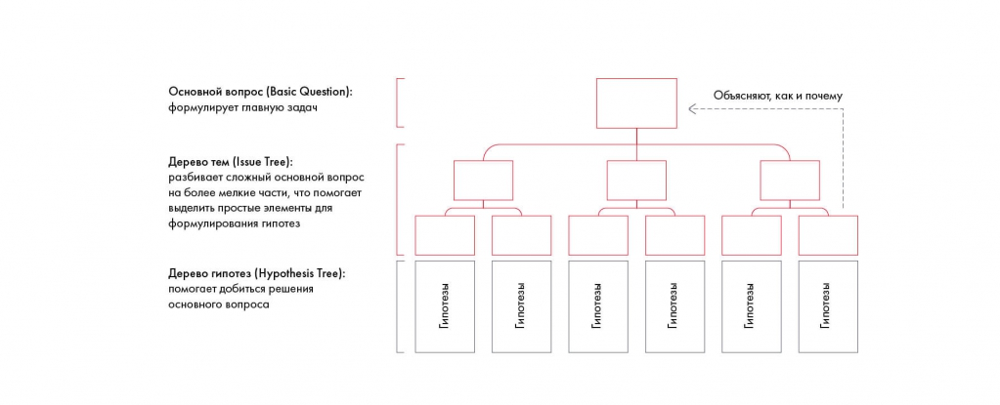
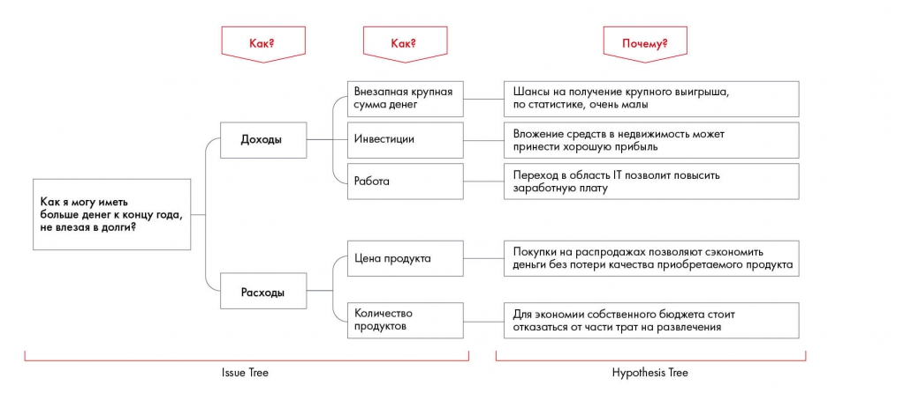
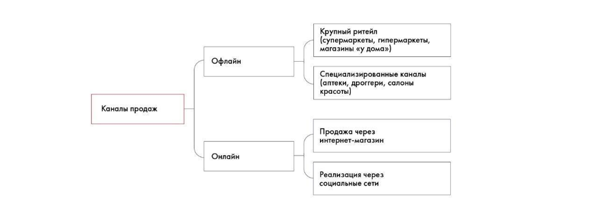
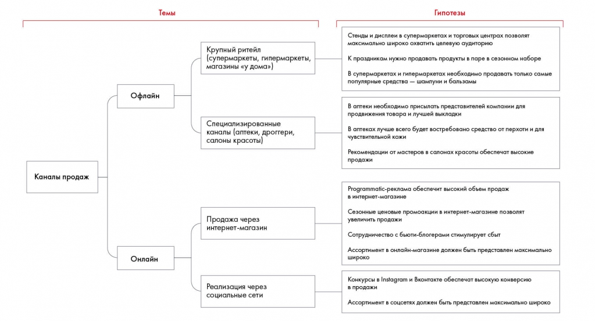
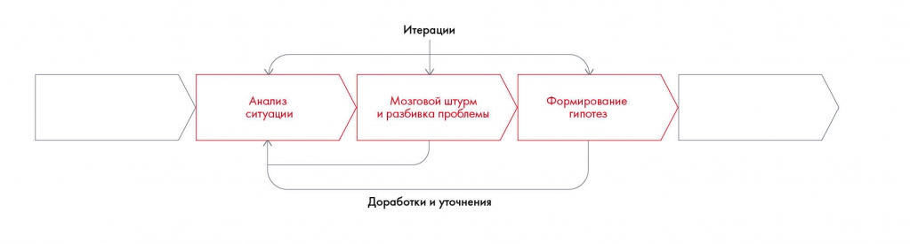

# Как правильно формулировать гипотезы

Показана связь основного вопроса, дерева тем и проверяемых предположений. Разбираются признаки хорошей гипотезы, упражнения 5.5–5.6 и самопроверка.

**Источник:** физические страницы PDF 86–91. Печатные номера не установлены.

**Для последовательного чтения:** [Оценка продукта и выбор стратегии](06-product-strategy.md).

**Навигация:** [Индекс главы](INDEX.md) · [Маршрутизатор](../../ROUTER.md) · [Проблемы источника](../../meta/issues.md).

---

## Источник: [PDF 86](../../SOURCE.md#pdf-086)

### Недели 4, 5 и 6. Структурирование и формирование

### гипотез

### КАК ПРАВИЛЬНО ФОРМУЛИРОВАТЬ

### ГИПОТЕЗЫ

Когда вы структурировали проблему достаточно глубоко, пора переходить к формулированию гипотез, то есть предположений о том, как можно решить поставленную задачу. Гипотезы являются продолжением каждой ветви дерева и отвечают на вопрос «Почему именно такое решение?». Дерево, содержащее одновременно и решения, и гипотезы, называется комбинированным.

**Ссылки на этой странице исходника:** [Ссылка url-056](../../meta/source-links.md#url-056); [Ссылка url-057](../../meta/source-links.md#url-057); [Ссылка url-058](../../meta/source-links.md#url-058); [Ссылка url-059](../../meta/source-links.md#url-059); [Ссылка url-060](../../meta/source-links.md#url-060); [Ссылка url-061](../../meta/source-links.md#url-061).

## Источник: [PDF 87](../../SOURCE.md#pdf-087)

На рисунке приведены элементы: Основной вопрос (Basic Question):; формулирует главную задач; Дерево тем (Issue Tree):; разбивает сложный основной вопрос; на более мелкие части, что помогает. Полная текстовая расшифровка приведена отдельно; геометрия и цветовые обозначения сохранены на изображении.

[Подробная текстовая расшифровка рисунка](../../assets/transcripts/pdf-087-img-01.md).

Комбинированное дерево решений с гипотезами

Вернемся к дереву решений о сохранении денег к концу месяца. Добавим к каждому способу наше предположение, почему эта мера поможет либо окажется бесполезной в борьбе с нашей проблемой.

Иллюстрация исходника: «Пример комбинированного дерева решений с гипотезами». Подписи и числовые значения вынесены в расшифровку; порядок и связи элементов проверяются по сохранённому изображению.

[Подробная текстовая расшифровка рисунка](../../assets/transcripts/pdf-087-img-02.md).

Пример комбинированного дерева решений с гипотезами

Не бойтесь выдвигать гипотезы. Они могут оказаться верными или нет. В дальнейшем мы это обязательно проверим. А сейчас основная задача — создать четкие формулировки.

**Ссылки на этой странице исходника:** [Ссылка url-062](../../meta/source-links.md#url-062); [Ссылка url-063](../../meta/source-links.md#url-063).

## Источник: [PDF 88](../../SOURCE.md#pdf-088)

Как отличить хорошую гипотезу от плохой? Главный критерий — хорошая гипотеза должна быть конкретной и давать ответ на вопрос кейса. Ваши гипотезы по кейсу должны охватывать все важные для решения факторы. Хорошую гипотезу можно измерить и протестировать, подтвердить рядом совместно исчерпывающих и взаимно исключающих утверждений. Например, мы выдвигаем по кейсу Besh гипотезу «Установка дисплеев в гипермаркетах позволит увеличить продажи новой линейки в рамках заданного бюджета». Это конкретный шаг, для обоснования которого нам понадобятся данные: оценка потенциального ROI[1], исследования по теме и т. д. Плохая гипотеза — это либо абстрактное утверждение, которое нельзя протестировать и опровергнуть, либо настолько очевидная мысль, что нет смысла тратить время на ее отработку. Пример плохой гипотезы: «Маркетинговые меры позволят увеличить продажи». Понятно, что позволят, но какие именно меры? А вдруг они будут настолько дороги, что увеличение продаж обернется убытком?

**Практическое задание № 5.5**

Телекоммуникационная компания теряет долю рынка. Выберите корректно сформулированную гипотезу:

1. Если провести сокращение персонала, можно добиться более высокой маржинальности.

2. Нужно перейти на гибкие тарифы, так как остальные конкуренты уже перешли на эту модель.

3. Более активные маркетинговые меры помогут увеличить выручку.

4. Увеличение доли рынка требует затрат.

**Ссылки на этой странице исходника:** [Ссылка url-064](../../meta/source-links.md#url-064).

## Источник: [PDF 89](../../SOURCE.md#pdf-089)

**Практическое задание № 5.6**

Дмитрий снимает двухкомнатную квартиру в Беляево — спальном районе на юго-западе Москвы. В последнее время он заметил, что отдает за съем квартиры и коммунальные услуги ровно половину своего дохода. Дмитрий задумался, как можно сэкономить на проживании в съемной квартире, не меняя ее и не съезжая. Постройте комбинированное дерево решений и гипотез, чтобы показать возможные способы.

Вернемся к кейсу Besh. На этом этапе нам необходимо выдвинуть гипотезы по маркетинговым мерам и продуктам для каждого канала продаж, отталкиваясь от существующей структуры и идей, которые мы высказали ранее.

Напомним задачу кейса:

Увеличить продажи компании Besh на 30 % за ближайший год за счет запуска нового продукта, выявив релевантные каналы продаж и проведя трейд-маркетинговые активности с учетом целевой аудитории и ценового сегмента.

Попробуйте выдвинуть несколько гипотез, опираясь на правила:

На рисунке приведены элементы: Каналы продаж; Офлайн; Онлайн; рупный ритейл; супермаркеты, гипермаркеты. Полная текстовая расшифровка приведена отдельно; геометрия и цветовые обозначения сохранены на изображении.

[Подробная текстовая расшифровка рисунка](../../assets/transcripts/pdf-089-img-02.md).

А вот какие гипотезы выдвинули мы исходя из личного опыта, интуиции и анализа разных маркетинговых мер. В дальнейшем, возможно, многие гипотезы придется отсечь, заменить другими или детализировать.

**Ссылки на этой странице исходника:** [Ссылка url-065](../../meta/source-links.md#url-065).

## Источник: [PDF 90](../../SOURCE.md#pdf-090)

На рисунке приведены элементы: Каналы продаж; Темы; Крупный ритейл; (супермаркеты, гипермаркеты,; магазины «у дома»). Полная текстовая расшифровка приведена отдельно; геометрия и цветовые обозначения сохранены на изображении.

[Подробная текстовая расшифровка рисунка](../../assets/transcripts/pdf-090-img-01.md).

Во время работы над деревом постоянно возвращайтесь к гипотезам и проверяйте, по-прежнему ли они актуальны. Новые данные, которые вы получите в процессе, могут изменить исходные предположения. Возможно, вам придется снова вернуться к анализу ситуации, провести мозговой штурм и выдвинуть гипотезы, чтобы качественно структурировать проблему.

На рисунке приведены элементы: Анализ; ситуации; Итерации; Мозговой штурм; и разбивка проблемы. Полная текстовая расшифровка приведена отдельно; геометрия и цветовые обозначения сохранены на изображении.

[Подробная текстовая расшифровка рисунка](../../assets/transcripts/pdf-090-img-02.md).

Процесс структурного мышления при решении кейса

### Чек-лист по итогам пятой недели:

**Ссылки на этой странице исходника:** [Ссылка url-066](../../meta/source-links.md#url-066); [Ссылка url-067](../../meta/source-links.md#url-067).

## Источник: [PDF 91](../../SOURCE.md#pdf-091)

- Понимаю, как работает пирамида Минто и зачем она нужна.

- Знаю, чем пять сил Портера отличаются от внешних факторов влияния в SPECIAL-T.

- Могу объяснить, чем хорошая гипотеза отличается от плохой.

- Умею строить комбинированное дерево решений и гипотез.

[1] Return on Investment — возврат инвестиций, соотношение полученной выгоды и инвестиций.

**Ссылки на этой странице исходника:** [Ссылка url-068](../../meta/source-links.md#url-068); [Ссылка url-069](../../meta/source-links.md#url-069).

## Связанные разделы

- [Все темы главы](INDEX.md)
- [Термины и сокращения](../../GLOSSARY.md)
- [Предыдущая тема: Оценка продукта и выбор стратегии](06-product-strategy.md)
- [Следующая тема: Расстановка приоритетов](../06-prioritization/01-priorities.md)
- [Авторские ответы по этой неделе](../13-answers/03-week-05.md)
