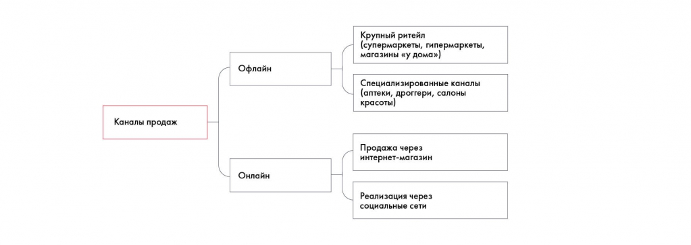
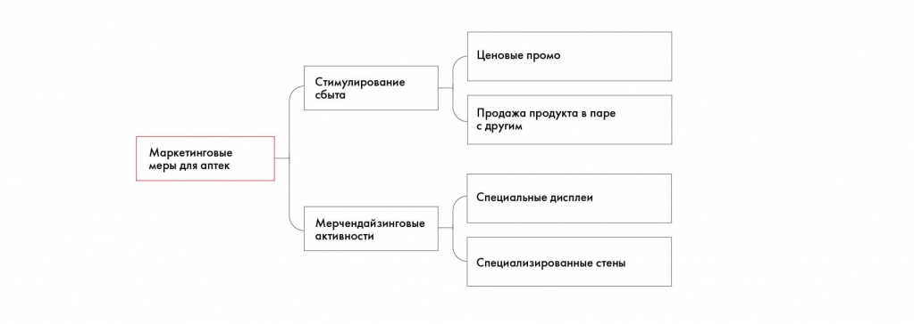

# Кейс Besh: как идеи формируются в пирамиду

Идеи по Besh группируются в дерево каналов продаж и маркетинговых мер. Пример показывает, как структура выявляет пропущенные онлайн-каналы.

**Источник:** физические страницы PDF 72–74. Печатные номера не установлены.

**Для последовательного чтения:** [Дерево решений (Issue Tree)](../03-issue-tree.md).

**Навигация:** [Индекс главы](../INDEX.md) · [Маршрутизатор](../../../ROUTER.md) · [Проблемы источника](../../../meta/issues.md).

---

## Источник: [PDF 72](../../../SOURCE.md#pdf-072)

Как идеи формируются в пирамиду

Вспомним, какие идеи по кейсу Besh мы решили взять в работу:

Закупить рекламу на радио / в соцсетях / в поисковиках / на ТВ.

Разработать мотивирующие месседжи.

Сделать красивую упаковку.

Приоритизировать продукты линейки, распределить продукты по каналам продаж.

Продавать продукт в супермаркетах/гипермаркетах/аптеках.

Провести ценовые промоакции.

Продавать в универмагах класса люкс.

Продавать продукт в паре с другим.

Устроить конкурс среди потребителей.

Сделать стенды в точках продаж.

Повесить плакаты в точках продаж.

## Источник: [PDF 73](../../../SOURCE.md#pdf-073)

Установить в магазинах брендированные дисплеи.

Изменить цену продукта.

Для начала попробуйте самостоятельно построить дерево на основе этих идей.

Мы предлагаем при построении дерева отталкиваться от задачи кейса. Напомним, что формулировка задачи по SMART звучит так:

Увеличить продажи компании Besh на 30 % за ближайший год за счет запуска нового продукта, выявив релевантные каналы продаж и проведя трейд-маркетинговые активности с учетом целевой аудитории и ценового сегмента.

Таким образом, у нас есть две основные подзадачи: выявить каналы продаж и предложить инициативы в области трейд-маркетинга для этих каналов. Поскольку для каждого канала, скорее всего, потребуются свои инициативы, можно начать структурирование именно с выбора необходимых каналов, а к маркетинговым мерам перейти позже.

После мозгового штурма мы уже вычеркнули из списка некоторые идеи, но там по-прежнему осталось несколько нерелевантных предложений. Например, нам не подойдут косметические универмаги класса люкс, поскольку согласно PSW наш ценовой сегмент — средний и ниже среднего.

Каналы продаж Besh делятся на офлайн и онлайн. В офлайне выделены крупный ритейл и специализированные каналы, поэтому дерево выявляет ранее пропущенную ветвь онлайн-продаж.

[Подробная текстовая расшифровка рисунка](../../../assets/transcripts/pdf-073-img-01.md).

## Источник: [PDF 74](../../../SOURCE.md#pdf-074)

Можно заметить, что в дереве появилась новая ветвь — в ходе мозгового штурма участники совсем забыли, что помимо офлайн-каналов продаж существуют еще и онлайн-каналы.

На следующем этапе необходимо структурировать маркетинговые меры — лучше проделать это отдельно для каждого канала. Например, для канала «Аптеки» дерево может выглядеть следующим образом:

На рисунке приведены элементы: Маркетинговые; меры для аптек; Стимулирование; сбыта; Мерчендайзинговые /. Полная текстовая расшифровка приведена отдельно; геометрия и цветовые обозначения сохранены на изображении.

[Подробная текстовая расшифровка рисунка](../../../assets/transcripts/pdf-074-img-01.md).

**Ссылки на этой странице исходника:** [Ссылка url-043](../../../meta/source-links.md#url-043).

## Связанные разделы

- [Все темы главы](../INDEX.md)
- [Термины и сокращения](../../../GLOSSARY.md)
- [Предыдущая тема: Дерево решений (Issue Tree)](../03-issue-tree.md)
- [Следующая тема: Фреймворки для общего разбора задачи](../04-frameworks-overview.md)
- [Авторские ответы по этой неделе](../../13-answers/03-week-05.md)
