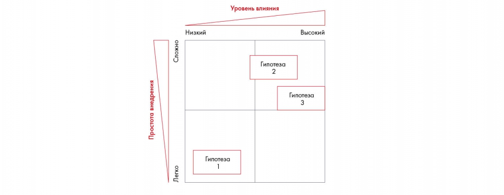
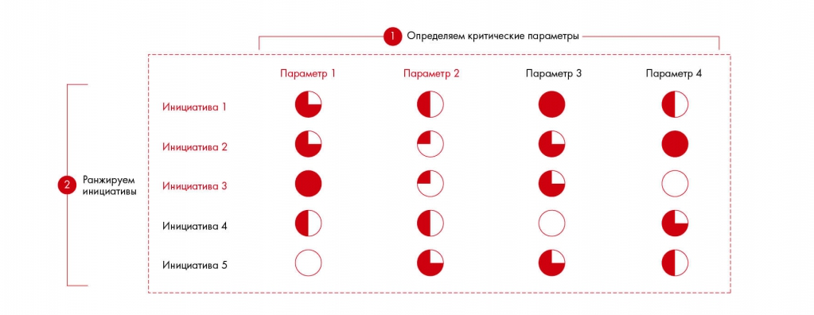

# Расстановка приоритетов

Разбирается выбор ветвей, которые дадут наибольший эффект при ограниченном времени. Матрицы влияния и простоты внедрения помогают сравнивать инициативы.

**Источник:** физические страницы PDF 91–93. Печатные номера не установлены.

**Предварительно:** [Этапы решения кейса](../01-case-method/04-solution-stages.md).

**Навигация:** [Индекс главы](INDEX.md) · [Маршрутизатор](../../ROUTER.md) · [Проблемы источника](../../meta/issues.md).

---

## Источник: [PDF 91](../../SOURCE.md#pdf-091)

### Недели 4, 5 и 6. Структурирование и формирование

### гипотез

### НЕДЕЛЯ 6. РАССТАНОВКА

### ПРИОРИТЕТОВ

На первый взгляд, может показаться, что на анализ всего дерева уйдет целая вечность. Действительно, с учетом соблюдения правила MECE и изучения множества аспектов проблемы ваше дерево может вырасти в гигантскую секвойю. Но консультанты — люди занятые и ценят свое время. Поэтому они соблюдают правило Парето[1]: 20 % усилий дают 80 % результата. В нашем случае это правило можно сформулировать так: 20 % дерева обеспечивают основную часть решения кейса. Так что если в процессе структурирования вы поняли, что какое-то направление проработки неперспективно, не тратьте на него время — вычеркивайте.

Чтобы выделить самые важные аспекты решения, воспользуйтесь инструментом матрицы влияния (Impact Matrix). Суть матрицы — приоритизировать ваши предложения по двум измерениям: простота внедрения и уровень влияния. Другие критерии приоритизации: срочность, схожесть с ценностями, миссией и возможностями компании, стратегическое соответствие, ценность альтернативных вариантов. Применяя эти критерии, порой можно исключить целые ветви проблем.

**Ссылки на этой странице исходника:** [Ссылка url-068](../../meta/source-links.md#url-068); [Ссылка url-069](../../meta/source-links.md#url-069).

## Источник: [PDF 92](../../SOURCE.md#pdf-092)

Матрица приоритетов сравнивает гипотезы по влиянию и простоте внедрения. Положение инициатив служит основанием для выбора очередности исследования.

[Подробная текстовая расшифровка рисунка](../../assets/transcripts/pdf-092-img-01.md).

Подход Impact Matrix

Частным случаем Impact Matrix являются так называемые быстрые победы (Quick Wins). Quick Win — это действие, которое требует минимальных затрат, предполагает низкий риск, имеет понятную причину и обладает узким сфокусированным влиянием. Quick Win очень привлекателен, поскольку вероятность положительного исхода высока. Quick Win также не требует долгого внедрения и согласований на высоком уровне.

Рассмотрим Quick Win на примере супермаркета. Как быстро и эффективно поднять продажи? Например, можно увеличить размер тележки для продуктов, открываться чуть раньше конкурентов, а закрываться чуть позже. Эти меры просты во внедрении и быстро принесут отдачу.

Другой инструмент, который поможет выделить самые важные гипотезы, — это так называемые шары Harvey’s Balls. Они позволяют быстро провести качественный анализ и сравнить несколько альтернатив по ряду параметров. Для этого нужно создать таблицу, где в заголовках столбцов будут критерии, а в первой строке — гипотезы. На пересечении нужно изобразить круговые диаграммы, в каждой из которых закрашено от нуля до четырех секторов. Пустой круг означает полное несоответствие критерию, а заполненный — полное соответствие. Шары Harvey’s Balls пригождаются, когда нужно сравнить несколько альтернатив, но при этом точная числовая оценка не нужна или не все критерии можно измерить количественно, но нужно сравнить несколько инициатив.

**Ссылки на этой странице исходника:** [Ссылка url-070](../../meta/source-links.md#url-070).

## Источник: [PDF 93](../../SOURCE.md#pdf-093)

Иллюстрация исходника: «Подход к ранжированию с Harvey’s Balls». Подписи и числовые значения вынесены в расшифровку; порядок и связи элементов проверяются по сохранённому изображению.

[Подробная текстовая расшифровка рисунка](../../assets/transcripts/pdf-093-img-01.md).

Подход к ранжированию с Harvey’s Balls

Если вы решаете кейс с командой, составляйте дерево вместе — вам понадобятся идеи и мнение каждого. Возможно, придется несколько раз провести мозговой штурм по разным вопросам, перестроить дерево, обновить и дополнить ветви. Это позволит вам выявить новые перспективы и пути решения проблемы. Лучше проработать пирамиду уровень за уровнем, прежде чем вы углубитесь в детали, — это позволит убедиться, что каждый уровень структурирован по MECE. Не пытайтесь сделать дерево идеальным сразу: набросайте черновик, а затем ищите новую информацию, дополняйте и улучшайте дерево.

**Ссылки на этой странице исходника:** [Ссылка url-071](../../meta/source-links.md#url-071).

## Связанные разделы

- [Все темы главы](INDEX.md)
- [Термины и сокращения](../../GLOSSARY.md)
- [Предыдущая тема: Как правильно формулировать гипотезы](../05-structuring-hypotheses/07-hypotheses.md)
- [Следующая тема: Задание, чек-лист и литература шестой недели](02-checklist.md)
