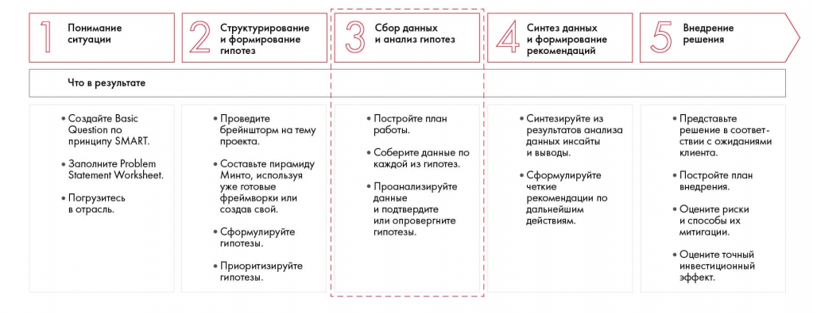
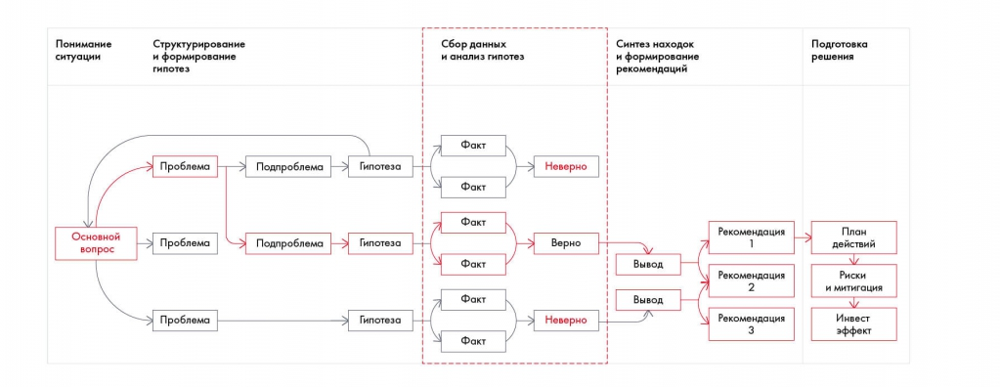
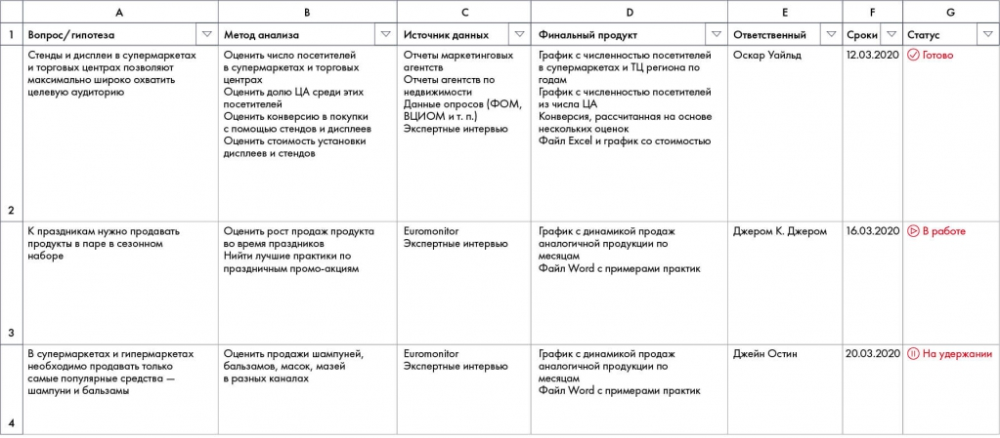
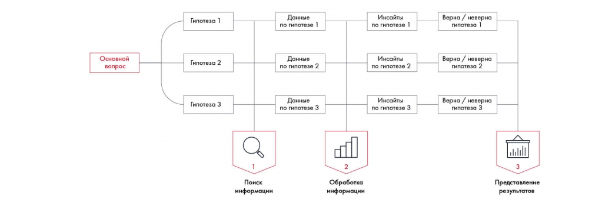

# Работа с информацией и построение плана работ

Показано, как связать гипотезы, необходимые данные, методы и исполнителей. Сохранён пример рабочего плана по Besh.

**Источник:** физические страницы PDF 95–99. Печатные номера не установлены.

**Предварительно:** [Этапы решения кейса](../01-case-method/04-solution-stages.md).

**Навигация:** [Индекс главы](INDEX.md) · [Маршрутизатор](../../ROUTER.md) · [Проблемы источника](../../meta/issues.md).

---

## Источник: [PDF 95](../../SOURCE.md#pdf-095)

### Недели 7 и 8. Работа с информацией

### НЕДЕЛИ 7 И 8. РАБОТА С

### ИНФОРМАЦИЕЙ

За предыдущие три недели мы сформулировали несколько гипотез о том, как можно решить основную проблему кейса. Пришла пора узнать, какие из предположений были верны, а какие нет. Для этого перейдем к следующему этапу — поиску и анализу информации для подтверждения или опровержения гипотез. Список направлений, по которым надо копать, уже обозначен, наша задача — найти и обработать данные.

На рисунке приведены элементы: Понимание; ситуации; Что в результате; • Создайте Basic; Question no. Полная текстовая расшифровка приведена отдельно; геометрия и цветовые обозначения сохранены на изображении.

[Подробная текстовая расшифровка рисунка](../../assets/transcripts/pdf-095-img-01.md).

Шаг 3. Сбор данных и анализ гипотез

Казалось бы, что сложного — набрать в поисковике запрос по теме? Но работа с данными — это целая наука, которая пригодится не только для решения кейсов. Мы живем в экономике знаний и информации, объем которой в мире удваивается каждый год. При этом сами по себе данные не так важны. Главное

— суметь их найти и правильно использовать. От способности искать и анализировать данные зависят ваши карьерные успехи. Так, по данным

## Источник: [PDF 96](../../SOURCE.md#pdf-096)

LinkedIn, из 25 наиболее востребованных навыков 6 связаны с работой с данными.

На рисунке приведены элементы: Понимание; ситуации; Основной; вопрос; Структурирование. Полная текстовая расшифровка приведена отдельно; геометрия и цветовые обозначения сохранены на изображении.

[Подробная текстовая расшифровка рисунка](../../assets/transcripts/pdf-096-img-01.md).

Анализ данных в решении кейса

Чтобы сэкономить время, распределите гипотезы между участниками команды. Главное — составьте четкий план работ с описанием методики анализа и указанием ответственных. Данные можно искать в интернете или собственной базе (если она есть). Кроме того, источником информации может стать общение с экспертом или ваше собственное исследование.

После сбора информации сделайте Sanity Check[1] — проверку на здравый смысл. Отсеяв нерелевантные данные, приступайте к анализу информации. В этом помогут такие инструменты, как ранжирование, матрицы, сценарный подход, сегментирование, инвестиционный и риск-анализ. С помощью этих инструментов вы найдете инсайты — логическое обобщение собранных данных в конкретные выводы. Проанализировав найденную информацию, вы должны прийти к подтверждению или опровержению гипотез.

После анализа необходимо представить данные в удобном для восприятия виде. Это может быть схема, диаграмма, матрица ранжирования или другой наглядный вариант.

### Неделя 7. Поиск информации

### Построение плана работ

**Ссылки на этой странице исходника:** [Ссылка url-073](../../meta/source-links.md#url-073); [Ссылка url-074](../../meta/source-links.md#url-074).

## Источник: [PDF 97](../../SOURCE.md#pdf-097)

Ваша миссия на этой неделе — разобраться, как планировать работу по поиску информации, узнать, где можно получить нужные данные, научиться пользоваться разными источниками и понять, в чем их плюсы и минусы.

Прежде чем приступать к поискам информации, составьте план работ. Заведите таблицу в Excel и внесите туда информацию по каждой гипотезе: метод анализа, источник информации, формат представления данных, ответственный, дедлайн и статус выполнения задачи.

Пропишите в столбик все гипотезы. Подумайте, что именно необходимо проанализировать по каждой них. Например, для гипотезы по открытию нового магазина в спальном районе это могут быть численность населения, среднестатистический состав продуктовой корзины, портрет покупателя и конкуренты. Это будет вашей методикой анализа. Она нужна для того, чтобы поиски не увели в сторону и вы не обнаружили, что уже два часа читаете о позиционировании детских подгузников, хотя искали данные об объеме рынка нефтехимии.

После того как определитесь с методикой анализа, укажите список приоритетных источников информации. Где вы будете искать данные: на сайте Росстата, в исследовательских отчетах консалтинговых компаний или в интервью отраслевых экспертов? Возможно, недавно вам на глаза попадалась статья по нужной теме — внесите в таблицу и ее. Составлять план работ лучше всей командой. Вместе вы наверняка вспомните больше полезных источников.

Следующий столбик — описание формата, в котором нужно представить данные по каждой гипотезе. Это может быть график, диаграмма, схема или матрица ранжирования. Вывалить на коллег море необработанной информации — значит проявить неуважение к ним. Так что постарайтесь привести найденные данные в удобный вид.

Итак, вы договорились, где будете искать информацию и в каком виде ее представите. Осталось распределить работу между участниками команды. Параллельный поиск информации сократит время работы и улучшит качество анализа, поскольку каждый человек будет сосредоточен только на одной гипотезе, а не на пяти одновременно. Назначьте ответственного за сбор данных по каждой гипотезе и зафиксируйте это в таблице. Так вы избежите

## Источник: [PDF 98](../../SOURCE.md#pdf-098)

неловкой ситуации, когда одна из задач осталась без внимания, потому что каждый думал, что ею занимается кто-то другой. Укажите дедлайн, когда ответственный должен будет представить информацию, и следите за его соблюдением.

В последнем столбце рекомендуем указать статус выполнения каждой задачи: «Готово», «В работе», «На удержании». Воспользуйтесь функцией Excel «Условное форматирование», чтобы каждый из статусов подсвечивался зеленым, желтым и красным цветом соответственно. Так по таблице сразу будет видно, какие гипотезы проанализированы, а к каким еще не приступали.

Если вы работаете один, для вас важной колонкой станет не распределение зон ответственности, а постановка дедлайнов. Составьте график и пропишите, в какое время вы будете заниматься анализом каждой гипотезы. Можете указать себе часы работы, чтобы не увлечься поиском. Например, зафиксируйте, что на первую гипотезу вы потратите максимум один час, на вторую — не больше двух часов и т. д.

Рабочий план Besh связывает вопрос или гипотезу с необходимыми данными, способом их получения, методом анализа, ответственным и сроком. Каждая строка является отдельной проверкой.

[Подробная текстовая расшифровка рисунка](../../assets/transcripts/pdf-098-img-01.md).

План работ по кейсу Besh

После составления плана работ каждый участник команды приступает к анализу своей гипотезы. Этот процесс делится на три этапа: поиск информации, ее обработку и представление результатов анализа.

## Источник: [PDF 99](../../SOURCE.md#pdf-099)

На рисунке приведены элементы: Основной; вопрос; Гипотеза 1; Данные; по гипотезе 1. Полная текстовая расшифровка приведена отдельно; геометрия и цветовые обозначения сохранены на изображении.

[Подробная текстовая расшифровка рисунка](../../assets/transcripts/pdf-099-img-01.md).

Процесс работы с информацией

[1] Sanity check — выражение, пришедшее из математики и физики. Означает простую, быструю проверку на логичность выводов, достоверность цифр (например, пересчет того же показателя другим методом).

**Ссылки на этой странице исходника:** [Ссылка url-075](../../meta/source-links.md#url-075).

## Связанные разделы

- [Все темы главы](INDEX.md)
- [Термины и сокращения](../../GLOSSARY.md)
- [Предыдущая тема: Задание, чек-лист и литература шестой недели](../06-prioritization/02-checklist.md)
- [Следующая тема: Источники информации. Часть 1](02-source-types.md)
- [Авторские ответы по этой неделе](../13-answers/04-week-07.md)

В приложении есть пункт «7.1», однако явного заголовка такого упражнения в основном тексте PDF нет. Его связь с условием не восстановлена догадкой; см. реестр упражнений.
