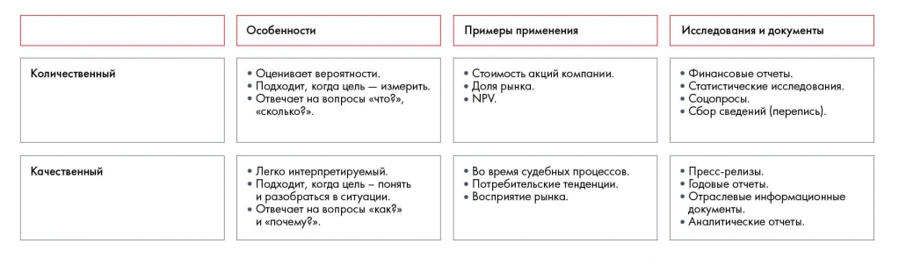
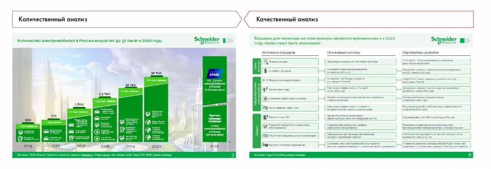

# Источники информации. Часть 1

Сопоставлены количественный и качественный анализ и типы источников. Объясняется, как выбирать данные под задачу, а не собирать их без плана.

**Источник:** физические страницы PDF 99–102. Печатные номера не установлены.

**Для последовательного чтения:** [Работа с информацией и построение плана работ](01-workplan.md).

**Навигация:** [Индекс главы](INDEX.md) · [Маршрутизатор](../../ROUTER.md) · [Проблемы источника](../../meta/issues.md).

---

## Источник: [PDF 99](../../SOURCE.md#pdf-099)

### Недели 7 и 8. Работа с информацией

### ИСТОЧНИКИ ИНФОРМАЦИИ. ЧАСТЬ 1

Определившись с гипотезами и планом, приступайте к поиску данных по своей гипотезе. Как это сделать правильно и не потратить на работу слишком много времени? Для этого нужно понимать, какую информацию вы хотите получить и где ее искать.

Вы можете изучать качественные и количественные данные — и то и другое вам пригодится. Пример: количественный анализ выявил постепенное уменьшение доли рынка компании — на 7 % за полгода. Качественный анализ объяснил это тем, что бизнес вовремя не отреагировал на изменение запросов потребителя.

**Ссылки на этой странице исходника:** [Ссылка url-075](../../meta/source-links.md#url-075).

## Источник: [PDF 100](../../SOURCE.md#pdf-100)

Сравниваются количественный и качественный анализ: измерение и статистические выводы против объяснения причин, мотивов и контекста. Сохранены методы и ограничения каждого подхода.

[Подробная текстовая расшифровка рисунка](../../assets/transcripts/pdf-100-img-01.md).

Качественные и количественные методы сбора информации

Иллюстрация исходника: «Источник: Changellenge >> Cup Moscow, решение команды Old & Bold». Подписи и числовые значения вынесены в расшифровку; порядок и связи элементов проверяются по сохранённому изображению.

[Подробная текстовая расшифровка рисунка](../../assets/transcripts/pdf-100-img-02.md).

Вот так качественные и количественные методы выглядят на слайдах. Источник: Changellenge >> Cup Moscow, решение команды Old & Bold

У каждого источника информации есть две основные характеристики: простота поиска и качество данных.

Интернет-источники. Это самый простой и очевидный вариант. Но здесь нужно понимать, что качество данных может быть низким, если не использовать проверенные сайты и базы данных.

Собственная база данных. Этот источник часто используют консультанты и сотрудники крупных компаний, поскольку у них есть доступ к корпоративной базе знаний, где хранятся данные по старым проектам и исследованиям. В вашем случае это могут быть наработки по кейсам, которые вы решали раньше, институтским исследованиям и другим проектам.

**Ссылки на этой странице исходника:** [Ссылка url-076](../../meta/source-links.md#url-076); [Ссылка url-077](../../meta/source-links.md#url-077); [Ссылка url-012](../../meta/source-links.md#url-012).

## Источник: [PDF 101](../../SOURCE.md#pdf-101)

Экспертное мнение. Найти подходящего эксперта бывает сложно, но зато именно от профессионала из отрасли вы сможете получить данные, которых нет в открытых источниках. Попробуйте поискать экспертные сообщества в соцсетях. Обычно там публикуют много полезной информации по отраслевой статистике, трендам и анализу лучших практик.

Собственное исследование. Это самый трудозатратный источник информации. Тем не менее правильно проведенное исследование ценнее вторичных данных. Вы можете запустить соцопрос, посетить магазин в роли тайного покупателя, проанализировать отзывы в интернете, построить эконометрическую или финансовую модель. Если вы хотите научиться строить финансовые модели, обратите внимание на курс «Finance: базовый уровень» от Changellenge >> ToolKit. Вам предложат построить финмодель для инвестиционного проекта вымышленной компании. Несмотря на то, что клиент нереальный, задачи будут более чем настоящими: от определения предпосылок и расчета себестоимости до выбора способа финансирования и учета налогов.

При поиске информации мы рекомендуем начинать с самых простых источников и постепенно переходить к более трудоемким:

1. Перед тем как начинать поиск, разберитесь, что именно вы ищете. Постарайтесь найти аналогичные проекты и вникнуть в тему.

2. Изучите общую картину с помощью поиска в интернете. Сформулируйте вопросы.

3. Найдите эксперта по теме, организуйте звонок или встречу. Это поможет определить направление работы.

4. Соберите подробную информацию в открытых источниках. Это самая важная и объемная часть работы.

5. Проведите повторную коммуникацию с экспертом или собственное исследование, проясните накопившиеся вопросы.

6. Объедините собранные данные для дальнейшей обработки.

В результате поиска вы соберете необходимые данные для проверки гипотезы. Например, в случае с гипотезой по кейсу Besh «Золотая полка в супермаркетах обеспечит рост выручки при небольших тратах» вам необходимы следующие данные:

- Динамика продаж продуктов по уходу за волосами в супермаркетах региона за 2012–2018 годы.

- Объемы продаж продуктов на «золотой полке» по сравнению с другими полками.

- Оценка затрат на зарплату мерчендайзеров.

**Ссылки на этой странице исходника:** [Ссылка url-078](../../meta/source-links.md#url-078).

## Источник: [PDF 102](../../SOURCE.md#pdf-102)

- Размер платы ритейлеру за удачное расположение товара.

### Задание по кейсу

Просмотрите свои гипотезы по кейсу Coca-Cola HBC Россия. Какие данные потребуются для анализа каждой из них?

Теперь рассмотрим каждый из четырех возможных источников информации более подробно.

## Связанные разделы

- [Все темы главы](INDEX.md)
- [Термины и сокращения](../../GLOSSARY.md)
- [Предыдущая тема: Работа с информацией и построение плана работ](01-workplan.md)
- [Следующая тема: Поиск информации в интернете](03-web-search.md)
- [Авторские ответы по этой неделе](../13-answers/04-week-07.md)

В приложении есть пункт «7.1», однако явного заголовка такого упражнения в основном тексте PDF нет. Его связь с условием не восстановлена догадкой; см. реестр упражнений.

> Редакторское примечание SRC-02: здесь сохранено сквозное задание, но полное условие кейса Coca-Cola из приложения 1 отсутствует в предоставленном PDF. См. [реестр проблем](../../meta/issues.md).
