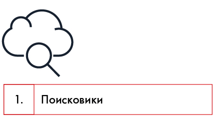
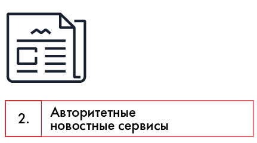
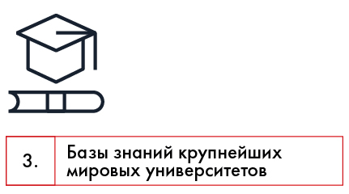
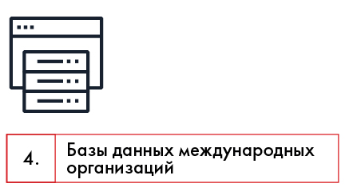
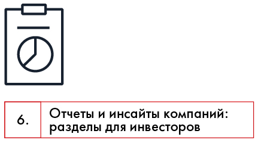
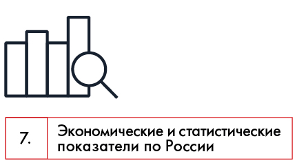
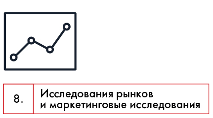
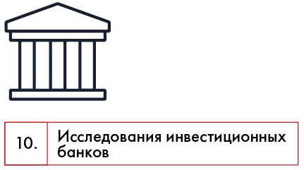
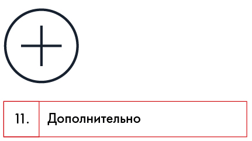
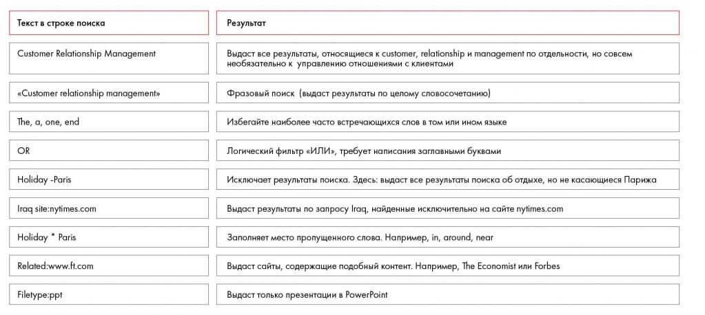

# Поиск информации в интернете

Перечислены категории интернет-источников и поисковые приёмы. Практическое задание 7.2 тренирует формулировку запросов.

**Источник:** физические страницы PDF 102–108. Печатные номера не установлены.

**Для последовательного чтения:** [Источники информации. Часть 1](02-source-types.md).

**Навигация:** [Индекс главы](INDEX.md) · [Маршрутизатор](../../ROUTER.md) · [Проблемы источника](../../meta/issues.md).

---

## Источник: [PDF 102](../../SOURCE.md#pdf-102)

### 1. Поиск информации в интернете

Самый доступный источник информации — это интернет. Но на просторах Сети нужно быть аккуратным и не доверять всему, что находите. Используя поисковики, старайтесь тщательно фильтровать информацию и учитесь писать лаконичные запросы, используя именно те ключевые слова, которые выведут вас на нужные ресурсы. При поиске держите в голове вопрос, на который ищете ответ. Быстро сканируйте взглядом документы, которые находите; смотрите тематические подборки, оглавление, чтобы выловить те пункты, которые представляют интерес.

Используйте для поиска информации базы данных консалтинговых компаний, крупных университетов и международных организаций. Этот источник лучше поисковиков, потому что там собрана только проверенная и авторитетная информация. Сайты с презентациями, например Slideshare или Scribd, тоже иногда помогают. Кроме того, обратите внимание на отчеты компаний, разные статистические ресурсы, маркетинговые исследования (они позволят быстро погрузиться в отрасль) и исследования инвестиционных банков (там всегда указаны источники данных, а информация очень высокого качества).

## Источник: [PDF 103](../../SOURCE.md#pdf-103)

На рисунке приведены элементы: Поисковики. Полная текстовая расшифровка приведена отдельно; геометрия и цветовые обозначения сохранены на изображении.

[Подробная текстовая расшифровка рисунка](../../assets/transcripts/pdf-103-img-01.md).

- Google (глобальный поиск)

- Yandex (лучше для поиска по Рунету)

- WolframAlpha (очень удобен для поиска матмоделей)

На рисунке приведены элементы: 2.; Авторитетные; новостные сервисы. Полная текстовая расшифровка приведена отдельно; геометрия и цветовые обозначения сохранены на изображении.

[Подробная текстовая расшифровка рисунка](../../assets/transcripts/pdf-103-img-02.md).

- http://www.kommersant.ru/

- http://www.vedomosti.ru/

- http://www.forbes.ru/

- http://www.kommersant.ru/sf/(Секрет фирмы)

- www.rbc.ru/

- http://www.economist.com

**Ссылки на этой странице исходника:** [Ссылка url-079](../../meta/source-links.md#url-079); [Ссылка url-080](../../meta/source-links.md#url-080); [Ссылка url-081](../../meta/source-links.md#url-081); [Ссылка url-082](../../meta/source-links.md#url-082); [Ссылка url-083](../../meta/source-links.md#url-083); [Ссылка url-084](../../meta/source-links.md#url-084).

## Источник: [PDF 104](../../SOURCE.md#pdf-104)

На рисунке приведены элементы: 3.; Базы знаний крупнейших; мировых университетов. Полная текстовая расшифровка приведена отдельно; геометрия и цветовые обозначения сохранены на изображении.

[Подробная текстовая расшифровка рисунка](../../assets/transcripts/pdf-104-img-01.md).

- http://knowledge.insead.edu/

- http://www.hbs.edu/faculty/-> Publications

- https://cb.hbsp.harvard.edu/

На рисунке приведены элементы: 4.; Базы данных международных; организаций. Полная текстовая расшифровка приведена отдельно; геометрия и цветовые обозначения сохранены на изображении.

[Подробная текстовая расшифровка рисунка](../../assets/transcripts/pdf-104-img-02.md).

- http://www.worldbank.org/en/research

- http://data.un.org/(ООН)

- http://www.imf.org/external/data.htm(МВФ)

- https://www.wto.org/english/res_e/statis_e/statis_e.htm(ВТО)

- http://stats.oecd.org/

- http://www.opec.org/opec_web/en/data_graphs/40.htm

- https://ec.europa.eu/eurostat/

- http://open-data.europa.eu/en/data/

**Ссылки на этой странице исходника:** [Ссылка url-085](../../meta/source-links.md#url-085); [Ссылка url-086](../../meta/source-links.md#url-086); [Ссылка url-087](../../meta/source-links.md#url-087); [Ссылка url-088](../../meta/source-links.md#url-088); [Ссылка url-089](../../meta/source-links.md#url-089); [Ссылка url-090](../../meta/source-links.md#url-090); [Ссылка url-091](../../meta/source-links.md#url-091); [Ссылка url-092](../../meta/source-links.md#url-092); [Ссылка url-093](../../meta/source-links.md#url-093); [Ссылка url-094](../../meta/source-links.md#url-094); [Ссылка url-095](../../meta/source-links.md#url-095).

## Источник: [PDF 105](../../SOURCE.md#pdf-105)

- http://www.gesis.org/en/eurobarometer-data-service/home/

- http://blog.euromonitor.com

- http://www.bls.gov/fls/home.htm

- http://demoscope.ru/weekly/pril.php(демография)

- https://www.cia.gov/ru(ЦРУ)

На рисунке приведены элементы: 6.; Отчеты и инсайты компаний:; разделы для инвесторов. Полная текстовая расшифровка приведена отдельно; геометрия и цветовые обозначения сохранены на изображении.

[Подробная текстовая расшифровка рисунка](../../assets/transcripts/pdf-105-img-01.md).

- http://ir.gazprom-neft.ru/

- http://alfabank.ru/about/annual_report/

- http://www.sberbank.ru/moscow/ru/about/analytics/

На рисунке приведены элементы: 7.; Экономические и статистические; показатели по России. Полная текстовая расшифровка приведена отдельно; геометрия и цветовые обозначения сохранены на изображении.

[Подробная текстовая расшифровка рисунка](../../assets/transcripts/pdf-105-img-02.md).

- http://www.cbr.ru/statistics/

- http://www.gks.ru/

**Ссылки на этой странице исходника:** [Ссылка url-096](../../meta/source-links.md#url-096); [Ссылка url-097](../../meta/source-links.md#url-097); [Ссылка url-098](../../meta/source-links.md#url-098); [Ссылка url-099](../../meta/source-links.md#url-099); [Ссылка url-100](../../meta/source-links.md#url-100); [Ссылка url-101](../../meta/source-links.md#url-101); [Ссылка url-102](../../meta/source-links.md#url-102); [Ссылка url-103](../../meta/source-links.md#url-103); [Ссылка url-104](../../meta/source-links.md#url-104); [Ссылка url-105](../../meta/source-links.md#url-105).

## Источник: [PDF 106](../../SOURCE.md#pdf-106)

- http://info.minfin.ru/worldecon.php

- http://raexpert.ru/database/

- http://statistika.ru/

- http://opec.ru/economics/

На рисунке приведены элементы: Исследования рынков; и маркетинговые исследования. Полная текстовая расшифровка приведена отдельно; геометрия и цветовые обозначения сохранены на изображении.

[Подробная текстовая расшифровка рисунка](../../assets/transcripts/pdf-106-img-01.md).

- https://www.euromonitor.com/

- http://www.nielsen.com/ru/ru/insights.html

- http://www.comcon-2.com

- https://kantartns.ru/

- http://tass.ru/infographics/

На рисунке приведены элементы: 10.; 1сследования инвестиционных; анков. Полная текстовая расшифровка приведена отдельно; геометрия и цветовые обозначения сохранены на изображении.

[Подробная текстовая расшифровка рисунка](../../assets/transcripts/pdf-106-img-02.md).

- https://www.jpmorgan.com/pages/insights

**Ссылки на этой странице исходника:** [Ссылка url-106](../../meta/source-links.md#url-106); [Ссылка url-107](../../meta/source-links.md#url-107); [Ссылка url-108](../../meta/source-links.md#url-108); [Ссылка url-109](../../meta/source-links.md#url-109); [Ссылка url-110](../../meta/source-links.md#url-110); [Ссылка url-111](../../meta/source-links.md#url-111); [Ссылка url-112](../../meta/source-links.md#url-112); [Ссылка url-113](../../meta/source-links.md#url-113); [Ссылка url-114](../../meta/source-links.md#url-114); [Ссылка url-115](../../meta/source-links.md#url-115).

## Источник: [PDF 107](../../SOURCE.md#pdf-107)

- https://www.dbresearch.com/

- http://www.goldmansachs.com/our-thinking/index.html

На рисунке приведены элементы: 11.; Дополнительно. Полная текстовая расшифровка приведена отдельно; геометрия и цветовые обозначения сохранены на изображении.

[Подробная текстовая расшифровка рисунка](../../assets/transcripts/pdf-107-img-01.md).

- https://www.quora.com/– сервис обмена знаниями

- http://www.spark-interfax.ru/ru/statistics– информация о компаниях с аналитическими инструментами

Источники информации в интернете: специальные ресурсы

Чтобы быстро просматривать и анализировать информацию, используйте специальные техники чтения. Углубленное чтение и чтение-сканирование практиковал каждый, здесь проблем быть не должно. Насчет пользы скорочтения взгляды расходятся. Практика показывает, что без него вполне можно обойтись, но для увеличения производительности попробуйте освоить и этот метод. Вам помогут специализированные приложения, основанные на технологиях spritz (слова выводятся на экран по одному за раз, чтобы сократить время на переход глазами по строчкам).

Для ускорения работы научитесь быстро печатать. Существует много программ для развития этого навыка: VerseQ — для Windows, KeyKey — для Mac OS или онлайн-тренажер «Все10».

Чтобы повысить эффективность поиска, используйте специальные приемы от Google. Многие из них работают и в «Яндексе».

**Ссылки на этой странице исходника:** [Ссылка url-116](../../meta/source-links.md#url-116); [Ссылка url-117](../../meta/source-links.md#url-117); [Ссылка url-118](../../meta/source-links.md#url-118); [Ссылка url-119](../../meta/source-links.md#url-119).

## Источник: [PDF 108](../../SOURCE.md#pdf-108)

Таблица поисковых запросов показывает кавычки, минус-слово, site: и подстановку звёздочкой. Примеры сохраняют авторские английские запросы.

[Подробная текстовая расшифровка рисунка](../../assets/transcripts/pdf-108-img-01.md).

Синтаксис по ускорению поиска в Google

### Практическое задание № 7.2

Ответьте на вопросы, используя разные приемы поиска:

1. Назовите имена, компании и даты принятия на работу первой женщины в консалтинговой компании и первой женщины-партнера?

2. Насколько увеличится ваша продуктивность, если вы будете заранее планировать свои дела?

3. Один из первых сборников кейсов (1925) стоил 40 долларов. Сколько это в пересчете на современные деньги?

4. Сколько партнеров по розливу напитков, включая Coca-Cola HBC Россия, есть у The Coca-Cola Company?

5. Сколько составила бы капитализация монопольной американской нефтяной корпорации Standard Oil Дж. Рокфеллера, если бы она не была принудительно упразднена в 1911 году?

**Ссылки на этой странице исходника:** [Ссылка url-120](../../meta/source-links.md#url-120).

## Связанные разделы

- [Все темы главы](INDEX.md)
- [Термины и сокращения](../../GLOSSARY.md)
- [Предыдущая тема: Источники информации. Часть 1](02-source-types.md)
- [Следующая тема: Собственная база данных](04-personal-database.md)
- [Авторские ответы по этой неделе](../13-answers/04-week-07.md)

В приложении есть пункт «7.1», однако явного заголовка такого упражнения в основном тексте PDF нет. Его связь с условием не восстановлена догадкой; см. реестр упражнений.

> Редакторское примечание SRC-02: здесь сохранено сквозное задание, но полное условие кейса Coca-Cola из приложения 1 отсутствует в предоставленном PDF. См. [реестр проблем](../../meta/issues.md).
