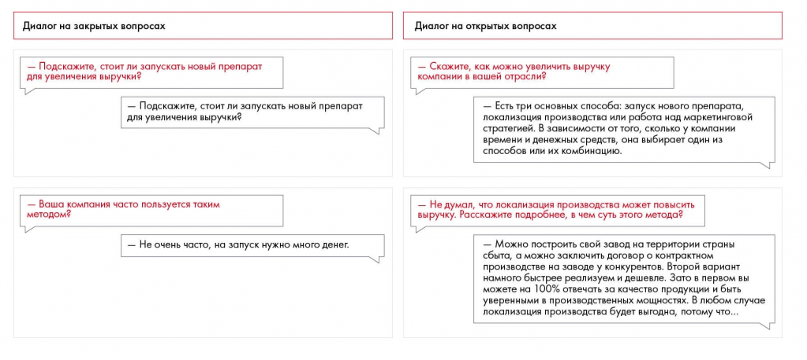

# Общение с экспертом и проведение интервью

Разобраны подготовка, поиск эксперта и проведение интервью. Пример показывает различие закрытых и открытых вопросов.

**Источник:** физические страницы PDF 110–112. Печатные номера не установлены.

**Для последовательного чтения:** [Собственная база данных](04-personal-database.md).

**Навигация:** [Индекс главы](INDEX.md) · [Маршрутизатор](../../ROUTER.md) · [Проблемы источника](../../meta/issues.md).

---

## Источник: [PDF 110](../../SOURCE.md#pdf-110)

### Недели 7 и 8. Работа с информацией

### Источники информации. Часть 2

### 3. Общение с экспертом и проведение интервью

Если есть возможность, постарайтесь найти эксперта в той области, которой посвящен кейс. Он расскажет вам о том, что нельзя найти в открытых источниках. Начните поиск со знакомых, напишите однокурсникам и тем, кого знаете по карьерным мероприятиям. Ищите в интернете, обращая внимание на публикации, блоги, личный сайт эксперта. Обратитесь в свой вуз — возможно, среди преподавателей или выпускников есть интересующий вас профессионал.

Когда вы нашли эксперта, тщательно подготовьтесь к звонку или встрече. Для начала убедитесь, что точно знаете должность и обязанности этого человека и уверены, что он может рассказать вам что-то полезное. Подумайте об оптимальном формате и месте интервью.

Теперь вам нужно отправить эксперту приглашение на встречу. Оно должно быть не длиннее 4–7 предложений и включать информацию о том, кто вы, почему проводите это исследование и как вам поможет интервью с экспертом. Подумайте, что может заинтересовать этого человека и мотивировать его помочь вам. Отправьте приглашение по 2–3 каналам связи, если эксперт не отвечает, напомните о себе через 3 дня, а потом через неделю. Имейте в виду, что вам могут отказать или не ответить вообще, поэтому хорошо иметь запасные варианты. Не стесняйтесь писать разным людям — в худшем случае вы просто услышите «нет».

Получив согласие, договоритесь о деталях: месте, времени, продолжительности интервью, списке присутствующих. С каждой стороны — от эксперта и от вас — должно быть одинаковое количество участников с перевесом в одного человека максимум. Это нужно для того, чтобы всем было комфортно. Если к одному эксперту придут сразу четверо участников команды, он будет чувствовать себя неуютно, может замкнуться и рассказать меньше, чем вам хотелось бы. Если же эксперт будет не один, вы тоже можете прийти на встречу с коллегой. Обязательно составьте план интервью и список вопросов. Чтобы получить больше информации, задавайте открытые вопросы. Они предполагают развернутый ответ и провоцируют развитие беседы. На закрытые вопросы вы получите односложный ответ. В целом этот тип вопросов

## Источник: [PDF 111](../../SOURCE.md#pdf-111)

тоже может быть полезен, главное — не переусердствуйте с ними, иначе у собеседника может возникнуть чувство, что вы его тестируете.

Иллюстрация исходника: «Пример диалога с закрытыми и открытыми вопросами». Подписи и числовые значения вынесены в расшифровку; порядок и связи элементов проверяются по сохранённому изображению.

[Подробная текстовая расшифровка рисунка](../../assets/transcripts/pdf-111-img-01.md).

Пример диалога с закрытыми и открытыми вопросами

В диалоге с закрытыми вопросами интервьюер ищет подтверждение или опровержение собственных предположений. Он получает четкий ответ на вопрос. У отвечающего нет возможности раскрыться и рассказать что-то интересное.

В диалоге с открытыми вопросами интервьюер позволяет отвечающему рассказать о разных способах повышения выручки, не ограничивая его вариантами ответа. После первого же ответа интервьюер получает новые сведения, о которых даже не подозревал. Развитие этой мысли дает доступ к интересной инсайдерской информации. Смысл интервью с экспертом именно в этом — узнать что-то новое, о чем вы сами не догадывались.

От того, как вы проведете встречу, зависит качество информации, которую вы получите. Для начала поприветствуйте эксперта и поблагодарите за предоставленную возможность. Подтвердите цель интервью, уточните, сколько времени есть у спикера.

Рассаживаясь на встрече, всегда оставляйте эксперту самое удобное место. Не сажайте его спиной к двери — это дискомфортное положение. Часто люди инстинктивно садятся друг напротив друга, но это напоминает бой стенка на стенку, и вы подсознательно ощущаете себя соперниками. Если вместе с вами

**Ссылки на этой странице исходника:** [Ссылка url-121](../../meta/source-links.md#url-121).

## Источник: [PDF 112](../../SOURCE.md#pdf-112)

на встречу пришел еще один член команды, он может сесть на сторону эксперта, чтобы разрядить обстановку. Если вы встречаетесь в кафе, придерживайтесь правила: платит тот, кто пригласил.

Всегда заранее просите разрешения делать заметки. Диктофон лучше не использовать. Это может насторожить человека, и он начнет говорить менее уверенно, стараясь не сболтнуть лишнего. В любом случае держите контакт с собеседником и не слишком увлекайтесь записями, иначе он будет чувствовать, что общается со стенографистом. Со временем вы научитесь фиксировать всю информацию, используя минимум заметок. Заведите собственные ключевые слова, сокращения и другие приемы, которые позволят сделать записи лаконичнее. Некоторые эксперты любят, объясняя что-то, рисовать схемы или писать тезисы. Попросите после интервью воспользоваться их записями. Во-первых, это действительно может пригодиться, во-вторых, таким образом вы выразите уважение к человеку.

На любой встрече вам пригодится методика активного слушания. Что это такое и чем активное слушание отличается от обычного? Чтобы ответить на этот вопрос, вспомните случай, когда вы разговаривали с человеком, но не были уверены, что он вас вообще слушает. Подобное поведение нервирует. Чтобы у эксперта не возникло такого ощущения, выражайте заинтересованность: не отвлекайтесь на гаджеты или разговоры с коллегами, задавайте вопросы, переспрашивайте, если что-то непонятно, пересказывайте своими словами то, что хотите закрепить. Если вы услышали нечто неприятное для себя, не показывайте негативные эмоции, иначе рискуете демотивировать собеседника. Когда эксперт отходит от темы, его можно перебить, но делайте это максимально тактично.

В конце кратко пробегитесь по пунктам, которые вы обсудили, чтобы собеседник в случае ошибки вас поправил. Уточните, нет ли чего-то важного, о чем вы забыли спросить. После встречи не забудьте написать эксперту благодарственное письмо, чтобы укрепить контакт. Кто знает, возможно, вам еще понадобится его помощь.

## Связанные разделы

- [Все темы главы](INDEX.md)
- [Термины и сокращения](../../GLOSSARY.md)
- [Предыдущая тема: Собственная база данных](04-personal-database.md)
- [Следующая тема: Собственное исследование](06-research.md)
- [Авторские ответы по этой неделе](../13-answers/04-week-07.md)

В приложении есть пункт «7.1», однако явного заголовка такого упражнения в основном тексте PDF нет. Его связь с условием не восстановлена догадкой; см. реестр упражнений.
