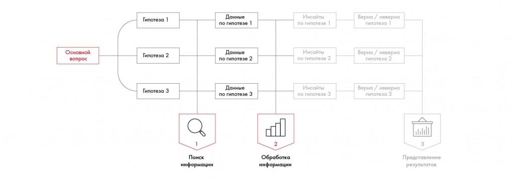
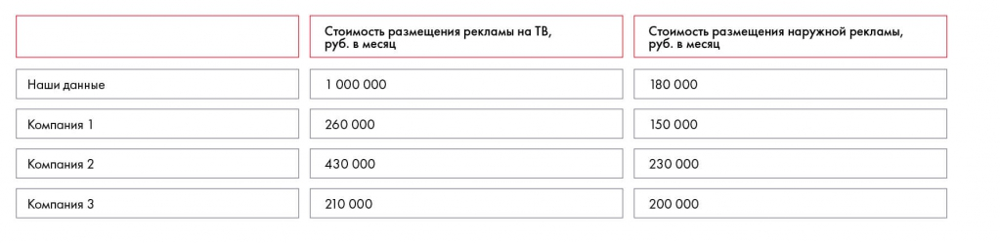
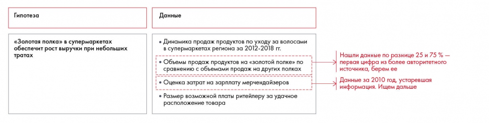

# Обработка и анализ данных

Показано, как сопоставлять источники и извлекать полезные выводы из данных. Пример динамики выручки и расходов объясняет отличие расчёта от инсайта.

**Источник:** физические страницы PDF 116–119. Печатные номера не установлены.

**Предварительно:** [Этапы решения кейса](../01-case-method/04-solution-stages.md).

**Навигация:** [Индекс главы](INDEX.md) · [Маршрутизатор](../../ROUTER.md) · [Проблемы источника](../../meta/issues.md).

---

## Источник: [PDF 116](../../SOURCE.md#pdf-116)

### Недели 7 и 8. Работа с информацией

### НЕДЕЛЯ 8. ОБРАБОТКА ИНФОРМАЦИИ

### И ОФОРМЛЕНИЕ РЕЗУЛЬТАТОВ

На этой неделе ваша задача — разобраться, что делать с данными, которые вы нашли, изучить разные подходы к анализу информации и понять, как представить результаты работы, чтобы наиболее эффективно продать свои выводы.

### Обработка и анализ данных

**Ссылки на этой странице исходника:** [Ссылка url-123](../../meta/source-links.md#url-123).

## Источник: [PDF 117](../../SOURCE.md#pdf-117)

Предположим, вы собрали данные по своим гипотезам. Но сама по себе информация не так важна, более ценно получить из нее инсайты[1], то есть трансформировать в логичные выводы, которые помогут на следующем этапе сформулировать рекомендации.

На рисунке приведены элементы: Основной; BONDOC; Гипотеза 1; Данные; по гипотезе 1. Полная текстовая расшифровка приведена отдельно; геометрия и цветовые обозначения сохранены на изображении.

[Подробная текстовая расшифровка рисунка](../../assets/transcripts/pdf-117-img-01.md).

Этапы работы с информацией

Обработка информации состоит из двух этапов: проверки качества и анализа.

На этапе проверки оцените, насколько информация соответствует четырем критериям:

- Полнота. Проверьте, точно ли у вас есть все нужные данные. Если вы составили матрицу ранжирования и увидели, что для какого-то варианта не хватает информации хотя бы по одному из критериев, стоит поискать еще раз.

- Актуальность. Вам вряд ли пригодятся показатели за 2012 год, если вы решаете кейс о проблеме, которая возникла в 2017-м. В некоторых случаях вы можете использовать эти данные, но их одних будет недостаточно — придется найти более свежую информацию.

- Достоверность. Два источника могут противоречить друг другу. В таком случае посмотрите несколько других и оцените их авторитетность. Покажите данные эксперту отрасли, спросите, насколько они правдоподобны. Если в одном источнике вы нашли размер прибыли компании, в другом — объем продаж, а в третьем — маржинальность, сделайте быстрые расчеты и проверьте, соотносятся ли эти данные друг с другом.

- Релевантность. Проверьте, не увлеклись ли вы поиском. Возможно, среди найденных данных есть информация, не относящаяся к вашей

**Ссылки на этой странице исходника:** [Ссылка url-124](../../meta/source-links.md#url-124).

## Источник: [PDF 118](../../SOURCE.md#pdf-118)

проблеме. Выбрасывайте ее без сожаления, иначе она запутает вас на этапе анализа.

Полезный инструмент проверки числовых данных — бенчмаркинг, то есть сравнение ваших данных с данными других компаний. Например, в открытых источниках вы нашли следующую стоимость размещения офлайн-рекламы: 1 млн рублей в месяц для ТВ, 180 тыс. рублей в месяц для наружной рекламы. Чтобы удостовериться в адекватности этих цифр, посмотрите, сколько тратят на рекламу конкуренты. Можно также изучить, сколько просят за эти услуги рекламные агентства. Предположим, в итоге вы получили следующие цифры:

Бенчмаркинг сопоставляет стоимость рекламы на ТВ по собственным данным и трём компаниям. Значительное расхождение требует проверки сопоставимости и качества источников.

[Подробная текстовая расшифровка рисунка](../../assets/transcripts/pdf-118-img-01.md).

В случае с рекламой на ТВ порядок чисел разный. Это значит, что, скорее всего, ваша компания потратит на размещение на ТВ значительно меньше, чем 1 млн рублей в месяц. По наружной рекламе порядок чисел совпадает. 180 тыс. рублей представляются адекватной стоимостью, которую можно использовать при расчете потенциальных затрат.

На рисунке приведены элементы: Гипотеза; «Золотая полка» в супермаркетах; обеспечит рост выручки при небольших; тратах; Данные. Полная текстовая расшифровка приведена отдельно; геометрия и цветовые обозначения сохранены на изображении.

[Подробная текстовая расшифровка рисунка](../../assets/transcripts/pdf-118-img-02.md).

Проверка данных на примере кейса Besh

**Задание по кейсу**

**Ссылки на этой странице исходника:** [Ссылка url-125](../../meta/source-links.md#url-125).

## Источник: [PDF 119](../../SOURCE.md#pdf-119)

Проверьте качество собранных данных по кейсу Coca-Cola HBC Россия. Проведите бенчмаркинг, проверьте их актуальность.

После того как вы проверили данные, нужно их обработать: разобраться во взаимосвязях и найти инсайты. Как это сделать? У вас есть разрозненные цифры и факты, которые нужно связать между собой и обобщить. В этом помогут фреймворки, логические аргументы или математические формулы.

Например, вы изучаете отчетность компании и получили такие данные:

Издержки за год 1 — 100 долларов.

Доход за последний год — 120 долларов.

Рост затрат и дохода в год 1 составили 10 и 5 % в год соответственно.

Темпы роста поддерживаются на одном уровне из года в год уже долгое время.

На этапе выстраивания взаимосвязей вам нужно объединить эти факты. В нашем случае данные можно связать математической формулой: издержки / доходы следующего года = издержки / доходы этого года × темп роста, прибыль = выручка – издержки.

По формулам получаем:

| Показатель | Год 1 | Год 2 | Год 3 | Год 4 | Год 5 |
| --- | --- | --- | --- | --- | --- |
| Выручка | 120 | 120 × 1,05 = 126 | 126 × 1,05 = 132 | 132 × 1,05 = 139 | 139 × 1,05 = 146 |
| Издержки | 100 | 100 × 1,1 = 110 | 110 × 1,1 = 121 | 121 × 1,1 = 133 | 133 × 1,1 = 146 |
| Прибыль | 20 | 16 | 11 | 6 | 0 |

Вы получили следующие инсайты:

Доходы растут медленнее, чем расходы.

Через 5 лет бизнес перестанет приносить прибыль.

## Связанные разделы

- [Все темы главы](INDEX.md)
- [Термины и сокращения](../../GLOSSARY.md)
- [Предыдущая тема: Собственное исследование](../07-information-search/06-research.md)
- [Следующая тема: Практические задания 8.1–8.3: расчёты и выводы](exercises/01-data-analysis.md)
- [Авторские ответы по этой неделе](../13-answers/05-week-08.md)

> Редакторское примечание SRC-02: здесь сохранено сквозное задание, но полное условие кейса Coca-Cola из приложения 1 отсутствует в предоставленном PDF. См. [реестр проблем](../../meta/issues.md).
