# Представление результата: типы диаграмм

Разбирается выбор визуализации для структуры, величины, динамики, частоты и связи показателей. Сохранены примеры диаграмм и требования к подписям и единицам.

**Источник:** физические страницы PDF 124–130. Печатные номера не установлены.

**Для последовательного чтения:** [Практические задания 8.1–8.3: расчёты и выводы](exercises/01-data-analysis.md).

**Навигация:** [Индекс главы](INDEX.md) · [Маршрутизатор](../../ROUTER.md) · [Проблемы источника](../../meta/issues.md).

---

## Источник: [PDF 124](../../SOURCE.md#pdf-124)

### Недели 7 и 8. Работа с информацией

### Представление результата

Работа по анализу данных не заканчивается на подтверждении или опровержении гипотезы. О том, какая огромная работа проделана и сколько чашек кофе выпито перед экраном ноутбука, знаете только вы. Другие члены команды, ваш руководитель или клиент не поверят на слово, когда вы скажете, что гипотеза оказалась верна. Их надо убедить в этом, причем коротко и ясно.

**Ссылки на этой странице исходника:** [Ссылка url-131](../../meta/source-links.md#url-131); [Ссылка url-132](../../meta/source-links.md#url-132); [Ссылка url-133](../../meta/source-links.md#url-133).

## Источник: [PDF 125](../../SOURCE.md#pdf-125)

Поэтому заключительный этап работы с данными — это представление результатов.

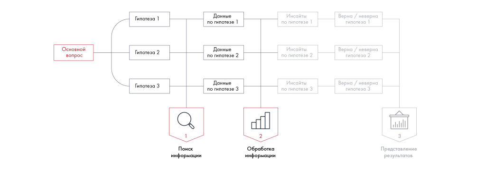

Иллюстрация исходника: «формат, в котором представите информацию. Это может быть таблица,». Подписи и числовые значения вынесены в расшифровку; порядок и связи элементов проверяются по сохранённому изображению.

[Подробная текстовая расшифровка рисунка](../../assets/transcripts/pdf-125-img-01.md).

Итог работы с данными

Мы уже говорили, что в плане работ для каждой гипотезы вы закрепляете формат, в котором представите информацию. Это может быть таблица, матрица ранжирования или схема. Но самый популярный вариант представления информации — диаграммы и графики.

Тип диаграммы выбирается в зависимости от того, что вы хотите показать: структуру, величину, динамику, частоту или корреляцию.

## Источник: [PDF 126](../../SOURCE.md#pdf-126)

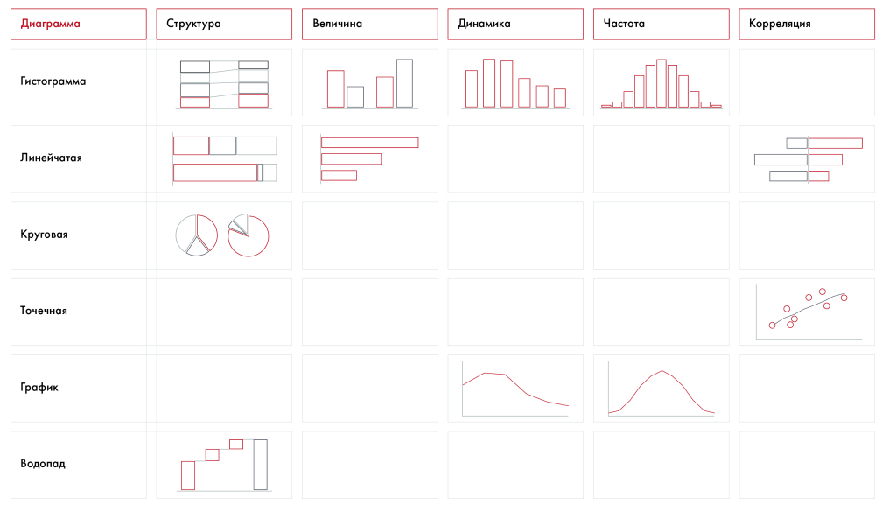

Матрица сопоставляет образцы гистограмм, линейчатых, круговых, точечных диаграмм, графиков и водопада с задачами представления структуры, величины, динамики, частоты и корреляции. В ячейках показаны графические образцы; числовых данных для самостоятельного расчёта нет.

[Подробная текстовая расшифровка рисунка](../../assets/transcripts/pdf-126-img-01.md).

Виды диаграмм. Источник: “Say It With Charts” by Gene Zelazny

Рассмотрим, какие виды диаграмм используются чаще всего и что они отображают.

Колонки показывают динамику показателя во времени. Нормированные колонки сравнивают доли, ненормированные — абсолютные величины.

[Подробная текстовая расшифровка рисунка](../../assets/transcripts/pdf-126-img-03.md).

Кольцевая диаграмма показывает разделение целого на части. Сектора располагаются от большего к меньшему, начиная от позиции «12 часов»; «Другое» помещается последним.

[Подробная текстовая расшифровка рисунка](../../assets/transcripts/pdf-126-img-02.md).

Редакторское представление двух колонок исходной таблицы; графические элементы приведены рядом.

| Левая колонка | Правая колонка |
| --- | --- |
| Кольцевая диаграмма показывает, как целое делится на части. Располагайте сектора от большего к меньшему, самый большой должен начинать от «12 часов». Далее сектора идут в порядке уменьшения кроме сектора «Другое»: он в любом случае должен быть последним. Для ясности не делите диаграмму больше чем на 5 частей. | Колонки помогают отследить динамику изменения объекта во времени. В зависимости от цели вы можете делать их нормированными (чтобы сравнить изменение доли) или ненормированными (для сравнения абсолютных величин). Располагайте элементы от большего к меньшему. Другое — наверх. Чтобы между колонками была видна связь, |

**Ссылки на этой странице исходника:** [Ссылка url-134](../../meta/source-links.md#url-134).

## Источник: [PDF 127](../../SOURCE.md#pdf-127)

Редакторское представление двух колонок исходной таблицы; графические элементы приведены рядом.

| Левая колонка | Правая колонка |
| --- | --- |
| Мы рекомендуем использовать кольцо, а не круг: так аккуратнее. Кроме того, внутри кольца можно разместить важную информацию, например общую выручку от продаж по странам Комбинация круга и колонки показывает дальнейшую разбивку компонентов. Начните с круговой диаграммы, затем поверните нужную часть в сторону колонки и закрасьте ее. Разделите часть круга на дальнейшие составляющие. В Microsoft Power Point этот тип диаграммы называется «вторичная линейчатая». Также, чтобы построить ее, вы можете воспользоваться надстройкой think-cell Линейная диаграмма показывает тренд или сравнение двух временных рядов. Для ясности добавляйте на один график не больше четырех линий. Используйте такие диаграммы для длинных временных рядов | проведите между ними пунктирные линии Линейчатая диаграмма подходит для позиционного сравнения. Здесь действуют те же правила: располагайте позиции от большего к меньшему, другое — в конец независимо от доли Диаграмма с областямисравнивает показатели нескольких факторов за период времени и показывает их взаимный рост. Диаграмма хорошо иллюстрирует совокупный эффект суммы элементов, а также от каждого элемента по отдельности |

Комбинация круга и колонки детализирует один сектор круговой диаграммы. Выбранная часть разворачивается в отдельную колонку с составляющими.

[Подробная текстовая расшифровка рисунка](../../assets/transcripts/pdf-127-img-01.md).

Линейчатая диаграмма сравнивает позиции по величине. Позиции упорядочены от большей к меньшей, «Другое» — в конце.

[Подробная текстовая расшифровка рисунка](../../assets/transcripts/pdf-127-img-02.md).

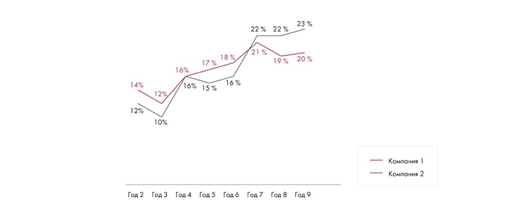

Линейная диаграмма показывает тренд или сравнивает временные ряды. Для ясности в книге рекомендуется не более четырёх линий.

[Подробная текстовая расшифровка рисунка](../../assets/transcripts/pdf-127-img-03.md).

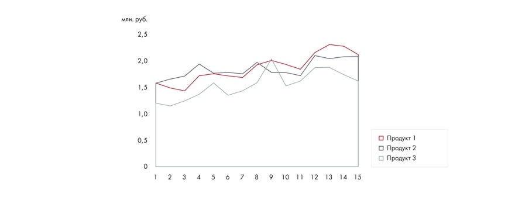

Диаграмма с областями показывает значения нескольких факторов за период, их взаимный рост и совокупный эффект.

[Подробная текстовая расшифровка рисунка](../../assets/transcripts/pdf-127-img-04.md).

## Источник: [PDF 128](../../SOURCE.md#pdf-128)

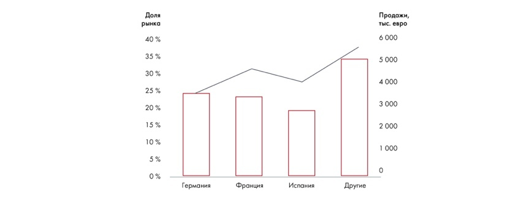

Иллюстрация исходника: «диаграммы бывают полезны, когда». Подписи и числовые значения вынесены в расшифровку; порядок и связи элементов проверяются по сохранённому изображению.

[Подробная текстовая расшифровка рисунка](../../assets/transcripts/pdf-128-img-02.md).

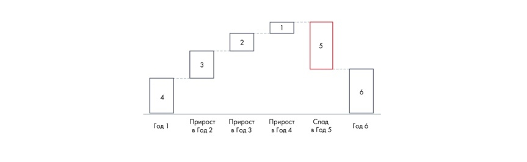

Иллюстрация исходника: «диаграммы бывают полезны, когда». Подписи и числовые значения вынесены в расшифровку; порядок и связи элементов проверяются по сохранённому изображению.

[Подробная текстовая расшифровка рисунка](../../assets/transcripts/pdf-128-img-01.md).

Редакторское представление двух колонок исходной таблицы; графические элементы приведены рядом.

| Левая колонка | Правая колонка |
| --- | --- |
| Каскадный график (водопад) показывает изменения за период. Лучше использовать его в конце, чтобы подвести итоги. Подходит для отображения общей выручки либо инвестиций и начала их возврата Диаграмма с корреляцией поможет выделить кластеры. Используйте дополнительные стрелки и круги, чтобы акцентировать внимание. Избегайте перегруженности матриц кластерами, чтобы ваша идея оставалась ясной | Комбинированные диаграммы бывают полезны, когда вы хотите показать две единицы измерения на одной оси. Будьте осторожны: если диаграмма интуитивно непонятна, зрители могут запутаться в ней Диаграмма разброса — наиболее удобный способ показать корреляцию, если у вас есть более 15 наблюдений. Чтобы подчеркнуть взаимосвязи, проведите прямую через точки на вашем графике и выделите скопления точек. Используйте легенду, а не подписи данных, чтобы лучше объяснить диаграмму |

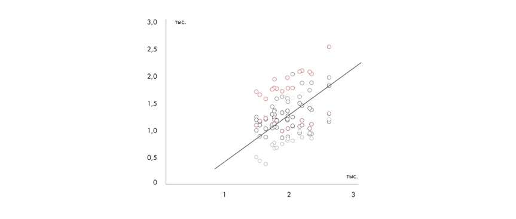

Иллюстрация исходника: «Диаграмма разброса — наиболее». Подписи и числовые значения вынесены в расшифровку; порядок и связи элементов проверяются по сохранённому изображению.

[Подробная текстовая расшифровка рисунка](../../assets/transcripts/pdf-128-img-04.md).

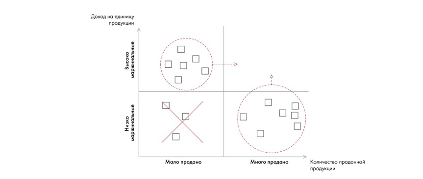

Иллюстрация исходника: «Диаграмма разброса — наиболее». Подписи и числовые значения вынесены в расшифровку; порядок и связи элементов проверяются по сохранённому изображению.

[Подробная текстовая расшифровка рисунка](../../assets/transcripts/pdf-128-img-03.md).

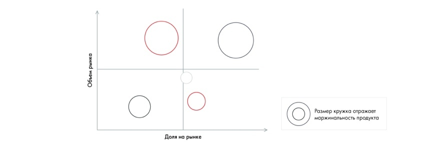

На рисунке приведены элементы: Обьем рынка; Размер кружка отражает; маржинальность продукта; Доля на рынке. Полная текстовая расшифровка приведена отдельно; геометрия и цветовые обозначения сохранены на изображении.

[Подробная текстовая расшифровка рисунка](../../assets/transcripts/pdf-128-img-05.md).

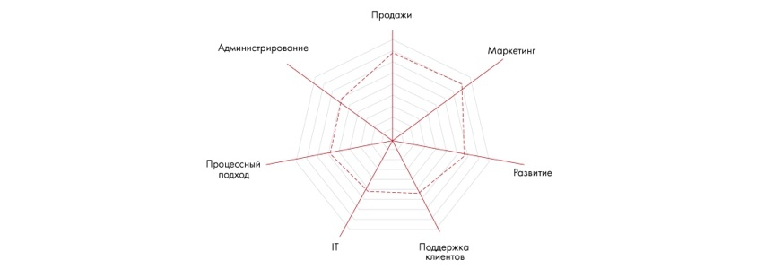

На рисунке приведены элементы: Продажи; Администрирование; Маркетинг; Процессный; розвитие. Полная текстовая расшифровка приведена отдельно; геометрия и цветовые обозначения сохранены на изображении.

[Подробная текстовая расшифровка рисунка](../../assets/transcripts/pdf-128-img-06.md).

## Источник: [PDF 129](../../SOURCE.md#pdf-129)

Редакторское представление двух колонок исходной таблицы; графические элементы приведены рядом.

| Левая колонка | Правая колонка |
| --- | --- |
| Пузырьковая диаграмма подходит для того, чтобы показывать наблюдения в трех измерениях: помимо горизонтальной и вертикальной оси имеет значение и размер каждого шара. Используйте стрелки, чтобы показать движение шаров. Разделяйте диаграмму на четыре части. Чаще всего верхний правый угол считается идеальным состоянием показателя | Диаграмма радар удобна для сравнения 1–4 объектов, сегментов или процессов по нескольким параметрам |

Рейтинговая диаграмма — уже известные вам шары Харви (Harvey’s balls). Используйте контрастные цвета, чтобы достигнуть максимального эффекта. Также можно добавить легенду с обозначениями разных степеней заливки. Обычно полный шарик означает абсолютное соответствие критерию, а пустой — абсолютное несоответствие Как сделать графики еще круче: ● Всегда проверяйте подписи и единицы измерения — они должны быть на каждой диаграмме. ● Добавляйте на линейчатый график линию CAGR[1], показывающую совокупный средний темп роста показателя за период. ● Если вы строите прогноз, добавьте три линии — для оптимистичного, нейтрального и негативного сценариев. ● Выделяйте цветом или помечайте прогнозные значения. ● Разделяйте разряды в длинных значениях пробелом или приводите цифры в других единицах измерения (например, не в рублях, а в миллионах рублей). ● Делайте поясняющие комментарии к важным цифрам.

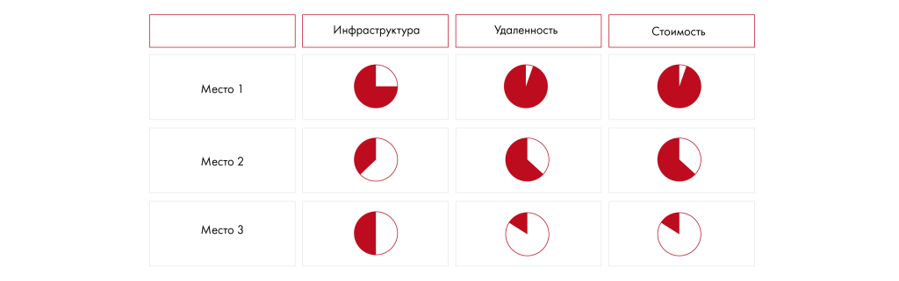

Иллюстрация исходника: «Рейтинговая диаграмма — уже известные вам шары Харви (Harvey’s balls).». Подписи и числовые значения вынесены в расшифровку; порядок и связи элементов проверяются по сохранённому изображению.

[Подробная текстовая расшифровка рисунка](../../assets/transcripts/pdf-129-img-01.md).

**Ссылки на этой странице исходника:** [Ссылка url-135](../../meta/source-links.md#url-135).

## Источник: [PDF 130](../../SOURCE.md#pdf-130)

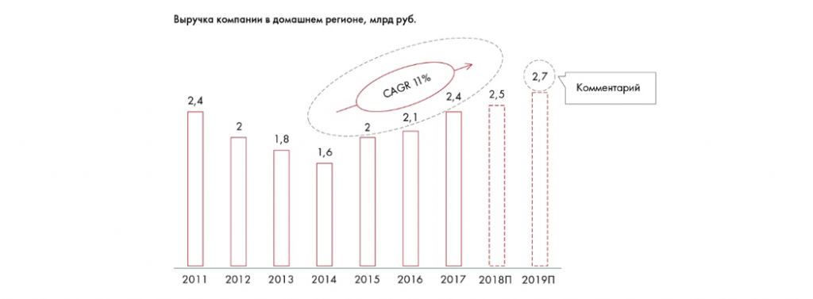

Иллюстрация исходника: «Пример хорошего графика: единицы измерения подписаны, показан CAGR,». Подписи и числовые значения вынесены в расшифровку; порядок и связи элементов проверяются по сохранённому изображению.

[Подробная текстовая расшифровка рисунка](../../assets/transcripts/pdf-130-img-01.md).

Пример хорошего графика: единицы измерения подписаны, показан CAGR, выделены прогнозные значения, даны комментарии к отдельным цифрам. Ось в случае хронологического порядка подписывать необязательно. Вместо длинных цифр даны измерения в миллиардах рублей.

**Ссылки на этой странице исходника:** [Ссылка url-136](../../meta/source-links.md#url-136).

## Связанные разделы

- [Все темы главы](INDEX.md)
- [Термины и сокращения](../../GLOSSARY.md)
- [Предыдущая тема: Практические задания 8.1–8.3: расчёты и выводы](exercises/01-data-analysis.md)
- [Следующая тема: Практическое задание 8.4 и чек-лист](exercises/02-chart-choice.md)
- [Авторские ответы по этой неделе](../13-answers/05-week-08.md)
