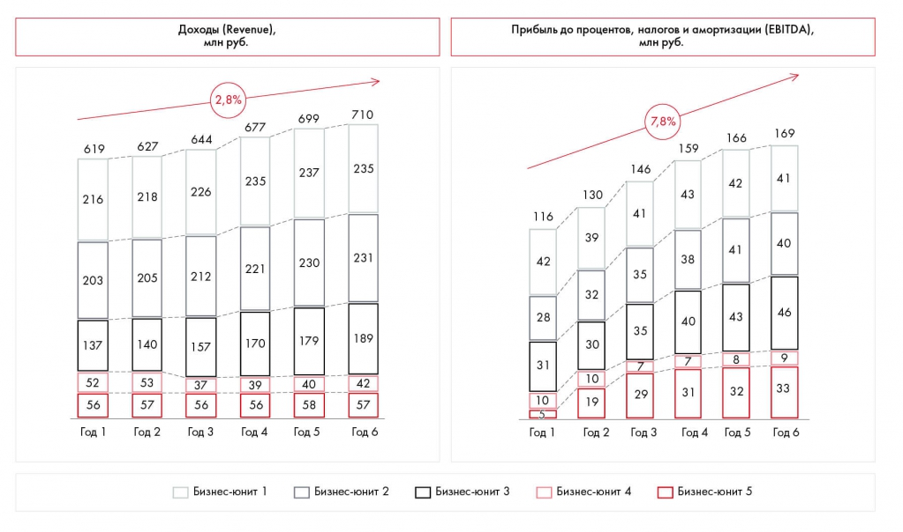
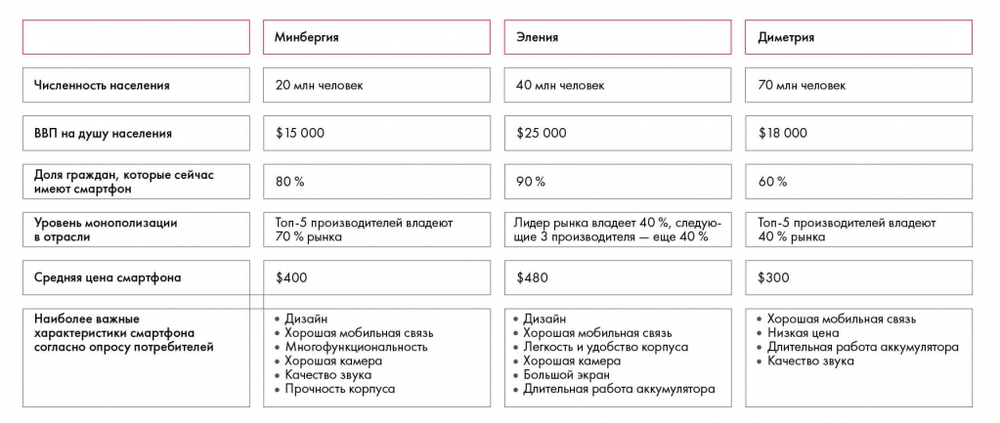
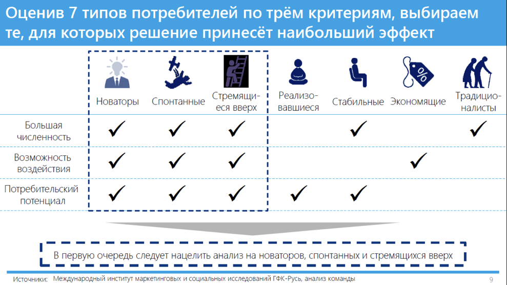
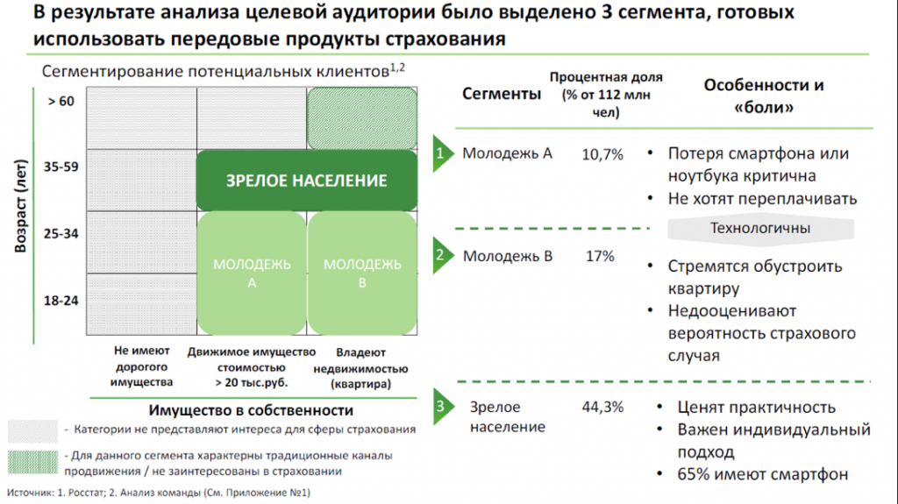
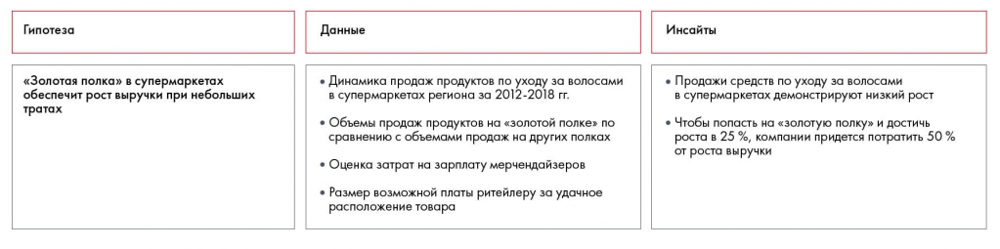

# Практические задания 8.1–8.3: расчёты и выводы

Сохранены данные и вопросы упражнений об обработке, выборе факторов и сегментации. Ответы вынесены в соответствующий раздел приложения.

**Источник:** физические страницы PDF 119–124. Печатные номера не установлены.

**Для последовательного чтения:** [Обработка и анализ данных](../01-analysis.md).

**Навигация:** [Индекс главы](../INDEX.md) · [Маршрутизатор](../../../ROUTER.md) · [Проблемы источника](../../../meta/issues.md).

---

## Источник: [PDF 119](../../../SOURCE.md#pdf-119)

**Практическое задание № 8.1**

## Источник: [PDF 120](../../../SOURCE.md#pdf-120)

Найдите на графиках как можно больше инсайтов.

На рисунке приведены элементы: 619; 216; 203; 137; 52. Полная текстовая расшифровка приведена отдельно; геометрия и цветовые обозначения сохранены на изображении.

[Подробная текстовая расшифровка рисунка](../../../assets/transcripts/pdf-120-img-01.md).

**Практическое задание № 8.2**

Компания Arwee занимается производством смартфонов. Ее флагманская модель, смартфон Arwee X1, стоит от 300 до 500 долларов и обладает такими характеристиками, как удобный корпус, чистый звук, многофункциональность, две качественные камеры, высокая емкость аккумулятора. Среди недостатков модели — относительно небольшой экран и хрупкость корпуса. Сейчас компания уже завоевала 35 % рынка в своей родной стране Букании и рассматривает новые страны. У нее есть три варианта. На основе данных сформулируйте инсайты и определите, на рынок какой страны лучше всего выходить.

**Ссылки на этой странице исходника:** [Ссылка url-126](../../../meta/source-links.md#url-126).

## Источник: [PDF 121](../../../SOURCE.md#pdf-121)

Дерево факторов оценки рынка смартфонов связывает размер населения, обеспеченность смартфонами, доход, монополизацию и цену. Ветки нужны для выбора данных, влияющих на результат.

[Подробная текстовая расшифровка рисунка](../../../assets/transcripts/pdf-121-img-01.md).

Анализировать данные вам помогут специальные инструменты: ранжирование, матрицы, инвестиционный анализ, сегментирование, сценарный подход, риск-анализ.

Ранжирование мы уже рекомендовали для оценки гипотез. Во время анализа информации этот инструмент помогает сопоставить отдельные инициативы на более глубоком уровне. Составьте список критериев для сравнения и оцените свои варианты по ним. Используйте 3–4 критерия оценки и не больше 5 инициатив. Вы можете сравнивать разные опции, используя Harvey’s balls[1], проставляя баллы или просто указывая «да/нет».

На рисунке приведены элементы: Оценив 7 типов потребителей по трём критериям, выбираем; те, для которых решение принесёт наибольший эффект; Стремящи-; Новаторы Спонтанные; еся вверх. Полная текстовая расшифровка приведена отдельно; геометрия и цветовые обозначения сохранены на изображении.

[Подробная текстовая расшифровка рисунка](../../../assets/transcripts/pdf-121-img-02.md).

**Ссылки на этой странице исходника:** [Ссылка url-127](../../../meta/source-links.md#url-127); [Ссылка url-124](../../../meta/source-links.md#url-124); [Ссылка url-128](../../../meta/source-links.md#url-128).

## Источник: [PDF 122](../../../SOURCE.md#pdf-122)

Пример ранжирования по принципу «да/нет». Источник: Changellenge ≫ Cup Russia, решение команды «Хурма Case»

**Практическое задание № 8.3**

Для увеличения доли рынка компания МТС решила запустить сервис по просмотру VR-фильмов в приложении «МТС-ТВ». Перед командой проекта встал вопрос: какое VR-устройство среди трех аналогов будет самым доступным для массового рынка?

Для ответа специалисты собрали данные и представили их в таком виде:

Oculus Rift. Стоят дорого — 45 тыс. рублей. Разрешение 2160 × 1200 точек с частотой обновления 90 Гц, качественный каркас, съемные наушники и микрофон. Пользователи дают устройству максимальную оценку.

Google Daydream. Купить можно за 9 тыс. руб. Для удешевления вместо пластикового каркаса и сложного крепления используется мягкая ткань и лента. Зато устройство совместимо с мобильными устройствами.

VR BOX. Совместимы практически с любыми мобильными устройствами. Стоят всего 1500 рублей. Имеют достаточно крепкий пластиковый каркас. Пользователи дают устройству оценку выше среднего.

Проанализируйте данные, используя ранжирование.

Сегментирование помогает разделить отрасли, компании и другие объекты анализа на группы в соответствии с рядом признаков. Частный случай сегментирования — матрицы, которые помогают наглядно разбить объекты на несколько групп, используя два параметра. На этом принципе основаны многие известные фреймворки: матрица McKinsey, матрица BCG, матрица Ансоффа. Также этот подход хорошо подходит для выделения сегментов потребителей. Можно сегментировать, например, по локации, социальному и экономическому эффекту, влиянию на цели, объем продаж, долю рынка и так далее. Для сегментирования широко используются статистические методы, в частности кластерный анализ[3].

**Ссылки на этой странице исходника:** [Ссылка url-014](../../../meta/source-links.md#url-014); [Ссылка url-129](../../../meta/source-links.md#url-129).

## Источник: [PDF 123](../../../SOURCE.md#pdf-123)

Иллюстрация исходника: «Пример построения матрицы.». Подписи и числовые значения вынесены в расшифровку; порядок и связи элементов проверяются по сохранённому изображению.

[Подробная текстовая расшифровка рисунка](../../../assets/transcripts/pdf-123-img-01.md).

Пример построения матрицы. Источник: Changellenge≫ Cup Moscow решение команды Achievement Catchers

Еще три подхода к анализу данных пригодятся при оценке эффекта и последствий решения. Инвестиционный анализ используется для сопоставления затрат с предполагаемыми доходами. Сценарный подход позволяет спрогнозировать эффект от принятого решения или экономическую обстановку, причем он работает даже в ситуации неопределенности внешней среды. При риск-анализе сопоставляется вероятность нежелательного события и ожидаемый ущерб со стоимостью защитных мер. Более подробно эти инструменты мы рассмотрим в главе «Подготовка решения».

Помимо общих подходов, вы можете использовать фреймворки: пять сил Портера, SWOT-анализ и так далее.

По итогам анализа вы получите ряд инсайтов, с помощью которых сможете подтвердить или опровергнуть гипотезу. Допустим, по гипотезе для кейса Besh вы получили следующие инсайты:

**Ссылки на этой странице исходника:** [Ссылка url-130](../../../meta/source-links.md#url-130); [Ссылка url-012](../../../meta/source-links.md#url-012).

## Источник: [PDF 124](../../../SOURCE.md#pdf-124)

На рисунке приведены элементы: Гипотеза; олотая полка» в супермаркет; еспечит рост выручки при небольш; тратах; Данные. Полная текстовая расшифровка приведена отдельно; геометрия и цветовые обозначения сохранены на изображении.

[Подробная текстовая расшифровка рисунка](../../../assets/transcripts/pdf-124-img-01.md).

Теперь вы можете понять, верна ли гипотеза. В данном случае гипотеза опровергнута: попадание на «золотую полку» принесет больше трат, чем компания готова выделить согласно условиям кейса. Аналогичную работу по сбору и анализу необходимо проделать по каждой из гипотез.

**Задание по кейсу**

Проанализируйте данные, чтобы сделать выводы по вашим гипотезам к кейсу Coca-Cola HBC Россия.

[1] От англ. Insight — «озарение».

[2] См. главу 4.

[3] См. Field, A. (2009). Discovering statistics using SPSS. Sage publications.

**Ссылки на этой странице исходника:** [Ссылка url-131](../../../meta/source-links.md#url-131); [Ссылка url-132](../../../meta/source-links.md#url-132); [Ссылка url-133](../../../meta/source-links.md#url-133).

## Связанные разделы

- [Все темы главы](../INDEX.md)
- [Термины и сокращения](../../../GLOSSARY.md)
- [Предыдущая тема: Обработка и анализ данных](../01-analysis.md)
- [Следующая тема: Представление результата: типы диаграмм](../02-charts.md)
- [Авторские ответы по этой неделе](../../13-answers/05-week-08.md)

> Редакторское примечание SRC-02: здесь сохранено сквозное задание, но полное условие кейса Coca-Cola из приложения 1 отсутствует в предоставленном PDF. См. [реестр проблем](../../../meta/issues.md).
