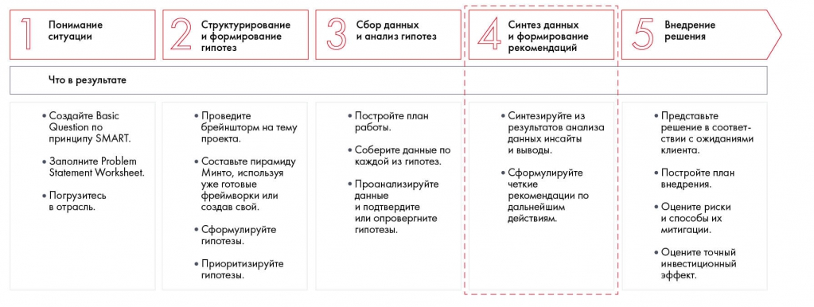
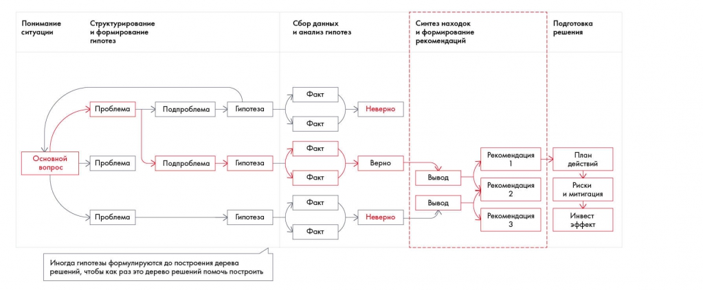
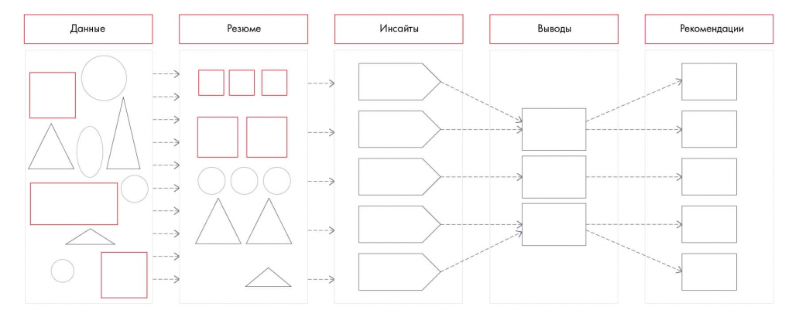

# Синтез данных

Различаются данные, резюме, инсайты, выводы и рекомендации. Упражнение 9.1 помогает проверить понимание этих уровней.

**Источник:** физические страницы PDF 132–136. Печатные номера не установлены.

**Предварительно:** [Этапы решения кейса](../01-case-method/04-solution-stages.md).

**Навигация:** [Индекс главы](INDEX.md) · [Маршрутизатор](../../ROUTER.md) · [Проблемы источника](../../meta/issues.md).

---

## Источник: [PDF 132](../../SOURCE.md#pdf-132)

### Неделя 9. Синтез данных и формирование рекомендаций

Вы уже проделали большую работу по построению структуры решения, выдвинули гипотезы и проверили их данными. На этой неделе разберемся, как свести все это вместе, овладеть мастерством синтеза и сформулировать рекомендации по кейсу.

На рисунке приведены элементы: Понимание; ситуации; Что в результате; • Создайте Basic; Question no. Полная текстовая расшифровка приведена отдельно; геометрия и цветовые обозначения сохранены на изображении.

[Подробная текстовая расшифровка рисунка](../../assets/transcripts/pdf-132-img-01.md).

Четвертый шаг — синтез данных и формирование рекомендаций

Синтез данных позволяет получить из выводов по гипотезам цельную картину, которую можно преобразовать в рекомендации. На самом деле процесс синтеза сопровождает весь ход решения кейса: вы постоянно обобщаете поступающую информацию и делаете из нее выводы. Во время структурирования решения и анализа гипотез синтез помогает концентрироваться на основном вопросе, находить слабые места и направления дальнейшей проработки. Но важнее всего правильно синтезировать данные на этапе рекомендаций, так как от этого зависит, одобрит клиент ваше решение или нет.

**Ссылки на этой странице исходника:** [Ссылка url-137](../../meta/source-links.md#url-137); [Ссылка url-138](../../meta/source-links.md#url-138).

## Источник: [PDF 133](../../SOURCE.md#pdf-133)

На рисунке приведены элементы: Понимание; ситуации; Структурирование; и формирование; гипотез. Полная текстовая расшифровка приведена отдельно; геометрия и цветовые обозначения сохранены на изображении.

[Подробная текстовая расшифровка рисунка](../../assets/transcripts/pdf-133-img-01.md).

Синтез находок и формулирование рекомендаций в решении кейса

Чтобы получить рекомендации по кейсу, нужно пройти несколько шагов:

1. Структурно изложить данные в виде резюме.

2. Получить инсайт –– обобщить информацию, связать факты вместе и сформировать таким образом свежий взгляд на проблему.

3. Сделать вывод на основе инсайта — придумать, какие пути решения возможны в данной ситуации.

4. Составить рекомендации на основе выводов. Они обязательно должны быть сформулированы по SMART, чтобы клиент четко понимал, что нужно сделать для решения проблемы.

### СИНТЕЗ ДАННЫХ

Синтез — это переход от неструктурированного и общего к максимально структурированному и конкретному. Процесс синтеза состоит из нескольких переходов — от данных к резюме, от резюме к инсайтам, от инсайтов к выводам и от выводов к рекомендациям.

**Ссылки на этой странице исходника:** [Ссылка url-139](../../meta/source-links.md#url-139).

## Источник: [PDF 134](../../SOURCE.md#pdf-134)

Последовательность синтеза: данные → резюме → инсайты → выводы → рекомендации. Каждый следующий уровень должен опираться на предыдущий.

[Подробная текстовая расшифровка рисунка](../../assets/transcripts/pdf-134-img-01.md).

Процесс синтеза

В чем разница между этими понятиями? Давайте рассмотрим на примере. Предположим, у вас есть данные в виде неструктурированных фактов:

- Прогноз погоды: ветер 15 м/с.

- Я вышел на улицу в шляпе, а через несколько минут ее уже не было в поле видимости.

- Шляпа стоила 10 тыс. руб., но была куплена со скидкой 30 %.

Эти данные можно структурировать — составить резюме. Ничего нового к имеющимся данным мы не добавляем, а просто представляем их более наглядно. В нашем случае резюме выглядит так:

- На улице сильный ветер.

- Что-то сорвало шляпу с моей головы.

- Что-то унесло шляпу прочь.

- Шляпа стоит 7 тыс. рублей.

**Ссылки на этой странице исходника:** [Ссылка url-140](../../meta/source-links.md#url-140).

## Источник: [PDF 135](../../SOURCE.md#pdf-135)

В отличие от резюме, инсайт — это результат ваших интеллектуальных усилий. Вы генерируете новую информацию, обобщая данные из разных источников, и получаете свежий взгляд на проблему. Инсайт — это не полет вашего воображения, на 80 % он научно обоснован. Вспомните, как в предыдущей главе мы получали инсайты с помощью фреймворков и формул. Из нашего резюме мы можем составить следующие инсайты:

- Ветер сорвал шляпу с моей головы (этот инсайт мы получили путем объединения информации «на улице сильный ветер» и «что-то сорвало шляпу с моей головы»).

- Я потерял 7 тыс. рублей (этот инсайт получили объединением информации «шляпа стоит 7 тыс. рублей» и «что-то унесло шляпу прочь»).

В отличие от инсайта, вывод может содержать в себе множество путей решения проблемы и на 70 % является творческим процессом. Тут можно дать волю фантазии. В данном случае можно сделать, например, следующие выводы:

- Нужна шляпа, которая будет держаться на голове даже в сильный ветер.

- Лучше не выходить из дома в ветреную погоду.

- Нельзя надевать шляпу при сильном ветре.

- Нельзя покупать такие дорогие шляпы.

Рекомендации — это то, что нужно сделать, опираясь на выводы, то есть четкий план по решению проблемы. Какие рекомендации можно составить в данном случае:

- Пойти в магазин и купить новую шляпу.

- Перед выходом на улицу оценивать силу ветра.

- Если ветер больше 7 м/с, не надевать шляпу, а оставить ее дома (надевать шляпу с завязками, снимать шляпу с головы и держать ее в руке и т. д.).

**Практическое задание № 9.1**

## Источник: [PDF 136](../../SOURCE.md#pdf-136)

У вас есть следующее резюме:

- У меня развязались шнурки на кедах.

- Я очень тороплюсь на встречу.

- На коленях появились ссадины.

Какие инсайты, выводы и рекомендации вы можете составить на основе данного резюме

**Ссылки на этой странице исходника:** [Ссылка url-141](../../meta/source-links.md#url-141); [Ссылка url-142](../../meta/source-links.md#url-142).

## Связанные разделы

- [Все темы главы](INDEX.md)
- [Термины и сокращения](../../GLOSSARY.md)
- [Предыдущая тема: Практическое задание 8.4 и чек-лист](../08-analysis-visualization/exercises/02-chart-choice.md)
- [Следующая тема: Формулирование рекомендаций с помощью синтеза](02-recommendations.md)
- [Авторские ответы по этой неделе](../13-answers/06-week-09.md)
