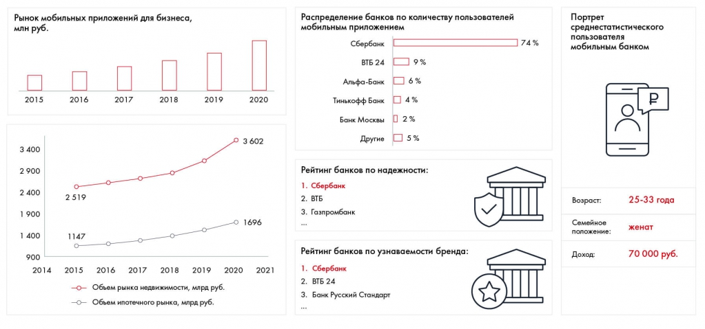
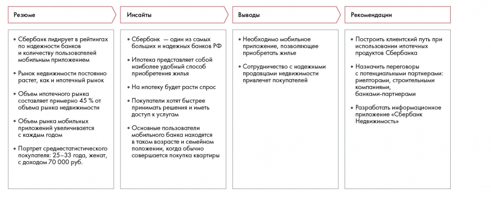

# Формулирование рекомендаций с помощью синтеза

Цепочка синтеза применяется к примеру мобильного банковского продукта. Разобраны требования к рекомендациям и необходимость проверки логики.

**Источник:** физические страницы PDF 136–141. Печатные номера не установлены.

**Для последовательного чтения:** [Синтез данных](01-synthesis.md).

**Навигация:** [Индекс главы](INDEX.md) · [Маршрутизатор](../../ROUTER.md) · [Проблемы источника](../../meta/issues.md).

---

## Источник: [PDF 136](../../SOURCE.md#pdf-136)

### Неделя 9. Синтез данных и формирование

### рекомендаций

### ФОРМУЛИРОВАНИЕ РЕКОМЕНДАЦИЙ С

### ПОМОЩЬЮ СИНТЕЗА

Чтобы понять, как правильно формулировать рекомендации, рассмотрим процесс синтеза на примере бизнес-задачи. Допустим, вы решали кейс, задача которого — разработать для Сбербанка новый цифровой продукт, который увеличит лояльность клиентов. Была выдвинута гипотеза «создать маркетплейс[1] на базе Сбербанка». По ней собрали следующие данные.

На рисунке приведены элементы: Рынок мобильных приложений для бизнеса,; млн руб.; 2015; 2016; 2017. Полная текстовая расшифровка приведена отдельно; геометрия и цветовые обозначения сохранены на изображении.

[Подробная текстовая расшифровка рисунка](../../assets/transcripts/pdf-136-img-01.md).

Эти данные можно резюмировать следующим образом:

**Ссылки на этой странице исходника:** [Ссылка url-141](../../meta/source-links.md#url-141); [Ссылка url-142](../../meta/source-links.md#url-142).

## Источник: [PDF 137](../../SOURCE.md#pdf-137)

- Сбербанк лидирует в рейтингах по надежности банка, количеству пользователей мобильного приложения и узнаваемости бренда.

- Рынок недвижимости постоянно растет, как и ипотечный рынок.

- Объем ипотечного рынка составляет примерно 45 % от объема рынка недвижимости.

- Объем рынка мобильных приложений увеличивается с каждым годом.

- Портрет среднестатистического пользователя мобильного банка: 25–33 года, женат, с доходом 70 тыс. рублей.

Чтобы получить инсайт, нужно задать вопрос «почему?» по каждому пункту резюме. Почему ситуация на рынке улучшается? Почему эта компания — лидер рынка? Почему продажи растут или падают? Почему эти две вещи отличаются? Почему этого не случилось? В процессе поиска инсайта вы увидите новые перспективы развития вопроса, начнете лучше понимать проблему и выявите главное.

Помните, что инсайт — это новое видение существующей ситуации. Это тот этап, на котором ваше решение получает «добавленную стоимость»: ваша работа по выстраиванию взаимосвязей позволяет увидеть проблему с непривычной стороны.

Попробуем вывести инсайты из нашего резюме, чтобы потом превратить их в рекомендации:

- Сбербанк лидирует в рейтингах по надежности банка и количеству пользователей мобильного приложения. Вероятно, Сбербанк — один из самых крупных и надежных банков РФ.

- Рынок недвижимости растет, как и ипотечный рынок, — значит, растет спрос на квартиры, а ипотека является одним из удобных способов приобрести недвижимость.

- Объем рынка мобильных приложений увеличивается. Почему? Вероятно, одна из причин в том, что пользователи хотят принимать решения быстрее и иметь доступ к услугам.

## Источник: [PDF 138](../../SOURCE.md#pdf-138)

- Портрет среднестатистического пользователя мобильного банка: 25–33 года, женат, с доходом 70 тыс. рублей. Значит, большинство пользователей мобильного банка находятся в том возрасте и семейном положении, когда совершается покупка квартиры.

Напомним: чтобы получить инсайт, вы можете провести анализ самостоятельно (с помощью фреймворков и других подходов, рассмотренных ранее) или пообщаться с экспертом. Хорошей идеей также будет провести повторный мозговой штурм, чтобы собрать все возможные подходы к проблеме. Спорьте, ищите альтернативные варианты, сравнивайте их по критериям. Избегайте инсайтов, основанных на одном мнении или факте. Ищите обоснование всех утверждений, которые выдвигаете. В то же время не стремитесь к излишнему перфекционизму — у каждой идеи будут свои слабые стороны, вам нужно просто выбрать самую привлекательную. Закладывайте на поиск инсайтов достаточно времени — это небыстрый процесс.

После того как инсайты найдены, перейдем к выводам. Вывод — это синтез инсайтов. вы объединяете их, чтобы понять, что же это значит для вашей проблемы. Чтобы перейти от инсайтов к выводу, задайте себе вопрос «и что?». В чем тут проблема на самом деле? Что это значит для компании? Как это можно использовать?

Вывод отличается от резюме и инсайтов тем, что содержит в себе элемент креативности. Все зависит от того, как вы истолкуете свои данные, под каким углом на них посмотрите. Инсайты требуют максимальной четкости и аккуратности при формулировке, в то время как для вывода важны интерпретация и понимание логики. Залог успешного инсайта — хорошая аналитическая работа и полное понимание фактов, в то время как хороший вывод должен также соотноситься с корпоративной стратегией компании, ее ценностями, целями заказчика.

Вернемся к примеру Сбербанка. На основе инсайтов, которые мы рассмотрели ранее, можно сделать следующие выводы:

- Итак, у нас крупный и надежный банк с большим количеством пользователей мобильного приложения. Многие клиенты готовы приобрести

## Источник: [PDF 139](../../SOURCE.md#pdf-139)

квартиру в ипотеку, а также хотят более быстрого сервиса. Вывод: банку нужно приложение, которое позволит покупать недвижимость.

- Наши клиенты с нами, потому что Сбербанк надежен. Если банк создаст собственное приложение для покупки недвижимости, важно обеспечить им надежность сделок.

Как видно из примера, выводы основаны на данных, но дополнены собственными идеями. Выводом вы не только обобщаете инсайты, но и развиваете свою мысль.

### Задание по кейсу

Сделайте выводы на основе ваших инсайтов по кейсу Coca-Cola HBC Россия.

Наконец, переходим к самому важному — рекомендациям. Это краткое изложение того, что необходимо предпринять. Обычно это список из 2–5 пунктов, который отражает четкую последовательность действий. Не нужно создавать полный и детализированный рабочий план, но и не нужно выдавать в числе рекомендаций только одну из многих вещей, которые, как вы считаете, нужно сделать.

Рекомендации формируются, когда при анализе выводов вы задаете вопрос «Что делать?». Как мы можем повлиять на эту ситуацию? Что стоит предпринять по этому поводу?

Например, для Сбербанка мы можем дать следующие рекомендации:

- Построить клиентский путь при использовании ипотечных продуктов Сбербанка.

- Назначить переговоры с потенциальными партнерами: риелторами, строительными компаниями, банками-партнерами.

- Разработать информационное приложение «Сбербанк.Недвижимость».

## Источник: [PDF 140](../../SOURCE.md#pdf-140)

Пример синтеза для Сбербанка: факты о надёжности, ипотеке и мобильном банкинге переходят в инсайты, затем в вывод о мобильном приложении и конкретные действия с партнёрами.

[Подробная текстовая расшифровка рисунка](../../assets/transcripts/pdf-140-img-01.md).

Процесс синтеза для формирования рекомендаций

При формулировании рекомендации следуйте правилам:

**- Все рекомендации должны строго строиться на данных. Убедитесь,**

что рекомендация действительно опирается на те данные, что вы использовали. Идея, не подкрепленная данными, — это гипотеза, которую нужно еще проверить, прежде чем сообщать ее заказчику.

- Используйте принцип SMART. Ваши рекомендации должны быть максимально конкретны, чтобы клиенту было легче их применить.

**- Разрабатывайте рекомендации, начиная с ранних стадий работы над**

кейсом. Первые рекомендации можно сформулировать, когда решение готово на 20–40 %. По ходу решения перепроверяйте рекомендации, используйте их, чтобы перестроить и переориентировать направление работы.

**- Получите обратную связь по рекомендациям в процессе**

решения. Обсуждайте рекомендации с людьми, которые хорошо разбираются в теме и заинтересованы в результате. Это могут быть ваши коллеги, члены команды, клиент (если вы представляете решение непосредственно компании-заказчику).

**- Будьте готовы, что найдете недочеты в своей логике. Оставьте запас**

времени на поиск и исправление ошибок.

**- Если вы работаете непосредственно с заказчиком, дайте ему время**

на принятие рекомендаций. Клиенту нужно все осмыслить. К тому же вы

**Ссылки на этой странице исходника:** [Ссылка url-143](../../meta/source-links.md#url-143).

## Источник: [PDF 141](../../SOURCE.md#pdf-141)

можете столкнуться с психологическими барьерами («мы уже это пробовали, это не работает», «на самом деле это не проблема»), а также с идеями, которые в компании считаются неоспоримыми, и людьми, чье мнение непререкаемо.

**Ссылки на этой странице исходника:** [Ссылка url-144](../../meta/source-links.md#url-144).

## Связанные разделы

- [Все темы главы](INDEX.md)
- [Термины и сокращения](../../GLOSSARY.md)
- [Предыдущая тема: Синтез данных](01-synthesis.md)
- [Следующая тема: Сравнение альтернатив и рекомендации по Besh](03-options.md)
- [Авторские ответы по этой неделе](../13-answers/06-week-09.md)

> Редакторское примечание SRC-02: здесь сохранено сквозное задание, но полное условие кейса Coca-Cola из приложения 1 отсутствует в предоставленном PDF. См. [реестр проблем](../../meta/issues.md).
