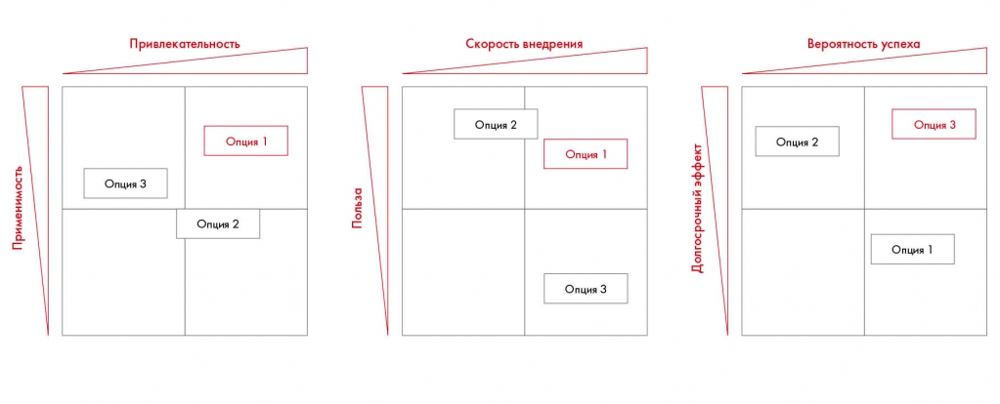
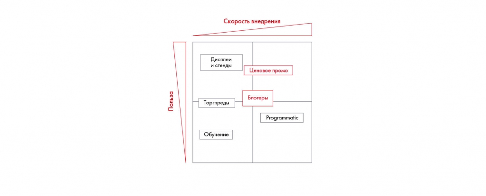

# Сравнение альтернатив и рекомендации по Besh

Матрицы сравнивают применимость, привлекательность, пользу и скорость инициатив. Пример Besh доводит анализ альтернатив до набора рекомендаций.

**Источник:** физические страницы PDF 141–145. Печатные номера не установлены.

**Для последовательного чтения:** [Формулирование рекомендаций с помощью синтеза](02-recommendations.md).

**Навигация:** [Индекс главы](INDEX.md) · [Маршрутизатор](../../ROUTER.md) · [Проблемы источника](../../meta/issues.md).

---

## Источник: [PDF 141](../../SOURCE.md#pdf-141)

Разработав рекомендации, важно разложить их на опции и сравнить между собой. Для этого удобно использовать знакомый нам инструмент Impact Matrix или другие матрицы с двумя параметрами.

Три матрицы сравнивают опции по привлекательности и применимости, пользе и скорости внедрения, вероятности успеха и долгосрочному эффекту.

[Подробная текстовая расшифровка рисунка](../../assets/transcripts/pdf-141-img-01.md).

Варианты сравнения опций

Например, для рекомендации «Разработать информационное приложение» можно предложить такие опции:

- Нанять агентство для разработки приложения под ключ.

- Разработать техническое задание на приложение и нанять агентство для разработки.

- Полностью разработать приложение внутренней командой.

Теперь вернемся к кейсу Besh. Предположим, по итогам анализа инсайтов у нас подтвердились

**Ссылки на этой странице исходника:** [Ссылка url-144](../../meta/source-links.md#url-144).

## Источник: [PDF 142](../../SOURCE.md#pdf-142)

следующие гипотезы:

- Стенды и дисплеи в супермаркетах и торговых центрах позволят максимально широко охватить целевую аудиторию.

- В супермаркетах и гипермаркетах стоит продавать только самые популярные средства — шампуни и бальзамы.

- В аптеки необходимо присылать представителей компании для продвижения товара и лучшей выкладки.

- В аптеках лучше всего будут продаваться средства от перхоти и для чувствительной кожи.

- Programmatic[2]-реклама обеспечит высокий объем продаж в интернет-магазине.

- Сезонные ценовые промоакции в интернет-магазине позволят увеличить продажи.

- Сотрудничество с бьюти-блогерами стимулирует сбыт.

- Рекомендации мастеров в салонах красоты обеспечат высокие продажи.

- Ассортимент в онлайн-магазине должен быть представлен максимально широко.

На их основе мы можем сделать следующие выводы:

- Ключевые каналы для нашего продукта — супермаркеты, гипермаркеты и торговые центры, при этом салоны красоты дадут небольшой, но стратегически важный прирост продаж.

- В салонах красоты нужно представить всю линейку продуктов, в аптеках

— лечебные средства, а в супермаркетах и гипермаркетах — только шампуни и бальзамы.

- В офлайне товар нужно продвигать с помощью стендов и дисплеев, а в онлайн-каналах –– через programmatic-рекламу, ценовые промоакции и сотрудничество с блогерами.

**Ссылки на этой странице исходника:** [Ссылка url-145](../../meta/source-links.md#url-145).

## Источник: [PDF 143](../../SOURCE.md#pdf-143)

- В салонах красоты необходимо добиваться того, чтобы мастера рекомендовали средства для ухода клиентам.

- В аптеках необходимо выстраивать отношения через торговых представителей.

Исходя из этих выводов, мы предлагаем следующие рекомендации:

- Распределить товары по каналам следующим образом:

o Супермаркеты и гипермаркеты — Besh Home Oil (шампунь + ополаскиватель), Besh Home Strength (шампунь + ополаскиватель).

o Аптеки — линейка Besh Home Anti-Dandruff, линейка Besh Home Scalp.

o Салоны красоты — все линейки.

o Интернет-магазин — все линейки.

- Воплотить следующие инициативы в каналах продаж:

o Супермаркеты и гипермаркеты — установить специализированные стенды с раздачей пробников и дисплеи.

o Аптеки — обеспечить лучшую выкладку через торговых представителей.

o Салоны красоты — проводить обучающие мероприятия для мастеров.

o Интернет-магазин — устраивать ценовые промоакции в начале продаж и во время праздников, договориться с бьюти-блогерами о продвижении товара, закупить programmatic-рекламу.

Теперь можно разложить предлагаемые инициативы на опции. Например, рассмотреть соотношение «польза — быстрота внедрения», то есть изучить потенциальную выручку или прибыльность инициативы и скорость, с которой ее можно воплотить в жизнь. Очевидно, инициативы, связанные с цифровым маркетингом, реализуются быстрее и проще. Однако потенциальная польза от работы в офлайн-каналах не меньше, а иногда и выше, поскольку благодаря этим каналам можно получить большой охват покупателей.

## Источник: [PDF 144](../../SOURCE.md#pdf-144)

Иллюстрация исходника: «Пример разложения по матрице». Подписи и числовые значения вынесены в расшифровку; порядок и связи элементов проверяются по сохранённому изображению.

[Подробная текстовая расшифровка рисунка](../../assets/transcripts/pdf-144-img-01.md).

Пример разложения по матрице

**Задание по кейсу**

Сформулируйте 5–6 рекомендаций для кейса Coca-Cola HBC Россия. Разложите их на опции, используя матрицы.

### Чек-лист по итогам девятой недели:

- Знаю, какие шаги нужно совершить, чтобы перейти от сырых данных к рекомендациям по кейсу.

- Понимаю, чем инсайты отличаются от выводов.

- Умею правильно формулировать рекомендации.

- Могу разложить свою рекомендацию на опции и сравнить их между собой.

[1] Маркетплейс — платформа электронной коммерции, предоставляющая покупателям информацию о продуктах или услугах третьих лиц и возможность их приобрести.

**Ссылки на этой странице исходника:** [Ссылка url-146](../../meta/source-links.md#url-146).

## Источник: [PDF 145](../../SOURCE.md#pdf-145)

[2] Покупка показов или целевых действий через автоматические площадки, а не напрямую у владельцев сайтов. Пример — рекламные кампании в Google Ads, «Яндекс.Директ».

**Ссылки на этой странице исходника:** [Ссылка url-147](../../meta/source-links.md#url-147).

## Связанные разделы

- [Все темы главы](INDEX.md)
- [Термины и сокращения](../../GLOSSARY.md)
- [Предыдущая тема: Формулирование рекомендаций с помощью синтеза](02-recommendations.md)
- [Следующая тема: План внедрения и диаграмма Гантта](../10-solution/01-implementation.md)
- [Авторские ответы по этой неделе](../13-answers/06-week-09.md)

> Редакторское примечание SRC-02: здесь сохранено сквозное задание, но полное условие кейса Coca-Cola из приложения 1 отсутствует в предоставленном PDF. См. [реестр проблем](../../meta/issues.md).
