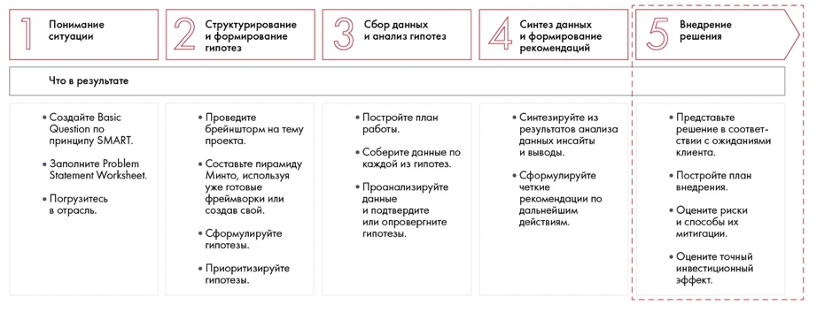
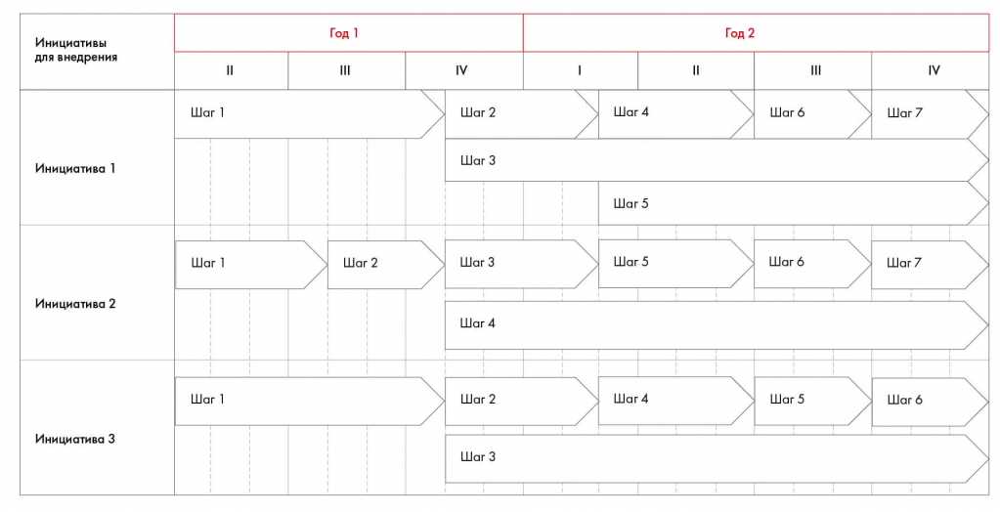
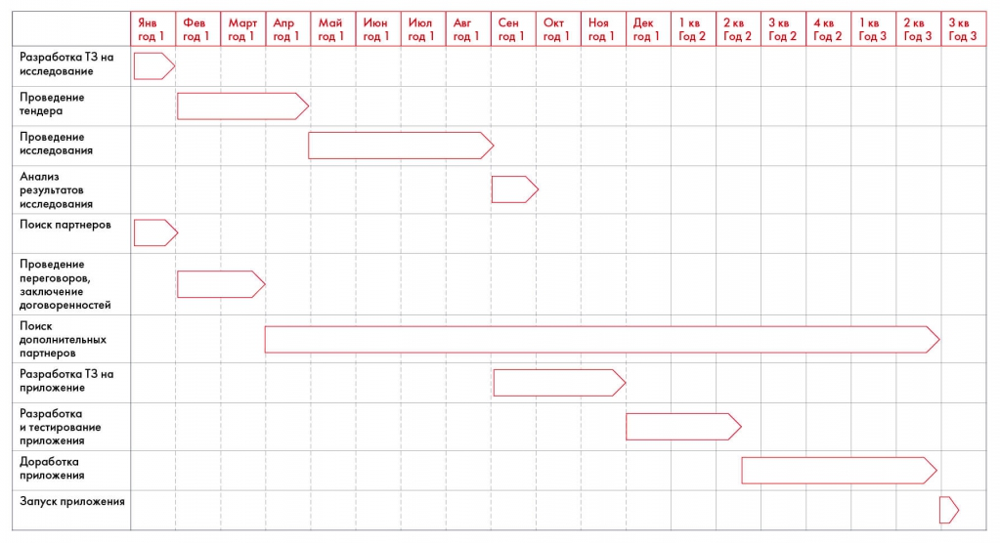
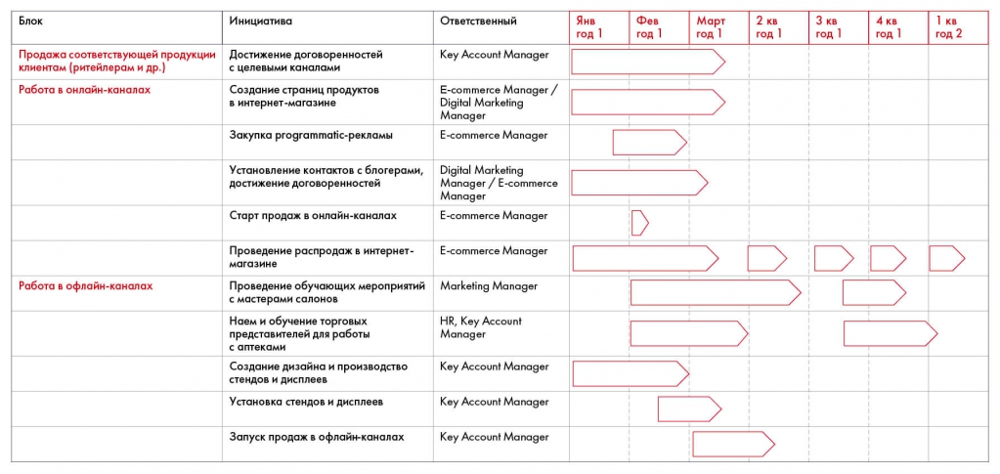

# План внедрения и диаграмма Гантта

Рекомендации превращаются в конкретные шаги, сроки и ответственность. Сохранены примеры плана банковского приложения и внедрения инициатив Besh.

**Источник:** физические страницы PDF 145–152. Печатные номера не установлены.

**Предварительно:** [Этапы решения кейса](../01-case-method/04-solution-stages.md).

**Навигация:** [Индекс главы](INDEX.md) · [Маршрутизатор](../../ROUTER.md) · [Проблемы источника](../../meta/issues.md).

---

## Источник: [PDF 145](../../SOURCE.md#pdf-145)

### Неделя 10. Подготовка решения

Теперь главная задача — подумать над воплощением ваших рекомендаций в жизнь. Вы узнаете, как подготовить план внедрения, а также научитесь оценивать потенциальные риски и финансовый эффект своего решения. Неделя будет насыщенной! Чтобы вы лучше разобрались в сложных темах, мы приготовили много практических заданий.

Иллюстрация исходника: «План внедрения удобнее всего представлять в виде диаграммы Гантта. При оценке». Подписи и числовые значения вынесены в расшифровку; порядок и связи элементов проверяются по сохранённому изображению.

[Подробная текстовая расшифровка рисунка](../../assets/transcripts/pdf-145-img-01.md).

Шаг 5. Внедрение решения

План внедрения удобнее всего представлять в виде диаграммы Гантта. При оценке сроков важно учитывать не только сам процесс, но и рабочее время сотрудников, необходимые согласования. Чтобы не промахнуться со сроками, посоветуйтесь с экспертом в отрасли или сотрудником компании-заказчика.

Оцените риски с помощью матрицы рисков — инструмента, который ранжирует их по вероятности возникновения и потенциальному ущербу. Важно не только перечислить риски, но и предложить способы их минимизировать.

**Ссылки на этой странице исходника:** [Ссылка url-147](../../meta/source-links.md#url-147).

## Источник: [PDF 146](../../SOURCE.md#pdf-146)

Финансовый результат оценивается с помощью финансового моделирования, эконометрических моделей, бенчмаркинга и экспертного мнения. При решении кейса от вас может понадобиться построить финансовую отчетность на ближайшие несколько лет или оценить будущие денежные потоки от проекта. Соотношение затрат и выгод также помогает выбрать самые привлекательные инициативы и убедить клиента в обоснованности решения.

### План внедрения и оценка рисков

Чтобы убедить заказчика, что ваши рекомендации не пустой звук, вы должны предоставить детальный план работ по их внедрению. В отличие от самих рекомендаций, он должен включать в себя все шаги, которые нужно предпринять компании, конкретные сроки, а в идеале еще и ответственных лиц.

Конечно, если у вас нет опыта работы над процессами, упоминаемыми в кейсе, и вы никогда не трудились в крупной компании, на этапе детализации плана вы можете столкнуться с трудностями. В этом случае обращайтесь к сторонним источникам. Например, если вам нужно разработать облачное решение, просмотрите сайты агентств и разработчиков, позвоните им, узнайте, в какие сроки они готовы создать нужный программный продукт. Поищите знакомых, которые работают в интересующей отрасли или даже компании, кейс которой вы решаете. Возможно, они тоже никогда не сталкивались с подобной задачей, но им в любом случае будет гораздо легче прикинуть, за какое время ее можно решить. Ориентируйтесь на задание кейса — обычно там указаны сроки внедрения. Но здесь важно не подгонять ваши меры под заданные условия. Если вы понимаете, что они никак не укладываются в срок, то лучше сократите или уберите их.

Никогда не ставьте сроки наобум. За три недели вы не внедрите систему умных скважин на четырех месторождениях и не обновите внутреннее обустройство 20 салонов красоты в Москве. Помните, что в любой крупной компании процессы требуют обсуждения и зачастую долгих согласований, а сотрудники будут заниматься не только вашим проектом, но и другими задачами. Учитывайте это при составлении плана.

В предыдущей главе мы сформулировали рекомендации для Сбербанка. Какие шаги нужны, чтобы воплотить эти рекомендации в жизнь:

1. Построить клиентский путь при использовании ипотечных продуктов Сбербанка.

## Источник: [PDF 147](../../SOURCE.md#pdf-147)

2. Назначить переговоры с потенциальными партнерами: риелторами, строительными компаниями, банками-партнерами.

3. Разработать информационное приложение «Сбербанк.Недвижимость».

Первые два шага, по сути, станут подготовительным этапом для третьего. Разберемся, как будет выстроен этот процесс.

Чтобы построить клиентский путь при использовании ипотечных продуктов Сбербанка, необходимо провести исследование потребителей. Можно использовать разные варианты: например, найти и проанализировать вторичные данные, нанять агентство, провести самостоятельно. Предположим, по нашей Impact Matrix мы решили выбрать второй вариант. Тогда нам необходимо выделить проектного менеджера под проведение исследования, сформулировать бизнес-задачу, провести тендер на исследование, сделать бриф для агентства, проконтролировать процесс с приемкой результатов. Если внутренняя подготовка может занять немного времени (1– 2 недели), то проведение тендера —это уже более сложная процедура, которая может идти и полгода. Однако предположим, что возможно будет ускорить процесс, и заложим 3 месяца. Далее наступит долгая кропотливая работа над исследованием. Подумаем, какие оно включает этапы. Допустим, это анализ больших данных покупателей ипотечных продуктов, качественное исследование (глубинные интервью), количественное исследование (опрос). Затем на основе этих трех этапов получится воссоздать клиентский путь. Каждый из этих этапов займет около месяца с учетом загрузки агентства, согласования результатов его работы с проектным менеджером, внутренних согласований с обеих сторон.

Теперь создадим план для этого процесса:

| Ключевые шаги | Сроки |
| --- | --- |
| Разработка ТЗ на исследование | Январь, год 1 |
| Проведение тендера | Февраль — апрель, год 1 |
| Проведение исследования | Май — август, год 1 |
| Анализ результатов | Сентябрь, год 1 |

## Источник: [PDF 148](../../SOURCE.md#pdf-148)

Параллельно с исследованием вы можете приступать и к шагу 2 — переговорам. Учитывая обширные связи Сбербанка, этот процесс займет не так много времени — максимум 1–2 месяца. Кроме того, поиск партнеров можно продолжать и после запуска приложения. Стоит заложить также пару недель на составление предварительного списка возможных партнеров.

| Ключевые шаги | Сроки |
| --- | --- |
| Поиск партнеров | Январь, год 1 |
| Проведение переговоров, заключение договоренностей | Февраль — март, год 1 |
| Дополнение списка партнеров | Апрель, год 1 |

Теперь приступим к самому сложному — разработке приложения. Поразмышляем, из чего она состоит.

Сначала надо разработать техническое задание на создание приложения. Этот процесс включает в себя создание брифа, обсуждение с проектной командой, внесение правок и необходимые согласования. Создание ТЗ[1] в крупной корпорации (даже такой продвинутой agile[2]-компании, как Сбербанк) займет минимум месяц, с учетом согласований, может, и год. Сделаем предположение, что разработка ТЗ займет три месяца. После этого начинается разработка, тестирование приложения и его доработка. Здесь основная загвоздка в том, что в банках все продукты должны быть супербезопасными, так как в их распоряжение поступают финансовые данные пользователей. Поэтому все решения, что быстро принимаются в других сферах, в банках проходят длительную разработку и последующую проверку. Таким образом, чтобы получить минимально жизнеспособный продукт, понадобится еще около шести месяцев. Дальнейшая доработка приложения зависит от того, как его воспримут клиенты и нужно ли будет адаптировать его под ситуацию на рынке и новых партнеров. Таким образом, если мы начнем разрабатывать приложение прямо после получения результатов исследования потребителей, то оно будет готово примерно через год, а дорабатываться по результатам обратной связи будет еще около года.

Предлагаем создать план для этого процесса.

| Ключевые шаги | Сроки |
| --- | --- |
| Разработка ТЗ на приложение | Сентябрь — ноябрь, год 1 |
| Разработка и тестирование приложения | Декабрь, год 1 — май, год 2 |

**Ссылки на этой странице исходника:** [Ссылка url-148](../../meta/source-links.md#url-148); [Ссылка url-149](../../meta/source-links.md#url-149).

## Источник: [PDF 149](../../SOURCE.md#pdf-149)

| Доработка приложения | Июнь, год 2 — июнь, год 3 |
| --- | --- |
| Запуск приложения | Сентябрь, год 2 |

При желании вы можете копнуть еще глубже, например уточнить, сколько времени займет разработка UI/UX[3]-дизайна приложения.

Визуально план внедрения удобнее всего изображать с помощью диаграммы Гантта[4]. Это таблица, где в строках указаны меры, а в столбцах — время на их внедрение (недели, месяцы, кварталы или годы). Вы можете группировать свои инициативы по блокам, чтобы диаграмма была более компактной.

Иллюстрация исходника: «Упрощенный вариант диаграммы Гантта». Подписи и числовые значения вынесены в расшифровку; порядок и связи элементов проверяются по сохранённому изображению.

[Подробная текстовая расшифровка рисунка](../../assets/transcripts/pdf-149-img-01.md).

Упрощенный вариант диаграммы Гантта

А вот так может выглядеть диаграмма Гантта для кейса Сбербанка:

**Ссылки на этой странице исходника:** [Ссылка url-150](../../meta/source-links.md#url-150); [Ссылка url-151](../../meta/source-links.md#url-151); [Ссылка url-152](../../meta/source-links.md#url-152).

## Источник: [PDF 150](../../SOURCE.md#pdf-150)

План приложения распределяет исследование, поиск партнёров, техническое задание, разработку, тестирование и запуск по месяцам первого года и кварталам последующих лет. Точные интервалы читаются по полосам диаграммы.

[Подробная текстовая расшифровка рисунка](../../assets/transcripts/pdf-150-img-01.md).

Диаграмма Гантта для кейса Сбербанка

Соблюдайте следующие рекомендации при построении диаграммы Гантта:

- Структурируйте части по блокам. Например, создание продукта, маркетинг и продвижение. А уже в рамках блоков ставьте отдельные задачи.

- Некоторые люди строят диаграммы прямо с точностью до дней. Очень не советуем этого делать, так как все быстро меняется и вам придется менять диаграмму каждый день. Лучше строить ее с точностью максимум до недель.

- При этом ключевые события (например, дату запуска продукта) все-таки нужно обозначить конкретным днем, чтобы все к ней готовились. Таких ключевых событий должно быть 1–3 на диаграмму — не больше.

- Диаграмму можно строить в любом инструменте: от простых Excel и PowerPoint до специальных Microsoft Project, OnlyOffice, Smartsheet и т.д.

**Давайте вернемся к кейсу Besh и построим к нему диаграмму Гантта. Вспомним,**

какие инициативы мы предлагали:

**Ссылки на этой странице исходника:** [Ссылка url-153](../../meta/source-links.md#url-153).

## Источник: [PDF 151](../../SOURCE.md#pdf-151)

**· Распределить товары по каналам следующим образом:**

o Супермаркеты и гипермаркеты — Besh Home Oil (шампунь + ополаскиватель), Besh Home Strength (шампунь + ополаскиватель).

o Аптеки — линейка Besh Home Anti-Dandruff, линейка Besh Home Scalp.

o Салоны красоты — все линейки.

o Интернет-магазин — все линейки.

**· Воплотить следующие инициативы в каналах продаж:**

o Супермаркеты и гипермаркеты — установить специализированные стенды с раздачей пробников и дисплеи.

o Аптеки — обеспечить лучшую выкладку через торговых представителей.

o Салоны красоты — проводить обучающие мероприятия для мастеров.

o Интернет-магазины — проводить промоакции в начале продаж и во время праздников, договориться с бьюти-блогерами о продвижении товара, закупить programmatic-рекламу.

Согласно условию, мы должны уложиться в 1 год. Как в таком случае нужно спланировать инициативы? Какие сотрудники в Besh должны быть ответственны за тот или иной шаг?

Исходя из условий задачи, мы создали план по подготовке к выводу продукта на рынок и перечислили мероприятия, которые нам понадобятся уже после старта продаж. Самый ответственный этап — запуск. На этот период мы и запланировали большую часть активностей, посвященных линейке.

## Источник: [PDF 152](../../SOURCE.md#pdf-152)

Диаграмма Гантта Besh связывает инициативы онлайн- и офлайн-каналов с должностями ответственных и периодами внедрения. Сохранены все текстовые строки, временные полосы остаются на изображении.

[Подробная текстовая расшифровка рисунка](../../assets/transcripts/pdf-152-img-01.md).

Пример диаграммы Гантта по кейсу Besh

**Задание по кейсу**

Постройте план работ по кейсу Coca-Cola HBC Россияс использованием диаграммы Гантта..

**Ссылки на этой странице исходника:** [Ссылка url-154](../../meta/source-links.md#url-154).

## Связанные разделы

- [Все темы главы](INDEX.md)
- [Термины и сокращения](../../GLOSSARY.md)
- [Предыдущая тема: Сравнение альтернатив и рекомендации по Besh](../09-synthesis/03-options.md)
- [Следующая тема: Оценка рисков и меры нивелирования](02-risks.md)
- [Авторские ответы по этой неделе](../13-answers/07-week-10-risks.md)
- [Ответ к заданию 10.4](../13-answers/08-week-10-pnl.md)
- [Ответы к заданиям 10.5–10.7](../13-answers/09-week-10-valuation.md)

> Редакторское примечание SRC-02: здесь сохранено сквозное задание, но полное условие кейса Coca-Cola из приложения 1 отсутствует в предоставленном PDF. См. [реестр проблем](../../meta/issues.md).
