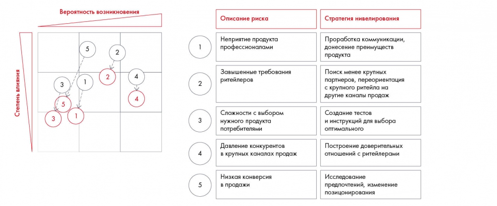

# Оценка рисков и меры нивелирования

Показаны вероятностная оценка, влияние и действия по снижению рисков. Упражнение 10.1 и пример Besh связывают риск с планом внедрения.

**Источник:** физические страницы PDF 152–154. Печатные номера не установлены.

**Для последовательного чтения:** [План внедрения и диаграмма Гантта](01-implementation.md).

**Навигация:** [Индекс главы](INDEX.md) · [Маршрутизатор](../../ROUTER.md) · [Проблемы источника](../../meta/issues.md).

---

## Источник: [PDF 152](../../SOURCE.md#pdf-152)

Второй важный этап внедрения решения — проработка рисков. Она нужна для того, чтобы еще раз проверить гипотезы и задуматься над жизнеспособностью тех инициатив, которые вы предлагаете. Подумайте, что может пойти не так.

Проведите мозговой штурм, еще раз проанализируйте информацию о компании и отрасли (например, с помощью SWOT-или PEST-анализа), пообщайтесь с экспертом или представителем компании-заказчика. Когда с рисками все будет понятно, найдите способы их минимизации. Если риск слишком велик, лучше уберите из решения инициативы, которые могут его спровоцировать.

Визуализировать работу с рисками удобнее всего в виде матрицы, где на одной оси риски ранжируются по вероятности возникновения, а на другой — по объемам возможного ущерба. Обычно на матрице изображается риск до и после его

**Ссылки на этой странице исходника:** [Ссылка url-154](../../meta/source-links.md#url-154).

## Источник: [PDF 153](../../SOURCE.md#pdf-153)

нивелирования. Скорее всего, предложенные вами действия не ликвидируют риск полностью, но снизят его вероятность или последствия для бизнеса.

Матрица пяти рисков Besh показывает вероятность и влияние до и после мер нивелирования. Таблица связывает каждый риск с отдельной стратегией снижения.

[Подробная текстовая расшифровка рисунка](../../assets/transcripts/pdf-153-img-01.md).

Пример матрицы рисков для кейса Besh

**Практическое задание 10.1**

Ваш друг решил открыть небольшой кофейный ларек у станции метро в формате «кофе с собой». Прежде чем вкладывать деньги в мероприятие, он попросил вас помочь определить возможные риски и способы их нивелирования.

Проведите риск-анализ данного мероприятия. Составьте матрицу рисков из пяти элементов. Для каждого элемента придумайте путь уменьшения степени возникновения или влияния риска на бизнес.

**Задание по кейсу**

## Источник: [PDF 154](../../SOURCE.md#pdf-154)

Оцените, какие риски могут возникнуть на пути внедрения ваших рекомендаций для Coca-Cola HBC Россия. Пропишите способы их нивелирования.

[1] Техническое задание.

[2] Agile — гибкая методология разработки программных продуктов, философия которой позже перешла в другие процессы, не связанные с IT. Позволяет значительно сократить сроки разработки продуктов.

[3] User Interface / User Experience дизайн — проектирование пользовательских интерфейсов, в которых удобство использования так же важно, как и внешний вид.

[4] Разработана менеджером Генри Л. Ганттом в начале XX века. Диаграммы Гантта применялись на таких масштабных проектах, как строительство дамбы Гувера, начатое в 1931 году, и в построении сети скоростных автострад США в 1956 году. Диаграмма оказалась настолько мощным инструментом, что за сотню лет почти не претерпела изменений.

**Ссылки на этой странице исходника:** [Ссылка url-155](../../meta/source-links.md#url-155); [Ссылка url-156](../../meta/source-links.md#url-156); [Ссылка url-157](../../meta/source-links.md#url-157); [Ссылка url-158](../../meta/source-links.md#url-158).

## Связанные разделы

- [Все темы главы](INDEX.md)
- [Термины и сокращения](../../GLOSSARY.md)
- [Предыдущая тема: План внедрения и диаграмма Гантта](01-implementation.md)
- [Следующая тема: Финансовая оценка. Часть 1: прибыль и убытки](03-pnl.md)
- [Авторские ответы по этой неделе](../13-answers/07-week-10-risks.md)
- [Ответ к заданию 10.4](../13-answers/08-week-10-pnl.md)
- [Ответы к заданиям 10.5–10.7](../13-answers/09-week-10-valuation.md)

> Редакторское примечание SRC-02: здесь сохранено сквозное задание, но полное условие кейса Coca-Cola из приложения 1 отсутствует в предоставленном PDF. См. [реестр проблем](../../meta/issues.md).
