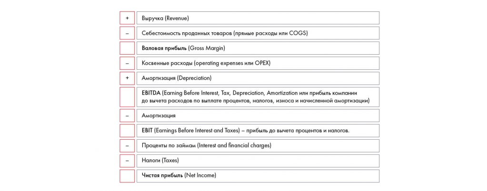

# Финансовая оценка. Часть 1: прибыль и убытки

Вводятся базовые формы отчётности и структура P&L. Сохранены пример с носками, расчёты валовой прибыли, EBITDA, EBIT и чистой прибыли, а также задание 10.2.

**Источник:** физические страницы PDF 154–162. Печатные номера не установлены.

**Для последовательного чтения:** [Оценка рисков и меры нивелирования](02-risks.md).

**Навигация:** [Индекс главы](INDEX.md) · [Маршрутизатор](../../ROUTER.md) · [Проблемы источника](../../meta/issues.md).

---

## Источник: [PDF 154](../../SOURCE.md#pdf-154)

### Неделя 10. Подготовка решения

### ФИНАНСОВАЯ ОЦЕНКА. ЧАСТЬ 1

Один из самых важных аспектов решения — финансовый результат. От приведенных цифр многое зависит. Получите вы или нет одобрение инициативы и бюджет. Естественно, судьям или заказчику хочется, чтобы меры одновременно принесли доход и обошлись недорого. Имейте в виду, что финансовые показатели должны выглядеть правдоподобно и обоснованно. Так будет легче убедить их в том, что в реальности все так и получится.

**Ссылки на этой странице исходника:** [Ссылка url-155](../../meta/source-links.md#url-155); [Ссылка url-156](../../meta/source-links.md#url-156); [Ссылка url-157](../../meta/source-links.md#url-157); [Ссылка url-158](../../meta/source-links.md#url-158).

## Источник: [PDF 155](../../SOURCE.md#pdf-155)

Как справиться с нелегким процессом оценки? Нужно понимать базовые принципы экономики и финансов и уметь делать прогнозы, основываясь на предпосылках и сценариях.

**Базовые принципы экономики и финансов**

Пожалуйста, учтите, что целью данной книги не является научить людей разбираться в финансах. Чтобы действительно разобраться в этой теме, необходимо прочитать несколько книг по ней. Наша задача — объяснить основные принципы. Если вы хотите основательно изучить финансы, советуем поступить на курс Changellenge >> ToolKit, сдать экзамен CFA или прочитать список литературы в конце этой главы.

Чтобы действительно разобраться в этой теме, необходимо прочитать несколько книг по ней. Наша цель — помочь верхнеуровнево понимать основные принципы. Если вы хотите разобраться более детально, то советуем поступить на наш курс Changellenge >> Toolkit по финансам, сдать экзамен CFA или ознакомиться с книгами, которые мы приводим в конце этой главы.

Чтобы по-настоящему понимать финансы, нужно разобраться, кому и зачем нужна финотчетность. Здесь есть как минимум шесть заинтересованных сторон:

1. Топ-менеджер на основе финансовых показателей принимает управленческие решения.

2. Собственники оценивают свою прибыль и эффективность решений, принятых руководством.

3. Инвесторы решают, в какую компанию вложить средства.

4. Государство взимает налоги.

5. Банки проверяют, можно ли дать компании кредит.

6. Контрагенты оценивают надежность поставщика через его отчетность.

Финансовая отчетность составляется всеми компаниями по единым принципам, чтобы результаты легко было сравнивать между собой. Есть несколько методов учета и составления отчетности: страновые (в России — РСБУ[1], в США — US GAAP[2], в

**Ссылки на этой странице исходника:** [Ссылка url-078](../../meta/source-links.md#url-078); [Ссылка url-159](../../meta/source-links.md#url-159); [Ссылка url-160](../../meta/source-links.md#url-160); [Ссылка url-161](../../meta/source-links.md#url-161).

## Источник: [PDF 156](../../SOURCE.md#pdf-156)

Германии — German GAAP,) и международные (МСФО[3], они же IFRS[4]). Наиболее распространен МСФО. Его используют во всем мире. Оформление отчетности по этому стандарту — обязательное требование для финансовых компаний и организаций, которые торгуются на национальных биржах. Если вы решаете кейс для крупной международной компании, будьте уверены, что у нее есть отчетность по МСФО.

**Отчетность по МСФО включает в себя пять основных форм:**

Баланс (бухгалтерский баланс, Balance Sheet, Statement of Financial Position).

Отчет о прибыли и убытках (Profit & Loss Statement[5], Income Statement, отчет о финансовых результатах).

Отчет о движении денежных средств (Cash Flow Statement).

Отчет о движении капитала (Statement of Changes in Equity).

· Примечания (Notes) или раскрытие существенных финансовых показателей и существенных учетных политик (Disclosure of material financial indicators and significant accounting policies).

Чаще всего приходится иметь дело с тремя из них: отчетом о прибыли и убытках, балансом и отчетом о движении денежных средств. Когда вам нужно посчитать выручку, прибыль или проанализировать затраты, смотрите отчет о прибыли и убытках. Если хотите узнать количество собственных и заемных средств, сумму обязательств перед поставщиками, величину краткосрочных (деньги, дебиторская задолженность) и долгосрочных (оборудование, здания, интеллектуальная собственность) активов, обратите внимание на баланс компании. Отчет о движении денежных средств связан с этими двумя формами и показывает движение денежных средств компании — их поступления и выплаты в течение года.

**Отчет о прибыли и убытках**

**Ссылки на этой странице исходника:** [Ссылка url-162](../../meta/source-links.md#url-162); [Ссылка url-163](../../meta/source-links.md#url-163); [Ссылка url-164](../../meta/source-links.md#url-164).

## Источник: [PDF 157](../../SOURCE.md#pdf-157)

Разберем на примере компании, которая производит пирожки с капустой. Ее выручкаскладывается из количества пирожков, проданных за определенный период, умноженного на цену единицы товара.

Выручка (sales или revenue) = цена (price) × количество (quantity)

Если компания продала 1000 пирожков по 15 рублей за штуку, то ее выручка составит 15 000 рублей.

К сожалению, выручка — не то, что получает в итоге компания. Потому что у бизнеса много расходов: на приготовление пирожков, аренду помещения, зарплату продавцам, выплату налогов и так далее.

Для удобства подсчета выделяют несколько видов издержек. Распространенная классификация в управленческом учете — деление расходов на постоянные (fixed costs, FC)и переменные издержки (variable costs, VC). Постоянные издержки не зависят от количества произведенной продукции — в нашем случае это зарплата поваров, оплата аренды и т. д. Переменные же зависят от объема производства. Обычно это сырье, оплата труда по сдельному принципу и другие параметры.

В то время как для внутренних нужд и управленческих решений в компаниях анализируют постоянные и переменные издержки (например, для расчета маржинального дохода или точки безубыточности), для внешней отчетности используют другую классификацию, выделяющую прямые и косвенные издержки. Их отражают в отчете о прибыли и убытках компании.

Прямые расходы — это расходы компании на зарплату людей, непосредственно связанные с производством, на сырье, использованное в производстве, а также на другие связанные ресурсы (воду, электричество, пр.). Чаще всего именно эту величину, поделенную на число произведенной и реализованной продукции, считают себестоимостью[6]. При этом важно учитывать, что если компания купила муку и не потратила ее на производство, то мука не будет учитываться в себестоимости как расход (не пойдет в PNL), а останется на балансе в качестве понесенных затрат (запасов).

Пример. Мы купили 100 кг муки, из которых потратили 60 кг. Стоимость этих 60 кг — это прямые расходы. Стоимость оставшихся 40 кг мы не списываем в прямые расходы, они остаются на балансе в строке «Ззапасы». Кроме того, в себестоимость пойдет амортизация[7], но не всех активов, а только тех, которые напрямую относятся к

**Ссылки на этой странице исходника:** [Ссылка url-165](../../meta/source-links.md#url-165); [Ссылка url-166](../../meta/source-links.md#url-166).

## Источник: [PDF 158](../../SOURCE.md#pdf-158)

производству. Например, амортизация печи и здания цеха пойдет в себестоимость, а амортизация здания, где сидит бухгалтерия, нет (она пойдет в косвенные расходы). Также, в себестоимость мы добавляем зарплату повара и другого персонала, участвующего в процессе производства.

Предположим, что в нашем примере себестоимость каждого пирожка — 3 рубля. Тогда валовая прибыль составит: 15 000 – 3 000 = 12 000 рублей.

Валовая прибыль (gross profit) = выручка (revenue) — себестоимость проданных товаров (прямые расходы или COGS)

Косвенные расходы включают расходы, которые не связаны напрямую с производством пирожков (например, на зарплату административного персонала и размещение рекламы, амортизацию офисного здания). Предположим, они составили 2000 рублей, из которых 500 рублей —амортизация).

Зная величину валовой прибыли и косвенных расходов, мы можем получить следующий важный аналитический показатель — EBITDA (Earning Before Interest, Tax, Depreciation[8], Amortization[9]), равный объему прибыли компании до вычета расходов по выплате процентов, налогов, износа и начисленной амортизации.

Чтобы рассчитать показатель EBITDA, нам нужно из рассчитанной валовой прибыли вычесть все косвенные расходы. Обратите внимание, что в состав прямых и косвенных расходов входит амортизация, поэтому когда мы вычитаем из выручки сначала прямые, а потом косвенные расходы, то мы уменьшаем выручку в том числе на размер амортизации. Поэтому в результате мы получаем показатель EBIT (Earnings Before Interest and Taxes — прибыль до вычета процентов и налогов). Для того чтобы получить именно показатель EBITDA, нам нужно вернуть амортизацию, которая была вычтена ранее в составе расходов[10].

**Ссылки на этой странице исходника:** [Ссылка url-167](../../meta/source-links.md#url-167); [Ссылка url-168](../../meta/source-links.md#url-168); [Ссылка url-169](../../meta/source-links.md#url-169).

## Источник: [PDF 159](../../SOURCE.md#pdf-159)

В нашем случае EBITDA составляет 11 500 рублей: 12 000 (выручка) – 2000 (себестоимость) + 500 (амортизация в составе косвенных) + 1000 (амортизация в составе прямых расходов) = 11 500.

EBITDA = выручка (Revenue) – себестоимость проданных товаров COGS (который включает в себя амортизацию) – операционные расходы OPEX (которые тоже включают в себя амортизацию) + вся амортизация

EBITDA нужна нам, чтобы понять, какую прибыль приносит непосредственно бизнес компании. Умеет компания зарабатывать деньги? Этот показатель говорит нам, сколько компания зарабатывала бы в идеальных условиях, если бы все заводы у нее уже были, станки не изнашивались, а государство ввело для нее нулевую налоговую ставку.

Вернемся и подробнее остановимся на расчете амортизации.

Существует несколько методов расчета амортизации, самый простой (его называют прямым, или линейным) — разделить первоначальную стоимость актива на годы использования.

Предположим, что организация в нашем примере приобрела объект основных средств (печь) стоимостью 50 000 рублей со сроком полезного использования, например, 50 лет. При начислении амортизации линейным способом организация ежегодно будет признавать в расходах амортизационные отчисления в размере 1000 рублей (50 000 рублей / 50 лет). В расчете выше мы учли амортизацию печи в прямых расходах.

Почему мы распределяем стоимость актива на срок полезного использования, а не списываем всю сумму сразу в расходах? Если бы вместо того, чтобы амортизировать его в течении срока полезного использования, мы бы разом списали в расходы все затраты на покупку, это сильно бы исказило нашу себестоимость: в момент покупки мы несем огромные убытки, а потом «бесплатно» производим продукцию, никак не учитывая стоимость купленных активов. В таком случае, не имея амортизации, можно было бы продавать пирожки сильно дешево и вложения в основные средства никогда не окупились. Чтобы этого избежать, придумали амортизацию — равномерное распределение стоимости купленных активов на производимую продукцию.

## Источник: [PDF 160](../../SOURCE.md#pdf-160)

В процессе расчета показателя EBITDA мы упомянули еще один важный показатель — EBIT, который отвечает на вопрос: какую прибыль приносит бизнес, если не учитывать заемный капитал и налоговую нагрузку? Чтобы его получить, нам нужно снова вычесть амортизацию из показателя EBITDA.

EBIT = EBITDA – амортизационные расходы (Depreciation and Amortization)

EBIT позволяет сравнивать компании одной отрасли (даже из разных стран). Ведь если в одной стране налог 13 %, а в другой — 50 %, то, имея одну и ту же прибыль от бизнеса, мы получим разную чистую прибыль. По EBIT прибыль будет одинаковой.

Показатели EBIT и EBITDA не установлены международными стандартами в качестве обязательных показателей, однако очень широко используются аналитиками, инвесторами и другими заинтересованными лицами для оценки и анализа финансового положения компаний или проектов. Для расчета этих показателей компании могут использовать различные методологии, поэтому важно понимать смысл этих показателей.

Но EBIT — это еще не финальный результат. Компания также платит налоги и проценты по долгам.

В нашем примере прибыль до выплаты процентов и налогов (EBIT) составляет 10 000 рублей. После этого компания уплатила проценты по ранее взятому кредиту — 1000 рублей. После учета этих трат мы получаем размер прибыли, за которую компания должна уплатить налог. Это прибыль до налогообложения. В нашем случае она равна 9000 рублей.

Прибыль до налогообложения (Profit before taxes) = EBIT – проценты по займам (interest)

## Источник: [PDF 161](../../SOURCE.md#pdf-161)

Предположим, налог на прибыль составляет 20 %. Тогда чистая прибыль компании — 7200 рублей.

Чистая прибыль (Net profit) = прибыль до налогообложения – налоги (taxes)

На рисунке приведены элементы: Выручка (Revenue); Себестоимость проданных товаров (прямые расходы или COGS); Валовая прибыль (Gross Margin); Косвенные расходы (operating expenses или ОРЕХ); Амортизация (Depreciation). Полная текстовая расшифровка приведена отдельно; геометрия и цветовые обозначения сохранены на изображении.

[Подробная текстовая расшифровка рисунка](../../assets/transcripts/pdf-161-img-01.md).

Отчет о прибыли и убытках в упрощенном виде

Помимо существующего деления издержки также делятся на операционные (OPEX) и капитальные (CAPEX). Операционные затраты — это повседневные затраты компании, которые обеспечивают ее деятельность (например, расходы на упаковку пирожков, рекламу, зарплата продавцов, управляющего магазином). Капитальные затраты — единовременные расходы.

Подсчет финансового результата обязательно пригодится вам при решении кейса. Зачастую цель компании в кейсе — увеличить или снизить какой-либо параметр P&L (например, увеличить выручку или валовую прибыль).

**Практическое задание № 10.2**

**Ссылки на этой странице исходника:** [Ссылка url-170](../../meta/source-links.md#url-170).

## Источник: [PDF 162](../../SOURCE.md#pdf-162)

1. Прибыль до налогообложения равна 500 тыс. руб. Амортизационные расходы равны 120 тыс. руб., уплачено процентов по займам 20 тыс. руб. Ставка налога — 30 %. Посчитайте EBITDA.

2. EBITDA = 230 тыс. руб. Косвенные расходы составили 90 тыс. руб., амортизация — 10 тыс. руб. Посчитайте валовую прибыль.

3. Чистая прибыль компании составила 560 тыс. руб. EBIT = 720 тыс. руб. Ставка налога — 20 %. Сколько составляют проценты по займам?

4. Прямые расходы составили 20 тыс. руб., косвенные — 40 тыс. руб, амортизация — 10 тыс. руб. EBITDA = 120 тыс. руб. Цена товара — 200 руб. Рассчитайте количество проданной продукции.

## Связанные разделы

- [Все темы главы](INDEX.md)
- [Термины и сокращения](../../GLOSSARY.md)
- [Предыдущая тема: Оценка рисков и меры нивелирования](02-risks.md)
- [Следующая тема: Отчёт о движении денежных средств](04-cash-flow.md)
- [Авторские ответы по этой неделе](../13-answers/07-week-10-risks.md)
- [Ответ к заданию 10.4](../13-answers/08-week-10-pnl.md)
- [Ответы к заданиям 10.5–10.7](../13-answers/09-week-10-valuation.md)
