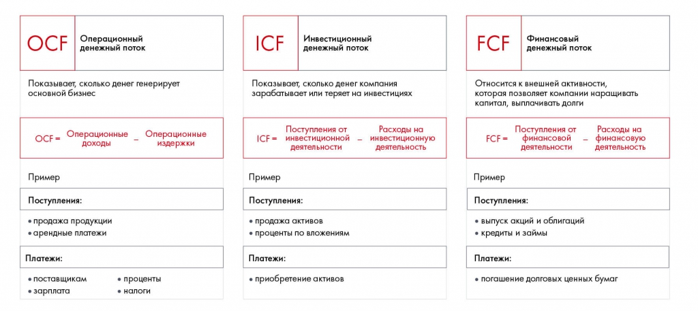

# Отчёт о движении денежных средств

Различаются прибыль и движение денег, операционные, инвестиционные и финансовые потоки. Приведена формула FCFF и пояснения её компонентов.

**Источник:** физические страницы PDF 162–165. Печатные номера не установлены.

**Для последовательного чтения:** [Финансовая оценка. Часть 1: прибыль и убытки](03-pnl.md).

**Навигация:** [Индекс главы](INDEX.md) · [Маршрутизатор](../../ROUTER.md) · [Проблемы источника](../../meta/issues.md).

---

## Источник: [PDF 162](../../SOURCE.md#pdf-162)

**Отчет о движении денежных средств**

Ключевое различие между отчетом о прибыли и убытках и отчетом о движении денежных средств состоит в том, что ОПУ составляется методом начисления, что означает начисление дохода в момент его получения, и отражение расходов в то время, когда они понесены или признаны, в то время как ОДДС содержит информацию только о реальных оттоках и притоках.

Цель этого отчета — показать динамику денежных средств за определенный период, а

также объяснить изменение в чистых ликвидных средствах компании. Потоки денежных средств в ОДДС классифицируются по категориям деятельности, что дает пользователям возможность оценить влияние каждого вида деятельности на общее финансовое положение фирмы.

**Существует три вида денежных потоков:**

Поток от операционной деятельности. Все, что связано с ключевым бизнесом (например, расходы на сырье для пирожков).

Поток от инвестиционной деятельности. Это вложения в активы, которые будут использоваться долго: в пекарню, печи, транспорт.

## Источник: [PDF 163](../../SOURCE.md#pdf-163)

Поток от финансовой деятельности. Включает все, что связано с привлечением капитала: получение и погашение кредитов, размещение облигаций, займы.

В каждом потоке компания может как получать деньги, так и отдавать их.

На рисунке приведены элементы: OCF; Операционный; денежный поток; Показывает, сколько денег генерирует; основной бизнес. Полная текстовая расшифровка приведена отдельно; геометрия и цветовые обозначения сохранены на изображении.

[Подробная текстовая расшифровка рисунка](../../assets/transcripts/pdf-163-img-01.md).

Три денежных потока компании: OCF[11], ICF[12], FCF[13]

В литературе и интернет-источниках можно встретить разные понятия и виды денежных потоков:

Cash flow (CF) — денежный поток.

Free cash flow (FCF) — свободный денежный поток.

Free cash flow to firm (FCFF, unlevered) — свободный денежный поток фирмы, денежный поток от активов.

Free cash flow to equity (FCFE, levered) — свободный денежный поток собственникам.

Финансовых аналитиков интересуют реальные денежные потоки, которые генерирует компания. Для их оценки наиболее важным показателем выступает FCFF.

**Ссылки на этой странице исходника:** [Ссылка url-171](../../meta/source-links.md#url-171); [Ссылка url-172](../../meta/source-links.md#url-172); [Ссылка url-173](../../meta/source-links.md#url-173).

## Источник: [PDF 164](../../SOURCE.md#pdf-164)

На рисунке приведены элементы: FCFF = EBIT (1-t) + D&A - CAPEX - A Net WC; ЕВІТ(1 -t) - Чистая операционная прибыль; D&A = Амортизация; САРЕХ = Капитальные вложения; Д Net WC = Изменения чистого оборотного капитала. Полная текстовая расшифровка приведена отдельно; геометрия и цветовые обозначения сохранены на изображении.

$$FCFF=EBIT(1-t)+D\&A-CAPEX-\Delta Net\,WC.$$

$EBIT(1-t)$ — чистая операционная прибыль; $D\&A$ — амортизация; $CAPEX$ — капитальные вложения; $\Delta Net\,WC$ — изменение чистого оборотного капитала; $t$ — ставка налога из множителя $(1-t)$.

[Подробная текстовая расшифровка рисунка](../../assets/transcripts/pdf-164-img-01.md).

Формула расчета FCFF

Общей отправной точкой для расчета FCFF является чистая операционная прибыль после налогообложения. Ее можно получить путем умножения прибыли до вычета процентов и налогов на разницу между единицей и налоговой ставкой, чтобы получить чистую операционную прибыль. К полученному результату возвращают все неденежные расходы, вычитают капитальные затраты и изменения в рабочем капитале, получая итоговое значение свободного денежного потока фирмы за рассматриваемый период.

[1] Российские стандарты финансового учета.

[2] Generally Accepted Accounting Principles.

[3] Международные стандарты финансовой отчетности.

[4] International Financial Reporting Standards.

[5] Также PNL, P&L.

**Ссылки на этой странице исходника:** [Ссылка url-174](../../meta/source-links.md#url-174); [Ссылка url-175](../../meta/source-links.md#url-175); [Ссылка url-176](../../meta/source-links.md#url-176); [Ссылка url-177](../../meta/source-links.md#url-177); [Ссылка url-178](../../meta/source-links.md#url-178).

## Источник: [PDF 165](../../SOURCE.md#pdf-165)

[6] На самом деле методика расчета себестоимости более сложна и отличается в разных стандартах.

[7] Как правило, в отчетности обычно в прямые (COGS) и косвенные (OPEX) расходы включена амортизация, поэтому отдельной строчки «Амортизация» в отчетности нет. В книге мы рассматриваем именно этот случай. Если в отчетности амортизация не записана отдельной строкой, найти ее можно в пояснениях к отчетности (Notes), там всегда есть размер амортизации за год.

[8] Depreciation — амортизация материальных активов.

[9] Amortization — амортизация нематериальных активов.

[10] В некоторых случаях амортизация может не входить в состав себестоимости, а идти отдельной строкой расходов. В таком случае, для расчета EBITDA вам не потребуется возвращать амортизацию, однако в отчетности реальных компаний такое случается крайне редко.

[11] Operating Cash Flow.

[12] Investing Cash Flow.

[13] Financing Cash Flow.

**Ссылки на этой странице исходника:** [Ссылка url-179](../../meta/source-links.md#url-179); [Ссылка url-180](../../meta/source-links.md#url-180); [Ссылка url-181](../../meta/source-links.md#url-181); [Ссылка url-182](../../meta/source-links.md#url-182); [Ссылка url-183](../../meta/source-links.md#url-183); [Ссылка url-184](../../meta/source-links.md#url-184); [Ссылка url-185](../../meta/source-links.md#url-185); [Ссылка url-186](../../meta/source-links.md#url-186).

## Связанные разделы

- [Все темы главы](INDEX.md)
- [Термины и сокращения](../../GLOSSARY.md)
- [Предыдущая тема: Финансовая оценка. Часть 1: прибыль и убытки](03-pnl.md)
- [Следующая тема: Финансовая оценка. Часть 2: баланс](05-balance-sheet.md)
- [Авторские ответы по этой неделе](../13-answers/07-week-10-risks.md)
- [Ответ к заданию 10.4](../13-answers/08-week-10-pnl.md)
- [Ответы к заданиям 10.5–10.7](../13-answers/09-week-10-valuation.md)
