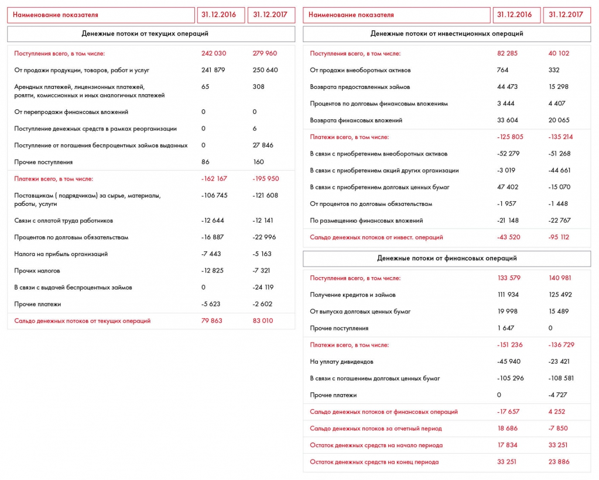
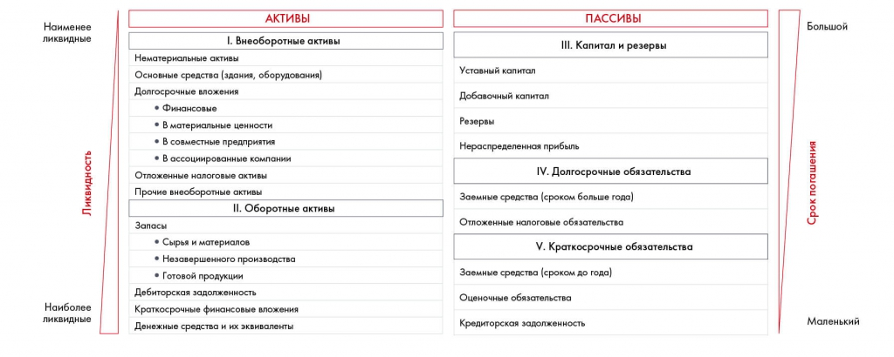
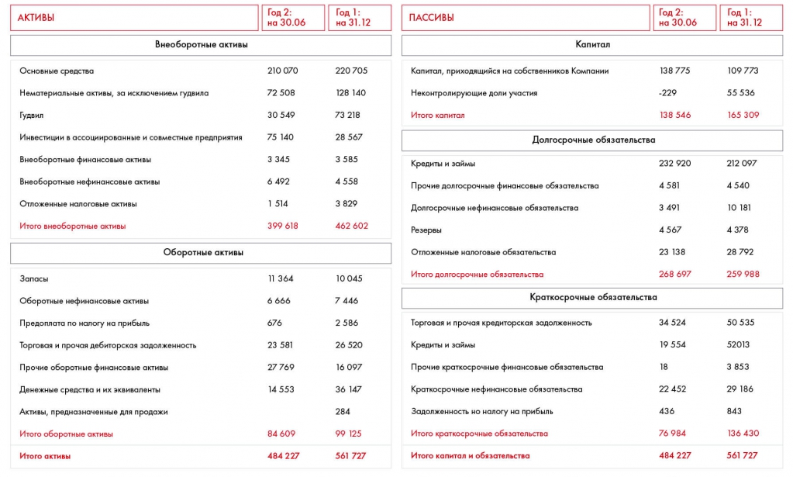

# Финансовая оценка. Часть 2: баланс

Разбираются активы, обязательства и собственный капитал. Примеры отчётности и упражнение 10.3 показывают, как читать структуру бизнеса.

**Источник:** физические страницы PDF 165–169. Печатные номера не установлены.

**Для последовательного чтения:** [Отчёт о движении денежных средств](04-cash-flow.md).

**Навигация:** [Индекс главы](INDEX.md) · [Маршрутизатор](../../ROUTER.md) · [Проблемы источника](../../meta/issues.md).

---

## Источник: [PDF 165](../../SOURCE.md#pdf-165)

### Неделя 10. Подготовка решения

**Ссылки на этой странице исходника:** [Ссылка url-179](../../meta/source-links.md#url-179); [Ссылка url-180](../../meta/source-links.md#url-180); [Ссылка url-181](../../meta/source-links.md#url-181); [Ссылка url-182](../../meta/source-links.md#url-182); [Ссылка url-183](../../meta/source-links.md#url-183); [Ссылка url-184](../../meta/source-links.md#url-184); [Ссылка url-185](../../meta/source-links.md#url-185); [Ссылка url-186](../../meta/source-links.md#url-186).

## Источник: [PDF 166](../../SOURCE.md#pdf-166)

### ФИНАНСОВАЯ ОЦЕНКА. ЧАСТЬ 2

Иллюстрация исходника: «Пример отчета о движении денежных средств». Подписи и числовые значения вынесены в расшифровку; порядок и связи элементов проверяются по сохранённому изображению.

| Наименование показателя | 31.12.2016 | 31.12.2017 |
| --- | --- | --- |
| Денежные потоки от текущих операций |  |  |
| Поступления всего | 242 030 | 279 960 |
| От продажи продукции, товаров, работ и услуг | 241 879 | 250 640 |
| Арендные, лицензионные платежи, роялти, комиссионные и аналогичные платежи | 65 | 308 |
| От перепродажи финансовых вложений | 0 | 0 |
| Поступление в рамках реорганизации | 0 | 6 |
| Погашение беспроцентных займов выданных | 0 | 27 846 |
| Прочие поступления | 86 | 160 |
| Платежи всего | -162 167 | -195 950 |
| Поставщикам за сырьё, материалы, работы, услуги | -106 745 | -121 608 |
| В связи с оплатой труда работников | -12 644 | -12 141 |
| Проценты по долговым обязательствам | -16 887 | -22 996 |
| Налог на прибыль организаций | -7 443 | -5 163 |
| Прочие налоги | -12 825 | -7 321 |
| Выдача беспроцентных займов | 0 | -24 119 |
| Прочие платежи | -5 623 | -2 602 |
| Сальдо от текущих операций | 79 863 | 83 010 |
| Денежные потоки от инвестиционных операций |  |  |
| Поступления всего | 82 285 | 40 102 |
| Продажа внеоборотных активов | 764 | 332 |
| Возврат предоставленных займов | 44 473 | 15 298 |
| Проценты по долговым финансовым вложениям | 3 444 | 4 407 |
| Возврат финансовых вложений | 33 604 | 20 065 |
| Платежи всего | -125 805 | -135 214 |
| Приобретение внеоборотных активов | -52 279 | -51 268 |
| Приобретение акций других организаций | -3 019 | -44 661 |
| Приобретение долговых ценных бумаг | 47 402 | -15 070 |
| Проценты по долговым обязательствам | -1 957 | -1 448 |
| Размещение финансовых вложений | -21 148 | -22 767 |
| Сальдо от инвестиционных операций | -43 520 | -95 112 |
| Денежные потоки от финансовых операций |  |  |
| Поступления всего | 133 579 | 140 981 |
| Получение кредитов и займов | 111 934 | 125 492 |
| Выпуск долговых ценных бумаг | 19 998 | 15 489 |
| Прочие поступления | 1 647 | 0 |
| Платежи всего | -151 236 | -136 729 |
| Уплата дивидендов | -45 940 | -23 421 |
| Погашение долговых ценных бумаг | -105 296 | -108 581 |
| Прочие платежи | 0 | -4 727 |
| Сальдо от финансовых операций | -17 657 | 4 252 |
| Сальдо денежных потоков за отчётный период | 18 686 | -7 850 |
| Остаток на начало периода | 17 834 | 33 251 |
| Остаток на конец периода | 33 251 | 23 886 |

Редакторское примечание: знак у 47 402 передан как на изображении, хотя строка относится к платежам. Единицы в данном фрагменте не указаны. Названия длинных строк сокращены без изменения категории.

[Подробная текстовая расшифровка рисунка](../../assets/transcripts/pdf-166-img-01.md).

Пример отчета о движении денежных средств

Когда стейкхолдеры[1] (т. е. лица, которые принимают решение, воплощать ли ваши рекомендации по кейсу в жизнь) рассматривают ваше предложение, как правило, они в первую очередь обращают внимание на денежные потоки.

**Баланс**

**Ссылки на этой странице исходника:** [Ссылка url-187](../../meta/source-links.md#url-187); [Ссылка url-188](../../meta/source-links.md#url-188).

## Источник: [PDF 167](../../SOURCE.md#pdf-167)

Баланс — это форма отчетности, в которой отражаются активы и пассивы компании. В отчетности баланс выглядит как таблица, где с одной стороны расположены активы, а с другой — пассивы. Все активы финансируются за счет пассивов, поэтому в балансе они равны друг другу. В отличие от отчета о прибыли и убытках, о движении денежных средств и о движении капитала, которые составляются за период, баланс составляется на конкретную дату и отражает данные на определенный момент.

Баланс сопоставляет активы и пассивы. Активы упорядочены от менее ликвидных внеоборотных к оборотным; обязательства — по сроку погашения вместе с капиталом и резервами.

[Подробная текстовая расшифровка рисунка](../../assets/transcripts/pdf-167-img-01.md).

Структура баланса

На рисунке приведены элементы: АКТИВЫ; Внеоборотные активы; Основные средства; Нематериальные активы, за исключением гудвила; Гудвил. Полная текстовая расшифровка приведена отдельно; геометрия и цветовые обозначения сохранены на изображении.

| Статья баланса | Год 2: на 30.06 | Год 1: на 31.12 |
| --- | --- | --- |
| АКТИВЫ |  |  |
| Внеоборотные активы |  |  |
| Основные средства | 210 070 | 220 705 |
| Нематериальные активы, кроме гудвила | 72 508 | 128 140 |
| Гудвил | 30 549 | 73 218 |
| Инвестиции в ассоциированные и совместные предприятия | 75 140 | 28 567 |
| Внеоборотные финансовые активы | 3 345 | 3 585 |
| Внеоборотные нефинансовые активы | 6 492 | 4 558 |
| Отложенные налоговые активы | 1 514 | 3 829 |
| Итого внеоборотные активы | 399 618 | 462 602 |
| Оборотные активы |  |  |
| Запасы | 11 364 | 10 045 |
| Оборотные нефинансовые активы | 6 666 | 7 446 |
| Предоплата по налогу на прибыль | 676 | 2 586 |
| Торговая и прочая дебиторская задолженность | 23 581 | 26 520 |
| Прочие оборотные финансовые активы | 27 769 | 16 097 |
| Денежные средства и эквиваленты | 14 553 | 36 147 |
| Активы, предназначенные для продажи |  | 284 |
| Итого оборотные активы | 84 609 | 99 125 |
| Итого активы | 484 227 | 561 727 |
| ПАССИВЫ |  |  |
| Капитал собственников компании | 138 775 | 109 773 |
| Неконтролирующие доли участия | -229 | 55 536 |
| Итого капитал | 138 546 | 165 309 |
| Долгосрочные обязательства |  |  |
| Кредиты и займы | 232 920 | 212 097 |
| Прочие долгосрочные финансовые обязательства | 4 581 | 4 540 |
| Долгосрочные нефинансовые обязательства | 3 491 | 10 181 |
| Резервы | 4 567 | 4 378 |
| Отложенные налоговые обязательства | 23 138 | 28 792 |
| Итого долгосрочные обязательства | 268 697 | 259 988 |
| Краткосрочные обязательства |  |  |
| Торговая и прочая кредиторская задолженность | 34 524 | 50 535 |
| Кредиты и займы | 19 554 | 52 013 |
| Прочие краткосрочные финансовые обязательства | 18 | 3 853 |
| Краткосрочные нефинансовые обязательства | 22 452 | 29 186 |
| Задолженность по налогу на прибыль | 436 | 843 |
| Итого краткосрочные обязательства | 76 984 | 136 430 |
| Итого капитал и обязательства | 484 227 | 561 727 |

Единицы в данном фрагменте не подписаны. Пустая ячейка оставлена пустой, без подстановки нуля.

[Подробная текстовая расшифровка рисунка](../../assets/transcripts/pdf-167-img-02.md).

## Источник: [PDF 168](../../SOURCE.md#pdf-168)

Пример баланса

Активы — это имущество, которое принадлежит организации. Есть два вида активов:

Оборотные. Те, что используются в краткосрочном периоде (зачастую это 1 год). Сюда входят денежные средства и их эквиваленты — краткосрочные высоколиквидные инвестиции, которые можно легко конвертировать в известные суммы денежных средств и которые подвержены только незначительному риску изменения стоимости, а также сырье, материалы, запасы готовой продукции, продукция, которая сейчас находится в процессе производства, краткосрочная задолженность со стороны физических и юридических лиц и прочие статьи.

Внеоборотные. Их компания использует в долгосрочном периоде (дольше 1 года или одного производственного цикла). Например, станки и оборудование, нематериальные активы (патенты, торговые марки) и вложения на длительный срок.

Пассивы — то, за счет чего были получены активы: прибыль, задолженность акционерам, кредиты, займы и кредиторская задолженность. Они делятся на три части:

**Собственный капитал.**

Краткосрочные обязательства. Задолженность перед поставщиками и собственными сотрудниками, а также кредитные обязательства, которые нужно погасить в течение года.

Долгосрочные обязательства. Обязательства, по которым до срока погашения, указанного в договоре, остается больше года.

Рассмотрим на примере. Допустим, вам нужно закупить для фирмы новые компьютеры стоимостью 1 млн рублей. Для этого вы берете беспроцентный заем на 500 тыс. рублей и добавляете 500 тыс. рублей из своих денег. Тогда в активе у вас будут компьютеры стоимостью 1 млн, а в пассиве — заем на 500 тыс. рублей и собственный капитал в размере 500 тыс. рублей.

## Источник: [PDF 169](../../SOURCE.md#pdf-169)

**Практическое задание № 10.3**

Проанализируйте ситуации ниже.

1. Крупная компания наняла вас для того, чтобы выяснить причины падения прибыли. Вы узнали, что издержки компании растут быстрее выручки. При этом постоянные издержки практически не меняются, а переменные растут год от года. Что можно порекомендовать компании?

2. Просматривая отчетность компании — лидера по доле рынка, вы обнаружили, что ее валовая прибыль заметно ниже, чем у конкурентов. С чем это может быть связано?

3. Сравнивая две компании с примерно одинаковой долей рынка, вы обнаружили, что у одной из них соотношение выручки и EBITDA значительно выше, чем у другой. Какая компания находится в проигрышном положении и что бы вы ей посоветовали?

## Связанные разделы

- [Все темы главы](INDEX.md)
- [Термины и сокращения](../../GLOSSARY.md)
- [Предыдущая тема: Отчёт о движении денежных средств](04-cash-flow.md)
- [Следующая тема: Практическое задание 10.4: прогноз P&L](exercises/01-pnl-forecast.md)
- [Авторские ответы по этой неделе](../13-answers/07-week-10-risks.md)
- [Ответ к заданию 10.4](../13-answers/08-week-10-pnl.md)
- [Ответы к заданиям 10.5–10.7](../13-answers/09-week-10-valuation.md)
