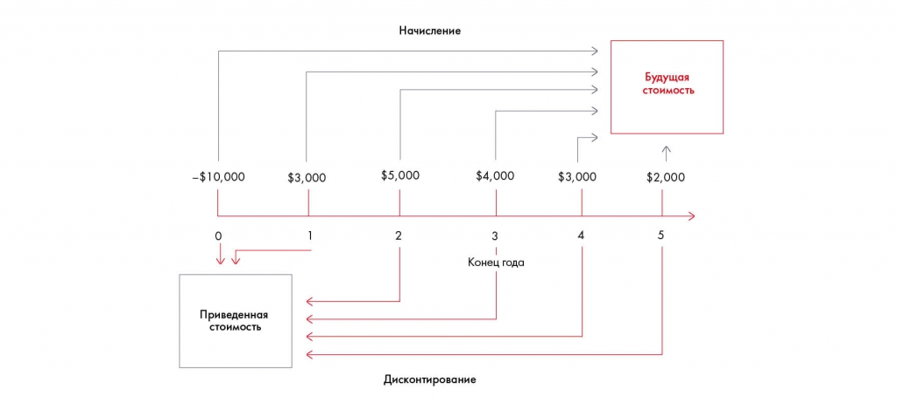
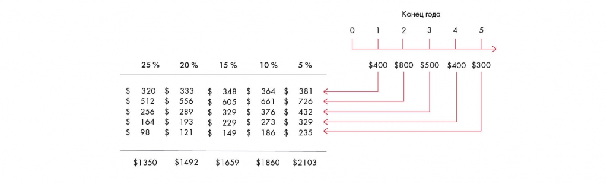

# Финансовая оценка. Часть 3: стоимость бизнеса

Объясняются подходы к оценке бизнеса и временная стоимость денег. Сохранены начисление, дисконтирование и пример влияния ставки на стоимость потока.

**Источник:** физические страницы PDF 170–173. Печатные номера не установлены.

**Для последовательного чтения:** [Практическое задание 10.4: прогноз P&L](exercises/01-pnl-forecast.md).

**Навигация:** [Индекс главы](INDEX.md) · [Маршрутизатор](../../ROUTER.md) · [Проблемы источника](../../meta/issues.md).

---

## Источник: [PDF 170](../../SOURCE.md#pdf-170)

### Неделя 10. Подготовка решения

**Ссылки на этой странице исходника:** [Ссылка url-189](../../meta/source-links.md#url-189).

## Источник: [PDF 171](../../SOURCE.md#pdf-171)

### ФИНАНСОВАЯ ОЦЕНКА. ЧАСТЬ 3

**Как оценить бизнес и выбрать привлекательный проект**

Один из самых важных разделов корпоративных финансов — оценка стоимости бизнеса. Возможно, при решении кейса вам нужно будет оценить целесообразность слияния или поглощения.

Обычно консультанты составляют детальные финансовые модели с множеством вариантов для того, чтобы прийти к точной оценке. Поскольку при решении кейса у вас нет времени на детализированные расчеты, вы можете руководствоваться упрощенными подходами.

Существует 3 основных подхода к оценке стоимости бизнеса:

Затратный подход. Например, мы собираемся купить ресторан за 10 млн рублей. Чтобы проверить адекватность цены, мы можем посчитать, в какую сумму обойдется открытие ресторана с нуля (аренда или покупка здания, наем поваров и т. д.).

Доходный подход. Ключевая идея этого подхода в том, что вместе с компанией вы покупаете и ее будущие денежные потоки. Чтобы оценить стоимость, нужно посчитать сумму всех потоков на N лет вперед (в идеале на бесконечное число лет вперед). Например, вы покупаете ресторан, который в следующие 10 лет будет ежегодно приносить 1 млн в год. Значит, он будет стоить не менее 10 млн (без учета дисконтирования).

Рыночный подход. В этом случае стоимость компании определяется путем сравнения со сделкой купли-продажи другой компании. Допустим, вы знаете, что компанию-конкурента купили за 20 млн рублей. Чтобы посчитать стоимость вашей компании, нужно найти какой-то коэффициент для сравнения (мультипликатор). Это может быть соотношение цены компании и ее выручки, чистой прибыли, EBITDA и так далее. Например, если у компании-конкурента EBITDA составила 1 млн рублей, а у вас — 500 тыс., то и стоимость бизнеса у вас будет в два раза меньше — 10 млн рублей.

У каждого из этих подходов своя специфика и недостатки. Так, при затратном подходе можно столкнуться со сложностями в оценке нематериальных активов компании, например бренда. В случае рыночного подхода будет сложно найти компании, которые полностью аналогичны оцениваемой, ведь выбор компании и мультипликатора обязательно должен быть обоснован. Пожалуй, самый простой и распространенный

## Источник: [PDF 172](../../SOURCE.md#pdf-172)

**способ оценки — метод дисконтированных денежных потоков (DCF[1]). Он основан**

на доходном подходе. Поговорим о нем подробнее.

Ключевая идея DCF в том, что в разное время одни и те же деньги имеют разную ценность. Как вы думаете, что выгоднее? Получить 1 доллар сегодня или через год? Правильный ответ — сегодня. Поскольку, получив деньги через год, вы потеряете возможный доход: если бы вам дали их сейчас и вы положили в банк под 5 % годовых, то через год у вас было бы уже 1,05 доллара. Если бы вам дали их сейчас, а вы, например, положили их в банк под проценты. Возможный доход, который вы могли получить, будет для вас альтернативными или упущенными издержками (opportunity costs).

Представьте, что у вас есть доллар. Какова его ценность? Для определения этой ценности используются два инструмента: начисление или наращение (compounding) и дисконтирование (discounting). Дисконтирование покажет вам реальную стоимость доллара через год, наращение — сколько долларов у вас будет через год, если сейчас положить доллар в банк. Если вы хотите узнать, сколько долларов надо положить в банк сегодня, чтобы через год получить доллар, доллар надо продисконтировать.

На рисунке приведены элементы: -$10,000; →; Приведенная; СтОИМОСТЬ; $3,000. Полная текстовая расшифровка приведена отдельно; геометрия и цветовые обозначения сохранены на изображении.

[Подробная текстовая расшифровка рисунка](../../assets/transcripts/pdf-172-img-01.md).

Начисление и дисконтирование

Чтобы узнать, сколько мы получим со своих денег через год, нужно понять, как их использовать. Допустим, вы положили 100 долларов на депозит в банке под 6 %. Тогда через год на вашем счете будет уже: 100 × (1 + 0,06) = 106 долларов. А если вы положили деньги на три года, то на счете будет: 100 × (1 + 0,06) × (1 + 0,06) × (1 + 0,06) = 100 × (1 + 0,06)3 = 119,1 доллара.

**Ссылки на этой странице исходника:** [Ссылка url-190](../../meta/source-links.md#url-190); [Ссылка url-191](../../meta/source-links.md#url-191).

## Источник: [PDF 173](../../SOURCE.md#pdf-173)

Таким образом, будущую стоимость (future value) денег можно рассчитать по следующей формуле:

$$FV=PV\times(1+r)^n$$

где FV — будущая стоимость, PV — текущая стоимость (present value), r (от английского discount rate) — ставка дисконтирования, n — число периодов.

Аналогично мы можем рассчитать приведенную стоимость — ту сумму, которую нам нужно инвестировать сейчас, чтобы получить определенную будущую стоимость. Например, чтобы получить через год 100 долларов при ставке 6 %, сегодня нам нужно инвестировать: 100 / (1 + 0,06) = 94,34 доллара.

$$PV=\frac{FV}{(1+r)^n}$$

Ставка дисконтирования не обязательно является банковским процентом. Это может быть ключевая ставка[2], средняя доходность имеющегося бизнеса и т. д. Ставку дисконтирования также называют opportunity cost (требуемая доходность, затраты на капитал). Она сильно влияет на расчет денежных потоков, поэтому для каждого инвестиционного проекта рассчитывается индивидуально, а ее определению и обоснованию уделяется большое внимание.

Потоки 400, 800, 500, 400, 300 долларов в конце годов 1–5 дисконтируются по ставкам 25 %, 20 %, 15 %, 10 %, 5 %. Чем выше ставка, тем меньше приведённая стоимость; значения перенесены в таблицу.

| Поток, $ | 25 % | 20 % | 15 % | 10 % | 5 % |
| --- | --- | --- | --- | --- | --- |
| 400 | 320 | 333 | 348 | 364 | 381 |
| 800 | 512 | 556 | 605 | 661 | 726 |
| 500 | 256 | 289 | 329 | 376 | 432 |
| 400 | 164 | 193 | 229 | 273 | 329 |
| 300 | 98 | 121 | 149 | 186 | 235 |
| Итого | 1350 | 1492 | 1659 | 1860 | 2103 |

[Подробная текстовая расшифровка рисунка](../../assets/transcripts/pdf-173-img-01.md).

Влияние ставки дисконтирования на конечный результат

**Ссылки на этой странице исходника:** [Ссылка url-192](../../meta/source-links.md#url-192); [Ссылка url-193](../../meta/source-links.md#url-193).

## Связанные разделы

- [Все темы главы](INDEX.md)
- [Термины и сокращения](../../GLOSSARY.md)
- [Предыдущая тема: Практическое задание 10.4: прогноз P&L](exercises/01-pnl-forecast.md)
- [Следующая тема: WACC, NPV, IRR, DPP, PI и ROI](07-investment-metrics.md)
- [Авторские ответы по этой неделе](../13-answers/07-week-10-risks.md)
- [Ответ к заданию 10.4](../13-answers/08-week-10-pnl.md)
- [Ответы к заданиям 10.5–10.7](../13-answers/09-week-10-valuation.md)
