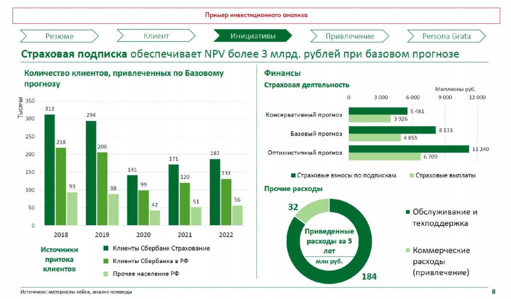

# WACC, NPV, IRR, DPP, PI и ROI

Рассматриваются ставка дисконтирования и показатели инвестиционной привлекательности. Формулы перенесены с пометками о противоречиях исходника.

**Источник:** физические страницы PDF 173–176. Печатные номера не установлены.

**Для последовательного чтения:** [Финансовая оценка. Часть 3: стоимость бизнеса](06-valuation.md).

**Навигация:** [Индекс главы](INDEX.md) · [Маршрутизатор](../../ROUTER.md) · [Проблемы источника](../../meta/issues.md).

---

## Источник: [PDF 173](../../SOURCE.md#pdf-173)

В качестве ставки дисконтирования в модели дисконтированных денежных потоков чаще всего используется средневзвешенная стоимость капитала (weighted average cost of capital, WACC). Эта цифра обобщает стоимость всех источников капитала компании в зависимости от их доли в пассивах. Суть WACC — показать, какую доходность обязана заработать компания, чтобы окупить затраты на привлечение капитала.

**Ссылки на этой странице исходника:** [Ссылка url-192](../../meta/source-links.md#url-192); [Ссылка url-193](../../meta/source-links.md#url-193).

## Источник: [PDF 174](../../SOURCE.md#pdf-174)

Разберем это на примере. Допустим, вы открыли пирожковую, потратив на это 10 млн рублей. Чтобы найти эти деньги, вы взяли кредит 6 млн рублей под 7 % годовых. На оставшиеся 4 млн вы выпустили и продали акции с годовой доходностью 5 %. Чтобы покрыть эти траты, вам необходимо заработать как минимум 0,6 × 7 % + 0,4 × 5 % = 6,2 % доходности в год.

Наличие процентных выплат уменьшает налогооблагаемую прибыль (см. выше: прибыль до налога равняется EBIT минус процентные платежи). Это снижает средневзвешенную стоимость капитала, так как позволяет бизнесу экономить на налоговых выплатах. Это называется налоговым щитом (tax shield). Он возникает, потому что выплаты по процентам учитываются в качестве расходов при расчете налога на прибыль. Таким образом, формула расчета WACC выглядит следующим образом:

На рисунке приведены элементы: WACC= DHE *(r x (1-tax||+ E=D *.; D - долг; Е - собственный капитал (equity); г. - норма доходности акционерного капитала; г, - затраты на обслуживание заемного капитала. Полная текстовая расшифровка приведена отдельно; геометрия и цветовые обозначения сохранены на изображении.

$$WACC=\frac{D}{D+E}[r_d(1-tax)]+\frac{E}{E-D}r_e.$$

$D$ — долг, $E$ — собственный капитал, $r_e$ — норма доходности акционерного капитала, $r_d$ — затраты на обслуживание заёмного капитала, $tax$ — ставка налога на прибыль.

> Редакторское примечание FIN-01: на изображении в знаменателе второго слагаемого напечатано **E−D**. Это противоречит описанию взвешивания по долям и соседнему примеру. Формула передана как в PDF; использовать её без проверки нельзя.

[Подробная текстовая расшифровка рисунка](../../assets/transcripts/pdf-174-img-01.md).

В качестве стоимости собственного капитала обычно берется доходность акций компании. Легче всего ее рассчитать по модели CAPM, разработанной экономистом У. Шарпом[3]. Эта модель предполагает, что доходность акции складывается из безрисковой доходности (обычно это доходность государственных облигаций) и премии за риск.

$$r_a=r_f+\beta_a(r_m-r_f)$$

где $r_f$ — безрисковая ставка, $\beta_a$ — бета-величина ценной бумаги (отношение её риска к риску на рынке в целом), $r_m$ — ожидаемая доходность рыночного портфеля (средневзвешенная доходность всех акций, которые есть на рынке). Бета-коэффициент считается на основе соотношения колебаний цены акций с общими колебаниями рынка и обычно доступен на открытых ресурсах[4] для каждой компании, которая торгуется на бирже.

Зная методику дисконтирования и размер ставки, можно посчитать и стоимость компании по будущим денежным потокам. Сумма дисконтированных потоков называется чистой приведенной стоимостью (net present value — NPV) и считается по формуле:

**Ссылки на этой странице исходника:** [Ссылка url-194](../../meta/source-links.md#url-194); [Ссылка url-195](../../meta/source-links.md#url-195).

## Источник: [PDF 175](../../SOURCE.md#pdf-175)

Иллюстрация исходника: «Пример расчета NPV». Подписи и числовые значения вынесены в расшифровку; порядок и связи элементов проверяются по сохранённому изображению.

$$NPV=\sum_{t=0}^{N}\frac{CF_t}{(1+i)^t}=-IC+\sum_{t=1}^{N}\frac{CF_t}{(1+i)^t}.$$

$CF_t$ — денежный поток в год $t$, $N$ — последний год расчёта, $i$ — ставка дисконтирования (в упрощении источника $i=WACC$), $IC$ — начальные инвестиции.

[Подробная текстовая расшифровка рисунка](../../assets/transcripts/pdf-175-img-01.md).

NPV можно рассчитывать не только для компании, но и для отдельного проекта.

Потоки 400, 800, 500, 400, 300 долларов в конце годов 1–5 приведены к настоящему моменту. Подписи приведённых значений: 368,00; 673,60; 386,00; 283,20; 195,00; итог 1904,60 доллара.

| Год | Поток, $ | Приведённое значение, $ |
| --- | --- | --- |
| 1 | 400 | 368,00 |
| 2 | 800 | 673,60 |
| 3 | 500 | 386,00 |
| 4 | 400 | 283,20 |
| 5 | 300 | 195,00 |
| Итого |  | 1904,60 |

[Подробная текстовая расшифровка рисунка](../../assets/transcripts/pdf-175-img-02.md).

Пример расчета NPV

Есть и ряд других важных показателей успешности, помимо NPV:

**Внутренняя норма доходности (internal rate of return, IRR) — это ставка**

дисконтирования, при которой NPV = 0. Чем выше IRR, тем привлекательнее проект. Формула расчета IRR достаточно сложная, поэтому легче всего посчитать ее в Excel через формулу IRR.

**Период окупаемости (discounted payback period, DPP) — время, через которое при**

текущей ставке дисконтирования NPV = 0. Чем меньше DPP, тем привлекательнее проект.

На рисунке показан визуальный пример из этого раздела. Полная текстовая расшифровка приведена отдельно; геометрия и цветовые обозначения сохранены на изображении.

$$DPP=\sum_{t=1}^{n}\frac{CF_t}{(1+R)^t}\ge I_0.$$

$CF_t$ — денежный поток периода $t$, $R$ — ставка дисконтирования, $n$ — число периодов, $I_0$ — первоначальные инвестиции.

> Редакторское примечание FIN-02: источник называет эту запись формулой периода, хотя сумма имеет денежную размерность. Неравенство описывает покрытие инвестиций накопленным дисконтированным потоком; оно не является численным значением срока.

[Подробная текстовая расшифровка рисунка](../../assets/transcripts/pdf-175-img-03.md).

Формула расчёта DPP: $CF_t$ — денежный поток в период $t$, $R$ — ставка дисконтирования, $n$ — число периодов, $I_0$ — объём первоначальных инвестиций.

**Ссылки на этой странице исходника:** [Ссылка url-196](../../meta/source-links.md#url-196).

## Источник: [PDF 176](../../SOURCE.md#pdf-176)

**Рентабельность инвестиций (profitability index, PI) — соотношение NPV и объема**

инвестиций в проект. Чем выше PI, тем привлекательней проект. Если PI < 1, то проект убыточен и инвестировать в него не стоит.

**Возврат от инвестиций (return on investment, ROI) — соотношение чистой прибыли**

от проекта и инвестиций в проект.

По этим показателям удобно сравнивать инициативы. Сопоставив показатели их окупаемости, вы сможете сделать вывод о том, какая из них является наиболее привлекательной (инвестиционный анализ).

Иллюстрация исходника: «Пример инвестиционного анализа. Источник: Changellenge≫ Cup Russia, решение». Подписи и числовые значения вынесены в расшифровку; порядок и связи элементов проверяются по сохранённому изображению.

[Подробная текстовая расшифровка рисунка](../../assets/transcripts/pdf-176-img-01.md).

Пример инвестиционного анализа. Источник: Changellenge≫ Cup Russia, решение команды Sublime

**Ссылки на этой странице исходника:** [Ссылка url-197](../../meta/source-links.md#url-197); [Ссылка url-014](../../meta/source-links.md#url-014).

## Связанные разделы

- [Все темы главы](INDEX.md)
- [Термины и сокращения](../../GLOSSARY.md)
- [Предыдущая тема: Финансовая оценка. Часть 3: стоимость бизнеса](06-valuation.md)
- [Следующая тема: Финансовая модель и сценарный анализ](08-financial-model.md)
- [Авторские ответы по этой неделе](../13-answers/07-week-10-risks.md)
- [Ответ к заданию 10.4](../13-answers/08-week-10-pnl.md)
- [Ответы к заданиям 10.5–10.7](../13-answers/09-week-10-valuation.md)

> Редакторское примечание FIN-03: авторское определение PI как отношения NPV к инвестициям и соседний порог PI < 1 требуют проверки. Здесь сохранена формулировка учебника.
