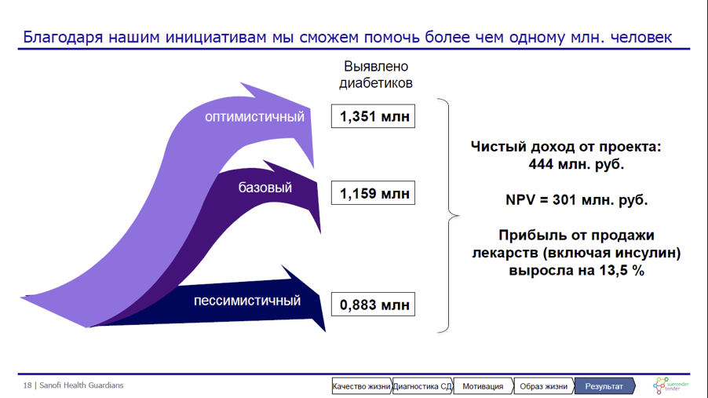
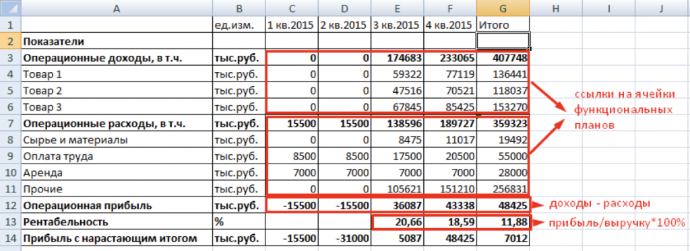
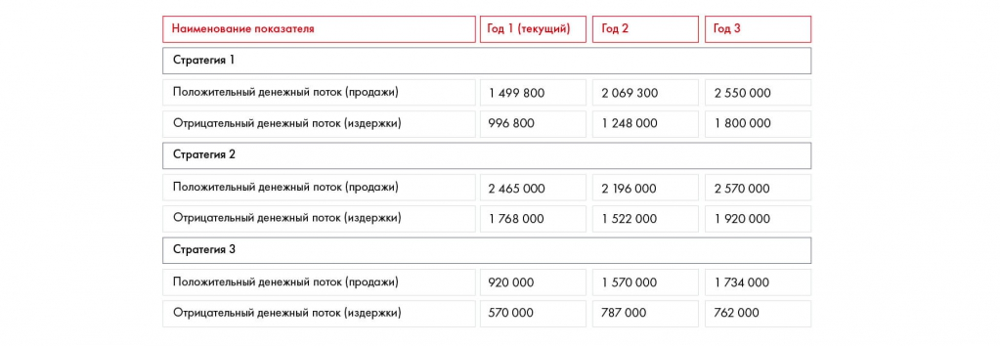

# Финансовая модель и сценарный анализ

Показана простая модель с зависимостью результатов от предпосылок. Сохранены рекомендации по выбору показателей и упражнение 10.5.

**Источник:** физические страницы PDF 176–180. Печатные номера не установлены.

**Для последовательного чтения:** [WACC, NPV, IRR, DPP, PI и ROI](07-investment-metrics.md).

**Навигация:** [Индекс главы](INDEX.md) · [Маршрутизатор](../../ROUTER.md) · [Проблемы источника](../../meta/issues.md).

---

## Источник: [PDF 176](../../SOURCE.md#pdf-176)

Чтобы ваше решение было более гибким, применяйте сценарный подход — представьте 2–3 варианта развития событий. Например, вы можете представить модель DCF с учетом трех разных процентных ставок. Но не нужно применять сценарии ради сценариев. Если вы меняете какую-либо переменную, обоснуйте это расчетами или ссылкой на авторитетный источник (например, эксперты Strategy Partners Group приводят три прогноза ключевой ставки ЦБ, и, исходя из этого, у нас есть три варианта сроков, за которые окупится проект).

**Ссылки на этой странице исходника:** [Ссылка url-197](../../meta/source-links.md#url-197); [Ссылка url-014](../../meta/source-links.md#url-014).

## Источник: [PDF 177](../../SOURCE.md#pdf-177)

Наиболее вероятный сценарий обычно считается базовым. Часто также приводятся пессимистичный и оптимистичный прогнозы, которые отличаются от базового в худшую и лучшую сторону соответственно.

Иллюстрация исходника: «Пример сценарного подхода. Источник: Sanofi Health Guardians, решение». Подписи и числовые значения вынесены в расшифровку; порядок и связи элементов проверяются по сохранённому изображению.

[Подробная текстовая расшифровка рисунка](../../assets/transcripts/pdf-177-img-01.md).

Пример сценарного подхода. Источник: Sanofi Health Guardians, решение команды SurrenderTender

Чтобы проверить разные сценарии и сравнить финансовый результат предложенных инициатив, вы можете построить финансовую модель. Это удобный инструмент, основанный на расчете различных финансовых показателей компании или проекта (рентабельность, внутренняя норма доходности и другие) и позволяющий оценить эффективность использования ресурсов. Например, если вы построите в Excel таблицу денежных потоков по годам, укажете WACC и в отдельную ячейку введете формулу NPV, это можно считать простой финансовой моделью, где в зависимости от введенных значений будут рассчитываться финансовые показатели.

**Пример простой финансовой модели**

**Ссылки на этой странице исходника:** [Ссылка url-198](../../meta/source-links.md#url-198).

## Источник: [PDF 178](../../SOURCE.md#pdf-178)

На рисунке приведены элементы: A; Показатели; Операционные доходы, в т.ч.; 4; Товар 1. Полная текстовая расшифровка приведена отдельно; геометрия и цветовые обозначения сохранены на изображении.

[Подробная текстовая расшифровка рисунка](../../assets/transcripts/pdf-178-img-01.md).

Несколько дополнительных советов:

У финансового анализа обычно две ключевые цели: а) что по результатам работы компания или проект получит максимальную чистую прибыль (для этого нужен анализ PNL) или отдачу на инвестиции (для этого нужно рассчитать ROI); б) что компании хватит денег и не будет кассового разрыва (для этого нужно построить прогноз отчета о движении денежных средств).

Не стройте финансовую модель как самоцель. На создание хорошей финансовой модели уйдет примерно столько же времени, сколько и на решение всего кейса. При этом далеко не факт, что это будет стоить той разницы в точности вычислений, что вы получите при построении сложной модели. Для большинства кейсов будет достаточно простых расчетов на одном листе в Excel.

Если вам нужно оценить эффективность вложенных денег, то лучшей практикой будет расчет либо ROI, либо NPV и, соответственно, IRR. Но так как рассчитать NPV и IRR гораздо сложнее, чем ROI, то советуем вам в 80–90 % случаев ограничиться только расчетом ROI. NPV и IRR стоит считать только в случае финансовых и инвестиционных кейсов.

Ключевая проблема в расчете NPV — это ставка дисконтирования и попытка ее расчета. Для упрощения предположите, что для крупной российской компании стоимость долгового финансирования будет примерно 10–12 % годовых, акционерного

— 15–20 % годовых (чем больше компания, тем меньше цифра), а для небольшой и средней компании стоимость долгового финансирования будет примерно 12–17 % годовых и акционерного 20–30 % (чем больше компания, тем меньше цифра)[5].

**Ссылки на этой странице исходника:** [Ссылка url-199](../../meta/source-links.md#url-199).

## Источник: [PDF 179](../../SOURCE.md#pdf-179)

**Практическое задание № 10.5**

Вы решаете кейс для компании, производящей жевательную резинку. Задача кейса — увеличить продажи на 20 % за три года с помощью трейд-маркетинговой стратегии. В ходе анализа вы нашли три привлекательных варианта:

1. Провести ряд конкурсов (промоупаковки, мероприятия в точках продаж).

2. Сделать упор на ценовые промоакции (скидки) и программу лояльности (бонусы за покупку).

3. Изменить дизайн точек продаж: установить специализированные дисплеи, доплачивать магазинам за лучшую раскладку.

Денежные потоки для каждой стратегии вы оценили следующим образом:

На рисунке приведены элементы: Наименование показателя; Стратегия 1; Положительный денежный поток (продажи); Отрицательный денежный поток (издержки); Стратегия 2. Полная текстовая расшифровка приведена отдельно; геометрия и цветовые обозначения сохранены на изображении.

| Стратегия / показатель | Год 1 (текущий) | Год 2 | Год 3 |
| --- | --- | --- | --- |
| Стратегия 1: положительный поток (продажи) | 1 499 800 | 2 069 300 | 2 550 000 |
| Стратегия 1: отрицательный поток (издержки) | 996 800 | 1 248 000 | 1 800 000 |
| Стратегия 2: положительный поток (продажи) | 2 465 000 | 2 196 000 | 2 570 000 |
| Стратегия 2: отрицательный поток (издержки) | 1 768 000 | 1 522 000 | 1 920 000 |
| Стратегия 3: положительный поток (продажи) | 920 000 | 1 570 000 | 1 734 000 |
| Стратегия 3: отрицательный поток (издержки) | 570 000 | 787 000 | 762 000 |

Единица в самой таблице не подписана; денежные величины не переименованы редактором.

[Подробная текстовая расшифровка рисунка](../../assets/transcripts/pdf-179-img-02.md).

Считая ставку дисконтирования равной 10 %, определите, какая из этих инициатив наиболее привлекательна с точки зрения инвестиционного анализа. Как изменится ваш ответ, если ставка дисконтирования будет равна 3 %? 25 %?

[1] Discounted cash flow.

[2] Минимальная процентная ставка, по которой Центральный банк России предоставляет кредиты коммерческим банкам.

**Ссылки на этой странице исходника:** [Ссылка url-200](../../meta/source-links.md#url-200); [Ссылка url-201](../../meta/source-links.md#url-201); [Ссылка url-202](../../meta/source-links.md#url-202).

## Источник: [PDF 180](../../SOURCE.md#pdf-180)

[3] Sharpe, W. F. (1970). Portfolio theory and capital markets. McGraw-Hill College.

[4] См. конец этой главы.

[5] Это очень грубое упрощение. С точки зрения финансов и инвестиционной аналитики крайне неправильно давать вам подобные цифры, так как они могут очень сильно отличаться в зависимости от ситуации в экономике, компании и проекта в рамках компании. Но так как задача по расчету NPV обычно факультативная в рамках кейса, мы даем такую грубую рекомендацию. В случае если вы решаете финансовый или инвестиционный кейс, то, пожалуйста, сделайте все по правилам.

**Ссылки на этой странице исходника:** [Ссылка url-203](../../meta/source-links.md#url-203); [Ссылка url-204](../../meta/source-links.md#url-204); [Ссылка url-205](../../meta/source-links.md#url-205).

## Связанные разделы

- [Все темы главы](INDEX.md)
- [Термины и сокращения](../../GLOSSARY.md)
- [Предыдущая тема: WACC, NPV, IRR, DPP, PI и ROI](07-investment-metrics.md)
- [Следующая тема: Как делать прогнозы и предпосылки](09-forecasting.md)
- [Авторские ответы по этой неделе](../13-answers/07-week-10-risks.md)
- [Ответ к заданию 10.4](../13-answers/08-week-10-pnl.md)
- [Ответы к заданиям 10.5–10.7](../13-answers/09-week-10-valuation.md)
