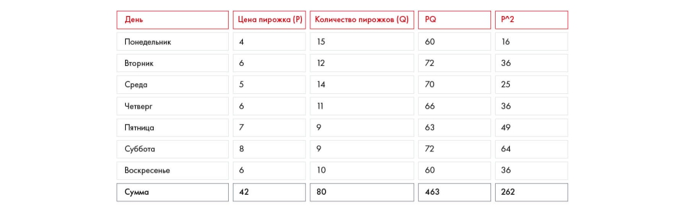
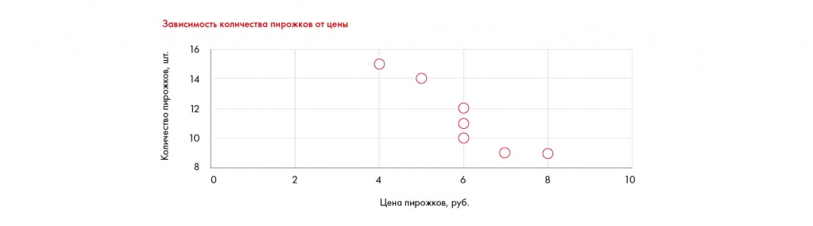
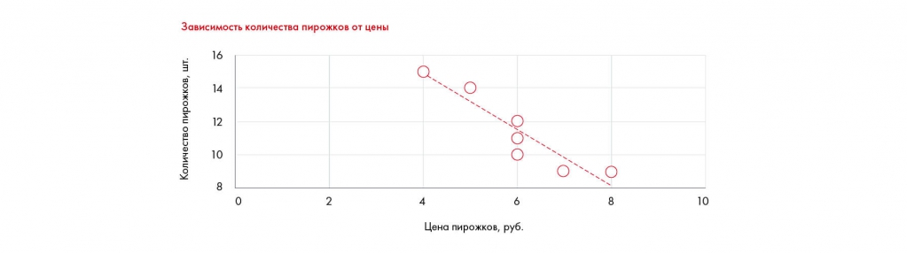

# Как делать прогнозы и предпосылки

Разбираются эконометрическая модель, линейная регрессия и способы прогнозирования при нехватке данных. Сохранены упражнения 10.6–10.7, ограничения и итоговые источники.

**Источник:** физические страницы PDF 180–190. Печатные номера не установлены.

**Для последовательного чтения:** [Финансовая модель и сценарный анализ](08-financial-model.md).

**Навигация:** [Индекс главы](INDEX.md) · [Маршрутизатор](../../ROUTER.md) · [Проблемы источника](../../meta/issues.md).

---

## Источник: [PDF 180](../../SOURCE.md#pdf-180)

### Неделя 10. Подготовка решения

### Как делать прогнозы и предпосылки

Чтобы оценить влияние ваших инициатив на финансовый результат компании и сравнить их NPV, нужно начать с оценки будущих денежных потоков, которые они принесут. Хорошо, если в кейсе уже есть данные по тому, какой эффект окажут те или иные меры и какие затраты повлекут. Если же их нет, вам придется провести более глубокий анализ.

Чтобы оценить, какой эффект окажут ваши инициативы, вы можете построить эконометрическую модель.

Эконометрика — это наука, которая помогает на основе массивов данных предсказать ожидаемые значения того или иного параметра в зависимости от ряда других по формуле:

$$Y=a_0+a_1X_1+a_2X_2+a_3X_3+\dots+a_nX_n$$

**Ссылки на этой странице исходника:** [Ссылка url-203](../../meta/source-links.md#url-203); [Ссылка url-204](../../meta/source-links.md#url-204); [Ссылка url-205](../../meta/source-links.md#url-205).

## Источник: [PDF 181](../../SOURCE.md#pdf-181)

где $Y$ — зависимая переменная, которую вы хотите предсказать (например, число проданных пирожков), $X_1,\dots,X_n$ — независимые переменные, значения которых вам известны (например, цена пирожка, население улицы, где стоит пирожковая, день недели и т. д.), $a_0,\dots,a_n$ — коэффициенты, рассчитываемые эконометрическими методами (самый часто применяемый — метод наименьших квадратов, или МНК).

Чтобы определить зависимость одной переменной от другой, нужно посчитать коэффициенты уравнения по формуле:

На рисунке показан визуальный пример из этого раздела. Полная текстовая расшифровка приведена отдельно; геометрия и цветовые обозначения сохранены на изображении.

$$a_1=\frac{n\sum xy-\sum x\sum y}{n\sum x^2-(\sum x)^2},\qquad a_0=\frac{\sum y-a_1\sum x}{n}.$$

$x,y$ — значения независимой и зависимой переменных, $n$ — количество наблюдений; $a_1$ — коэффициент при $x$, $a_0$ — свободный член. Обозначения пояснены редакторски по формуле и соседнему примеру.

[Подробная текстовая расшифровка рисунка](../../assets/transcripts/pdf-181-img-01.md).

Допустим, у вас есть данные о цене пирожка и количестве проданных пирожков за последние 7 дней. Вы можете построить простую модель зависимости количества от цены.

На рисунке приведены элементы: День; Понедельник; Вторник; Среда; Четверг. Полная текстовая расшифровка приведена отдельно; геометрия и цветовые обозначения сохранены на изображении.

| День | Цена пирожка P | Количество Q | PQ | P² |
| --- | --- | --- | --- | --- |
| Понедельник | 4 | 15 | 60 | 16 |
| Вторник | 6 | 12 | 72 | 36 |
| Среда | 5 | 14 | 70 | 25 |
| Четверг | 6 | 11 | 66 | 36 |
| Пятница | 7 | 9 | 63 | 49 |
| Суббота | 8 | 9 | 72 | 64 |
| Воскресенье | 6 | 10 | 60 | 36 |
| Сумма | 42 | 80 | 463 | 262 |

[Подробная текстовая расшифровка рисунка](../../assets/transcripts/pdf-181-img-02.md).

$$a_1=\frac{7\times463-42\times80}{7\times262-42^2}=-1{,}7;\qquad a_0=\frac{80+1{,}7\times42}{7}=21{,}6.$$

Редакторское примечание: в исходнике значения округлены; коэффициенты приведены с той же точностью.

У вас получится уравнение, с помощью которого вы сможете предсказывать число проданных пирожков по их цене:

Q = –1,7P + 21,6.

**Ссылки на этой странице исходника:** [Ссылка url-206](../../meta/source-links.md#url-206).

## Источник: [PDF 182](../../SOURCE.md#pdf-182)

Допустим, цена одного пирожка — 9 рублей. Тогда с высокой вероятностью вы сможете продать за день от 6 до 7 пирожков, так как из уравнения число пирожков = 6,3.

Если вы захотите узнать, как влияет день недели на количество проданных пирожков, можно ввести еще одну переменную. Например, 1 — это выходной, 0

— будний день. Ниже сделали для вас небольшую инструкцию для решения таких задач в Excel:

1. Постройте график зависимости одного параметра от другого. В нашем случае это будет график зависимости количества от цены.

На рисунке приведены элементы: Зависимость количества пирожков от цены; 16; 14; Количество пирожков,; 8. Полная текстовая расшифровка приведена отдельно; геометрия и цветовые обозначения сохранены на изображении.

[Подробная текстовая расшифровка рисунка](../../assets/transcripts/pdf-182-img-01.md).

2. Добавьте линию тренда (trend line). Это можно сделать, если нажать на график, перейти во вкладку «Дизайн» и нажать на кнопку «Добавить элемент графика».

3. Щелкните два раза по появившейся линии и в панели справа выберите «Показать зависимость на графике». Это позволит увидеть формулу.

На рисунке приведены элементы: Зависимость количества пирожков от цены; 16; 14; Количество пирожков, шт.; 8. Полная текстовая расшифровка приведена отдельно; геометрия и цветовые обозначения сохранены на изображении.

[Подробная текстовая расшифровка рисунка](../../assets/transcripts/pdf-182-img-02.md).

4. Полученное уравнение совпадает с тем, что вы рассчитали вручную.

**Ссылки на этой странице исходника:** [Ссылка url-207](../../meta/source-links.md#url-207).

## Источник: [PDF 183](../../SOURCE.md#pdf-183)

Подобные задачи можно решить с помощью Excel — это наиболее распространенный и удобный инструмент. С помощью встроенного инструмента «Пакет анализа» можно построить регрессию с любым количеством переменных и оценить значимость самой регрессии (например, если бы мы захотели установить зависимость количества проданных пирожков от нескольких переменных — и от цены, и от дня недели). Кроме Excel, для решения статистических задач подходят специализированные и значительно более сложные инструменты, такие как SPSS, Statistica, Stata, Gretl и т. д.

**Практическое задание № 10.6**

Перед вами статистические данные по размеру и стоимости квартиры. Сколько будет стоить квартира площадью 40 кв. м? 65 кв. м? В чем недостаток полученной вами модели?

| Площадь квартиры, кв. м | Стоимость, млн руб. |
| --- | --- |
| 37 | 3,54 |
| 42 | 3,81 |
| 65 | 5,02 |
| 44 | 3,93 |
| 76 | 6,78 |
| 80 | 7,22 |
| 121 | 10,34 |

Эконометрика позволяет строить и более сложные прогнозы. Например, модели с временным лагом, зависимость от значений предыдущего периода, экстраполяцию и нелинейные уравнения. Кроме того, чтобы правильно построить модель, нужно учитывать размер и качество выборки. А еще показатели качества модели: коэффициент детерминации, гетероскедастичность, гомогенность и т .д. Чтобы научиться правильно строить модели и проверять их, ознакомьтесь с теорией более подробно с помощью книг из нашей подборки.

## Источник: [PDF 184](../../SOURCE.md#pdf-184)

Что делать, когда нет времени и ресурсов на построение качественной модели? Воспользоваться бенчмаркингом[1]. Предположим, вы хотите узнать, как создание мобильного приложения с использованием Big Data повлияет на число клиентов банка. Изучив вопрос, вы обнаружили, что в случае с банком А эта мера помогла увеличить число клиентов на 10 % за два года, в случае с банком Б — на 15 % за то же время, в случае с банком С — на целых 20 %. Из этих данных можно предположить, что создание такого приложения в вашем банке также приведет к увеличению числа клиентов на 10–20 % в течение двух лет. Очевидный минус такого подхода — неточная оценка, поскольку полную аналогию провести сложно. Тем не менее это поможет вам хотя бы не промахнуться с порядком цифр.

Если вы не можете найти информацию в открытых источниках, проведите интервью с экспертом. Попробуйте найти человека с опытом в отрасли и ориентируйтесь на его оценку. Часто в сети можно найти интервью с экспертной оценкой. Например, рассуждая о конкретном опыте своей компании, человек может обобщить приблизительные значения для других (например: «обычно внедрение agile позволяет сократить сроки разработки проекта на 30 %»). Лучше узнать мнения как минимум троих экспертов, так как мнение одного может быть частным и сильно отличаться от мнений других экспертов.

При оценке роста числа клиентов, прибыли или выручки компании, доли рынка и т. д. не забывайте, что не только ваши меры способны оказать влияние на эти показатели. Помните об органическом росте, инфляции, макроэкономической обстановке и потребительских трендах. Ориентируйтесь на авторитетные источники, прогнозы экспертов и проводите при необходимости дополнительные расчеты.

Что делать, если вас просят оценить какой-то параметр с нуля и у вас нет ни данных по компании, ни бенчмарка, ни экспертной оценки? Воспользуйтесь методом Ферми — подходом к оценке неизвестного через общеизвестные величины.

Этот метод изобрел физик Энрико Ферми и применял его в науке и жизни. Ферми считал, что каждый человек способен за минуту оценить что угодно и найти ответ на самый необычный вопрос, например сколько мячей для гольфа влезет в школьный автобус. Суть метода в том, чтобы за короткое время провести быстрые приблизительные расчеты, не имея точных данных. Это возможно потому, что все знания, которыми мы обладаем, взаимосвязаны и на

**Ссылки на этой странице исходника:** [Ссылка url-208](../../meta/source-links.md#url-208).

## Источник: [PDF 185](../../SOURCE.md#pdf-185)

самом деле не существует вопроса, по которому у нас вообще не было бы данных. Один из самых известных примеров — задача на определение числа настройщиков пианино в Чикаго. Чтобы рассчитать его, Ферми предлагал начать с определения населения Чикаго: три миллиона. В каждой семье — два-три человека. Пианино есть где-то в каждой десятой семье, но не все настраивают пианино. Предположим, половина не пользуется этими услугами. Пианино необходимо настраивать как минимум раз в год. Учитывая количество рабочих дней, настройщики работают где-то 200 дней в году. На настройку одного инструмента может уйти час, а еще полчаса/час уйдет на дорогу от одного клиента к другому. Значит, в течение восьмичасового рабочего дня настройщик успевает настроить около 5 пианино, а за год — 1000 пианино.

Итак, решить задачу можно следующим образом.

Находим число семей, у которых есть пианино и которым может понадобиться настройка: 3 000 000 / 3 / 20 = 50 000.

Если в год один настройщик настраивает 1000 пианино, то, чтобы настроить все 50 000 пианино, потребуется: 50 000 / 1000 = 50 настройщиков. Кстати, именно столько настройщиков работало в Чикаго во времена Ферми.

При решении кейсов на собеседованиях чаще всего приходится использовать комбинацию методов Ферми и бенчмарка. Сначала вы разбиваете необходимую величину на более простые показатели. После этого значение некоторых показателей можно без больших погрешностей прикинуть самостоятельно. Но для предположений по другим показателям у вас недостаточно экспертизы. Тогда вы находите приблизительное значение сложных показателей при помощи бенчмарка. Консультанты используют такой подход для быстрой оценки инициатив. Этот способ позволяет провести поверхностный анализ и за несколько минут отбросить 80 % гипотез.

Не бойтесь делать предположения. Это часто очень важно. Да, не факт, что ваше предположение окажется верным. Но зато за пару минут получите расчет, что иначе строили бы часами. Да, скорее всего, он на 30– 50 % будет отличаться от реального. Но зато вы с большой вероятностью попадете в порядок цифр.

После расчетов необходимо сделать Sanity check, то есть проверить информацию на адекватность. Для этого вы можете воспользоваться альтернативным методом оценки. Например, если вы пользовались бенчмаркингом, то попробуйте сделать оценку по методу Ферми, а если уже сделали оценку по Ферми, уточните у эксперта, адекватна ли цифра.

## Источник: [PDF 186](../../SOURCE.md#pdf-186)

**Практическое задание № 10.7**

Посчитайте с помощью метода Ферми, сколько людей будет посещать двухзальный кинотеатр, расположенный рядом с метро «Ясенево» в Москве.

Вернемся к кейсу Besh. Вам необходимо рассчитать, сколько будут стоить обучающие мероприятия для мастеров. Подумайте, что нужно учесть? Запишите, какие траты предполагает проведение этих мероприятий.

В расчете затрат важно опираться на то, как будет проходить процесс. Возможно, вы слышали о «пути покупателя» (Customer Journey). Коротко его суть в том, чтобы обеспечить лучший опыт использования продукта, воссоздав путь потребителя по шагам. Например, чтобы купить билет в кино, вам необходимо сначала узнать о сеансе в интернете, найти кинотеатр, в который пойдете, а потом купить билет в кассе или онлайн. После этого вы идете к стойке с попкорном, ждете начала сеанса у зала, затем заходите в зал и смотрите фильм. В каждой из этих точек кинотеатр должен обеспечить вам наилучшие впечатления, ведь если вы не сможете купить билет онлайн или будете стоять огромную очередь за попкорном, то вы туда больше не пойдете.

## Источник: [PDF 187](../../SOURCE.md#pdf-187)

Иллюстрация исходника: «Пример построения Customer Journey. Источник: Changellenge >> Cup». Подписи и числовые значения вынесены в расшифровку; порядок и связи элементов проверяются по сохранённому изображению.

[Подробная текстовая расшифровка рисунка](../../assets/transcripts/pdf-187-img-01.md).

Пример построения Customer Journey. Источник: Changellenge >> Cup Russia, решениекоманды Shaken, Not Stirred

Согласно той же логике можно оценивать и затраты на проект. Например, для проведения обучающих мероприятий с мастерами в салонах необходимо проделать следующие шаги:

Менеджер по работе с ключевыми клиентами объезжает салоны, договаривается о проведении мероприятий.

Менеджер по маркетингу делает рассылку и распространяет информацию в сети, чтобы мастера приехали.

Менеджер по продажам ищет площадку для мероприятий и платит аренду.

Кто-то отбирает и приглашает моделей для мастеров.

Эксперт проводит обучение в салоне.

Как мы видим, основные затраты — это зарплата сотрудников и аренда помещения. Если ваше решение не предполагает найма дополнительных людей, то оплату их труда можно не считать. Это компания учитывает в общих издержках. Если же вы планируете нанять больше сотрудников, то можно

**Ссылки на этой странице исходника:** [Ссылка url-209](../../meta/source-links.md#url-209); [Ссылка url-014](../../meta/source-links.md#url-014).

## Источник: [PDF 188](../../SOURCE.md#pdf-188)

посчитать, во сколько обойдется труд менеджера по работе с ключевыми клиентами на этом проекте. Предположим, вы хотите договориться с 50 салонами. Тогда встречи и договоренности с мастерами и владельцами салонов могут занять у менеджера примерно месяц. Если заработная плата менеджера –– 100 000 рублей, то затраты на этот шаг составят 100 000[2].

Аналогично можно рассчитать и другие траты по проекту.

**Задание по кейсу**

Оцените затраты и эффект и посчитайте окупаемость ваших инициатив по кейсу Coca-Cola HBC Россия.

### Чек-лист по итогам десятой недели:

Умею составлять диаграмму Ганта для внедрения своих инициатив.

Могу оценить риски по каждой инициативе.

Разобрался в основах финансов.

Знаю, как проводить инвестиционный анализ.

Умею применять 3 подхода к оценке стоимости бизнеса.

Понимаю, что такое ставка дисконтирования, IRR и ROI.

Могу построить финансовую модель.

На базовом уровне владею основами эконометрики.

**Рекомендуемая литература**

Арчибальд Р. Управление высокотехнологичными программами и проектами.

**Ссылки на этой странице исходника:** [Ссылка url-210](../../meta/source-links.md#url-210).

## Источник: [PDF 189](../../SOURCE.md#pdf-189)

Брейли Р., Майерс С. Принципы корпоративных финансов (R. Brealy, S. Meyers. Principles of Corporate Finance).

Дамодаран А. Инвестиционная оценка. Инструменты и методы оценки любых активов.

Marc Goedhart, David Wessels, Tim Koller. Valuation: Measuring and Managing the Value of Companies (McKinsey & Company).

Доугерти К.. Введение в эконометрику (C. Dougherty. Introduction to Econometrics).

Field A. Discovering Statistics Using SPSS.

Молчанов С.С. Бухгалтерский учет за 14 дней. Экспресс-курс.

Collings S. IFRS For Dummies.

**Рекомендуемые источники данных**

http://finance.yahoo.com

http://thomsonone.com

http://bloomberg.com

http://www.spark-interfax.ru/ru/statistics

http://pages.stern.nyu.edu/~adamodar/

https://1.changellenge.com/toolkit/finance

**Практическое задание 10.2**

1. EBITDA = прибыль до налогообложения + амортизация + проценты по займам = 500 + 120 + 20 = 640 тыс. руб.

2. Валовая прибыль = EBITDA + косвенные расходы = 230 + 90 = 320 тыс. руб.

3. Проценты по займам = EBIT – (чистая прибыль / (1-ставка налога)) = 720 – 560 / 0,8 = 20.

**Ссылки на этой странице исходника:** [Ссылка url-211](../../meta/source-links.md#url-211); [Ссылка url-212](../../meta/source-links.md#url-212); [Ссылка url-213](../../meta/source-links.md#url-213); [Ссылка url-214](../../meta/source-links.md#url-214); [Ссылка url-215](../../meta/source-links.md#url-215); [Ссылка url-216](../../meta/source-links.md#url-216); [Ссылка url-119](../../meta/source-links.md#url-119); [Ссылка url-217](../../meta/source-links.md#url-217); [Ссылка url-218](../../meta/source-links.md#url-218).

## Источник: [PDF 190](../../SOURCE.md#pdf-190)

720 – 560 / 0,8 = 720 – 700 = 20 тыс. руб.

4. Количество проданной продукции = (EBITDA + прямые расходы + косвенные расходы) / цена товара = (120 + 20 + 40) / 200 = 0,9 тыс. шт. = 900 шт.

[1] Бенчмаркинг — сравнение с показателями других компаний.

[2] Данный подсчет — это грубое вычисление. В реальности стоимость сотрудника — это его зарплата, умноженная на 3 или 4 (а в некоторых случаях до 6). Только тогда покрываются все расходы на сотрудника с учетом налогов, офиса, неэффективной работы, затрат на менеджмент, бек-офис и т. д.

**Ссылки на этой странице исходника:** [Ссылка url-219](../../meta/source-links.md#url-219); [Ссылка url-220](../../meta/source-links.md#url-220).

## Связанные разделы

- [Все темы главы](INDEX.md)
- [Термины и сокращения](../../GLOSSARY.md)
- [Предыдущая тема: Финансовая модель и сценарный анализ](08-financial-model.md)
- [Следующая тема: Презентация решения: общий процесс](../11-presentation/01-process.md)
- [Авторские ответы по этой неделе](../13-answers/07-week-10-risks.md)
- [Ответ к заданию 10.4](../13-answers/08-week-10-pnl.md)
- [Ответы к заданиям 10.5–10.7](../13-answers/09-week-10-valuation.md)

> Редакторское примечание SRC-02: здесь сохранено сквозное задание, но полное условие кейса Coca-Cola из приложения 1 отсутствует в предоставленном PDF. См. [реестр проблем](../../meta/issues.md).
