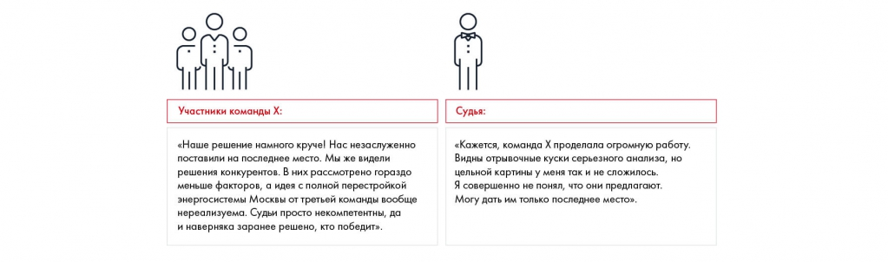
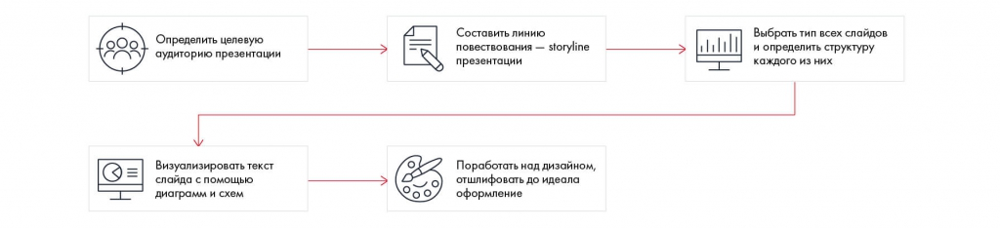

# Презентация решения: общий процесс

Показана роль презентации в восприятии выполненного анализа. Обозначена последовательность от аудитории до проверки оформления.

**Источник:** физические страницы PDF 190–192. Печатные номера не установлены.

**Предварительно:** [Этапы решения кейса](../01-case-method/04-solution-stages.md).

**Навигация:** [Индекс главы](INDEX.md) · [Маршрутизатор](../../ROUTER.md) · [Проблемы источника](../../meta/issues.md).

---

## Источник: [PDF 190](../../SOURCE.md#pdf-190)

### Неделя 11. Презентация решения

На этой неделе вы познакомитесь с алгоритмом создания качественной презентации — от определения целевой аудитории и построения линии повествования до разных подходов к визуализации данных и базовым принципам дизайна.

На рисунке приведены элементы: Участники команды X:; «Наше решение намного круче! Нас незаслуженно; поставили на последнее место. Мы же видели; решения конкурентов. В них рассмотрено гораздо; меньше факторов, а идея с полной перестройкой. Полная текстовая расшифровка приведена отдельно; геометрия и цветовые обозначения сохранены на изображении.

[Подробная текстовая расшифровка рисунка](../../assets/transcripts/pdf-190-img-01.md).

Вы прошли от начала до конца все 5 шагов по решению кейса и теперь готовы предложить клиенту конкретные рекомендации. Ваши идеи оригинальны, подкреплены глубоким анализом и точными финансовыми расчетами. Думаете, можно выдохнуть и расслабиться? К сожалению, нет. Страшно представить, сколько гениальных идей не получили должного внимания из-за того, что их неправильно презентовали.

**Ссылки на этой странице исходника:** [Ссылка url-219](../../meta/source-links.md#url-219); [Ссылка url-220](../../meta/source-links.md#url-220).

## Источник: [PDF 191](../../SOURCE.md#pdf-191)

Как видят ситуацию судьи и участники

Свести все свои исследования и предложения в 5–10-минутную презентацию

— это трудная работа. Слушатели не знают, как много материалов вы прочитали и сколько бессонных ночей потратили на их проработку. Все, что они видят, — ваша итоговая презентация. Успех идеи зависит от нескольких слайдов в PowerPoint и от того, насколько понятно вы преподнесли ее, смогли ли показать глубину проработки, аккуратно ли оформили презентацию.

Презентация — это квинтэссенция вашего решения, которая должна структурно и просто передавать его суть. В этой главе мы расскажем об основных правилах создания презентации и наиболее распространенных ошибках.

На рисунке приведены элементы: Определить целевую; аудиторию презентации; Визуализировать текст; слайда с помощью; диаграмм и схем. Полная текстовая расшифровка приведена отдельно; геометрия и цветовые обозначения сохранены на изображении.

[Подробная текстовая расшифровка рисунка](../../assets/transcripts/pdf-191-img-01.md).

Процесс подготовки презентации Changellenge>>

Решение кейса обычно оформляется в виде презентации и сопровождается комментариями в устной форме. Начните с подготовки слайдов. Презентация создается в три этапа: сначала определяется структура изложения, затем структура и наполнение каждого слайда и наконец дизайн презентации.

Структуру изложения (Storyline) нужно начинать с определения целевой аудитории презентации. Затем составьте структуру по принципу пирамиды Минто. Набросайте эскизы слайдов, чтобы определить, какая ключевая информация будет расположена на каждом из них (Storyboard). Сформулируйте заголовки — месседжи, отражающие ключевую мысль каждого слайда и складывающиеся в единую историю.

После составления структуры презентации приступайте к заполнению слайдов. Заполнение зависит от предназначения презентации — для чтения или для выступления перед маленькой, средней и большой аудиторией. При заполнении соблюдайте принципы изложения слева направо и сверху вниз.

## Источник: [PDF 192](../../SOURCE.md#pdf-192)

Заранее создайте шаблон презентации и добавьте туда самые распространенные структуры. Добавьте в каждый слайд стандартные элементы: месседж, номер страницы, источники, навигацию. Старайтесь максимально визуализировать ваше решение с помощью таблиц, списков, колонок, схем и графиков.

При создании презентации придерживайтесь четырех принципов дизайна: приближенности, выравнивания, повторения, контраста.

**Ссылки на этой странице исходника:** [Ссылка url-221](../../meta/source-links.md#url-221).

## Связанные разделы

- [Все темы главы](INDEX.md)
- [Термины и сокращения](../../GLOSSARY.md)
- [Предыдущая тема: Как делать прогнозы и предпосылки](../10-solution/09-forecasting.md)
- [Следующая тема: Определение целевой аудитории презентации](02-audience.md)
- [Авторские ответы по этой неделе](../13-answers/10-week-11.md)
